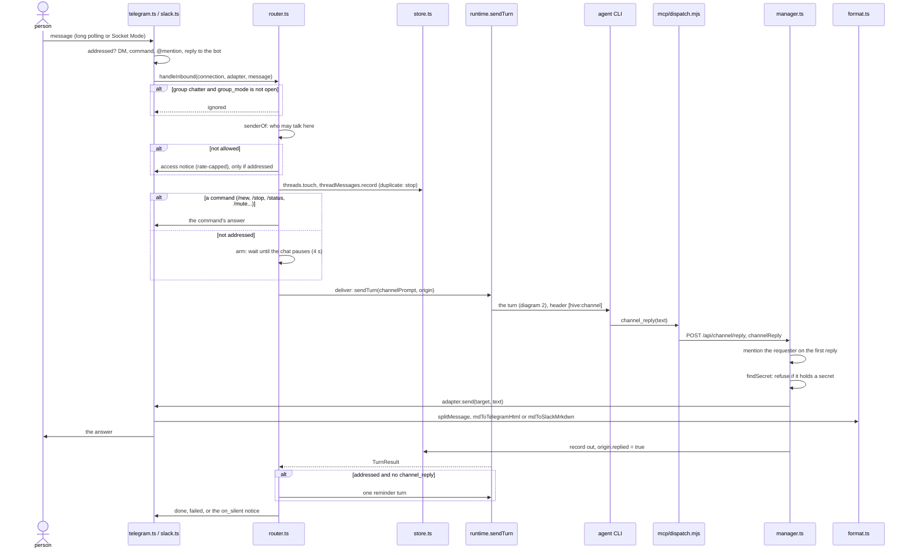

# 1. A chat message, round trip

> 🇪🇸 [Leer en español](../es/01-channel-message.md)

Lines checked against commit `60f69d8`.

## What it shows and when to look at it

A person writes to an agent in Telegram or Slack and gets an answer: the platform adapter receives the message, the router checks who may talk and whether the message is for the agent, records it in its thread, runs a turn on the agent's single session with a `[hive:channel]` header, and the agent answers with the `channel_reply` tool, which goes through the hive MCP server and the API, is checked for secrets and is sent by the adapter in the platform's format. Look here when a message gets no answer, an answer goes to the wrong place, a group message wakes the agent when it should not (or does not when it should), or a reply is blocked.

## Diagram

## Step by step

| Step | File | Function or symbol | What it does |
|---|---|---|---|
| 1 | `server/src/connections/telegram.ts:76` | `start` | Telegram: checks the token and starts long polling (`poll`, line 110, with `getUpdates` at line 115). |
| 2 | `server/src/connections/telegram.ts:158` | `addressed` | A Telegram message is for the agent in a private chat, as a command, with an @mention of the bot (line 155) or as a reply to one of its messages. |
| 3 | `server/src/connections/slack.ts:115` | `start` | Slack: Socket Mode over a WebSocket this machine opens (no public URL). |
| 4 | `server/src/connections/slack.ts:277` | `addressed` | A Slack message is for the agent in a DM, with a mention, as a command or inside a thread the agent is part of. |
| 5 | `server/src/connections/manager.ts:49` | `handleInbound` | Each adapter is started with the router as its callback. |
| 6 | `server/src/connections/router.ts:91` | `handleInbound` | One inbound message: access, commands, then a turn. |
| 7 | `server/src/connections/router.ts:96` | `calledByName` | In a group, calling the agent by name or alias as a vocative also counts as addressed (`vocativeOf`, `server/src/connections/addressing.ts:25`). |
| 8 | `server/src/connections/router.ts:99` | `group_mode` | Group chatter that is not for the agent is ignored unless the connection is open to it. |
| 9 | `server/src/connections/router.ts:65` | `senderOf` | Who may talk: the people list in a DM or an unlisted group; in a listed group, everyone or only its members. |
| 10 | `server/src/connections/router.ts:105` | `allow` | A stranger who addressed the agent gets an access notice, at most 5 per person and 20 per chat per minute (`allow`, `server/src/connections/rate.ts:7`). |
| 11 | `server/src/connections/router.ts:114` | `duplicate delivery` | The message is recorded once; a platform that delivers it again is ignored. |
| 12 | `server/src/connections/router.ts:133` | `m.command` | Commands answered by hive-am itself: `/help`, `/id`, `/stop`, `/status`, `/mute`, `/unmute`, `/new` (admins, with confirmation). An unknown command is text for the agent. |
| 13 | `server/src/connections/router.ts:154` | `addressed` | Not addressed: kept as context, and handed over only when the chat pauses (`arm`, line 169; `QUIET_MS`, line 20), never in a muted thread. |
| 14 | `server/src/connections/router.ts:184` | `deliver` | Hands the message (and anything the agent has not seen in this thread) to the agent. |
| 15 | `server/src/connections/router.ts:191` | `tooFast` | More than `rate_limit` messages per user per minute (20 by default, line 13): "too many messages". |
| 16 | `server/src/connections/router.ts:194` | `T.queued` | The agent is busy: a "queued" notice with how many are ahead. |
| 17 | `server/src/connections/router.ts:196` | `unseen` | Earlier messages of the thread the agent was not shown go with this one. |
| 18 | `server/src/connections/router.ts:202` | `sendTurn` | The turn, on the agent's single session, with the message's `origin` (diagram 2). |
| 19 | `server/src/connections/prompt.ts:33` | `channelPrompt` | The text the agent receives: the `[hive:channel]` header line (line 39), the message, its files and the unseen context. The web reads the header back in `web/lib/channel.ts:16` (`parseChannelPrompt`). |
| 20 | `server/mcp/dispatch.mjs:72` | `channel_reply` | The tool (capability `channel`); its call is a POST to `/api/channel/reply` (line 383). |
| 21 | `server/src/http/routes/channel.ts:9` | `/api/channel/reply` | The route. |
| 22 | `server/src/connections/manager.ts:101` | `channelReply` | Answers the message being handled now (`liveOrigin`): no live channel message, no running connection or no thread is an error for the agent. |
| 23 | `server/src/connections/manager.ts:110` | `origin.mention` | In a group, the first reply of the turn mentions the person who asked. |
| 24 | `server/src/connections/manager.ts:114` | `findSecret` | A reply that seems to hold a secret is refused (`server/src/connections/secrets.ts:42`) with `SECRET_REFUSAL` (line 49 there); `channelSendFile` checks the caption and text files the same way (line 150). |
| 25 | `server/src/connections/manager.ts:116` | `adapter.send` | The adapter sends it to the thread; the reply is recorded as `out` and `origin.replied` is set. |
| 26 | `server/src/connections/telegram.ts:251` | `splitMessage` | Telegram: pieces of at most 3500 characters (`server/src/connections/format.ts:2`), each converted to Telegram's HTML (`mdToTelegramHtml`, line 254; `server/src/connections/format.ts:28`). |
| 27 | `server/src/connections/slack.ts:336` | `splitMessage` | Slack: the same split, each piece as `mrkdwn` (`mdToSlackMrkdwn`, `server/src/connections/format.ts:48`). |
| 28 | `server/src/connections/router.ts:210` | `origin.replied` | Addressed, ended well and no `channel_reply`: one reminder turn (`NUDGE`, line 18). Unaddressed chatter gets it only after a turn of more than 45 s (line 205). |
| 29 | `server/src/connections/router.ts:214` | `on_silent` | Still nothing: `notice` (default, "the agent finished without replying"), `send_text` (the turn's text) or nothing. A failed turn says why. |

What each file of `connections/` does, as the code has it: `rules.ts` only holds `channelPermissionError` (a linked agent cannot be in Plan mode, `server/src/connections/rules.ts:5`); `outbound.ts` checks the files an agent sends (`resolveSendable`, `server/src/connections/outbound.ts:33`), not text; `format.ts` converts Markdown and splits messages, called by the adapters; the secret filter is applied in `manager.ts`, not in `router.ts` or `outbound.ts`.

## Covered by

- `test-addressing.ts` (no model): who a group message is for, with phrases from real chats.
- `test-chat-access.ts` (no model): who may talk in a listed group, everyone or only its members, through `handleInbound` with a fake platform.
- `test-rate.ts` (no model): the sliding-window limit.
- `test-format.ts` (no model): Telegram HTML, Slack `mrkdwn`, mentions, and that a mention does not trip `findSecret` while a real token does.
- `test-telegram-timeouts.ts` (no model): a Telegram call that never answers fails with a clear error.
- `sim-slack.ts` (no model, no network): the Slack adapter against a fake Slack, threads, commands, reactions, files and reconnection.
- `test-reactions.ts` and `test-connection-lifecycle.ts` (no model): reactions allowed per platform, and one adapter per connection when two starts race.
- `test-db-tools.ts` (no model, starts a server): a database password is blocked by `findSecret`.
- `sim-secrets.ts`, `sim-channel.ts`, `sim-groups.ts`, `sim-chatter.ts` and `sim-telegram.ts` need a real model (they take a provider argument).

## Edge cases

- **Duplicate delivery** from the platform is ignored (`server/src/connections/router.ts:114`).
- **Chatter while the agent is busy**: the hand-over is retried for about a minute (`QUIET_RETRIES`, `server/src/connections/router.ts:22`), then the message stays as context for the next turn; past `chatter_per_minute` (10 by default) it also stays as context.
- **A turn that ends without `channel_reply`** gets one reminder in the same conversation; a muted thread is respected.
- **Platform not connected yet**: `channel_reply` fails with "The connection is not running." (`server/src/connections/manager.ts:107`); later messages (wake-ups, notices) retry (diagram 5).
- **Only the first reply mentions the requester** (`origin.mentioned`, `server/src/connections/manager.ts:112`).
- **A blocked reply never leaves the machine**: the agent gets the refusal as the tool's error and is told to say it cannot share it.
- **A message longer than 8000 characters** is refused (`MAX_INPUT`, `server/src/connections/router.ts:12`).
- **A message that is only files**, none of which could be saved, is not handed over (`server/src/connections/router.ts:130`).
- **`/new`** wipes the shared session for every chat of the agent, so it needs an admin and a confirmation.

## See also

- [Reference 14: external connections](../../reference/en/14-external-connections.md).
- [Diagram 2: a turn inside an agent](02-agent-turn.md), [diagram 5: wake-ups and schedules](05-wakeups-and-schedules.md) (later messages to a thread), [diagram 7: source map](07-server-source-map.md).
