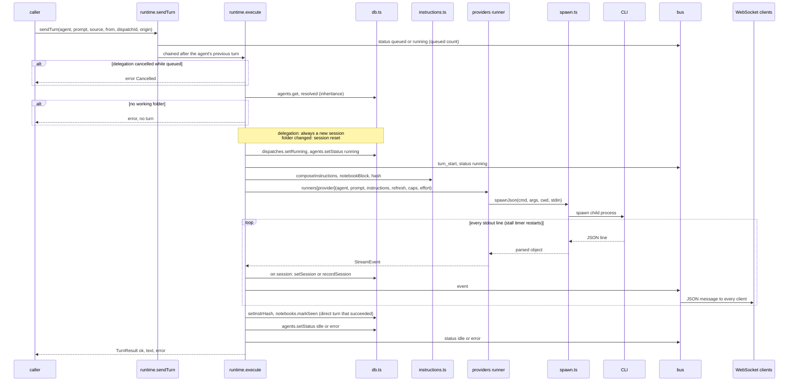

# 2. A turn inside an agent

> 🇪🇸 [Leer en español](../es/02-agent-turn.md)

Lines checked against commit `60f69d8`.

## What it shows and when to look at it

What happens between "a message for this agent" and "the agent is idle again": the per-agent queue, how the agent and its instructions are prepared, the call to the provider's CLI, how its events reach the browser and what is saved at the end. Every path that makes an agent work goes through here: a web message, a chat message (diagram 1), a delegation (diagram 4), a wake-up or a schedule (diagram 5). Look here when an agent stays "running", when a message waits behind another, when a turn fails with no events, or before changing what is recorded after a turn.

## Diagram

## Step by step

| Step | File | Function or symbol | What it does |
|---|---|---|---|
| 1 | `server/src/http/routes/agents.ts:36` | `sendTurn` | A web message (`POST /api/agents/:id/messages`) is queued and the request answers at once; the chat router (`server/src/connections/router.ts:202`), delegations (`server/src/runtime.ts:188`), wake-ups (`server/src/wake.ts:81`) and schedules (`server/src/schedules.ts:104`) call the same function. |
| 2 | `server/src/runtime.ts:26` | `states` | One in-memory state per agent: promise chain, controller, queued count, live turn, cancelled delegations. |
| 3 | `server/src/runtime.ts:57` | `sendTurn` | Counts the message as queued, emits a status and chains `execute` after the agent's previous turn, so one agent runs one turn at a time. |
| 4 | `server/src/runtime.ts:69` | `cancelled.delete` | A delegation cancelled while it waited ends here as `Cancelled` without reaching the CLI. |
| 5 | `server/src/runtime.ts:77` | `resolved` | The agent as it runs: the colony's folder, permission, prompt and skills folded in (`server/src/db.ts:201`). |
| 6 | `server/src/runtime.ts:78` | `agent.cwd` | No working folder: the turn fails with that reason. |
| 7 | `server/src/runtime.ts:82` | `agent.session_id = null` | A delegation always starts a new native session; the agent's own conversation is not touched. |
| 8 | `server/src/runtime.ts:85` | `agents.setSession(raw, null)` | The folder changed since the session started: the direct session is reset. |
| 9 | `server/src/runtime.ts:106` | `agents.setStatus(agentId, 'running')` | Stored status `running`, after `dispatches.setRunning` for a delegation. |
| 10 | `server/src/runtime.ts:107` | `turn_start` | Bus messages `turn_start` and `status` for the interface. |
| 11 | `server/src/runtime.ts:110` | `composeInstructions` | The instructions; the notebook text is appended outside the hash (diagram 3). |
| 12 | `server/src/runtime.ts:113` | `createHash` | A hash of the instructions without the notebook. |
| 13 | `server/src/runtime.ts:115` | `refreshInstructions` | A resumed direct session gets the instructions again when the hash changed or the notes were edited elsewhere. |
| 14 | `server/src/runtime.ts:116` | `runners[agent.provider]` | Calls the provider adapter (`server/src/providers/index.ts:21`), with the effort that applies (`effortOf`, line 46). |
| 15 | `server/src/providers/spawn.ts:87` | `spawnJson` | Yields the JSON objects of the CLI's stdout; a CLI that only prints prose is an error. |
| 16 | `server/src/providers/spawn.ts:24` | `spawnLines` | Spawns the CLI in the agent's folder, writes the prompt to stdin when the adapter gives one, yields lines. |
| 17 | `server/src/providers/spawn.ts:44` | `armStall` | The stall timer: restarted on every stdout line; after `STALL_MS` of silence the CLI is killed. |
| 18 | `server/src/runtime.ts:123` | `ev.t === 'session'` | A session id: the direct one is saved as the agent's session (`server/src/db.ts:230`); a delegation's is only logged (`server/src/db.ts:240`). |
| 19 | `server/src/runtime.ts:99` | `push` | Every event is kept in the live turn and emitted on the bus. |
| 20 | `server/src/index.ts:45` | `bus.on` | Each WebSocket client gets every bus message as JSON. |
| 21 | `server/src/runtime.ts:139` | `no events` | A turn with no event of any kind never reached the model: it is an error, not an empty answer. |
| 22 | `server/src/runtime.ts:144` | `setInstrHash` | Only a direct turn that did not fail and was not stopped saves the hash and marks the notes as seen. |
| 23 | `server/src/runtime.ts:145` | `agents.setStatus` | Stored status `idle` or `error`, and the same on the bus. |
| 24 | `server/src/runtime.ts:150` | `stopAgent` | Stop: aborts the running turn's controller; the CLI gets SIGTERM, then SIGKILL after the grace period (`server/src/providers/spawn.ts:33`). |
| 25 | `server/src/history/index.ts:21` | `readHistory` | The conversation shown in the web is read back from the CLI's own transcript, not from hive-am. |

## Covered by

- `test-runtime-recovery.ts` (no model): a failure while preparing a turn is that turn's error and does not leave the agent `running`; a burst of 34 turns runs in order; a silent CLI is cut (with `HIVE_AM_TURN_STALL_MS=400`) and the message behind it runs, while a turn that keeps printing is not cut; a wake-up delivery that failed is tried again.
- `test-providers-common.ts` (no model): `spawnJson` and `spawnLines`, stdin, exit codes and stderr in errors, a CLI that ignores SIGTERM is cut off.
- `test-provider-args.ts` (no model, stub CLIs): how OpenCode, Kiro and Cursor receive the prompt.
- `test-effort.ts` (no model, starts a server): the effort a turn asks for and the arguments each CLI gets.

## Edge cases

- **The queue lives only in memory** (`states`, `server/src/runtime.ts:26`). Nothing of it is saved: after a restart it is empty, a web message that was waiting is lost, and delegations that were queued or running are marked `interrupted` (diagram 4).
- **A hung turn**: a turn that never ends blocks the agent's queue. A CLI that prints nothing on stdout for 10 minutes is killed by the stall timer (`STALL_MS`, `server/src/providers/spawn.ts:5`, changed with `HIVE_AM_TURN_STALL_MS`): the turn fails with `StalledError` (`server/src/providers/spawn.ts:74`) and the queue moves on. The person can also stop it. What can still block the queue is a CLI that keeps printing forever.
- **Stopped turn**: it ends with a `done` event and the summary "Stopped"; the hash is not saved.
- **Effort that does not apply** to the agent's model: a line in the log and the CLI's own default instead of a failed turn (`effortOf`, `server/src/runtime.ts:46`).
- **`queued` is not stored**: it is only a status on the bus with a count; the stored status is `idle`, `running` or `error` (diagram 9).
- **Crash during a turn**: the turn is lost; at startup the agent is `idle` again and its session is intact on disk (`server/src/db.ts:291`).

## See also

- [Reference 8: sessions and history](../../reference/en/08-sessions-and-history.md), with the life cycle of a direct session.
- [Reference 5: backend and frontend communication](../../reference/en/05-backend-frontend-communication.md) for the WebSocket messages.
- [Diagram 3: the effective prompt](03-effective-prompt.md), [diagram 9: agent life cycle](09-agent-lifecycle.md), [diagram 10: providers](10-providers.md).
