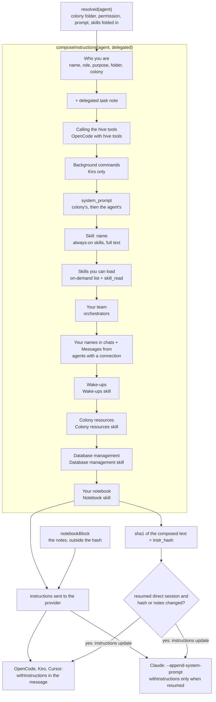

# 3. How the effective prompt is built

> 🇪🇸 [Leer en español](../es/03-effective-prompt.md)

Lines checked against commit `60f69d8`.

## What it shows and when to look at it

What an agent is told before its message: the sections of its instructions in the order `composeInstructions` writes them, which ones depend on the provider, the role or a skill, how the colony's settings are folded in, the hash that decides when a resumed conversation is sent the instructions again, and how each CLI receives them. Look here when an agent does not know something it should (its team, its aliases, a skill), when a change of configuration does not reach a running conversation, or before adding a new section.

## Diagram

## Step by step

| Step | File | Function or symbol | What it does |
|---|---|---|---|
| 1 | `server/src/db.ts:180` | `agentOf` | Computes `effective`: for each field the colony lends (`cwd`, `permission`, `skills`, `prompt`, all on by default, line 141) and the agent does not override, the colony's value. |
| 2 | `server/src/db.ts:191` | `system_prompt` | The colony's prompt first, then the agent's, so the agent has the last word. |
| 3 | `server/src/db.ts:192` | `skill_ids` | The colony's skills plus the agent's; for how each is loaded the agent's choice wins (line 194). |
| 4 | `server/src/db.ts:201` | `resolved` | The agent with those effective values in place; `runtime.ts` composes from it. |
| 5 | `server/src/instructions.ts:38` | `composeInstructions` | Writes the sections below in this order and joins them with blank lines. |
| 6 | `server/src/instructions.ts:44` | `## Who you are` | Name, role and purpose, "do not introduce yourself as the CLI", the working folder, the colony (line 49) and, for a delegated turn, the note to finish with a report (line 50). |
| 7 | `server/src/instructions.ts:54` | `opencode` | OpenCode with any hive tool: how to call them through its `execute` tool. |
| 8 | `server/src/instructions.ts:58` | `kiro` | Kiro: how to leave a command running without blocking the turn. |
| 9 | `server/src/instructions.ts:61` | `system_prompt` | The effective prompt (colony and agent). |
| 10 | `server/src/instructions.ts:63` | `skill_ids` | Each always-on skill, in full, as `## Skill: <name>`. |
| 11 | `server/src/instructions.ts:67` | `lazy.length` | On-demand skills: name and description only, with the `skill_read` tool. |
| 12 | `server/src/instructions.ts:17` | `lazySkills` | Claude in Plan mode cannot call MCP tools, so there every skill is included in full. |
| 13 | `server/src/instructions.ts:73` | `orchestrator` | An orchestrator: its team and how to delegate, or "you have no subagents". |
| 14 | `server/src/instructions.ts:84` | `connections.forAgent` | An agent with a connection: its aliases (line 88) and how to answer chat messages with `channel_reply` (line 89). |
| 15 | `server/src/instructions.ts:93` | `WAKEUPS_SKILL_ID` | With the Wake-ups skill: `wake_me`, `wake_when_done` and schedules. |
| 16 | `server/src/instructions.ts:97` | `OBJECTS_SKILL_ID` | With the Colony resources skill: the resource tools. |
| 17 | `server/src/instructions.ts:101` | `DATABASES_SKILL_ID` | With the Database management skill: the database tools. |
| 18 | `server/src/instructions.ts:106` | `NOTEBOOK_SKILL_ID` | With the Notebook skill: how to use the notebook, and whether it is shared. |
| 19 | `server/src/instructions.ts:23` | `mcpCaps` | Which hive tools the turn's MCP server offers; the same conditions as the sections above. |
| 20 | `server/src/instructions.ts:118` | `notebookBlock` | The notes themselves, under `### Your current notes`. |
| 21 | `server/src/runtime.ts:112` | `notebookBlock(agent)` | The notes are appended after the composed text, so a note the agent writes is not a change of configuration. |
| 22 | `server/src/runtime.ts:113` | `createHash` | The hash covers the composed text only. |
| 23 | `server/src/runtime.ts:115` | `refreshInstructions` | A resumed direct session is sent the instructions again when the hash differs from the saved `instr_hash` or the notes are newer than what this reader has seen. |
| 24 | `server/src/providers/claude.ts:27` | `--append-system-prompt` | Claude Code gets the instructions as a system prompt on every turn; a resumed session ignores it (comment at line 25). In a new session it is the only copy. |
| 25 | `server/src/providers/claude.ts:28` | `withInstructions` | Claude passes the message through `withInstructions` only in a resumed session, so it gets just the update; a new session's message goes as is. |
| 26 | `server/src/providers/preamble.ts:5` | `withInstructions` | New session: the whole `<instructions>` block before the message. Resumed with changes: `<instructions update="true">`. Otherwise: the message alone. |
| 27 | `server/src/providers/preamble.ts:16` | `stripInstructions` | When a conversation is read back, the block is taken off the person's message. |
| 28 | `server/src/runtime.ts:144` | `setInstrHash` | After a direct turn that succeeded, the hash is saved and the notes are marked as seen. |

## Covered by

- `test-agent-clone.ts`, `test-db-tools.ts`, `test-object-tools.ts` (no model, each starts a server): they call `composeInstructions` and check the sections their feature adds (the shared notebook, the database tools, the resource tools).
- `test-provider-args.ts` (no model, stub CLIs): OpenCode, Kiro and Cursor receive the message once, as the last argument, and a conversation read back drops the `<instructions>` block and duplicated copies.
- `test-providers-common.ts` (no model): `withInstructions` and `stripInstructions`.
- `test-session-permission.ts` (no model): an OpenCode conversation is flagged when its permission changed after it began.
- `sim-skills.ts` needs a real model: on-demand skills stay out of the instructions and the agent reads them when needed.
- `test-claude-args.ts` (no model, stub CLI): Claude's arguments, the instructions only as the system prompt in a new session and the update inside the message of a resumed one.
- No script asserts the order of the sections.

## Edge cases

- **Notes edited elsewhere** (by the person, or in another conversation of an agent that shares the notebook) make the next direct turn resend the instructions: `notebooks.get(agentId).seen < nbVersion` (`server/src/runtime.ts:115`).
- **Delegated turns never refresh**: each delegation is a new session and always receives the whole instructions (Claude as its system prompt, the others as the block in the message).
- **Claude and `--resume`**: Claude fixes its system prompt when the session starts, so a new session gets the instructions only there and a resumed conversation only learns of a change through the update inside the message (`server/src/providers/claude.ts:25`).
- **Agent types are not inherited at run time**: creating an agent from a type copies the type's prompt, skills and permission once (`spawnFromType`, `server/src/services/agents.ts:39`); later changes to the type do not reach it. Only the colony is folded in at each turn.
- **A changed permission** does not reach an OpenCode conversation that already started: it keeps the tools it began with, and the agent is flagged (`permissionStale`, `server/src/services/agents.ts:109`).
- **A setting changed** (a new worker, a skill, an alias) changes the hash; the instructions reach a resumed conversation on its next turn, not at once.

## See also

- [Reference 7: agents, types, skills and colonies](../../reference/en/07-agents-types-skills-colonies.md), on inheritance and composed instructions.
- [Diagram 2: a turn inside an agent](02-agent-turn.md), [diagram 10: providers](10-providers.md).
