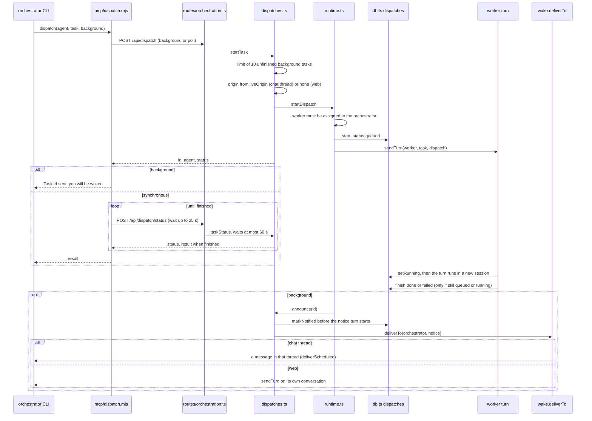
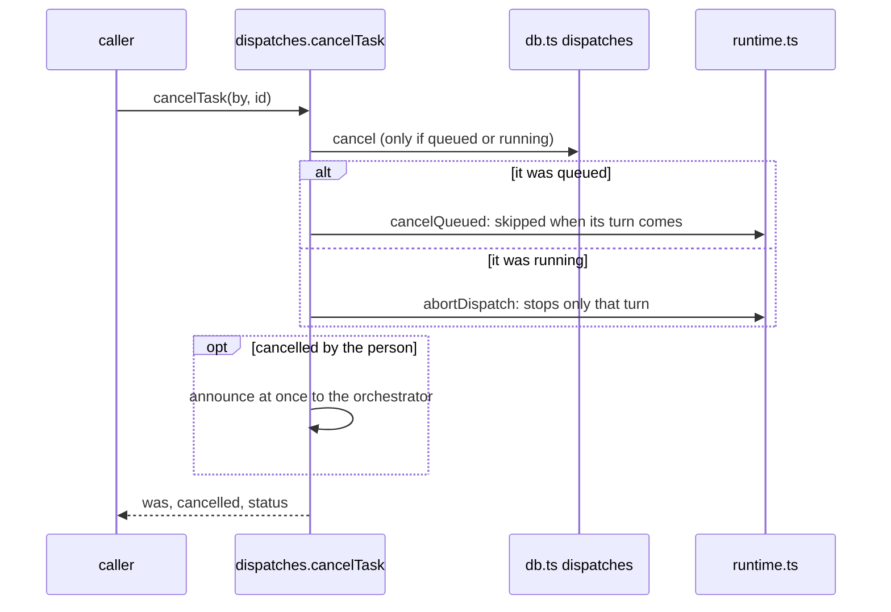

# 4. A delegation, with files

> 🇪🇸 [Leer en español](../es/04-dispatch.md)

Lines checked against commit `60f69d8`.

## What it shows and when to look at it

An orchestrator hands a task to one of its workers: the `dispatch` tool of the hive MCP server, the HTTP route, the row in `dispatches`, the worker's turn in its own new session and the way the result gets back. In the background (the default) the orchestrator is told when the task ends, in the place where it was asked; synchronously the tool polls `dispatch_status` with short calls until the end. The page also covers cancelling (queued or running) and what a restart does. Look here before changing how a delegation is started, announced or cancelled.

## Diagram

Cancel, from the orchestrator (`dispatch_cancel`) or from the web:

## Step by step

| Step | File | Function or symbol | What it does |
|---|---|---|---|
| 1 | `server/mcp/dispatch.mjs:26` | `dispatch` | The tool; the other delegation tools are `list_agents` (line 20), `dispatch_status` (41), `dispatch_list` (55) and `dispatch_cancel` (61), only for an orchestrator with a team. |
| 2 | `server/mcp/dispatch.mjs:336` | `/api/dispatch` | Sends `background` (default true) or `poll`. |
| 3 | `server/mcp/dispatch.mjs:346` | `taskStatus` | Synchronous mode: short `dispatch_status` calls of up to 25 s each (`POLL_S`, line 15) until the task ends. |
| 4 | `server/src/http/routes/orchestration.ts:23` | `/api/dispatch` | `background` or `poll` go to `startTask`; with neither, the request is held until the worker answers (the original form). |
| 5 | `server/src/dispatches.ts:27` | `startTask` | Refuses an 11th unfinished background task (`MAX_BACKGROUND`, line 15). |
| 6 | `server/src/dispatches.ts:32` | `liveOrigin` | In the background, remembers the chat thread the orchestrator is answering now, or none (its web conversation). |
| 7 | `server/src/runtime.ts:181` | `startDispatch` | Finds the worker by name and checks it is assigned to the orchestrator (line 186). |
| 8 | `server/src/db.ts:261` | `start` | The row: status `queued`, mode, origin. |
| 9 | `server/src/runtime.ts:188` | `sendTurn` | Queues the task on the worker as a `dispatch` turn; when it ends, `dispatches.finish` stores `done` or `failed` and the text (line 190). |
| 10 | `server/src/dispatches.ts:38` | `announce` | In the background, the end of the turn (or its failure) triggers the notice. |
| 11 | `server/src/runtime.ts:105` | `dispatches.setRunning` | The worker's turn starts: `queued` becomes `running`, in a new native session (diagram 2). |
| 12 | `server/src/db.ts:269` | `finish` | Closes the row only if it is still `queued` or `running`, so a cancel that came first is not overwritten. |
| 13 | `server/src/dispatches.ts:51` | `taskStatus` | `dispatch_status`: waits up to `wait_seconds` (at most `MAX_WAIT_S`, 60) and marks a finished result as read. |
| 14 | `server/src/dispatches.ts:119` | `announce` | Hands a finished background result to the orchestrator once; a second call while one is delivering does nothing. |
| 15 | `server/src/dispatches.ts:142` | `deliverTo` | The notice goes to the stored thread or to the orchestrator's web conversation; `markNotified` runs before the notice turn starts. |
| 16 | `server/src/wake.ts:66` | `deliverTo` | The shared delivery (also used by wake-ups, diagram 5): `sent`, `retry` or `dropped`. |
| 17 | `server/src/dispatches.ts:134` | `tries >= 12` | While the platform is not connected yet, the notice is retried every 5 s (`RETRY_MS`, line 18) up to 12 times, then marked notified. |
| 18 | `server/src/dispatches.ts:80` | `cancelTask` | Cancels a task that has not finished; one that has is left as it is and its state is answered. |
| 19 | `server/src/runtime.ts:158` | `cancelQueued` | A queued task leaves the worker's queue count now and is skipped when the chain reaches it. |
| 20 | `server/src/runtime.ts:168` | `abortDispatch` | A running task: aborts the worker's turn only if it is serving this task. |
| 21 | `server/src/dispatches.ts:101` | `openTasks` | `dispatch_list`: the orchestrator's unfinished tasks, oldest first. |
| 22 | `server/src/http/routes/orchestration.ts:45` | `/api/dispatches` | The web's log of delegations, and its cancel (line 47). |
| 23 | `server/src/dispatches.ts:153` | `armDispatchNotices` | At startup: tasks left `queued` or `running` become `interrupted`, and finished background tasks not announced yet are announced. |
| 24 | `server/src/db/migrations.ts:263` | `dispatch-background` | Migration 9 added `mode`, `origin`, `notified_at` and `read_at`. |
| 25 | `server/src/retention.ts:44` | `KEEP_DISPATCHES` | Retention keeps the newest 200 rows and never removes an unfinished task or a background result nobody has received yet. |

## Covered by

- `test-dispatch-background.ts` (no model, stub workers, starts a server): background tasks, `dispatch_status`, the synchronous tool polling instead of one long request, one notice in the place where it was asked, restarts, pruning and the limit per orchestrator.
- `test-dispatch-cancel.ts` (no model, stub workers, starts a server): cancel from the orchestrator and from the web, queued and running, the race with the end of the turn, one notice, restarts, pruning and the limit.
- No `sim-*` script covers delegation.

## Edge cases

- **Restart**: rows left `queued` or `running` become `interrupted` (`server/src/db.ts:285`, called at `server/src/db.ts:292` and again from `server/src/dispatches.ts:154`); finished background rows not announced yet are announced. A task is never resumed.
- **No double notice**: the row is marked notified before the notice turn starts, so a restart in between cannot announce it twice (`server/src/dispatches.ts:140`).
- **Nobody to tell** (the thread is gone, muted, or the connection now belongs to another agent): `dropped`, the row is marked notified and the result stays readable with `dispatch_status` (`server/src/dispatches.ts:144`).
- **Cancelling twice is harmless**: the second call answers the final state and changes nothing.
- **`cancelled` is never overwritten**: the aborted or skipped turn ends later, but `finish` only updates a row still `queued` or `running`.
- **A task the orchestrator cancelled** is never announced (the tool already told it); one the person cancelled is announced at once (`server/src/dispatches.ts:92`).
- **What a cancelled worker already changed stays in the folder.**
- **Delegations never touch the worker's own conversation**: each one gets a new native session, logged as `delegation` (diagram 9).
- Open issue [#58](https://github.com/hughcbscrt/hive-am/issues/58) is about checking cancel with Kiro, Cursor and a real running task.

## See also

- [Reference 9: orchestration and relations](../../reference/en/09-orchestration-and-relations.md), with its two diagrams of a delegation and of the per-agent queue.
- [Diagram 5: wake-ups and schedules](05-wakeups-and-schedules.md) for the shared delivery.
- [Diagram 2: a turn inside an agent](02-agent-turn.md), [diagram 9: agent life cycle](09-agent-lifecycle.md).
