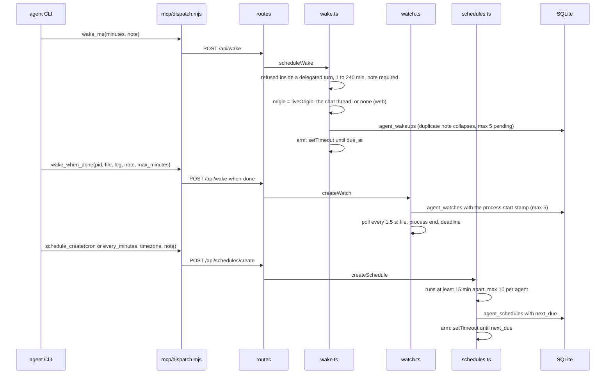
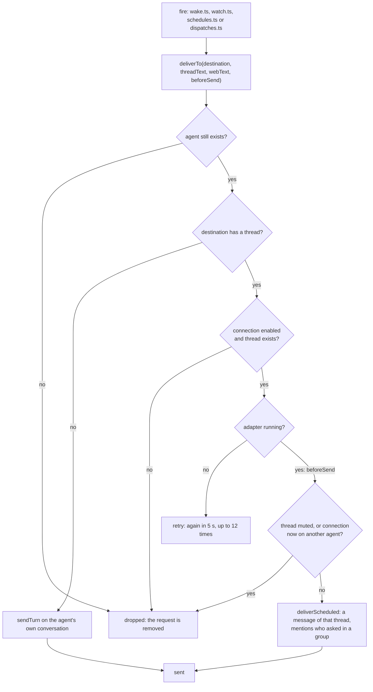

# 5. Wake-ups and scheduled tasks

> 🇪🇸 [Leer en español](../es/05-wakeups-and-schedules.md)

Lines checked against commit `60f69d8`.

## What it shows and when to look at it

An agent only runs while it handles a message, so "I'll tell you later" needs hive-am to wake it. Three tools do that: `wake_me` (once, after some minutes), `wake_when_done` (when a process ends, a marker file appears or the waiting time runs out) and `schedule_create` (on a cron expression or every N minutes). The first diagram follows each from the tool call to its timer; the second shows the delivery they share (with delegation notices, diagram 4) and how the destination is chosen. Look here when a wake-up arrives in the wrong place, never arrives, or arrives twice, or before changing the limits.

## Diagram

From the tool call to the timer:

When the timer fires, the shared delivery:

## Step by step

### `wake_me`

| Step | File | Function or symbol | What it does |
|---|---|---|---|
| 1 | `server/mcp/dispatch.mjs:198` | `wake_me` | The tool (capability `wake`, from the Wake-ups skill); the call is at line 462. |
| 2 | `server/src/http/routes/channel.ts:16` | `/api/wake` | The route. |
| 3 | `server/src/wake.ts:105` | `scheduleWake` | Validates and stores the request. |
| 4 | `server/src/wake.ts:107` | `liveSource` | Not available inside a delegated turn. |
| 5 | `server/src/wake.ts:17` | `WAKE_MAX_MINUTES` | 1 to 240 minutes, at most 5 pending. |
| 6 | `server/src/wake.ts:113` | `liveOrigin` | The destination: the chat thread the agent is answering now, or none (its web conversation). |
| 7 | `server/src/wake.ts:117` | `rows.same` | The same note in the same place twice is one wake-up (a model that retried). |
| 8 | `server/src/wake.ts:119` | `WAKE_MAX_PENDING` | At most 5 pending per thread, or per agent for the web. |
| 9 | `server/src/wake.ts:47` | `arm` | A timer until `due_at`. |
| 10 | `server/src/wake.ts:85` | `fire` | Delivers; `retry` tries again every 5 s up to 12 times; `dropped` removes the row. |
| 11 | `server/src/wake.ts:100` | `armWakeups` | After a restart, a wake-up more than 2 hours late is discarded (`TOO_LATE_MS`, line 20); the rest are armed again. |

### `wake_when_done`

| Step | File | Function or symbol | What it does |
|---|---|---|---|
| 1 | `server/mcp/dispatch.mjs:212` | `wake_when_done` | The tool; the call is at line 471. |
| 2 | `server/src/http/routes/channel.ts:17` | `/api/wake-when-done` | The route. |
| 3 | `server/src/watch.ts:66` | `createWatch` | Validates: not in a delegated turn, a running pid, a marker file inside the agent's folder, home or temp folder, 1 to 240 minutes (120 by default). |
| 4 | `server/src/watch.ts:44` | `processStamp` | The start time of the process, so a pid the system reuses is not taken for the job. |
| 5 | `server/src/watch.ts:93` | `WATCH_MAX_PENDING` | At most 5 watches per agent; the same pid twice is one watch. |
| 6 | `server/src/watch.ts:21` | `POLL_MS` | Polls every 1.5 s (`HIVE_AM_WATCH_POLL_MS`). |
| 7 | `server/src/watch.ts:156` | `tick` | Fires on the marker file, then on the process ending (`isAlive`, line 58), then on the deadline. |
| 8 | `server/src/watch.ts:120` | `noticeNow` | In a thread, a one-line notice right away ("the process has finished, checking the result") before the agent's report. |
| 9 | `server/src/watch.ts:138` | `fire` | Delivers the agent's message: once it is sent or dropped the watch is removed; on `retry` it stays and the next poll tries again. |
| 10 | `server/src/watch.ts:170` | `armWatches` | After a restart the poller resumes: the jobs ran on without hive-am. |

### Schedules

| Step | File | Function or symbol | What it does |
|---|---|---|---|
| 1 | `server/mcp/dispatch.mjs:229` | `schedule_create` | The tool (with `schedule_list` and `schedule_cancel`); the call is at line 480. |
| 2 | `server/src/http/routes/schedules.ts:11` | `/api/schedules/create` | The route; the same file has the interface's list, history, pause and delete. |
| 3 | `server/src/schedules.ts:125` | `createSchedule` | Validates the note, the time zone and the expression; not in a delegated turn. |
| 4 | `server/src/cron.ts:38` | `parseCron` | Five cron fields, names and macros such as `@daily`. |
| 5 | `server/src/cron.ts:102` | `minGapMinutes` | Runs must be at least 15 minutes apart (`MIN_INTERVAL_MINUTES`, `server/src/schedules.ts:18`). |
| 6 | `server/src/schedules.ts:19` | `MAX_PER_AGENT` | At most 10 schedules per agent; the same schedule twice is one. |
| 7 | `server/src/cron.ts:75` | `nextCron` | The next run in the schedule's time zone, through daylight-saving changes. |
| 8 | `server/src/schedules.ts:62` | `arm` | A timer until `next_due` (a long one is re-armed in steps). |
| 9 | `server/src/schedules.ts:78` | `fire` | Runs one occurrence. |
| 10 | `server/src/schedules.ts:83` | `store.setNext` | The next run is saved and armed before anything else can fail. |
| 11 | `server/src/schedules.ts:88` | `skipped_missed` | More than 5 minutes late (the server was down): skipped, not replayed. |
| 12 | `server/src/schedules.ts:89` | `skipped_busy` | Two messages already waiting for the agent: skipped. |
| 13 | `server/src/schedules.ts:96` | `skipped_reassigned` | The connection now belongs to another agent: the schedule is paused (disabled, muted and a connection not running are skipped too, lines 95 to 99). |
| 14 | `server/src/schedules.ts:101` | `deliverScheduled` | From a chat: a message of that thread; from the web: `sendTurn` on the agent's conversation (line 104). |
| 15 | `server/src/schedules.ts:116` | `armSchedules` | At startup: a run that came due while the server was down is handled now (more than 5 minutes late it is recorded as missed, otherwise it runs); the others are armed. |
| 16 | `server/src/services/schedules.ts:7` | `allSchedules` | The interface's list: schedules, wake-ups and watches together. |

### The shared delivery

| Step | File | Function or symbol | What it does |
|---|---|---|---|
| 1 | `server/src/wake.ts:66` | `deliverTo` | Where a later message goes: the stored thread, or the agent's web conversation. |
| 2 | `server/src/wake.ts:72` | `conn.enabled` | Connection gone or disabled, or thread gone: `dropped`. |
| 3 | `server/src/wake.ts:74` | `retry` | The adapter is not running yet (right after a start): `retry`. |
| 4 | `server/src/wake.ts:75` | `beforeSend` | The caller forgets the request now, so a restart cannot deliver it twice. |
| 5 | `server/src/wake.ts:76` | `thread.muted` | Muted thread, or a connection now linked to another agent: `dropped`. |
| 6 | `server/src/connections/router.ts:230` | `deliverScheduled` | Builds an inbound message of that thread from "hive-am (scheduled)" and hands it to the agent like any other (diagram 1); in a group, the person who asked is mentioned (`req_id`, `req_name`). |
| 7 | `server/src/wake.ts:81` | `sendTurn` | No thread: a message in the agent's own conversation. |

## Covered by

- `test-cron.ts` (no model): parsing and next runs, time zones and daylight-saving changes.
- `test-schedules.ts` (no model, starts a server): validation, limits, duplicates, missed runs and pausing.
- `test-watch.ts` (no model, starts a server): a process ending, a marker file appearing, the time running out, bad input. It needs `HIVE_AM_WATCH_POLL_MS=300 HIVE_AM_WAKE_MS_PER_MINUTE=1500`, as its header says.
- `test-runtime-recovery.ts` (no model): a wake-up whose delivery failed is tried again and then dropped, and one stored before a restart fires after it.
- `test-rate.ts` (no model): the sliding-window helper `allow`. Its header calls it the limit on wake-ups, but in the code only the chat router uses it (`server/src/connections/router.ts:5`), for access notices and group chatter.
- `sim-wake.ts`, `sim-schedule.ts` and `sim-watch.ts` need a real model.

## Edge cases

- **Inside a delegated turn** none of the three tools is available: the worker reports what is left instead.
- **The same request twice** (a model that retried) is one wake-up, one watch or one schedule.
- **After a restart**: wake-ups more than 2 hours late are discarded; watches resume (the jobs kept running); a schedule run missed while down is skipped, never replayed.
- **Platform not connected yet**: `retry` every 5 s up to 12 times, then the request is dropped.
- **A thread or connection that is gone**: the wake-up is dropped; a schedule bound to it is removed (`server/src/schedules.ts:94`).
- **A schedule's history** keeps the last 50 runs (`KEEP_RUNS`, `server/src/schedules.ts:22`).
- **Tests shrink a minute** with `HIVE_AM_WAKE_MS_PER_MINUTE`; it applies to wake-ups, watch deadlines and "every N minutes", not to cron.
- Open issue [#62](https://github.com/hughcbscrt/hive-am/issues/62) (conversation routes) will change how the destination is chosen. This page documents `main` as it is.

## See also

- [Reference 14: external connections](../../reference/en/14-external-connections.md).
- [Diagram 1: a chat message](01-channel-message.md), which `deliverScheduled` reuses.
- [Diagram 4: a delegation](04-dispatch.md), which uses the same `deliverTo`.
