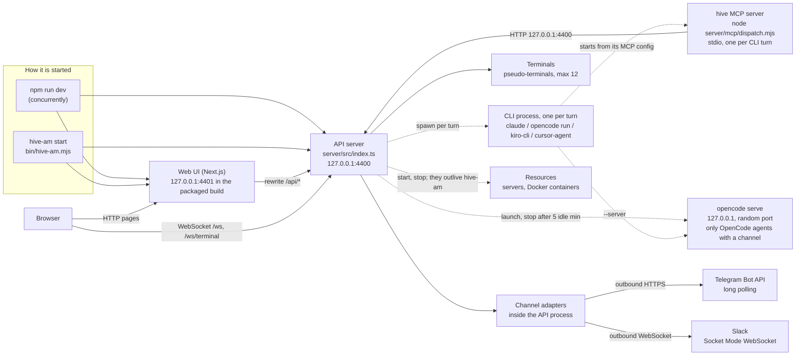

# 6. Processes and ports

> 🇪🇸 [Leer en español](../es/06-processes-and-ports.md)

Lines checked against commit `60f69d8`.

## What it shows and when to look at it

Which processes run while hive-am is up, who starts each one, which port it listens on and how long it lives. Look here when a port is taken, when a process is left behind after hive-am stops, when you wonder why a resource kept running after a restart, or before adding anything that runs in the background. The short version: two long-lived processes (the API server on 4400 and the web UI on 4401), one CLI process per turn with its own short-lived MCP server, an optional `opencode serve` per OpenCode agent with a channel, and resources that outlive hive-am on purpose.

## Diagram

Solid boxes live as long as hive-am; dashed edges start something that lives only for a turn or for a while.

## Step by step

| Step | File | Function or symbol | What it does |
|---|---|---|---|
| 1 | `package.json:44` | `concurrently` | `npm run dev` runs the server and the web in development, side by side. |
| 2 | `server/package.json:6` | `tsx watch src/index.ts` | The server in development (`start` at line 7 runs it without watching). |
| 3 | `web/package.json:5` | `next dev -p 4401` | The web in development on 4401 (`next start -p 4401` at line 7). |
| 4 | `bin/hive-am.mjs:75` | `specs` | The packaged launcher's two children: `node server/dist/index.js` and `next start -p <web port> -H 127.0.0.1`. |
| 5 | `bin/hive-am.mjs:67` | `HIVE_AM_PORT` | The packaged build refuses another API port: its UI is built to talk to 4400. |
| 6 | `server/src/mcp-config.ts:4` | `API_PORT` | The API port: `HIVE_AM_PORT`, 4400 by default. |
| 7 | `server/src/index.ts:20` | `skills.seedDefaults` | Startup: default skills and seed, then the timers saved before a restart are armed again (wake-ups, delegation notices, schedules, watches) and the resource poller starts (`armObjects`, line 29). |
| 8 | `server/src/index.ts:35` | `upgrade` | One port, two sockets: `/ws` (the bus, for the interface) and `/ws/terminal?id=` (one terminal). |
| 9 | `server/src/index.ts:39` | `isLocalRequest` | A terminal socket is refused unless it comes from this machine and terminals are on. |
| 10 | `server/src/index.ts:45` | `bus.on` | Every WebSocket client receives every bus message (diagram 2). |
| 11 | `server/src/index.ts:53` | `server.listen` | Listens on `127.0.0.1` only, then starts the channel connections (`startAll`). |
| 12 | `web/next.config.mjs:16` | `rewrites` | The web forwards `/api/*` to the API (`HIVE_AM_API`, default `http://127.0.0.1:4400`). |
| 13 | `web/lib/store.tsx:83` | `NEXT_PUBLIC_HIVE_WS_PORT` | The browser opens the WebSocket straight to the API port (4400 unless set). |
| 14 | `server/src/providers/spawn.ts:25` | `spawn` | Each turn is one child process of the CLI, killed when the turn ends or is stopped (diagram 2). |
| 15 | `server/src/mcp-config.ts:6` | `HIVE_CAPS` | The MCP server each CLI starts gets the agent id, the API URL and its capabilities in its environment. |
| 16 | `server/mcp/dispatch.mjs:383` | `/api/channel/reply` | The MCP server answers a tool call with an HTTP request to the API (here `channel_reply`). |
| 17 | `server/src/providers/opencode.ts:81` | `channel` | Only an OpenCode agent with the `channel` capability uses a persistent `opencode serve`. |
| 18 | `server/src/providers/opencode-server.ts:131` | `serve` | `opencode serve --hostname 127.0.0.1 --port 0` with a password, one per agent. |
| 19 | `server/src/providers/opencode-server.ts:18` | `MAX_SERVERS` | At most 2 at once (`HIVE_AM_OPENCODE_SERVERS`); the least recently used idle one is stopped to make room. |
| 20 | `server/src/providers/opencode-server.ts:16` | `IDLE_MS` | An `opencode serve` with no turn for 5 minutes is stopped. |
| 21 | `server/src/providers/opencode-server.ts:44` | `reapOrphans` | Servers left by a hive-am that died without cleaning up are listed in a pid file and stopped at the next start. |
| 22 | `server/src/terminals.ts:19` | `MAX_TERMINALS` | Terminals are pseudo-terminals inside the API process, 12 at most; `HIVE_AM_TERMINALS=0` turns them off (line 21). |
| 23 | `server/src/connections/manager.ts:72` | `startAll` | Starts every enabled connection: Telegram long polling and Slack Socket Mode run inside the API process. |
| 24 | `server/src/objects/runner.ts:65` | `detached: true` | A server resource runs in its own process group with its output in a log file, so it survives a hive-am restart. |
| 25 | `server/src/objects/index.ts:81` | `armObjects` | Polls the state of every resource every few seconds (`POLL_MS`, line 20) and applies supervision to servers: one that ended by itself is started again, after a growing wait, as its `restart` policy says (`on-failure` or `always`), and one that keeps failing its health checks is restarted when `health.restartWhenUnhealthy` is on; both count against `maxRestarts` (`supervise`, `server/src/objects/supervisor.ts:47`); one the person stopped is never started again. |
| 26 | `server/src/index.ts:60` | `shutdown` | Stop: WebSockets, HTTP, terminals, connections, database, in that order. Resources are not stopped. |

## Covered by

- `test-cli.ts` (no model): the launcher `bin/hive-am.mjs` starts in the background, reports, shows its log, stops and restarts, with stand-ins for its two children and ports of its own.
- `test-terminals.ts` (no model, starts a server): a real shell over `/ws/terminal`, who may reach it, limits and the off switch.
- `test-http-core.ts` (no model, starts a server): the local-only guard and the rest of the HTTP layer.
- `test-objects.ts` (no model): a server resource kept running and found again after hive-am restarts, and Docker resources (that part skips itself when Docker is not available).
- No script covers the server's own startup order or its shutdown sequence.

## Edge cases

- **Port 4400 already in use**: the server says so and exits (`server/src/index.ts:50`); `HIVE_AM_PORT` changes it in development.
- **A step of the shutdown hangs**: after 5 seconds the process leaves anyway (`server/src/index.ts:63`).
- **Unexpected errors**: a rejected promise nobody handled is logged and the server keeps serving; an uncaught exception is logged and the server shuts down cleanly with code 1 (`server/src/index.ts:79` and `:80`).
- **hive-am killed with `kill -9`**: an `opencode serve` it started survives it and is reaped at the next start. A turn in flight is lost; the agent is `idle` again on restart (diagram 9).
- **Resources outlive hive-am by design** (`server/src/index.ts:57` comment); `armObjects` finds them again. Only the process that started a server writes down how it ended (the `exit` listener, `server/src/objects/runner.ts:70`), so a server that dies while hive-am is down shows as `stopped` and is not restarted by itself (`server/src/objects/runner.ts:51`); supervision only restarts one whose end was recorded and that the person did not stop (`server/src/objects/supervisor.ts:77`).
- `opencode serve` also starts briefly to read the model catalog (`server/src/providers/opencode-server.ts:84`) and to compact a conversation (`:196`).
- **Never use 4400 or 4401 for tests**: the scripts that start a server take their own `HIVE_AM_PORT`, and a second web can use `NEXT_DIST_DIR` and `HIVE_AM_API`.

## See also

- [Reference 1: overview](../../reference/en/01-overview.md), with the architecture diagram.
- [Reference 3: entry points and execution](../../reference/en/03-entry-points-and-execution.md) for every environment variable.
- [Diagram 10: providers](10-providers.md) for the CLI processes and `opencode serve`.
- [Diagram 2: a turn inside an agent](02-agent-turn.md).
