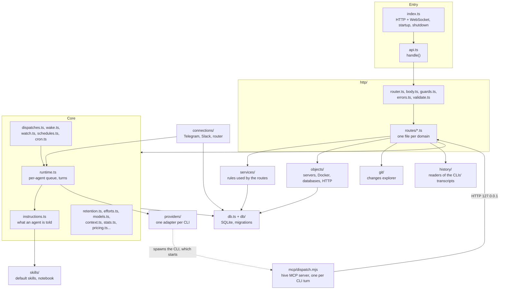

# 7. Source map of `server/src`

> 🇪🇸 [Leer en español](../es/07-server-source-map.md)

Lines checked against commit `60f69d8`.

## What it shows and when to look at it

Every file of the server (`server/src`) and the agents' MCP server (`server/mcp/dispatch.mjs`), one line each, grouped by layer: "if you want to change X, open Y". Look here before a change, to know which file holds the rule you want to touch, and which other pages of this folder follow it through a whole path. The folders themselves are described in [reference 2](../../reference/en/02-project-structure.md); this page does not repeat that, it goes file by file.

## Diagram

The layers and who calls whom. An arrow means "imports and calls". The table below has one row per file.

## Step by step

On this page each step is a file. Paths are relative to the repository root.

### Entry and HTTP layer

| File | What it holds | Open it to change |
|---|---|---|
| `server/src/index.ts` | Startup order (default skills, seed, re-arming of timers, resources), the HTTP server on `127.0.0.1`, the `/ws` and `/ws/terminal` upgrades, shutdown | what starts at boot, the WebSocket fan-out of the bus, the shutdown order |
| `server/src/api.ts` | `handle`: imports every route module, CORS, `OPTIONS`, 404, the one place where an error becomes a response | the order routes are registered, CORS headers |
| `server/src/http/router.ts` | The route table and `:name` matching | how a path is matched |
| `server/src/http/body.ts` | JSON body reading, size limits (2 MiB, larger for uploads), 413 | body limits |
| `server/src/http/errors.ts` | `HttpError` and `toHttpError`: domain error kind to status | which status an error gets |
| `server/src/http/guards.ts` | `isLocalRequest` and `requireLocal`: only this machine | what counts as a local request |
| `server/src/http/validate.ts` | Small value helpers (`text`, `strList`...) | how a field is read and checked |
| `server/src/http/routes/agents.ts` | Agents CRUD, `POST /api/agents/:id/messages` (a web message), stop, new or resumed session, history, stats, sessions, inbox files, compaction | anything the agent screens call |
| `server/src/http/routes/channel.ts` | `/api/channel/*` (reply, send-file, react, mute), `/api/wake`, `/api/wake-when-done` | the HTTP side of the chat and wake-up tools |
| `server/src/http/routes/colonies.ts` | Colonies CRUD | colony routes |
| `server/src/http/routes/connections.ts` | Connections CRUD, restart, test, threads | the Connections screen routes |
| `server/src/http/routes/fs.ts` | `GET /api/fs/dirs`, the folder picker | the folder and file picker |
| `server/src/http/routes/git.ts` | Every `/api/agents/:id/git/*` route of the changes explorer | git routes |
| `server/src/http/routes/meta.ts` | Health, providers, models and reasoning levels per model | what the agent form offers |
| `server/src/http/routes/notebook.ts` | The notebook tools (`/api/notebook/*`) and the notebook screen | notebook routes |
| `server/src/http/routes/orchestration.ts` | Workers of an orchestrator, `/api/dispatch*` and `/api/dispatches` | delegation routes (diagram 4) |
| `server/src/http/routes/resources.ts` | `/api/agent-objects/*` (agent tools) and `/api/objects/*`, `/api/docker/*` (interface) | resource routes |
| `server/src/http/routes/schedules.ts` | `/api/schedules/*`: the schedule tools and the schedules screen | schedule routes |
| `server/src/http/routes/skills.ts` | Skills CRUD, usage and `POST /api/skills/read` (`skill_read`) | skill routes |
| `server/src/http/routes/terminals.ts` | List, open and close terminals (local only) | terminal routes |
| `server/src/http/routes/types.ts` | Agent types CRUD and creating an agent from a type | type routes |

### Business rules (`services/`)

| File | What it holds | Open it to change |
|---|---|---|
| `server/src/services/agents.ts` | Create, clone, update and remove an agent; effective folder; which session to read; stale permission; resume a session | validation of an agent, cloning |
| `server/src/services/colonies.ts` | Colony rules (a colony cannot lend Plan mode to an agent with a channel) | colony validation |
| `server/src/services/connections.ts` | Cleaning and validating a connection's people and groups | connection validation |
| `server/src/services/notebook.ts` | Where a note came from (date, place, person, agent) | the provenance line of a note |
| `server/src/services/providers.ts` | Installed CLIs and the default model of a new agent | provider list, default models |
| `server/src/services/schedules.ts` | `allSchedules`: schedules, wake-ups and watches in one list for the interface | the schedules screen list |

### Core

| File | What it holds | Open it to change |
|---|---|---|
| `server/src/runtime.ts` | `bus`, `sendTurn` (per-agent queue), `execute` (one turn), `stopAgent`, `cancelQueued`, `abortDispatch`, `startDispatch`, `liveOrigin` | how a turn runs (diagram 2) |
| `server/src/instructions.ts` | `composeInstructions`, `notebookBlock`, `lazySkills`, `mcpCaps` | what an agent is told (diagram 3) |
| `server/src/mcp-config.ts` | `API_PORT` and the MCP configuration each CLI receives | how the `hive` MCP server is wired into a CLI |
| `server/src/dispatches.ts` | `startTask`, `taskStatus`, `cancelTask`, `openTasks`, `announce`, `armDispatchNotices` | background delegations (diagram 4) |
| `server/src/wake.ts` | `scheduleWake`, `deliverTo` (shared delivery), `armWakeups` | wake-ups and where later messages go (diagram 5) |
| `server/src/watch.ts` | `createWatch`, the poller, `armWatches` | `wake_when_done` |
| `server/src/schedules.ts` | `createSchedule`, `fire`, `armSchedules`, the interface's list and pause | recurring schedules |
| `server/src/cron.ts` | `parseCron`, `nextCron`, `minGapMinutes`, time zones | cron syntax and next run |
| `server/src/retention.ts` | `retentionPass`: what hive-am's own record keeps and for how long | retention caps (diagram 9) |
| `server/src/efforts.ts` | Reasoning levels per provider and model, learned and checked | effort levels |
| `server/src/models.ts` | Models each CLI lists, cached | the model list |
| `server/src/context.ts` | Context window size per model, learned from the CLIs | the context bar |
| `server/src/stats.ts` | `sessionStats`: tokens, cost, tools and timeline of a conversation | session statistics |
| `server/src/pricing.ts` | Price estimates per model family | cost estimates |
| `server/src/sessions-summary.ts` | Cached summary of each conversation for the Sessions list | the Sessions list |
| `server/src/seed.ts` | `seedIfEmpty` and `dropStarterSkills` on a fresh database | the first-run starter kit |
| `server/src/terminals.ts` | Real shells (pseudo-terminals) for the bottom panel, at most 12 | terminals |
| `server/src/errors.ts` | `DomainError` with its `kind` | the base of every module's error |
| `server/src/types.ts` | `Agent`, `Colony`, `Skill`, `StreamEvent`, `TurnOptions` and the other shared types | a shared type |

### Data (`db.ts`, `db/`)

| File | What it holds | Open it to change |
|---|---|---|
| `server/src/db.ts` | Opens the database, runs the migrations, the stores `skills`, `types`, `colonies`, `agents`, `dispatches`, and `resolved` (inheritance folded in) | a query, inheritance, what startup resets |
| `server/src/db/migrations.ts` | The whole schema as numbered migrations (`PRAGMA user_version`) | the schema (diagram 8) |
| `server/src/db/json.ts` | `parseJson`: reads a JSON column without throwing | reading JSON columns |

### Providers and history

| File | What it holds | Open it to change |
|---|---|---|
| `server/src/providers/index.ts` | `providers` and `runners`: the adapter of each CLI | registering a provider |
| `server/src/providers/spawn.ts` | `spawnLines`, `spawnJson`, the stall timer, SIGTERM then SIGKILL | how a CLI process is run and stopped |
| `server/src/providers/preamble.ts` | `withInstructions`, `stripInstructions`, `asPositional` | how instructions travel inside a message |
| `server/src/providers/claude.ts` | `runClaude` | Claude Code flags and stream parsing |
| `server/src/providers/opencode.ts` | `runOpencode`, `opencodeRunFlags`, OpenCode permission rules | OpenCode flags and stream parsing |
| `server/src/providers/opencode-server.ts` | One `opencode serve` per agent with a channel: pool, idle stop, pid file, compaction | the persistent OpenCode server |
| `server/src/providers/kiro.ts` | `runKiro`, the trusted tools per permission | Kiro flags and stream parsing |
| `server/src/providers/cursor.ts` | `runCursor`, `cursorPermissions`, `writeCursorMcp` | Cursor flags, rules and `mcp.json` |
| `server/src/history/index.ts` | `historyReaders`, `readHistory`, `historySig` | which reader each provider uses |
| `server/src/history/lines.ts` | `jsonLines`: reads a JSONL transcript, skipping a damaged line | JSONL reading |
| `server/src/history/claude.ts` | Reads Claude Code transcripts | how a Claude conversation is shown |
| `server/src/history/opencode.ts` | Reads OpenCode's database | how an OpenCode conversation is shown |
| `server/src/history/kiro.ts` | Reads Kiro sessions and their metering | how a Kiro conversation is shown |
| `server/src/history/cursor.ts` | Reads Cursor transcripts | how a Cursor conversation is shown |

### Connections (`connections/`)

| File | What it holds | Open it to change |
|---|---|---|
| `server/src/connections/index.ts` | Registers the Telegram and Slack adapters | adding a platform |
| `server/src/connections/manager.ts` | Start and stop adapters, housekeeping, `channelReply`, `channelSendFile`, `channelReact`, `channelMute` (with the secret filter) | what the chat tools do (diagram 1) |
| `server/src/connections/router.ts` | `handleInbound`, `deliver`, `deliverScheduled`: access, commands, group chatter, the turn and its outcome | how an incoming message is handled (diagram 1) |
| `server/src/connections/telegram.ts` | Telegram adapter: long polling, addressing, send, files, reactions | Telegram behaviour |
| `server/src/connections/slack.ts` | Slack adapter: Socket Mode, addressing, send, files, reactions | Slack behaviour |
| `server/src/connections/fake.ts` | In-memory platform for the simulation scripts | test harness |
| `server/src/connections/types.ts` | `ChannelAdapter`, `Inbound`, `Origin`, `Connection` | the adapter contract |
| `server/src/connections/store.ts` | `connections`, `threads`, `threadMessages` | connection and thread rows |
| `server/src/connections/addressing.ts` | `vocativeOf`, `calledByName`, `directedAtOther`, `firstNames` | who a group message is for |
| `server/src/connections/prompt.ts` | `channelPrompt` (the `[hive:channel]` header), `uploadsBlock`, `nowStamp` | what the agent receives for a chat message |
| `server/src/connections/secrets.ts` | `findSecret`, `SECRET_REFUSAL` | which secrets are blocked |
| `server/src/connections/rate.ts` | `allow`: sliding-window limit | rate limits on notices and chatter |
| `server/src/connections/format.ts` | `splitMessage`, `mdToTelegramHtml`, `mdToSlackMrkdwn` | how text is formatted and split |
| `server/src/connections/outbound.ts` | `resolveSendable`: checks a file an agent sends | which files may leave the machine |
| `server/src/connections/files.ts` | Files people send: saved per agent, cleaned after `RETENTION_DAYS` | received files |
| `server/src/connections/vision.ts` | Describes images with an image model | image descriptions |
| `server/src/connections/channel-skill.ts` | Keeps the "Chat channels" and "Wake-ups" skills on agents with a connection | the skills that ride along with a connection |
| `server/src/connections/public.ts` | The connection as the browser sees it (secrets masked) | what the interface receives |
| `server/src/connections/rules.ts` | `channelPermissionError`: a linked agent cannot be in Plan mode | that permission rule |

### Resources (`objects/`)

| File | What it holds | Open it to change |
|---|---|---|
| `server/src/objects/index.ts` | `armObjects` (state poller), actions, the list the interface reads | resource actions and states |
| `server/src/objects/model.ts` | Resource kinds and their configuration types | a resource's settings |
| `server/src/objects/store.ts` | `objectsStore`: `colony_objects` and `object_agents` rows | resource rows |
| `server/src/objects/runner.ts` | A server resource: a command in its own process group, found again after a restart | how a server is run |
| `server/src/objects/supervisor.ts` | Automatic restarts and health checks of servers | supervision |
| `server/src/objects/docker.ts` | Docker containers and compose projects through the `docker` command | Docker behaviour |
| `server/src/objects/docker-info.ts` | What Docker knows (containers, images, volumes, networks) for the forms | Docker suggestions |
| `server/src/objects/files.ts` | Editing or copying a compose file or a Dockerfile | file editing |
| `server/src/objects/exec.ts` | `execCapture`: runs a program without a shell | running external programs |
| `server/src/objects/stats.ts` | CPU and memory of a server or container | resource usage |
| `server/src/objects/database.ts` | Database resources: four engines, one small interface | database connections |
| `server/src/objects/driver-props.ts` | Driver properties a database resource can set | driver options |
| `server/src/objects/db-history.ts` | Run and saved queries, on disk | query history |
| `server/src/objects/agent.ts` | What an agent with "Colony resources" can do | agent access to resources |
| `server/src/objects/agent-db.ts` | What an agent with "Database management" can do | agent access to databases |
| `server/src/objects/http.ts` | HTTP resources: `.http` / `.rest` files | HTTP requests |
| `server/src/objects/http-script.ts` | Response handlers of a `.http` file, run safely | `.http` scripts |
| `server/src/objects/http-history.ts` | Runs of an HTTP resource, on disk | HTTP history |

### Git, skills and MCP

| File | What it holds | Open it to change |
|---|---|---|
| `server/src/git/repo.ts` | Read-only git (status, tree, diff, content) | the changes explorer reads |
| `server/src/git/ops.ts` | History and the writes (commit, pull, push, fetch, branches) | git actions |
| `server/src/git/switch.ts` | Branch switch that carries or stashes local changes | branch switching |
| `server/src/git/browse.ts` | Branches, tags, comparisons, search and pictures at a version | browsing the repository |
| `server/src/skills/defaults.ts` | The skills that ship with hive-am and their ids | a default skill |
| `server/src/skills/notebook.ts` | `notebooks`: the notebook store, its readers, limits and versions | the notebook |
| `server/mcp/dispatch.mjs` | The `hive` MCP server: announces tools by `HIVE_CAPS` and turns each call into a request to the API | an agent tool (name, schema, which route it calls) |

## Covered by

Not applicable: this page maps files, not an executable path. The table is checked mechanically instead: every file under `server/src` and `server/mcp` (`git ls-files server/src server/mcp`) appears in it once, and every file in it exists.

## Edge cases

- A new file under `server/src` needs a row here; the check above fails until it has one.
- Some names are older than their meaning: "objects" are what the interface calls resources (the routes keep `/api/objects`), and `mcp/dispatch.mjs` serves every hive tool, not only `dispatch`.
- `connections/rules.ts` only holds the Plan mode rule; the access rules of a chat are in `connections/router.ts` (`senderOf`), and the secret filter is applied in `connections/manager.ts`.

## See also

- [Reference 2: project structure](../../reference/en/02-project-structure.md) for the folders and the web side.
- [Diagram 6: processes and ports](06-processes-and-ports.md) for what runs.
- [Diagram 8: data model](08-data-model.md) for the tables behind `db.ts`.
