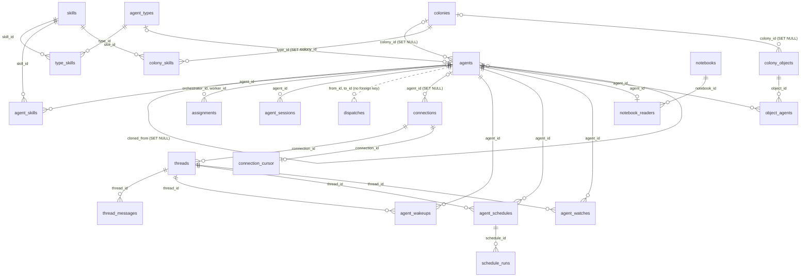

# 8. Data model

> 🇪🇸 [Leer en español](../es/08-data-model.md)

Lines checked against commit `60f69d8`.

## What it shows and when to look at it

The SQLite tables of `~/.hive-am/hive-am.db` and how they point at each other, how the schema is created and upgraded when the server opens the database, and which migration created each table or added each column. Look here before adding a column or a table, before writing a query that joins two of them, or to know what goes away when an agent, a connection or a colony is deleted. The conversations themselves are not here: they live in each CLI's own store and hive-am only keeps a pointer to them ([reference 8](../../reference/en/08-sessions-and-history.md)).

## Diagram

Solid lines are foreign keys; the dotted line from `agents` to `dispatches` is a plain id with no foreign key. Columns are left out: the tables below list them.

## Step by step

### How the schema is created and upgraded

| Step | File | Function or symbol | What it does |
|---|---|---|---|
| 1 | `server/src/db.ts:10` | `DATA_DIR` | The data folder: `HIVE_AM_HOME`, else `~/.hive-am`. |
| 2 | `server/src/db.ts:13` | `new Database` | Opens `hive-am.db` in that folder, with WAL and foreign keys on (lines 14 and 15). |
| 3 | `server/src/db.ts:18` | `migrate(db)` | Brings the schema up to date before any module prepares a statement. |
| 4 | `server/src/db/migrations.ts:279` | `migrate` | Reads `PRAGMA user_version` and runs every migration with a higher version. |
| 5 | `server/src/db/migrations.ts:284` | `db.transaction` | Each migration and its new `user_version` are written in one transaction. |
| 6 | `server/src/db/migrations.ts:15` | `addColumn` | Adds a column only when it is missing, so a migration can run on any older database. |
| 7 | `server/src/db/migrations.ts:276` | `SCHEMA_VERSION` | The schema version is the version of the last migration (9 today). |
| 8 | `server/src/db.ts:291` | `status='idle'` | At startup, agents left `running` by a crash become `idle` again. |
| 9 | `server/src/db.ts:292` | `interruptLeftovers` | At startup, delegations left `queued` or `running` become `interrupted`. |

### The tables

Every table comes from migration 1 (`baseline`), except `notebooks` and `notebook_readers` (migration 6). The baseline is the schema as it stood before versioning, written to be a no-op on a database that already had it. One of its tables, `agent_notebooks`, no longer exists: migration 6 moves its rows and drops it.

| Table | Defined at | Purpose | Created by | Columns added later |
|---|---|---|---|---|
| `skills` | `server/src/db/migrations.ts:27` | The skill library | 1 (baseline) | `load` (in 1) |
| `agent_types` | `server/src/db/migrations.ts:31` | Templates agents are made from | 1 (baseline) | `effort` (8) |
| `type_skills` | `server/src/db/migrations.ts:37` | Skills of a type | 1 (baseline) | `load` (in 1) |
| `agents` | `server/src/db/migrations.ts:42` | Agents: provider, model, permission, folder, current session, status | 1 (baseline) | `colony_id`, `overrides`, `session_cwd`, `instr_hash` (in 1); `browser` (3); `cloned_from` (7); `effort` (8) |
| `agent_skills` | `server/src/db/migrations.ts:50` | Skills of an agent | 1 (baseline) | `load` (in 1) |
| `assignments` | `server/src/db/migrations.ts:55` | Which workers an orchestrator may delegate to | 1 (baseline) | none |
| `colonies` | `server/src/db/migrations.ts:60` | Colonies: shared folder, permission, prompt, what members inherit | 1 (baseline) | none |
| `colony_skills` | `server/src/db/migrations.ts:65` | Skills of a colony | 1 (baseline) | `load` (in 1) |
| `agent_sessions` | `server/src/db/migrations.ts:71` | Every native conversation an agent used (a pointer, not the text) | 1 (baseline) | `kind`, `from_id`, `task` (in 1); `permission` (4) |
| `dispatches` | `server/src/db/migrations.ts:78` | The delegation log: who asked whom, state and result | 1 (baseline) | `session_id` (in 1); `mode`, `origin`, `notified_at`, `read_at` (9); index on `created_at` (5) |
| `seeded_skills` | `server/src/db/migrations.ts:82` | Default skills already added once, so a deleted one is not added back | 1 (baseline) | none |
| `connections` | `server/src/db/migrations.ts:85` | Telegram and Slack connections and the agent each answers through | 1 (baseline) | none |
| `threads` | `server/src/db/migrations.ts:91` | Known chats, topics and threads, and where a reply goes | 1 (baseline) | `muted`, `seen_id` (in 1) |
| `thread_messages` | `server/src/db/migrations.ts:97` | Messages in and out of each thread | 1 (baseline) | `files` (in 1) |
| `connection_cursor` | `server/src/db/migrations.ts:103` | Where a platform's polling left off | 1 (baseline) | none |
| `agent_wakeups` | `server/src/db/migrations.ts:109` | Pending `wake_me` requests | 1 (baseline) | `req_id`, `req_name` (in 1) |
| `agent_schedules` | `server/src/db/migrations.ts:114` | Recurring schedules | 1 (baseline) | `req_id`, `req_name` (in 1) |
| `schedule_runs` | `server/src/db/migrations.ts:121` | The last runs of each schedule | 1 (baseline) | none |
| `agent_watches` | `server/src/db/migrations.ts:126` | Processes watched for `wake_when_done` | 1 (baseline) | none |
| `agent_notebooks` | `server/src/db/migrations.ts:134` | The first notebook table, one per agent (dropped by 6) | 1 (baseline) | dropped in 6 |
| `colony_objects` | `server/src/db/migrations.ts:139` | Resources: servers, Docker, databases, HTTP | 1 (baseline) | none |
| `object_agents` | `server/src/db/migrations.ts:145` | The agent chosen to look after a resource | 1 (baseline) | none |
| `notebooks` | `server/src/db/migrations.ts:215` | A notebook as its own row | 6 (shared-notebook) | none |
| `notebook_readers` | `server/src/db/migrations.ts:219` | Which agent reads which notebook, and what it has seen | 6 (shared-notebook) | none |

"In 1" means the column is added by `addColumn` inside the baseline (`server/src/db/migrations.ts:152` and below), for databases older than versioning; it is not a separate version. Migration 2 (`renames`) only renames data. No other file creates tables: the modules that own one (`connections/store.ts`, `objects/store.ts`, `skills/notebook.ts`, `wake.ts`, `watch.ts`, `schedules.ts`) only read and write it.

### Who reads and writes each group

| Step | File | Function or symbol | What it does |
|---|---|---|---|
| 1 | `server/src/db.ts:205` | `agents` | Agents, their skills, workers and sessions. |
| 2 | `server/src/db.ts:260` | `dispatches` | The delegation log and its state changes. |
| 3 | `server/src/connections/store.ts:21` | `connections` | Connections; `threads` and `threadMessages` follow in the same file. |
| 4 | `server/src/skills/notebook.ts:62` | `notebooks` | Notebooks and their readers. |
| 5 | `server/src/objects/store.ts:43` | `objectsStore` | Resources and the agent of each one. |
| 6 | `server/src/retention.ts:21` | `retentionPass` | Ages out old thread messages, delegations and sessions (diagram 9). |

## Covered by

- `test-migrations.ts` (no model): a database written by an older build opens and migrates without losing rows, a second open changes nothing, and a fresh database gets the same schema.
- `test-retention.ts` (no model): what is aged out of `thread_messages`, `dispatches` and `agent_sessions`, and that nothing recent is.

## Edge cases

- **A migration that fails** rolls back with its `user_version`, so the next start tries it again from the same point.
- **Deleting an agent** removes its skills, assignments, sessions, wake-ups, schedules, watches, notebook reader and resource assignments (`ON DELETE CASCADE`), unlinks its connections and the agents cloned from it (`SET NULL`), and leaves its `dispatches` rows: they have no foreign key, so the log shows "a removed agent" (`server/src/dispatches.ts:24`).
- **Deleting a colony** leaves its members and resources without a colony (`SET NULL`) and removes its own skill assignments.
- **A notebook nobody reads any more** is deleted by the trigger `notebook_orphan` (`server/src/db/migrations.ts:225`).
- **An old `wakeups` table** from the first builds is dropped by the baseline (`server/src/db/migrations.ts:108`).
- **Retention caps**: 500 messages per thread and 30 days, 200 delegations, 50 delegation sessions per agent, 90 days for a conversation the CLI no longer has (`server/src/retention.ts:11`).
- The diagram is simplified (no columns, no indexes); the tables above are exact.

## See also

- [Reference 4: storage](../../reference/en/04-storage.md), with its own relationship diagram and every column.
- [Diagram 9: agent life cycle](09-agent-lifecycle.md) for what retention removes.
- [Diagram 7: source map](07-server-source-map.md).
