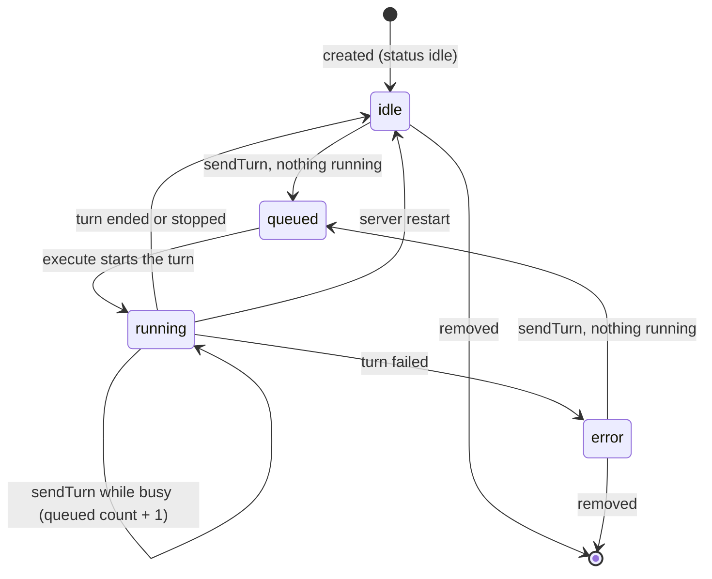
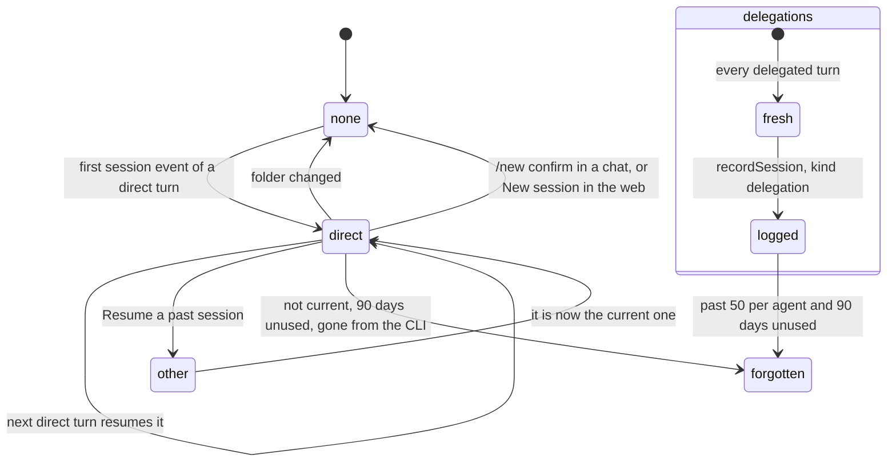

# 9. Agent life cycle

> 🇪🇸 [Leer en español](../es/09-agent-lifecycle.md)

Lines checked against commit `60f69d8`.

## What it shows and when to look at it

The states an agent goes through from the moment it is created (idle, queued, running, error) and what moves it between them; the states of its conversations (none, a direct session that is resumed every turn, a reset, delegation sessions that are never current); and what retention removes from hive-am's own record over time. Look here when an agent's status looks wrong, when a conversation started over unexpectedly, or to know what survives a restart.

## Diagram

The status of an agent. `queued` is only reported on the bus, with a count; the stored `status` column holds `idle`, `running` or `error`.

The conversation of an agent. Delegations never touch it.

## Step by step

| Step | File | Function or symbol | What it does |
|---|---|---|---|
| 1 | `server/src/services/agents.ts:22` | `create` | Creates the agent (from the form, `createAgent` line 31; from a type, `spawnFromType` line 39; as a clone, `cloneAgent` line 55) and removes it again if it has no working folder. |
| 2 | `server/src/db.ts:210` | `create` | Inserts the row with status `idle` and no session, its skills and its workers, in one transaction. |
| 3 | `server/src/runtime.ts:14` | `status` | The status message of the bus: `idle`, `running`, `error` or `queued`, with the queue count. |
| 4 | `server/src/runtime.ts:60` | `queued` | A new message reports `queued`, or `running` when a turn is already live. |
| 5 | `server/src/runtime.ts:106` | `agents.setStatus(agentId, 'running')` | The turn starts: stored status `running` (`agents.setStatus`, `server/src/db.ts:229`). |
| 6 | `server/src/runtime.ts:145` | `agents.setStatus` | The turn ends: `error` if it failed, else `idle` (a stopped turn is `idle`). |
| 7 | `server/src/runtime.ts:150` | `stopAgent` | Stop aborts the running turn; queued messages stay. |
| 8 | `server/src/runtime.ts:158` | `cancelQueued` | A cancelled delegation leaves the queue count at once (diagram 4). |
| 9 | `server/src/db.ts:291` | `status='idle'` | At startup an agent left `running` is `idle` again; its session is intact on disk. |
| 10 | `server/src/services/agents.ts:94` | `removeAgent` | Stops the agent and deletes it (what goes with it: diagram 8). |
| 11 | `server/src/runtime.ts:125` | `agents.setSession` | The first session id of a direct turn becomes the agent's session (`setSession`, `server/src/db.ts:230`): it also clears `instr_hash` and logs the session with its permission. |
| 12 | `server/src/runtime.ts:85` | `agents.setSession(raw, null)` | The folder changed since the session started: the next turn starts a new one. |
| 13 | `server/src/connections/router.ts:144` | `name === 'new'` | `/new confirm` from an admin in a chat stops the agent and drops its session (line 147). |
| 14 | `server/src/http/routes/agents.ts:68` | `/api/agents/:id/new-session` | The web's New session: stop and drop the session. |
| 15 | `server/src/services/agents.ts:115` | `resumeSession` | Makes a past direct session current again; a delegated one cannot be. |
| 16 | `server/src/runtime.ts:124` | `agents.recordSession` | A delegation's session is only logged as `delegation` (`server/src/db.ts:240`), with who asked and the task. |
| 17 | `server/src/history/index.ts:21` | `readHistory` | Any of these conversations is read from the CLI's own transcript. |
| 18 | `server/src/retention.ts:21` | `retentionPass` | Ages out hive-am's record: thread messages past 500 per thread and 30 days, delegations past 200, delegation sessions past 50 per agent and 90 days unused, direct sessions 90 days unused that the CLI no longer has. |
| 19 | `server/src/connections/manager.ts:67` | `housekeeping` | Runs the retention pass (and cleans received files) at startup and every 6 hours (`startAll`, line 72). |

## Covered by

- `test-runtime-recovery.ts` (no model): a turn that fails while being prepared leaves the agent `error`, not `running`, and the next message brings it back to `idle`.
- `test-retention.ts` (no model): what retention removes and what it keeps.
- `test-session-permission.ts` (no model): resuming a session and the stale permission flag of an OpenCode conversation.
- `test-agent-clone.ts` (no model, starts a server): a clone copies the configuration and none of the sessions.
- No script covers the status transitions as a whole.

## Edge cases

- **`queued` is never stored**: after a restart the queue is empty and the stored status is `idle` or `error` (diagram 2).
- **A stopped turn ends `idle`**, not `error`: it has no error, only the summary "Stopped".
- **Removing an agent** stops its running turn first; there is no state where an agent is removed after some days.
- **Retention never touches the CLIs' own conversations**, only hive-am's copy of the list (`server/src/retention.ts:7`). The current session of an agent is never forgotten.
- **A changed permission** does not reset an OpenCode session; the agent is flagged instead (`permissionStale`, `server/src/services/agents.ts:109`).
- **Delegation sessions never become current**: the agent's own conversation does not fill up with delegated work.

## See also

- [Reference 8: sessions and history](../../reference/en/08-sessions-and-history.md), with the life cycle of a direct session.
- [Diagram 2: a turn inside an agent](02-agent-turn.md), [diagram 8: data model](08-data-model.md), [diagram 4: a delegation](04-dispatch.md).
