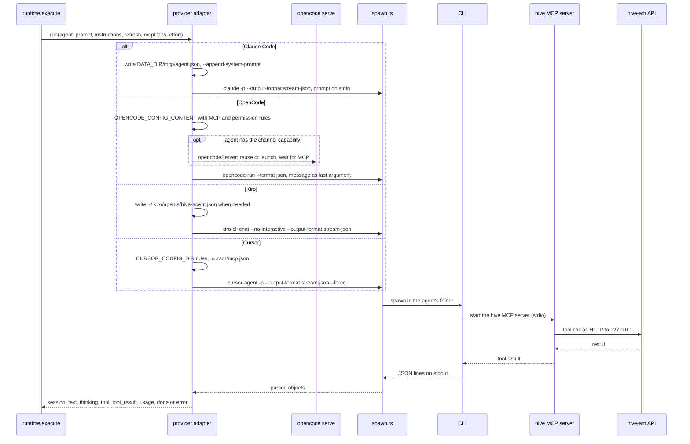

# 10. Providers

> 🇪🇸 [Leer en español](../es/10-providers.md)

Lines checked against commit `60f69d8`.

## What it shows and when to look at it

The four CLIs hive-am drives (Claude Code, OpenCode, Kiro and Cursor) side by side: how the message and the instructions reach each one, how a session is resumed, how the hive MCP server is wired in, how the permission level becomes the CLI's own rules, what the CLI prints and which extra processes it needs. Each adapter is one async generator that turns a CLI's output into `StreamEvent`s for the runtime (diagram 2). Look here before changing a flag, when one provider behaves differently from the others, or before adding a fifth.

## Diagram

One turn, from the runtime's call to the end of the CLI, with the part that differs per provider in `alt` blocks.

## Step by step

### Side by side

| | Claude Code | OpenCode | Kiro | Cursor |
|---|---|---|---|---|
| Command | `claude -p --output-format stream-json` | `opencode run --format json` | `kiro-cli chat --no-interactive --output-format stream-json` | `cursor-agent -p --output-format stream-json --stream-partial-output` |
| Message | on stdin | last argument | last argument | last argument |
| Instructions | `--append-system-prompt` on every turn, and `withInstructions` in the message | `withInstructions` in the message | `withInstructions` in the message | `withInstructions` in the message |
| Resume | `--resume <id>` | `-s <id>`, only when the session belongs to the same folder | `--resume-id <id>` | `--resume <id>` |
| MCP config | file `DATA_DIR/mcp/<agent>.json` and `--mcp-config` | `OPENCODE_CONFIG_CONTENT` in the environment | a generated profile `~/.kiro/agents/hive-<agent>.json` and `--agent` | `<folder>/.cursor/mcp.json` with `${env:...}` values, and `--approve-mcps` |
| Permissions | `--permission-mode`, plus a deny list for edits | OpenCode permission rules in the config | trusted tools and allowed paths in the profile, `--trust-all-tools` for Full access | `permissions` rules in a `cli-config.json` (`CURSOR_CONFIG_DIR`), `--mode plan` for read-only |
| Effort | `--effort` | `#variant` on the model | `--effort` | none (part of the model id) |
| Extra processes | none | `opencode serve` for agents with a channel | none | none |
| History | `~/.claude/projects` | OpenCode's database | `~/.kiro/sessions/cli` | `~/.cursor/projects` |

### Where each row comes from

| Step | File | Function or symbol | What it does |
|---|---|---|---|
| 1 | `server/src/providers/index.ts:13` | `providers` | One adapter per provider; `runners` (line 21) is what the runtime calls. |
| 2 | `server/src/providers/claude.ts:16` | `runClaude` | Claude Code. |
| 3 | `server/src/providers/claude.ts:18` | `--permission-mode` | The flags of every turn, with the agent's permission as Claude's own mode. |
| 4 | `server/src/providers/claude.ts:19` | `CLAUDE_EDIT_DENY` | Editing (`acceptEdits`) cannot touch `.git`, `*.pem` or `*.key` (list at line 13). |
| 5 | `server/src/providers/claude.ts:20` | `--resume` | Resumes the agent's session. |
| 6 | `server/src/providers/claude.ts:27` | `--append-system-prompt` | The instructions as a system prompt. |
| 7 | `server/src/providers/claude.ts:31` | `--chrome` | An agent with the Browser switch (and not read-only) drives the person's Chrome. |
| 8 | `server/src/providers/claude.ts:33` | `DATA_DIR` | Writes the MCP config file and allows `mcp__hive`. |
| 9 | `server/src/providers/claude.ts:44` | `stdin: prompt` | Claude is the only provider that gets the message on stdin. |
| 10 | `server/src/providers/opencode.ts:58` | `runOpencode` | OpenCode. |
| 11 | `server/src/providers/opencode.ts:38` | `opencodeRunFlags` | Reads `opencode run --help` once and passes only the flags that version knows (1.x and 2.x differ). |
| 12 | `server/src/providers/opencode.ts:65` | `resume` | A session started in another folder is not resumed. |
| 13 | `server/src/providers/opencode.ts:68` | `#${o.effort}` | The effort goes as the model's variant. |
| 14 | `server/src/providers/opencode.ts:20` | `opencodePermissions` | The permission levels as OpenCode rules: read-only denies edits and commands; editing denies commands, protected files and folders outside the agent's. |
| 15 | `server/src/providers/opencode.ts:74` | `OPENCODE_CONFIG_CONTENT` | The config (MCP, rules, `question` denied) goes in the environment. |
| 16 | `server/src/providers/opencode.ts:81` | `channel` | Only an agent with the `channel` capability uses a persistent server; any other runs `--standalone` (line 87) or the 1.x default. |
| 17 | `server/src/providers/opencode-server.ts:154` | `opencodeServer` | Reuses the agent's `opencode serve` or launches one (restarted when the folder or config changed, line 157). |
| 18 | `server/src/providers/opencode-server.ts:112` | `mcpSettled` | Waits until the MCP servers of the config have connected, so the first hive tool call does not fail. |
| 19 | `server/src/providers/opencode.ts:89` | `asPositional` | The message as the last argument; a leading dash gets a space so it is not read as an option (`server/src/providers/preamble.ts:29`). |
| 20 | `server/src/providers/kiro.ts:23` | `runKiro` | Kiro. |
| 21 | `server/src/providers/kiro.ts:27` | `o.mcpCaps.length` | With hive tools or path limits, a profile is generated (`kiroProfile`, `server/src/mcp-config.ts:25`) and passed with `--agent`. |
| 22 | `server/src/providers/kiro.ts:17` | `kiroEditAccess` | Editing trusts file and web tools (line 11) and lets `fs_write` write only inside the agent's folder. |
| 23 | `server/src/providers/kiro.ts:35` | `--trust-all-tools` | Full access trusts every tool. |
| 24 | `server/src/providers/kiro.ts:36` | `--resume-id` | Resumes the session. |
| 25 | `server/src/providers/cursor.ts:106` | `runCursor` | Cursor. |
| 26 | `server/src/providers/cursor.ts:108` | `--force` | Every turn runs with `--force` (without it every MCP call is refused); the rules set the limits. |
| 27 | `server/src/providers/cursor.ts:18` | `cursorPermissions` | Read-only denies writes and the shell; editing denies the shell and protected files; Full access has no rules. |
| 28 | `server/src/providers/cursor.ts:112` | `CURSOR_CONFIG_DIR` | A config folder of the agent with the person's `cli-config.json` plus those rules, rewritten every turn. |
| 29 | `server/src/providers/cursor.ts:60` | `writeCursorMcp` | Merges the `hive` entry into the folder's `.cursor/mcp.json` (`cursorMcpServer`, `server/src/mcp-config.ts:36`), and keeps the file out of git (`excludeFromGit`, line 41). |
| 30 | `server/src/providers/cursor.ts:114` | `--resume` | Resumes the session; no effort flag (line 116). |
| 31 | `server/src/providers/spawn.ts:7` | `KILL_GRACE_MS` | Shared by all four: stop sends SIGTERM, then SIGKILL after 5 s; the stall timer (diagram 2); the end of stderr in errors. |
| 32 | `server/src/history/index.ts:14` | `historyReaders` | One transcript reader per provider (`server/src/history/claude.ts`, `opencode.ts`, `kiro.ts`, `cursor.ts`). |

## Covered by

- `test-provider-args.ts` (no model, stub CLIs): OpenCode, Kiro and Cursor get the message once, as the last argument; Cursor's flags for resume, model, effort and each permission.
- `test-providers-common.ts` (no model): the shared spawn helpers and that there is a history reader for every provider.
- `test-cursor-provider.ts` (no model, recorded output through a stub CLI): Cursor's events, permission rules, `.cursor/mcp.json` and models.
- `test-cursor-history.ts` (no model): reading a Cursor conversation back.
- `test-session-permission.ts` (no model): an OpenCode conversation keeps the tools it started with.
- No script runs the real Claude, OpenCode or Kiro CLI without a model, and none checks Claude's arguments. The `sim-*` scripts (for example `sim-readonly.ts`, which checks that each permission level is enforced by the CLI) take a provider argument and need a real model.

## Edge cases

- **Claude and `--resume`**: the system prompt of a resumed session is fixed; changes travel inside the message (diagram 3).
- **OpenCode 1.x and 2.x** take different flags; an unknown one makes it print its help and exit, so the flags are probed first (`server/src/providers/opencode.ts:34`).
- **OpenCode's `question` tool** would end a non-interactive turn, so it is denied (`server/src/providers/opencode.ts:73`).
- **Stopping an OpenCode turn on a persistent server** also stops that server, so the model really stops (`server/src/providers/opencode.ts:91`).
- **Kiro without a profile** runs with its own defaults: a read-only agent with no hive tools gets no profile and no trusted tool.
- **Cursor's file tool can still write outside the agent's folder**: Cursor has no rule for that (comment at `server/src/providers/cursor.ts:16`).
- **Open issues**: [#53](https://github.com/hughcbscrt/hive-am/issues/53) tracks checking Cursor against the real CLI, and [#58](https://github.com/hughcbscrt/hive-am/issues/58) checking cancel with Kiro and Cursor.

## See also

- [Reference 6: providers](../../reference/en/06-providers.md), including how to add one.
- [Diagram 6: processes and ports](06-processes-and-ports.md) for `opencode serve`.
- [Diagram 2: a turn inside an agent](02-agent-turn.md), [diagram 3: the effective prompt](03-effective-prompt.md).
