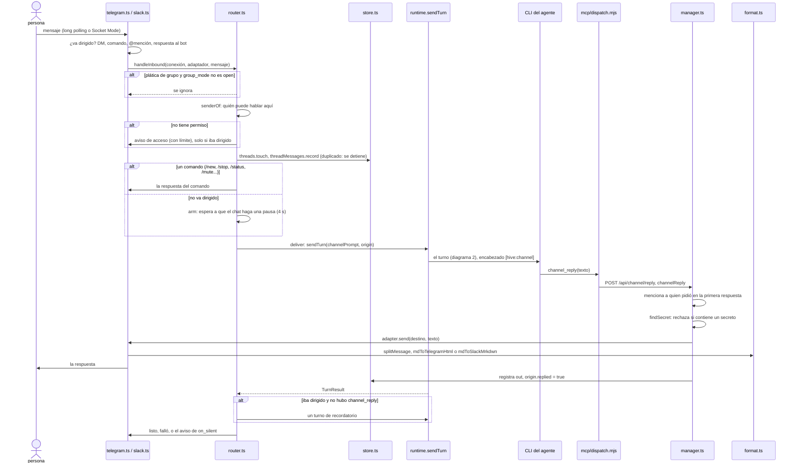

# 1. Un mensaje de chat, ida y vuelta

> 🇬🇧 [Read in English](../en/01-channel-message.md)

Líneas verificadas contra el commit `60f69d8`.

## Qué muestra y cuándo consultarla

Una persona le escribe a un agente por Telegram o Slack y recibe una respuesta: el adaptador de la plataforma recibe el mensaje, el router revisa quién puede hablar y si el mensaje es para el agente, lo registra en su hilo, corre un turno en la única sesión del agente con un encabezado `[hive:channel]`, y el agente contesta con la herramienta `channel_reply`, que pasa por el servidor MCP hive y la API, se revisa en busca de secretos y el adaptador la envía con el formato de la plataforma. Consúltala cuando un mensaje no recibe respuesta, una respuesta llega al lugar equivocado, un mensaje de grupo despierta al agente cuando no debería (o no lo despierta cuando sí debería), o una respuesta queda bloqueada.

## Diagrama

## Paso a paso

| Paso | Archivo | Función o símbolo | Qué hace |
|---|---|---|---|
| 1 | `server/src/connections/telegram.ts:76` | `start` | Telegram: revisa el token y empieza el long polling (`poll`, línea 110, con `getUpdates` en la línea 115). |
| 2 | `server/src/connections/telegram.ts:158` | `addressed` | Un mensaje de Telegram es para el agente en un chat privado, como comando, con una @mención al bot (línea 155) o como respuesta a uno de sus mensajes. |
| 3 | `server/src/connections/slack.ts:115` | `start` | Slack: Socket Mode sobre un WebSocket que abre esta máquina (sin URL pública). |
| 4 | `server/src/connections/slack.ts:277` | `addressed` | Un mensaje de Slack es para el agente en un DM, con una mención, como comando o dentro de un hilo donde participa el agente. |
| 5 | `server/src/connections/manager.ts:49` | `handleInbound` | Cada adaptador arranca con el router como su callback. |
| 6 | `server/src/connections/router.ts:91` | `handleInbound` | Un mensaje entrante: acceso, comandos y luego un turno. |
| 7 | `server/src/connections/router.ts:96` | `calledByName` | En un grupo, llamar al agente por su nombre o un alias como vocativo también cuenta como dirigido (`vocativeOf`, `server/src/connections/addressing.ts:25`). |
| 8 | `server/src/connections/router.ts:99` | `group_mode` | La plática de grupo que no es para el agente se ignora, salvo que la conexión esté abierta a ella. |
| 9 | `server/src/connections/router.ts:65` | `senderOf` | Quién puede hablar: la lista de personas en un DM o en un grupo que no está listado; en un grupo listado, todos o solo sus miembros. |
| 10 | `server/src/connections/router.ts:105` | `allow` | Un desconocido que se dirigió al agente recibe un aviso de acceso, como máximo 5 por persona y 20 por chat por minuto (`allow`, `server/src/connections/rate.ts:7`). |
| 11 | `server/src/connections/router.ts:114` | `duplicate delivery` | El mensaje se registra una sola vez; si la plataforma lo vuelve a entregar, se ignora. |
| 12 | `server/src/connections/router.ts:133` | `m.command` | Comandos que contesta hive-am mismo: `/help`, `/id`, `/stop`, `/status`, `/mute`, `/unmute`, `/new` (administradores, con confirmación). Un comando desconocido es texto para el agente. |
| 13 | `server/src/connections/router.ts:154` | `addressed` | No va dirigido: se guarda como contexto y se entrega solo cuando el chat hace una pausa (`arm`, línea 169; `QUIET_MS`, línea 20), nunca en un hilo silenciado. |
| 14 | `server/src/connections/router.ts:184` | `deliver` | Le entrega al agente el mensaje (y lo que no ha visto de este hilo). |
| 15 | `server/src/connections/router.ts:191` | `tooFast` | Más de `rate_limit` mensajes por usuario por minuto (20 por defecto, línea 13): "demasiados mensajes". |
| 16 | `server/src/connections/router.ts:194` | `T.queued` | El agente está ocupado: un aviso "en cola" con cuántos van delante. |
| 17 | `server/src/connections/router.ts:196` | `unseen` | Los mensajes anteriores del hilo que no se le mostraron al agente van con este. |
| 18 | `server/src/connections/router.ts:202` | `sendTurn` | El turno, en la única sesión del agente, con el `origin` del mensaje (diagrama 2). |
| 19 | `server/src/connections/prompt.ts:33` | `channelPrompt` | El texto que recibe el agente: la línea de encabezado `[hive:channel]` (línea 39), el mensaje, sus archivos y el contexto no visto. La web vuelve a leer el encabezado en `web/lib/channel.ts:16` (`parseChannelPrompt`). |
| 20 | `server/mcp/dispatch.mjs:72` | `channel_reply` | La herramienta (capacidad `channel`); su llamada es un POST a `/api/channel/reply` (línea 383). |
| 21 | `server/src/http/routes/channel.ts:9` | `/api/channel/reply` | La ruta. |
| 22 | `server/src/connections/manager.ts:101` | `channelReply` | Contesta el mensaje que se está atendiendo (`liveOrigin`): si no hay un mensaje de canal en curso, una conexión corriendo o un hilo, es un error para el agente. |
| 23 | `server/src/connections/manager.ts:110` | `origin.mention` | En un grupo, la primera respuesta del turno menciona a la persona que preguntó. |
| 24 | `server/src/connections/manager.ts:114` | `findSecret` | Una respuesta que parece contener un secreto se rechaza (`server/src/connections/secrets.ts:42`) con `SECRET_REFUSAL` (línea 49 de ese archivo); `channelSendFile` revisa igual el pie de foto y los archivos de texto (línea 150). |
| 25 | `server/src/connections/manager.ts:116` | `adapter.send` | El adaptador la envía al hilo; la respuesta se registra como `out` y se marca `origin.replied`. |
| 26 | `server/src/connections/telegram.ts:251` | `splitMessage` | Telegram: pedazos de 3500 caracteres como máximo (`server/src/connections/format.ts:2`), cada uno convertido al HTML de Telegram (`mdToTelegramHtml`, línea 254; `server/src/connections/format.ts:28`). |
| 27 | `server/src/connections/slack.ts:336` | `splitMessage` | Slack: el mismo corte, cada pedazo como `mrkdwn` (`mdToSlackMrkdwn`, `server/src/connections/format.ts:48`). |
| 28 | `server/src/connections/router.ts:210` | `origin.replied` | Iba dirigido, terminó bien y no hubo `channel_reply`: un turno de recordatorio (`NUDGE`, línea 18). La plática no dirigida solo lo recibe después de un turno de más de 45 s (línea 205). |
| 29 | `server/src/connections/router.ts:214` | `on_silent` | Si aún no hay nada: `notice` (por defecto, "el agente terminó sin responder"), `send_text` (el texto del turno) o nada. Un turno fallido dice por qué. |

Lo que hace cada archivo de `connections/`, según el código: `rules.ts` solo tiene `channelPermissionError` (un agente vinculado no puede estar en modo Plan, `server/src/connections/rules.ts:5`); `outbound.ts` revisa los archivos que envía un agente (`resolveSendable`, `server/src/connections/outbound.ts:33`), no el texto; `format.ts` convierte Markdown y parte los mensajes, y lo llaman los adaptadores; el filtro de secretos se aplica en `manager.ts`, no en `router.ts` ni en `outbound.ts`.

## Lo cubren

- `test-addressing.ts` (sin modelo): a quién va un mensaje de grupo, con frases de chats reales.
- `test-chat-access.ts` (sin modelo): quién puede hablar en un grupo listado, todos o solo sus miembros, por `handleInbound` con una plataforma de mentira.
- `test-rate.ts` (sin modelo): el límite de ventana deslizante.
- `test-format.ts` (sin modelo): HTML de Telegram, `mrkdwn` de Slack, menciones, y que una mención no dispara `findSecret` mientras que un token real sí.
- `test-telegram-timeouts.ts` (sin modelo): una llamada a Telegram que nunca responde falla con un error claro.
- `sim-slack.ts` (sin modelo, sin red): el adaptador de Slack contra un Slack de mentira, hilos, comandos, reacciones, archivos y reconexión.
- `test-reactions.ts` y `test-connection-lifecycle.ts` (sin modelo): las reacciones permitidas por plataforma, y un solo adaptador por conexión cuando dos arranques compiten.
- `test-db-tools.ts` (sin modelo, levanta un servidor): `findSecret` bloquea la contraseña de una base de datos.
- `sim-secrets.ts`, `sim-channel.ts`, `sim-groups.ts`, `sim-chatter.ts` y `sim-telegram.ts` necesitan un modelo real (reciben un proveedor como argumento).

## Casos límite

- **Una entrega duplicada** de la plataforma se ignora (`server/src/connections/router.ts:114`).
- **Plática mientras el agente está ocupado**: la entrega se reintenta durante cerca de un minuto (`QUIET_RETRIES`, `server/src/connections/router.ts:22`) y luego el mensaje queda como contexto para el siguiente turno; pasando `chatter_per_minute` (10 por defecto) también queda como contexto.
- **Un turno que termina sin `channel_reply`** recibe un recordatorio en la misma conversación; un hilo silenciado se respeta.
- **La plataforma todavía no está conectada**: `channel_reply` falla con "The connection is not running." (`server/src/connections/manager.ts:107`); los mensajes posteriores (recordatorios, avisos) se reintentan (diagrama 5).
- **Solo la primera respuesta menciona a quien pidió** (`origin.mentioned`, `server/src/connections/manager.ts:112`).
- **Una respuesta bloqueada nunca sale de la máquina**: el agente recibe el rechazo como error de la herramienta y se le pide decir que no puede compartirlo.
- **Un mensaje de más de 8000 caracteres** se rechaza (`MAX_INPUT`, `server/src/connections/router.ts:12`).
- **Un mensaje que solo trae archivos**, sin que se haya podido guardar ninguno, no se entrega (`server/src/connections/router.ts:130`).
- **`/new`** borra la sesión compartida de todos los chats del agente, por eso necesita un administrador y una confirmación.

## Ver también

- [Referencia 14: conexiones externas](../../reference/es/14-conexiones-externas.md).
- [Diagrama 2: un turno dentro de un agente](02-agent-turn.md), [diagrama 5: recordatorios y programaciones](05-wakeups-and-schedules.md) (mensajes posteriores a un hilo), [diagrama 7: mapa del código](07-server-source-map.md).
