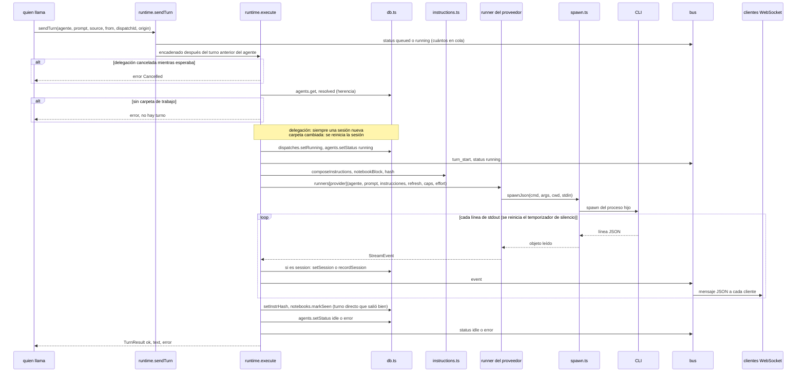

# 2. Un turno dentro de un agente

> 🇬🇧 [Read in English](../en/02-agent-turn.md)

Líneas verificadas contra el commit `60f69d8`.

## Qué muestra y cuándo consultarla

Lo que pasa entre "un mensaje para este agente" y "el agente vuelve a estar libre": la cola de cada agente, cómo se preparan el agente y sus instrucciones, la llamada al CLI del proveedor, cómo llegan sus eventos al navegador y qué se guarda al final. Todo camino que pone a trabajar a un agente pasa por aquí: un mensaje de la web, un mensaje de chat (diagrama 1), una delegación (diagrama 4), un recordatorio o una programación (diagrama 5). Consúltala cuando un agente se quede en "running", cuando un mensaje espere detrás de otro, cuando un turno falle sin eventos, o antes de cambiar lo que se registra después de un turno.

## Diagrama

## Paso a paso

| Paso | Archivo | Función o símbolo | Qué hace |
|---|---|---|---|
| 1 | `server/src/http/routes/agents.ts:36` | `sendTurn` | Un mensaje de la web (`POST /api/agents/:id/messages`) se encola y la petición responde de inmediato; el router de chats (`server/src/connections/router.ts:202`), las delegaciones (`server/src/runtime.ts:188`), los recordatorios (`server/src/wake.ts:81`) y las programaciones (`server/src/schedules.ts:104`) llaman a la misma función. |
| 2 | `server/src/runtime.ts:26` | `states` | Un estado en memoria por agente: cadena de promesas, controlador, cuántos en cola, turno en curso, delegaciones canceladas. |
| 3 | `server/src/runtime.ts:57` | `sendTurn` | Cuenta el mensaje como en cola, emite un estado y encadena `execute` después del turno anterior del agente, así un agente corre un turno a la vez. |
| 4 | `server/src/runtime.ts:69` | `cancelled.delete` | Una delegación que se canceló mientras esperaba termina aquí como `Cancelled` sin llegar al CLI. |
| 5 | `server/src/runtime.ts:77` | `resolved` | El agente como corre: con la carpeta, el permiso, el prompt y las skills de su colonia ya aplicados (`server/src/db.ts:201`). |
| 6 | `server/src/runtime.ts:78` | `agent.cwd` | Sin carpeta de trabajo: el turno falla con ese motivo. |
| 7 | `server/src/runtime.ts:82` | `agent.session_id = null` | Una delegación siempre empieza una sesión nativa nueva; la conversación propia del agente no se toca. |
| 8 | `server/src/runtime.ts:85` | `agents.setSession(raw, null)` | La carpeta cambió desde que empezó la sesión: la sesión directa se reinicia. |
| 9 | `server/src/runtime.ts:106` | `agents.setStatus(agentId, 'running')` | Estado guardado `running`, después de `dispatches.setRunning` si es una delegación. |
| 10 | `server/src/runtime.ts:107` | `turn_start` | Mensajes del bus `turn_start` y `status` para la interfaz. |
| 11 | `server/src/runtime.ts:110` | `composeInstructions` | Las instrucciones; el texto de la libreta se agrega fuera del hash (diagrama 3). |
| 12 | `server/src/runtime.ts:113` | `createHash` | Un hash de las instrucciones sin la libreta. |
| 13 | `server/src/runtime.ts:115` | `refreshInstructions` | Una sesión directa retomada recibe de nuevo las instrucciones cuando el hash cambió o las notas se editaron en otro lado. |
| 14 | `server/src/runtime.ts:116` | `runners[agent.provider]` | Llama al adaptador del proveedor (`server/src/providers/index.ts:21`), con el esfuerzo que aplica (`effortOf`, línea 46). |
| 15 | `server/src/providers/spawn.ts:87` | `spawnJson` | Entrega los objetos JSON del stdout del CLI; un CLI que solo imprime texto es un error. |
| 16 | `server/src/providers/spawn.ts:24` | `spawnLines` | Lanza el CLI en la carpeta del agente, escribe el prompt en stdin cuando el adaptador lo da y entrega líneas. |
| 17 | `server/src/providers/spawn.ts:44` | `armStall` | El temporizador de silencio: se reinicia con cada línea de stdout; tras `STALL_MS` sin salida, se mata el CLI. |
| 18 | `server/src/runtime.ts:123` | `ev.t === 'session'` | Un id de sesión: el directo se guarda como la sesión del agente (`server/src/db.ts:230`); el de una delegación solo se registra (`server/src/db.ts:240`). |
| 19 | `server/src/runtime.ts:99` | `push` | Cada evento se guarda en el turno en curso y se emite en el bus. |
| 20 | `server/src/index.ts:45` | `bus.on` | Cada cliente WebSocket recibe cada mensaje del bus como JSON. |
| 21 | `server/src/runtime.ts:139` | `no events` | Un turno sin ningún evento nunca llegó al modelo: es un error, no una respuesta vacía. |
| 22 | `server/src/runtime.ts:144` | `setInstrHash` | Solo un turno directo que no falló ni se detuvo guarda el hash y marca las notas como vistas. |
| 23 | `server/src/runtime.ts:145` | `agents.setStatus` | Estado guardado `idle` o `error`, y lo mismo en el bus. |
| 24 | `server/src/runtime.ts:150` | `stopAgent` | Detener: aborta el controlador del turno en curso; el CLI recibe SIGTERM y, tras el periodo de gracia, SIGKILL (`server/src/providers/spawn.ts:33`). |
| 25 | `server/src/history/index.ts:21` | `readHistory` | La conversación que se muestra en la web se lee de la transcripción propia del CLI, no de hive-am. |

## Lo cubren

- `test-runtime-recovery.ts` (sin modelo): una falla al preparar un turno es el error de ese turno y no deja al agente en `running`; una ráfaga de 34 turnos corre en orden; un CLI callado se corta (con `HIVE_AM_TURN_STALL_MS=400`) y el mensaje de atrás corre, mientras que un turno que sigue imprimiendo no se corta; una entrega de recordatorio que falló se vuelve a intentar.
- `test-providers-common.ts` (sin modelo): `spawnJson` y `spawnLines`, stdin, códigos de salida y stderr en los errores, un CLI que ignora SIGTERM se corta.
- `test-provider-args.ts` (sin modelo, CLIs de mentira): cómo reciben el prompt OpenCode, Kiro y Cursor.
- `test-effort.ts` (sin modelo, levanta un servidor): el esfuerzo que pide un turno y los argumentos que recibe cada CLI.

## Casos límite

- **La cola solo vive en memoria** (`states`, `server/src/runtime.ts:26`). No se guarda nada de ella: tras un reinicio queda vacía, un mensaje de la web que esperaba se pierde y las delegaciones que estaban en cola o corriendo se marcan `interrupted` (diagrama 4).
- **Un turno colgado**: un turno que nunca termina bloquea la cola del agente. Un CLI que no imprime nada en stdout durante 10 minutos lo mata el temporizador de silencio (`STALL_MS`, `server/src/providers/spawn.ts:5`, se cambia con `HIVE_AM_TURN_STALL_MS`): el turno falla con `StalledError` (`server/src/providers/spawn.ts:74`) y la cola sigue. La persona también puede detenerlo. Lo que todavía puede bloquear la cola es un CLI que siga imprimiendo para siempre.
- **Turno detenido**: termina con un evento `done` y el resumen "Stopped"; el hash no se guarda.
- **Un esfuerzo que no aplica** al modelo del agente: una línea en el log y el valor por defecto del CLI, en vez de un turno fallido (`effortOf`, `server/src/runtime.ts:46`).
- **`queued` no se guarda**: es solo un estado en el bus con un conteo; el estado guardado es `idle`, `running` o `error` (diagrama 9).
- **Un fallo durante un turno**: el turno se pierde; al arrancar, el agente vuelve a `idle` y su sesión sigue intacta en disco (`server/src/db.ts:291`).

## Ver también

- [Referencia 8: sesiones e historial](../../reference/es/08-sesiones-e-historial.md), con el ciclo de vida de una sesión directa.
- [Referencia 5: comunicación entre back y front](../../reference/es/05-comunicacion-back-front.md) para los mensajes del WebSocket.
- [Diagrama 3: el prompt efectivo](03-effective-prompt.md), [diagrama 9: ciclo de vida de un agente](09-agent-lifecycle.md), [diagrama 10: proveedores](10-providers.md).
