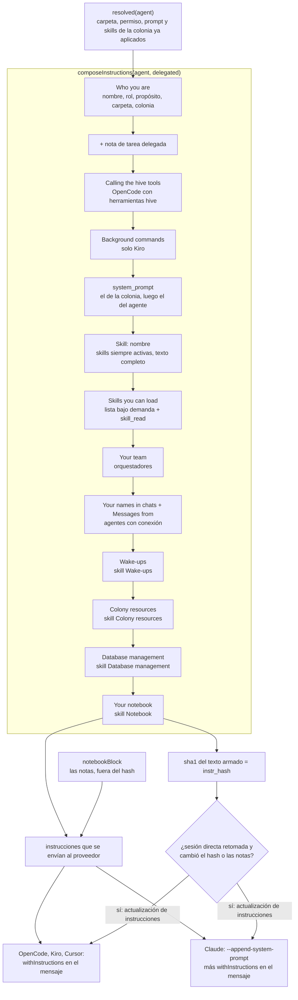

# 3. Cómo se arma el prompt efectivo

> 🇬🇧 [Read in English](../en/03-effective-prompt.md)

Líneas verificadas contra el commit `60f69d8`.

## Qué muestra y cuándo consultarla

Lo que se le dice a un agente antes de su mensaje: las secciones de sus instrucciones en el orden en que las escribe `composeInstructions`, cuáles dependen del proveedor, del rol o de una skill, cómo se aplica la configuración de la colonia, el hash que decide cuándo una conversación retomada recibe de nuevo las instrucciones y cómo las recibe cada CLI. Consúltala cuando un agente no sepa algo que debería (su equipo, sus alias, una skill), cuando un cambio de configuración no llegue a una conversación en curso, o antes de agregar una sección nueva.

## Diagrama

## Paso a paso

| Paso | Archivo | Función o símbolo | Qué hace |
|---|---|---|---|
| 1 | `server/src/db.ts:180` | `agentOf` | Calcula `effective`: para cada campo que presta la colonia (`cwd`, `permission`, `skills`, `prompt`, todos activos por defecto, línea 141) y que el agente no sobrescribe, toma el valor de la colonia. |
| 2 | `server/src/db.ts:191` | `system_prompt` | Primero el prompt de la colonia y luego el del agente, para que el agente tenga la última palabra. |
| 3 | `server/src/db.ts:192` | `skill_ids` | Las skills de la colonia más las del agente; en cómo se carga cada una gana lo que eligió el agente (línea 194). |
| 4 | `server/src/db.ts:201` | `resolved` | El agente con esos valores efectivos en su lugar; `runtime.ts` arma las instrucciones a partir de él. |
| 5 | `server/src/instructions.ts:46` | `composeInstructions` | Une con líneas en blanco las secciones que `instructionParts` (línea 51) escribe abajo, en este orden, cada una marcada con lo que es (la pestaña Instrucciones las mide). |
| 6 | `server/src/instructions.ts:57` | `## Who you are` | Nombre, rol y propósito, "no te presentes como el CLI", la carpeta de trabajo, la colonia (línea 63) y, en un turno delegado, la nota de terminar con un reporte (línea 64). |
| 7 | `server/src/instructions.ts:68` | `opencode` | OpenCode con alguna herramienta hive: cómo llamarlas desde su herramienta `execute`. |
| 8 | `server/src/instructions.ts:72` | `kiro` | Kiro: cómo dejar un comando corriendo sin bloquear el turno. |
| 9 | `server/src/instructions.ts:76` | `system_prompt` | El prompt efectivo (colonia y agente), en dos partes cuando el agente sigue el prompt de su colonia. |
| 10 | `server/src/instructions.ts:82` | `skill_ids` | Cada skill siempre activa, completa, como `## Skill: <nombre>`. |
| 11 | `server/src/instructions.ts:86` | `lazy.length` | Skills bajo demanda: solo nombre y descripción, con la herramienta `skill_read`. |
| 12 | `server/src/instructions.ts:17` | `lazySkills` | Claude en modo Plan no puede llamar herramientas MCP, así que ahí todas las skills van completas. |
| 13 | `server/src/instructions.ts:92` | `orchestrator` | Un orquestador: su equipo y cómo delegar, o "no tienes subagentes". |
| 14 | `server/src/instructions.ts:103` | `connections.forAgent` | Un agente con conexión: sus alias (línea 107) y cómo contestar mensajes de chat con `channel_reply` (línea 108). |
| 15 | `server/src/instructions.ts:112` | `WAKEUPS_SKILL_ID` | Con la skill Wake-ups: `wake_me`, `wake_when_done` y las programaciones. |
| 16 | `server/src/instructions.ts:116` | `OBJECTS_SKILL_ID` | Con la skill Colony resources: las herramientas de recursos. |
| 17 | `server/src/instructions.ts:120` | `DATABASES_SKILL_ID` | Con la skill Database management: las herramientas de bases de datos. |
| 18 | `server/src/instructions.ts:125` | `NOTEBOOK_SKILL_ID` | Con la skill Notebook: cómo usar la libreta y si es compartida. |
| 19 | `server/src/instructions.ts:23` | `mcpCaps` | Qué herramientas hive ofrece el servidor MCP del turno; las mismas condiciones que las secciones de arriba. |
| 20 | `server/src/instructions.ts:137` | `notebookBlock` | Las notas en sí, bajo `### Your current notes`. |
| 21 | `server/src/runtime.ts:112` | `notebookBlock(agent)` | Las notas se agregan después del texto armado, así una nota que escribe el agente no cuenta como cambio de configuración. |
| 22 | `server/src/runtime.ts:113` | `createHash` | El hash cubre solo el texto armado. |
| 23 | `server/src/runtime.ts:115` | `refreshInstructions` | Una sesión directa retomada recibe de nuevo las instrucciones cuando el hash no coincide con el `instr_hash` guardado o las notas son más nuevas que lo que este lector ya vio. |
| 24 | `server/src/providers/claude.ts:27` | `--append-system-prompt` | Claude Code recibe las instrucciones como prompt de sistema en cada turno; una sesión retomada lo ignora (comentario en la línea 25). |
| 25 | `server/src/providers/claude.ts:28` | `withInstructions` | Claude también pasa el mensaje por `withInstructions`, igual que los otros tres. |
| 26 | `server/src/providers/preamble.ts:5` | `withInstructions` | Sesión nueva: el bloque `<instructions>` completo antes del mensaje. Retomada con cambios: `<instructions update="true">`. Si no: solo el mensaje. |
| 27 | `server/src/providers/preamble.ts:16` | `stripInstructions` | Cuando se lee una conversación, el bloque se quita del mensaje de la persona. |
| 28 | `server/src/runtime.ts:144` | `setInstrHash` | Después de un turno directo que salió bien, se guarda el hash y las notas se marcan como vistas. |

## Lo cubren

- `test-agent-clone.ts`, `test-db-tools.ts`, `test-object-tools.ts` (sin modelo, cada uno levanta un servidor): llaman a `composeInstructions` y revisan las secciones que agrega su función (la libreta compartida, las herramientas de bases de datos, las de recursos).
- `test-provider-args.ts` (sin modelo, CLIs de mentira): OpenCode, Kiro y Cursor reciben el mensaje una sola vez, como último argumento, y una conversación leída de vuelta quita el bloque `<instructions>` y las copias duplicadas.
- `test-providers-common.ts` (sin modelo): `withInstructions` y `stripInstructions`.
- `test-session-permission.ts` (sin modelo): una conversación de OpenCode se marca cuando su permiso cambió después de empezar.
- `sim-skills.ts` necesita un modelo real: las skills bajo demanda quedan fuera de las instrucciones y el agente las lee cuando las necesita.
- `test-instructions-compose.ts` (sin modelo): el texto exacto y el sha1 de ocho agentes, uno por rama de arriba, así que un cambio de orden o de un solo byte falla.
- `test-instructions-size.ts` (sin modelo): las partes se unen en el texto que se envía, y el tamaño por parte que usa la pestaña Instrucciones.
- Ningún script revisa los argumentos de Claude.

## Casos límite

- **Notas editadas en otro lado** (por la persona, o en otra conversación de un agente que comparte la libreta) hacen que el siguiente turno directo reenvíe las instrucciones: `notebooks.get(agentId).seen < nbVersion` (`server/src/runtime.ts:115`).
- **Los turnos delegados nunca se refrescan**: cada delegación es una sesión nueva y siempre recibe el bloque completo.
- **Claude y `--resume`**: Claude fija su prompt de sistema cuando empieza la sesión, así que una conversación retomada solo se entera de un cambio por la actualización dentro del mensaje (`server/src/providers/claude.ts:25`).
- **Los tipos de agente no se heredan al correr**: crear un agente desde un tipo copia una vez el prompt, las skills y el permiso del tipo (`spawnFromType`, `server/src/services/agents.ts:39`); los cambios posteriores al tipo no le llegan. Solo la colonia se aplica en cada turno.
- **Un permiso cambiado** no llega a una conversación de OpenCode que ya empezó: conserva las herramientas con las que empezó y el agente queda marcado (`permissionStale`, `server/src/services/agents.ts:109`).
- **Un ajuste cambiado** (un trabajador nuevo, una skill, un alias) cambia el hash; las instrucciones llegan a una conversación retomada en su siguiente turno, no de inmediato.

## Ver también

- [Referencia 7: agentes, tipos, skills y colonias](../../reference/es/07-agentes-tipos-skills-colonias.md), sobre la herencia y las instrucciones compuestas.
- [Diagrama 2: un turno dentro de un agente](02-agent-turn.md), [diagrama 10: proveedores](10-providers.md).
