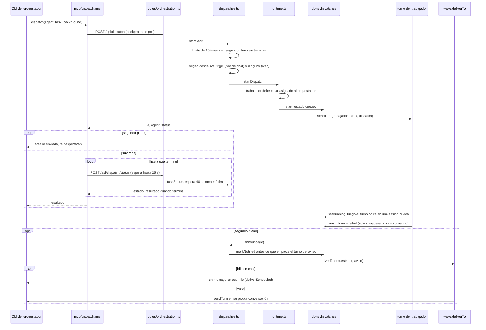
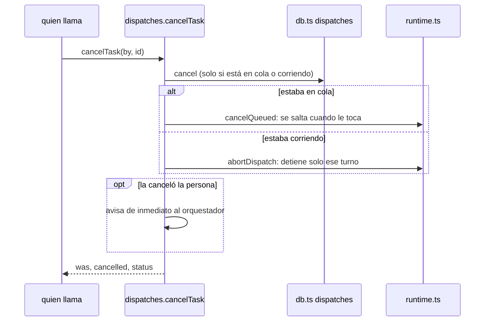

# 4. Una delegación, con archivos

> 🇬🇧 [Read in English](../en/04-dispatch.md)

Líneas verificadas contra el commit `60f69d8`.

## Qué muestra y cuándo consultarla

Un orquestador le pasa una tarea a uno de sus trabajadores: la herramienta `dispatch` del servidor MCP hive, la ruta HTTP, la fila en `dispatches`, el turno del trabajador en su propia sesión nueva y la forma en que regresa el resultado. En segundo plano (lo normal) se le avisa al orquestador cuando la tarea termina, en el lugar donde se la pidieron; en modo síncrono la herramienta consulta `dispatch_status` con llamadas cortas hasta el final. La página también cubre la cancelación (en cola o corriendo) y lo que hace un reinicio. Consúltala antes de cambiar cómo se inicia, se avisa o se cancela una delegación.

## Diagrama

Cancelar, desde el orquestador (`dispatch_cancel`) o desde la web:

## Paso a paso

| Paso | Archivo | Función o símbolo | Qué hace |
|---|---|---|---|
| 1 | `server/mcp/dispatch.mjs:26` | `dispatch` | La herramienta; las otras herramientas de delegación son `list_agents` (línea 20), `dispatch_status` (41), `dispatch_list` (55) y `dispatch_cancel` (61), solo para un orquestador con equipo. |
| 2 | `server/mcp/dispatch.mjs:336` | `/api/dispatch` | Manda `background` (verdadero por defecto) o `poll`. |
| 3 | `server/mcp/dispatch.mjs:346` | `taskStatus` | Modo síncrono: llamadas cortas a `dispatch_status` de hasta 25 s cada una (`POLL_S`, línea 15) hasta que la tarea termina. |
| 4 | `server/src/http/routes/orchestration.ts:23` | `/api/dispatch` | `background` o `poll` van a `startTask`; sin ninguno, la petición se queda abierta hasta que el trabajador responde (la forma original). |
| 5 | `server/src/dispatches.ts:27` | `startTask` | Rechaza una 11.ª tarea en segundo plano sin terminar (`MAX_BACKGROUND`, línea 15). |
| 6 | `server/src/dispatches.ts:32` | `liveOrigin` | En segundo plano, recuerda el hilo de chat que el orquestador está atendiendo en ese momento, o ninguno (su conversación de la web). |
| 7 | `server/src/runtime.ts:181` | `startDispatch` | Busca al trabajador por nombre y revisa que esté asignado al orquestador (línea 186). |
| 8 | `server/src/db.ts:261` | `start` | La fila: estado `queued`, modo, origen. |
| 9 | `server/src/runtime.ts:188` | `sendTurn` | Encola la tarea en el trabajador como un turno `dispatch`; cuando termina, `dispatches.finish` guarda `done` o `failed` y el texto (línea 190). |
| 10 | `server/src/dispatches.ts:38` | `announce` | En segundo plano, el final del turno (o su falla) dispara el aviso. |
| 11 | `server/src/runtime.ts:105` | `dispatches.setRunning` | Empieza el turno del trabajador: `queued` pasa a `running`, en una sesión nativa nueva (diagrama 2). |
| 12 | `server/src/db.ts:269` | `finish` | Cierra la fila solo si sigue en `queued` o `running`, así no se pisa una cancelación que llegó antes. |
| 13 | `server/src/dispatches.ts:51` | `taskStatus` | `dispatch_status`: espera hasta `wait_seconds` (como máximo `MAX_WAIT_S`, 60) y marca como leído un resultado terminado. |
| 14 | `server/src/dispatches.ts:119` | `announce` | Entrega una sola vez al orquestador el resultado de una tarea en segundo plano; una segunda llamada mientras otra entrega no hace nada. |
| 15 | `server/src/dispatches.ts:142` | `deliverTo` | El aviso va al hilo guardado o a la conversación web del orquestador; `markNotified` corre antes de que empiece el turno del aviso. |
| 16 | `server/src/wake.ts:66` | `deliverTo` | La entrega compartida (también la usan los recordatorios, diagrama 5): `sent`, `retry` o `dropped`. |
| 17 | `server/src/dispatches.ts:134` | `tries >= 12` | Mientras la plataforma no está conectada todavía, el aviso se reintenta cada 5 s (`RETRY_MS`, línea 18) hasta 12 veces y luego se marca como avisado. |
| 18 | `server/src/dispatches.ts:80` | `cancelTask` | Cancela una tarea que no ha terminado; una que ya terminó se deja como está y se responde su estado. |
| 19 | `server/src/runtime.ts:158` | `cancelQueued` | Una tarea en cola sale ya del conteo de la cola del trabajador y se salta cuando la cadena llega a ella. |
| 20 | `server/src/runtime.ts:168` | `abortDispatch` | Una tarea corriendo: aborta el turno del trabajador solo si está atendiendo esta tarea. |
| 21 | `server/src/dispatches.ts:101` | `openTasks` | `dispatch_list`: las tareas sin terminar del orquestador, de la más vieja a la más nueva. |
| 22 | `server/src/http/routes/orchestration.ts:45` | `/api/dispatches` | El registro de delegaciones de la web, y su cancelación (línea 47). |
| 23 | `server/src/dispatches.ts:153` | `armDispatchNotices` | Al arrancar: las tareas que quedaron en `queued` o `running` pasan a `interrupted`, y las tareas en segundo plano terminadas que no se avisaron se avisan. |
| 24 | `server/src/db/migrations.ts:263` | `dispatch-background` | La migración 9 agregó `mode`, `origin`, `notified_at` y `read_at`. |
| 25 | `server/src/retention.ts:44` | `KEEP_DISPATCHES` | La retención conserva las 200 filas más nuevas y nunca quita una tarea sin terminar ni un resultado en segundo plano que nadie ha recibido. |

## Lo cubren

- `test-dispatch-background.ts` (sin modelo, trabajadores de mentira, levanta un servidor): tareas en segundo plano, `dispatch_status`, la herramienta síncrona que consulta en vez de mantener una petición larga, un solo aviso en el lugar donde se pidió, reinicios, limpieza y el límite por orquestador.
- `test-dispatch-cancel.ts` (sin modelo, trabajadores de mentira, levanta un servidor): cancelar desde el orquestador y desde la web, en cola y corriendo, la carrera con el final del turno, un solo aviso, reinicios, limpieza y el límite.
- Ningún script `sim-*` cubre la delegación.

## Casos límite

- **Reinicio**: las filas que quedaron en `queued` o `running` pasan a `interrupted` (`server/src/db.ts:285`, llamado en `server/src/db.ts:292` y otra vez desde `server/src/dispatches.ts:154`); las filas en segundo plano terminadas que no se avisaron se avisan. Una tarea nunca se retoma.
- **Sin aviso doble**: la fila se marca como avisada antes de que empiece el turno del aviso, así un reinicio a la mitad no puede avisar dos veces (`server/src/dispatches.ts:140`).
- **Nadie a quién avisar** (el hilo ya no existe, está silenciado o la conexión ahora es de otro agente): `dropped`, la fila se marca como avisada y el resultado se puede leer con `dispatch_status` (`server/src/dispatches.ts:144`).
- **Cancelar dos veces no hace daño**: la segunda llamada responde el estado final y no cambia nada.
- **`cancelled` nunca se pisa**: el turno abortado o saltado termina después, pero `finish` solo actualiza una fila que siga en `queued` o `running`.
- **Una tarea que canceló el orquestador** nunca se avisa (la herramienta ya se lo dijo); una que canceló la persona se avisa de inmediato (`server/src/dispatches.ts:92`).
- **Lo que un trabajador cancelado ya cambió se queda en la carpeta.**
- **Las delegaciones nunca tocan la conversación propia del trabajador**: cada una recibe una sesión nativa nueva, registrada como `delegation` (diagrama 9).
- El issue abierto [#58](https://github.com/hughcbscrt/hive-am/issues/58) trata de verificar la cancelación con Kiro, Cursor y una tarea real corriendo.

## Ver también

- [Referencia 9: orquestación y relaciones](../../reference/es/09-orquestacion-y-relaciones.md), con sus dos diagramas de una delegación y de la cola por agente.
- [Diagrama 5: recordatorios y programaciones](05-wakeups-and-schedules.md) para la entrega compartida.
- [Diagrama 2: un turno dentro de un agente](02-agent-turn.md), [diagrama 9: ciclo de vida de un agente](09-agent-lifecycle.md).
