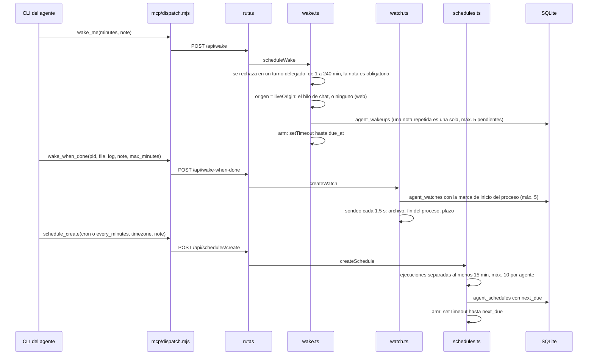
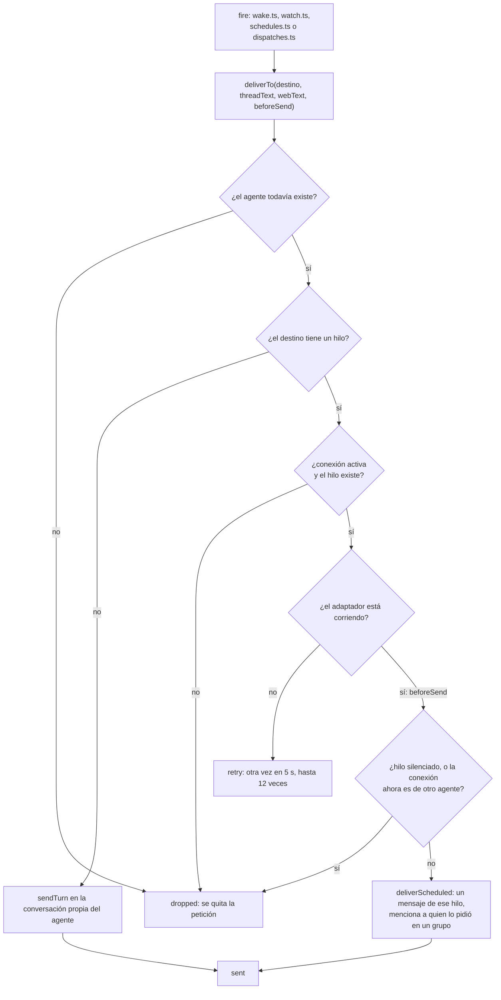

# 5. Recordatorios y tareas programadas

> 🇬🇧 [Read in English](../en/05-wakeups-and-schedules.md)

Líneas verificadas contra el commit `60f69d8`.

## Qué muestra y cuándo consultarla

Un agente solo corre mientras atiende un mensaje, así que "te aviso después" necesita que hive-am lo despierte. Tres herramientas lo hacen: `wake_me` (una vez, después de unos minutos), `wake_when_done` (cuando termina un proceso, aparece un archivo marcador o se acaba el tiempo de espera) y `schedule_create` (con una expresión cron o cada N minutos). El primer diagrama sigue cada una desde la llamada a la herramienta hasta su temporizador; el segundo muestra la entrega que comparten (con los avisos de delegación, diagrama 4) y cómo se elige el destino. Consúltala cuando un recordatorio llegue al lugar equivocado, nunca llegue o llegue dos veces, o antes de cambiar los límites.

## Diagrama

De la llamada a la herramienta al temporizador:

Cuando se dispara el temporizador, la entrega compartida:

## Paso a paso

### `wake_me`

| Paso | Archivo | Función o símbolo | Qué hace |
|---|---|---|---|
| 1 | `server/mcp/dispatch.mjs:198` | `wake_me` | La herramienta (capacidad `wake`, de la skill Wake-ups); la llamada está en la línea 462. |
| 2 | `server/src/http/routes/channel.ts:16` | `/api/wake` | La ruta. |
| 3 | `server/src/wake.ts:105` | `scheduleWake` | Valida y guarda la petición. |
| 4 | `server/src/wake.ts:107` | `liveSource` | No está disponible dentro de un turno delegado. |
| 5 | `server/src/wake.ts:17` | `WAKE_MAX_MINUTES` | De 1 a 240 minutos, 5 pendientes como máximo. |
| 6 | `server/src/wake.ts:113` | `liveOrigin` | El destino: el hilo de chat que el agente está atendiendo en ese momento, o ninguno (su conversación de la web). |
| 7 | `server/src/wake.ts:117` | `rows.same` | La misma nota en el mismo lugar dos veces es un solo recordatorio (un modelo que reintentó). |
| 8 | `server/src/wake.ts:119` | `WAKE_MAX_PENDING` | Como máximo 5 pendientes por hilo, o por agente en la web. |
| 9 | `server/src/wake.ts:47` | `arm` | Un temporizador hasta `due_at`. |
| 10 | `server/src/wake.ts:85` | `fire` | Entrega; con `retry` vuelve a intentar cada 5 s hasta 12 veces; con `dropped` borra la fila. |
| 11 | `server/src/wake.ts:100` | `armWakeups` | Tras un reinicio, un recordatorio con más de 2 horas de retraso se descarta (`TOO_LATE_MS`, línea 20); los demás se vuelven a armar. |

### `wake_when_done`

| Paso | Archivo | Función o símbolo | Qué hace |
|---|---|---|---|
| 1 | `server/mcp/dispatch.mjs:212` | `wake_when_done` | La herramienta; la llamada está en la línea 471. |
| 2 | `server/src/http/routes/channel.ts:17` | `/api/wake-when-done` | La ruta. |
| 3 | `server/src/watch.ts:66` | `createWatch` | Valida: que no sea un turno delegado, un pid que esté corriendo, un archivo marcador dentro de la carpeta del agente, su carpeta personal o la carpeta temporal, de 1 a 240 minutos (120 por defecto). |
| 4 | `server/src/watch.ts:44` | `processStamp` | La hora de inicio del proceso, para que un pid que el sistema reutiliza no se confunda con el trabajo. |
| 5 | `server/src/watch.ts:93` | `WATCH_MAX_PENDING` | Como máximo 5 vigilancias por agente; el mismo pid dos veces es una sola. |
| 6 | `server/src/watch.ts:21` | `POLL_MS` | Sondea cada 1.5 s (`HIVE_AM_WATCH_POLL_MS`). |
| 7 | `server/src/watch.ts:156` | `tick` | Se dispara con el archivo marcador, luego con el fin del proceso (`isAlive`, línea 58), luego con el plazo. |
| 8 | `server/src/watch.ts:120` | `noticeNow` | En un hilo, un aviso de una línea en ese momento ("terminó el proceso, reviso el resultado") antes del reporte del agente. |
| 9 | `server/src/watch.ts:138` | `fire` | Entrega el mensaje del agente: cuando se envía o se descarta, la vigilancia se borra; con `retry` se queda y el siguiente sondeo lo vuelve a intentar. |
| 10 | `server/src/watch.ts:170` | `armWatches` | Tras un reinicio, el sondeo continúa: los trabajos siguieron corriendo sin hive-am. |

### Programaciones

| Paso | Archivo | Función o símbolo | Qué hace |
|---|---|---|---|
| 1 | `server/mcp/dispatch.mjs:229` | `schedule_create` | La herramienta (junto con `schedule_list` y `schedule_cancel`); la llamada está en la línea 480. |
| 2 | `server/src/http/routes/schedules.ts:11` | `/api/schedules/create` | La ruta; el mismo archivo tiene la lista, el historial, la pausa y el borrado de la interfaz. |
| 3 | `server/src/schedules.ts:125` | `createSchedule` | Valida la nota, la zona horaria y la expresión; no en un turno delegado. |
| 4 | `server/src/cron.ts:38` | `parseCron` | Cinco campos cron, nombres y macros como `@daily`. |
| 5 | `server/src/cron.ts:102` | `minGapMinutes` | Las ejecuciones deben estar separadas al menos 15 minutos (`MIN_INTERVAL_MINUTES`, `server/src/schedules.ts:18`). |
| 6 | `server/src/schedules.ts:19` | `MAX_PER_AGENT` | Como máximo 10 programaciones por agente; la misma programación dos veces es una sola. |
| 7 | `server/src/cron.ts:75` | `nextCron` | La siguiente ejecución en la zona horaria de la programación, también con cambios de horario de verano. |
| 8 | `server/src/schedules.ts:62` | `arm` | Un temporizador hasta `next_due` (uno muy largo se vuelve a armar por tramos). |
| 9 | `server/src/schedules.ts:78` | `fire` | Corre una ejecución. |
| 10 | `server/src/schedules.ts:83` | `store.setNext` | La siguiente ejecución se guarda y se arma antes de que algo más pueda fallar. |
| 11 | `server/src/schedules.ts:88` | `skipped_missed` | Más de 5 minutos tarde (el servidor estaba apagado): se salta, no se repite. |
| 12 | `server/src/schedules.ts:89` | `skipped_busy` | Ya hay dos mensajes esperando al agente: se salta. |
| 13 | `server/src/schedules.ts:96` | `skipped_reassigned` | La conexión ahora es de otro agente: la programación se pausa (también se saltan una conexión desactivada, un hilo silenciado y una conexión que no está corriendo, líneas 95 a 99). |
| 14 | `server/src/schedules.ts:101` | `deliverScheduled` | Desde un chat: un mensaje de ese hilo; desde la web: `sendTurn` en la conversación del agente (línea 104). |
| 15 | `server/src/schedules.ts:116` | `armSchedules` | Al arrancar: una ejecución que se venció con el servidor apagado se atiende en ese momento (con más de 5 minutos de retraso se registra como perdida, si no, corre); las demás se arman. |
| 16 | `server/src/services/schedules.ts:7` | `allSchedules` | La lista de la interfaz: programaciones, recordatorios y vigilancias juntos. |

### La entrega compartida

| Paso | Archivo | Función o símbolo | Qué hace |
|---|---|---|---|
| 1 | `server/src/wake.ts:66` | `deliverTo` | A dónde va un mensaje posterior: el hilo guardado, o la conversación web del agente. |
| 2 | `server/src/wake.ts:72` | `conn.enabled` | La conexión ya no existe o está desactivada, o el hilo ya no existe: `dropped`. |
| 3 | `server/src/wake.ts:74` | `retry` | El adaptador todavía no corre (justo después de arrancar): `retry`. |
| 4 | `server/src/wake.ts:75` | `beforeSend` | Quien llama olvida la petición en ese momento, así un reinicio no puede entregarla dos veces. |
| 5 | `server/src/wake.ts:76` | `thread.muted` | Hilo silenciado, o una conexión que ahora está vinculada a otro agente: `dropped`. |
| 6 | `server/src/connections/router.ts:230` | `deliverScheduled` | Arma un mensaje entrante de ese hilo de parte de "hive-am (scheduled)" y se lo pasa al agente como cualquier otro (diagrama 1); en un grupo, se menciona a la persona que lo pidió (`req_id`, `req_name`). |
| 7 | `server/src/wake.ts:81` | `sendTurn` | Sin hilo: un mensaje en la conversación propia del agente. |

## Lo cubren

- `test-cron.ts` (sin modelo): lectura de expresiones y siguientes ejecuciones, zonas horarias y cambios de horario de verano.
- `test-schedules.ts` (sin modelo, levanta un servidor): validación, límites, duplicados, ejecuciones perdidas y pausa.
- `test-watch.ts` (sin modelo, levanta un servidor): un proceso que termina, un archivo marcador que aparece, el tiempo que se acaba, entradas inválidas. Necesita `HIVE_AM_WATCH_POLL_MS=300 HIVE_AM_WAKE_MS_PER_MINUTE=1500`, como dice su encabezado.
- `test-runtime-recovery.ts` (sin modelo): un recordatorio cuya entrega falló se vuelve a intentar y luego se descarta, y uno guardado antes de un reinicio se dispara después.
- `test-rate.ts` (sin modelo): la ayuda de ventana deslizante `allow`. Su encabezado la llama el límite de los recordatorios, pero en el código solo la usa el router de chats (`server/src/connections/router.ts:5`), para los avisos de acceso y la plática de grupo.
- `sim-wake.ts`, `sim-schedule.ts` y `sim-watch.ts` necesitan un modelo real.

## Casos límite

- **Dentro de un turno delegado** ninguna de las tres herramientas está disponible: el trabajador reporta lo que falta.
- **La misma petición dos veces** (un modelo que reintentó) es un solo recordatorio, una sola vigilancia o una sola programación.
- **Tras un reinicio**: los recordatorios con más de 2 horas de retraso se descartan; las vigilancias continúan (los trabajos siguieron corriendo); una ejecución programada que se perdió con el servidor apagado se salta, nunca se repite.
- **La plataforma todavía no está conectada**: `retry` cada 5 s hasta 12 veces, luego la petición se descarta.
- **Un hilo o una conexión que ya no existe**: el recordatorio se descarta; una programación ligada a él se borra (`server/src/schedules.ts:94`).
- **El historial de una programación** guarda las últimas 50 ejecuciones (`KEEP_RUNS`, `server/src/schedules.ts:22`).
- **Las pruebas acortan un minuto** con `HIVE_AM_WAKE_MS_PER_MINUTE`; aplica a los recordatorios, a los plazos de las vigilancias y a "cada N minutos", no a cron.
- El issue abierto [#62](https://github.com/hughcbscrt/hive-am/issues/62) (rutas de conversación) va a cambiar cómo se elige el destino. Esta página documenta `main` como está.

## Ver también

- [Referencia 14: conexiones externas](../../reference/es/14-conexiones-externas.md).
- [Diagrama 1: un mensaje de chat](01-channel-message.md), que reutiliza `deliverScheduled`.
- [Diagrama 4: una delegación](04-dispatch.md), que usa el mismo `deliverTo`.
