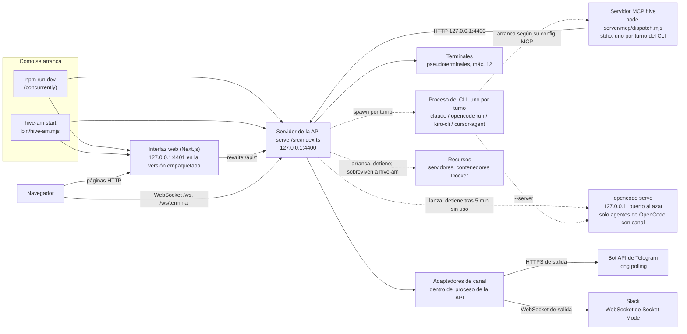

# 6. Procesos y puertos

> 🇬🇧 [Read in English](../en/06-processes-and-ports.md)

Líneas verificadas contra el commit `60f69d8`.

## Qué muestra y cuándo consultarla

Qué procesos corren mientras hive-am está arriba, quién arranca a cada uno, en qué puerto escucha y cuánto vive. Consúltala cuando un puerto esté ocupado, cuando quede un proceso suelto después de detener hive-am, cuando te preguntes por qué un recurso siguió corriendo tras un reinicio, o antes de agregar algo que corra en segundo plano. En corto: dos procesos de larga vida (el servidor de la API en 4400 y la interfaz web en 4401), un proceso del CLI por turno con su propio servidor MCP de corta vida, un `opencode serve` opcional por cada agente de OpenCode con canal, y recursos que sobreviven a hive-am a propósito.

## Diagrama

Las cajas continuas viven lo mismo que hive-am; las flechas punteadas arrancan algo que solo vive un turno o un rato.

## Paso a paso

| Paso | Archivo | Función o símbolo | Qué hace |
|---|---|---|---|
| 1 | `package.json:44` | `concurrently` | `npm run dev` corre el servidor y la web en desarrollo, lado a lado. |
| 2 | `server/package.json:6` | `tsx watch src/index.ts` | El servidor en desarrollo (`start` en la línea 7 lo corre sin vigilar cambios). |
| 3 | `web/package.json:5` | `next dev -p 4401` | La web en desarrollo en 4401 (`next start -p 4401` en la línea 7). |
| 4 | `bin/hive-am.mjs:75` | `specs` | Los dos hijos del lanzador empaquetado: `node server/dist/index.js` y `next start -p <puerto web> -H 127.0.0.1`. |
| 5 | `bin/hive-am.mjs:67` | `HIVE_AM_PORT` | La versión empaquetada rechaza otro puerto de API: su interfaz está construida para hablar con 4400. |
| 6 | `server/src/mcp-config.ts:4` | `API_PORT` | El puerto de la API: `HIVE_AM_PORT`, 4400 por defecto. |
| 7 | `server/src/index.ts:20` | `skills.seedDefaults` | Arranque: skills de fábrica y datos iniciales; luego se vuelven a armar los temporizadores guardados antes del reinicio (recordatorios, avisos de delegación, programaciones, vigilancias) y empieza el sondeo de recursos (`armObjects`, línea 29). |
| 8 | `server/src/index.ts:35` | `upgrade` | Un puerto, dos sockets: `/ws` (el bus, para la interfaz) y `/ws/terminal?id=` (una terminal). |
| 9 | `server/src/index.ts:39` | `isLocalRequest` | Un socket de terminal se rechaza si no viene de esta máquina o si las terminales están apagadas. |
| 10 | `server/src/index.ts:45` | `bus.on` | Cada cliente WebSocket recibe cada mensaje del bus (diagrama 2). |
| 11 | `server/src/index.ts:53` | `server.listen` | Escucha solo en `127.0.0.1` y luego arranca las conexiones de canal (`startAll`). |
| 12 | `web/next.config.mjs:16` | `rewrites` | La web reenvía `/api/*` a la API (`HIVE_AM_API`, por defecto `http://127.0.0.1:4400`). |
| 13 | `web/lib/store.tsx:83` | `NEXT_PUBLIC_HIVE_WS_PORT` | El navegador abre el WebSocket directo al puerto de la API (4400 si no se define). |
| 14 | `server/src/providers/spawn.ts:25` | `spawn` | Cada turno es un proceso hijo del CLI, que se mata cuando el turno termina o se detiene (diagrama 2). |
| 15 | `server/src/mcp-config.ts:6` | `HIVE_CAPS` | El servidor MCP que arranca cada CLI recibe en su entorno el id del agente, la URL de la API y sus capacidades. |
| 16 | `server/mcp/dispatch.mjs:383` | `/api/channel/reply` | El servidor MCP atiende una llamada a una herramienta con una petición HTTP a la API (aquí `channel_reply`). |
| 17 | `server/src/providers/opencode.ts:81` | `channel` | Solo un agente de OpenCode con la capacidad `channel` usa un `opencode serve` persistente. |
| 18 | `server/src/providers/opencode-server.ts:131` | `serve` | `opencode serve --hostname 127.0.0.1 --port 0` con contraseña, uno por agente. |
| 19 | `server/src/providers/opencode-server.ts:18` | `MAX_SERVERS` | 2 como máximo a la vez (`HIVE_AM_OPENCODE_SERVERS`); para hacer lugar se detiene el inactivo usado hace más tiempo. |
| 20 | `server/src/providers/opencode-server.ts:16` | `IDLE_MS` | Un `opencode serve` que pasa 5 minutos sin turnos se detiene. |
| 21 | `server/src/providers/opencode-server.ts:44` | `reapOrphans` | Los servidores que dejó un hive-am que murió sin limpiar quedan en un archivo de pids y se detienen en el siguiente arranque. |
| 22 | `server/src/terminals.ts:19` | `MAX_TERMINALS` | Las terminales son pseudoterminales dentro del proceso de la API, 12 como máximo; `HIVE_AM_TERMINALS=0` las apaga (línea 21). |
| 23 | `server/src/connections/manager.ts:72` | `startAll` | Arranca cada conexión activa: el long polling de Telegram y el Socket Mode de Slack corren dentro del proceso de la API. |
| 24 | `server/src/objects/runner.ts:65` | `detached: true` | Un recurso servidor corre en su propio grupo de procesos con su salida en un archivo de log, así sobrevive a un reinicio de hive-am. |
| 25 | `server/src/objects/index.ts:81` | `armObjects` | Sondea el estado de cada recurso cada pocos segundos (`POLL_MS`, línea 20) y aplica la supervisión a los servidores: uno que terminó solo se vuelve a arrancar, tras una espera creciente, según su política `restart` (`on-failure` o `always`), y uno que sigue fallando sus revisiones de salud se reinicia si `health.restartWhenUnhealthy` está activo; ambos cuentan contra `maxRestarts` (`supervise`, `server/src/objects/supervisor.ts:47`); uno que la persona detuvo nunca se vuelve a arrancar. |
| 26 | `server/src/index.ts:60` | `shutdown` | Al detener: WebSockets, HTTP, terminales, conexiones, base de datos, en ese orden. Los recursos no se detienen. |

## Lo cubren

- `test-cli.ts` (sin modelo): el lanzador `bin/hive-am.mjs` arranca en segundo plano, informa su estado, muestra su log, se detiene y se reinicia, con sustitutos de sus dos hijos y puertos propios.
- `test-terminals.ts` (sin modelo, levanta un servidor): un shell real por `/ws/terminal`, quién puede llegar a él, los límites y el interruptor de apagado.
- `test-http-core.ts` (sin modelo, levanta un servidor): la protección de solo local y el resto de la capa HTTP.
- `test-objects.ts` (sin modelo): un recurso servidor que sigue corriendo y se vuelve a encontrar después de reiniciar hive-am, y los recursos Docker (esa parte se salta sola si Docker no está disponible).
- Ningún script cubre el orden de arranque del servidor ni su secuencia de apagado.

## Casos límite

- **El puerto 4400 ya está en uso**: el servidor lo dice y termina (`server/src/index.ts:50`); en desarrollo `HIVE_AM_PORT` lo cambia.
- **Un paso del apagado se cuelga**: después de 5 segundos el proceso sale de todos modos (`server/src/index.ts:63`).
- **Errores inesperados**: una promesa rechazada que nadie manejó se registra y el servidor sigue atendiendo; una excepción no atrapada se registra y el servidor se apaga en orden con código 1 (`server/src/index.ts:79` y `:80`).
- **hive-am muerto con `kill -9`**: un `opencode serve` que arrancó le sobrevive y se recoge en el siguiente arranque. Un turno en curso se pierde; al reiniciar, el agente vuelve a `idle` (diagrama 9).
- **Los recursos sobreviven a hive-am por diseño** (comentario en `server/src/index.ts:57`); `armObjects` los vuelve a encontrar. Solo el proceso que arrancó un servidor anota cómo terminó (el listener de `exit`, `server/src/objects/runner.ts:70`), así que un servidor que muere mientras hive-am está apagado aparece como `stopped` y no se reinicia solo (`server/src/objects/runner.ts:51`); la supervisión solo reinicia uno cuyo final quedó anotado y que la persona no detuvo (`server/src/objects/supervisor.ts:77`).
- `opencode serve` también arranca un momento para leer el catálogo de modelos (`server/src/providers/opencode-server.ts:84`) y para compactar una conversación (`:196`).
- **Nunca uses 4400 ni 4401 para pruebas**: los scripts que levantan un servidor reciben su propio `HIVE_AM_PORT`, y una segunda web puede usar `NEXT_DIST_DIR` y `HIVE_AM_API`.

## Ver también

- [Referencia 1: visión general](../../reference/es/01-vision-general.md), con el diagrama de arquitectura.
- [Referencia 3: puntos de entrada y ejecución](../../reference/es/03-puntos-de-entrada-y-ejecucion.md) para cada variable de entorno.
- [Diagrama 10: proveedores](10-providers.md) para los procesos de los CLIs y `opencode serve`.
- [Diagrama 2: un turno dentro de un agente](02-agent-turn.md).
