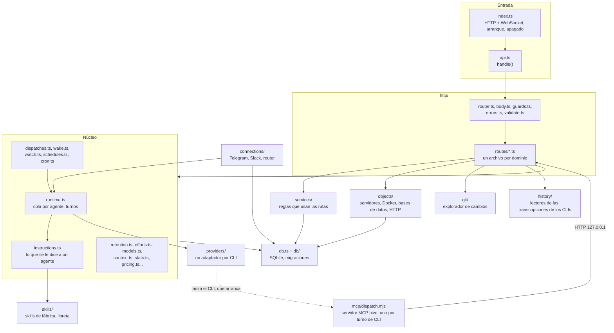

# 7. Mapa del código de `server/src`

> 🇬🇧 [Read in English](../en/07-server-source-map.md)

Líneas verificadas contra el commit `60f69d8`.

## Qué muestra y cuándo consultarla

Cada archivo del servidor (`server/src`) y del servidor MCP de los agentes (`server/mcp/dispatch.mjs`), una línea por archivo, agrupados por capa: "si quieres cambiar X, abre Y". Consúltala antes de un cambio para saber qué archivo tiene la regla que quieres tocar y qué otras páginas de esta carpeta la siguen por un camino completo. Las carpetas en sí se describen en la [referencia 2](../../reference/es/02-estructura-del-proyecto.md); esta página no lo repite, va archivo por archivo.

## Diagrama

Las capas y quién llama a quién. Una flecha quiere decir "importa y llama". La tabla de abajo tiene una fila por archivo.

## Paso a paso

En esta página cada paso es un archivo. Las rutas son relativas a la raíz del repositorio.

### Entrada y capa HTTP

| Archivo | Qué contiene | Ábrelo para cambiar |
|---|---|---|
| `server/src/index.ts` | El orden de arranque (skills de fábrica, datos iniciales, temporizadores que se vuelven a armar, recursos), el servidor HTTP en `127.0.0.1`, los upgrades de `/ws` y `/ws/terminal`, el apagado | qué arranca al iniciar, cómo se reparte el bus por WebSocket, el orden de apagado |
| `server/src/api.ts` | `handle`: importa cada módulo de rutas, CORS, `OPTIONS`, 404, el único lugar donde un error se vuelve respuesta | el orden en que se registran las rutas, los encabezados CORS |
| `server/src/http/router.ts` | La tabla de rutas y la coincidencia de `:name` | cómo se reconoce una ruta |
| `server/src/http/body.ts` | Lectura del cuerpo JSON, límites de tamaño (2 MiB, más para subir archivos), 413 | los límites del cuerpo |
| `server/src/http/errors.ts` | `HttpError` y `toHttpError`: del tipo de error de dominio al código HTTP | qué código recibe un error |
| `server/src/http/guards.ts` | `isLocalRequest` y `requireLocal`: solo esta máquina | qué cuenta como petición local |
| `server/src/http/validate.ts` | Ayudas pequeñas para valores (`text`, `strList`...) | cómo se lee y revisa un campo |
| `server/src/http/routes/agents.ts` | CRUD de agentes, `POST /api/agents/:id/messages` (un mensaje de la web), detener, sesión nueva o retomada, historial, estadísticas, sesiones, archivos del buzón, compactación | todo lo que llaman las pantallas del agente |
| `server/src/http/routes/channel.ts` | `/api/channel/*` (reply, send-file, react, mute), `/api/wake`, `/api/wake-when-done` | el lado HTTP de las herramientas de chat y recordatorios |
| `server/src/http/routes/colonies.ts` | CRUD de colonias | rutas de colonias |
| `server/src/http/routes/connections.ts` | CRUD de conexiones, reinicio, prueba, hilos | las rutas de la pantalla Conexiones |
| `server/src/http/routes/fs.ts` | `GET /api/fs/dirs`, el selector de carpetas | el selector de carpetas y archivos |
| `server/src/http/routes/git.ts` | Todas las rutas `/api/agents/:id/git/*` del explorador de cambios | rutas de git |
| `server/src/http/routes/meta.ts` | Salud, proveedores, modelos y niveles de razonamiento por modelo | lo que ofrece el formulario del agente |
| `server/src/http/routes/notebook.ts` | Las herramientas de la libreta (`/api/notebook/*`) y la pantalla de la libreta | rutas de la libreta |
| `server/src/http/routes/orchestration.ts` | Trabajadores de un orquestador, `/api/dispatch*` y `/api/dispatches` | rutas de delegación (diagrama 4) |
| `server/src/http/routes/resources.ts` | `/api/agent-objects/*` (herramientas del agente) y `/api/objects/*`, `/api/docker/*` (interfaz) | rutas de recursos |
| `server/src/http/routes/schedules.ts` | `/api/schedules/*`: las herramientas de programación y la pantalla de programaciones | rutas de programaciones |
| `server/src/http/routes/skills.ts` | CRUD de skills, uso y `POST /api/skills/read` (`skill_read`) | rutas de skills |
| `server/src/http/routes/terminals.ts` | Listar, abrir y cerrar terminales (solo local) | rutas de terminales |
| `server/src/http/routes/types.ts` | CRUD de tipos de agente y crear un agente desde un tipo | rutas de tipos |

### Reglas de negocio (`services/`)

| Archivo | Qué contiene | Ábrelo para cambiar |
|---|---|---|
| `server/src/services/agents.ts` | Crear, clonar, actualizar y borrar un agente; carpeta efectiva; qué sesión leer; permiso desactualizado; retomar una sesión | la validación de un agente, la clonación |
| `server/src/services/colonies.ts` | Reglas de colonias (una colonia no puede pasarle el modo Plan a un agente con canal) | la validación de colonias |
| `server/src/services/connections.ts` | Limpieza y validación de las personas y grupos de una conexión | la validación de conexiones |
| `server/src/services/notebook.ts` | De dónde vino una nota (fecha, lugar, persona, agente) | la línea de origen de una nota |
| `server/src/services/providers.ts` | CLIs instalados y el modelo inicial de un agente nuevo | la lista de proveedores, los modelos por defecto |
| `server/src/services/schedules.ts` | `allSchedules`: programaciones, recordatorios y vigilancias en una sola lista para la interfaz | la lista de la pantalla de programaciones |

### Núcleo

| Archivo | Qué contiene | Ábrelo para cambiar |
|---|---|---|
| `server/src/runtime.ts` | `bus`, `sendTurn` (cola por agente), `execute` (un turno), `stopAgent`, `cancelQueued`, `abortDispatch`, `startDispatch`, `liveOrigin` | cómo corre un turno (diagrama 2) |
| `server/src/instructions.ts` | `composeInstructions`, `notebookBlock`, `lazySkills`, `mcpCaps` | lo que se le dice a un agente (diagrama 3) |
| `server/src/mcp-config.ts` | `API_PORT` y la configuración MCP que recibe cada CLI | cómo se conecta el servidor MCP `hive` a un CLI |
| `server/src/dispatches.ts` | `startTask`, `taskStatus`, `cancelTask`, `openTasks`, `announce`, `armDispatchNotices` | las delegaciones en segundo plano (diagrama 4) |
| `server/src/wake.ts` | `scheduleWake`, `deliverTo` (la entrega compartida), `armWakeups` | los recordatorios y a dónde van los mensajes posteriores (diagrama 5) |
| `server/src/watch.ts` | `createWatch`, el sondeo, `armWatches` | `wake_when_done` |
| `server/src/schedules.ts` | `createSchedule`, `fire`, `armSchedules`, la lista y la pausa de la interfaz | las programaciones recurrentes |
| `server/src/cron.ts` | `parseCron`, `nextCron`, `minGapMinutes`, zonas horarias | la sintaxis cron y la siguiente ejecución |
| `server/src/retention.ts` | `retentionPass`: qué conserva el registro propio de hive-am y por cuánto tiempo | los topes de retención (diagrama 9) |
| `server/src/efforts.ts` | Niveles de razonamiento por proveedor y modelo, aprendidos y revisados | los niveles de esfuerzo |
| `server/src/models.ts` | Modelos que lista cada CLI, en caché | la lista de modelos |
| `server/src/context.ts` | Tamaño de la ventana de contexto por modelo, aprendido de los CLIs | la barra de contexto |
| `server/src/stats.ts` | `sessionStats`: tokens, costo, herramientas y línea de tiempo de una conversación | las estadísticas de una sesión |
| `server/src/pricing.ts` | Precios estimados por familia de modelos | las estimaciones de costo |
| `server/src/sessions-summary.ts` | Resumen en caché de cada conversación para la lista de Sesiones | la lista de Sesiones |
| `server/src/seed.ts` | `seedIfEmpty` y `dropStarterSkills` en una base de datos nueva | el kit inicial de la primera vez |
| `server/src/terminals.ts` | Shells reales (pseudoterminales) del panel inferior, 12 como máximo | las terminales |
| `server/src/errors.ts` | `DomainError` con su `kind` | la base del error de cada módulo |
| `server/src/types.ts` | `Agent`, `Colony`, `Skill`, `StreamEvent`, `TurnOptions` y los demás tipos compartidos | un tipo compartido |

### Datos (`db.ts`, `db/`)

| Archivo | Qué contiene | Ábrelo para cambiar |
|---|---|---|
| `server/src/db.ts` | Abre la base de datos, corre las migraciones, los almacenes `skills`, `types`, `colonies`, `agents`, `dispatches`, y `resolved` (con la herencia ya aplicada) | una consulta, la herencia, lo que se reinicia al arrancar |
| `server/src/db/migrations.ts` | Todo el esquema como migraciones numeradas (`PRAGMA user_version`) | el esquema (diagrama 8) |
| `server/src/db/json.ts` | `parseJson`: lee una columna JSON sin lanzar errores | la lectura de columnas JSON |

### Proveedores e historial

| Archivo | Qué contiene | Ábrelo para cambiar |
|---|---|---|
| `server/src/providers/index.ts` | `providers` y `runners`: el adaptador de cada CLI | registrar un proveedor |
| `server/src/providers/spawn.ts` | `spawnLines`, `spawnJson`, el temporizador de silencio, SIGTERM y luego SIGKILL | cómo se corre y se detiene el proceso de un CLI |
| `server/src/providers/preamble.ts` | `withInstructions`, `stripInstructions`, `asPositional` | cómo viajan las instrucciones dentro de un mensaje |
| `server/src/providers/claude.ts` | `runClaude` | las opciones de Claude Code y la lectura de su flujo |
| `server/src/providers/opencode.ts` | `runOpencode`, `opencodeRunFlags`, las reglas de permisos de OpenCode | las opciones de OpenCode y la lectura de su flujo |
| `server/src/providers/opencode-server.ts` | Un `opencode serve` por agente con canal: grupo de servidores, cierre por inactividad, archivo de pids, compactación | el servidor persistente de OpenCode |
| `server/src/providers/kiro.ts` | `runKiro`, las herramientas de confianza según el permiso | las opciones de Kiro y la lectura de su flujo |
| `server/src/providers/cursor.ts` | `runCursor`, `cursorPermissions`, `writeCursorMcp` | las opciones de Cursor, sus reglas y `mcp.json` |
| `server/src/history/index.ts` | `historyReaders`, `readHistory`, `historySig` | qué lector usa cada proveedor |
| `server/src/history/lines.ts` | `jsonLines`: lee una transcripción JSONL y se salta una línea dañada | la lectura de JSONL |
| `server/src/history/claude.ts` | Lee las transcripciones de Claude Code | cómo se muestra una conversación de Claude |
| `server/src/history/opencode.ts` | Lee la base de datos de OpenCode | cómo se muestra una conversación de OpenCode |
| `server/src/history/kiro.ts` | Lee las sesiones de Kiro y su medición | cómo se muestra una conversación de Kiro |
| `server/src/history/cursor.ts` | Lee las transcripciones de Cursor | cómo se muestra una conversación de Cursor |

### Conexiones (`connections/`)

| Archivo | Qué contiene | Ábrelo para cambiar |
|---|---|---|
| `server/src/connections/index.ts` | Registra los adaptadores de Telegram y Slack | agregar una plataforma |
| `server/src/connections/manager.ts` | Arrancar y detener adaptadores, limpieza periódica, `channelReply`, `channelSendFile`, `channelReact`, `channelMute` (con el filtro de secretos) | lo que hacen las herramientas de chat (diagrama 1) |
| `server/src/connections/router.ts` | `handleInbound`, `deliver`, `deliverScheduled`: acceso, comandos, plática de grupo, el turno y su resultado | cómo se maneja un mensaje que llega (diagrama 1) |
| `server/src/connections/telegram.ts` | Adaptador de Telegram: long polling, a quién va dirigido, envío, archivos, reacciones | el comportamiento de Telegram |
| `server/src/connections/slack.ts` | Adaptador de Slack: Socket Mode, a quién va dirigido, envío, archivos, reacciones | el comportamiento de Slack |
| `server/src/connections/fake.ts` | Plataforma en memoria para los scripts de simulación | el arnés de pruebas |
| `server/src/connections/types.ts` | `ChannelAdapter`, `Inbound`, `Origin`, `Connection` | el contrato de un adaptador |
| `server/src/connections/store.ts` | `connections`, `threads`, `threadMessages` | las filas de conexiones e hilos |
| `server/src/connections/addressing.ts` | `vocativeOf`, `calledByName`, `directedAtOther`, `firstNames` | a quién va un mensaje de grupo |
| `server/src/connections/prompt.ts` | `channelPrompt` (el encabezado `[hive:channel]`), `uploadsBlock`, `nowStamp` | lo que recibe el agente por un mensaje de chat |
| `server/src/connections/secrets.ts` | `findSecret`, `SECRET_REFUSAL` | qué secretos se bloquean |
| `server/src/connections/rate.ts` | `allow`: límite de ventana deslizante | los límites de avisos y de plática |
| `server/src/connections/format.ts` | `splitMessage`, `mdToTelegramHtml`, `mdToSlackMrkdwn` | cómo se da formato y se parte el texto |
| `server/src/connections/outbound.ts` | `resolveSendable`: revisa un archivo que envía un agente | qué archivos pueden salir de la máquina |
| `server/src/connections/files.ts` | Archivos que manda la gente: se guardan por agente y se limpian después de `RETENTION_DAYS` | los archivos recibidos |
| `server/src/connections/vision.ts` | Describe imágenes con un modelo de imágenes | las descripciones de imágenes |
| `server/src/connections/channel-skill.ts` | Mantiene las skills "Chat channels" y "Wake-ups" en los agentes con conexión | las skills que acompañan a una conexión |
| `server/src/connections/public.ts` | La conexión como la ve el navegador (secretos enmascarados) | lo que recibe la interfaz |
| `server/src/connections/rules.ts` | `channelPermissionError`: un agente vinculado no puede estar en modo Plan | esa regla de permisos |

### Recursos (`objects/`)

| Archivo | Qué contiene | Ábrelo para cambiar |
|---|---|---|
| `server/src/objects/index.ts` | `armObjects` (sondeo de estados), acciones, la lista que lee la interfaz | las acciones y estados de los recursos |
| `server/src/objects/model.ts` | Tipos de recurso y sus tipos de configuración | la configuración de un recurso |
| `server/src/objects/store.ts` | `objectsStore`: filas de `colony_objects` y `object_agents` | las filas de recursos |
| `server/src/objects/runner.ts` | Un recurso servidor: un comando en su propio grupo de procesos, que se vuelve a encontrar después de un reinicio | cómo corre un servidor |
| `server/src/objects/supervisor.ts` | Reinicios automáticos y revisiones de salud de los servidores | la supervisión |
| `server/src/objects/docker.ts` | Contenedores Docker y proyectos compose mediante el comando `docker` | el comportamiento de Docker |
| `server/src/objects/docker-info.ts` | Lo que sabe Docker (contenedores, imágenes, volúmenes, redes) para los formularios | las sugerencias de Docker |
| `server/src/objects/files.ts` | Editar o copiar un archivo compose o un Dockerfile | la edición de archivos |
| `server/src/objects/exec.ts` | `execCapture`: corre un programa sin shell | correr programas externos |
| `server/src/objects/stats.ts` | CPU y memoria de un servidor o un contenedor | el uso de un recurso |
| `server/src/objects/database.ts` | Recursos de base de datos: cuatro motores, una interfaz pequeña | las conexiones a bases de datos |
| `server/src/objects/driver-props.ts` | Propiedades del driver que puede ajustar un recurso de base de datos | las opciones del driver |
| `server/src/objects/db-history.ts` | Consultas ejecutadas y guardadas, en disco | el historial de consultas |
| `server/src/objects/agent.ts` | Lo que puede hacer un agente con "Colony resources" | el acceso de un agente a los recursos |
| `server/src/objects/agent-db.ts` | Lo que puede hacer un agente con "Database management" | el acceso de un agente a las bases de datos |
| `server/src/objects/http.ts` | Recursos HTTP: archivos `.http` / `.rest` | las peticiones HTTP |
| `server/src/objects/http-script.ts` | Manejadores de respuesta de un archivo `.http`, ejecutados de forma segura | los scripts de `.http` |
| `server/src/objects/http-history.ts` | Ejecuciones de un recurso HTTP, en disco | el historial HTTP |

### Git, skills y MCP

| Archivo | Qué contiene | Ábrelo para cambiar |
|---|---|---|
| `server/src/git/repo.ts` | Git de solo lectura (estado, árbol, diff, contenido) | lo que lee el explorador de cambios |
| `server/src/git/ops.ts` | El historial y las escrituras (commit, pull, push, fetch, ramas) | las acciones de git |
| `server/src/git/switch.ts` | Cambio de rama que lleva o guarda en stash los cambios locales | el cambio de rama |
| `server/src/git/browse.ts` | Ramas, etiquetas, comparaciones, búsqueda e imágenes en una versión | la navegación del repositorio |
| `server/src/skills/defaults.ts` | Las skills que vienen con hive-am y sus ids | una skill de fábrica |
| `server/src/skills/notebook.ts` | `notebooks`: el almacén de la libreta, sus lectores, límites y versiones | la libreta |
| `server/mcp/dispatch.mjs` | El servidor MCP `hive`: anuncia herramientas según `HIVE_CAPS` y convierte cada llamada en una petición a la API | una herramienta del agente (nombre, esquema, qué ruta llama) |

## Lo cubren

No aplica: esta página relaciona archivos, no un camino que se ejecuta. En su lugar, la tabla se revisa de forma mecánica: cada archivo de `server/src` y `server/mcp` (`git ls-files server/src server/mcp`) aparece una vez y cada archivo de la tabla existe.

## Casos límite

- Un archivo nuevo en `server/src` necesita su fila aquí; la revisión de arriba falla hasta que la tenga.
- Algunos nombres son más viejos que su significado: los "objects" son lo que la interfaz llama recursos (las rutas conservan `/api/objects`), y `mcp/dispatch.mjs` atiende todas las herramientas hive, no solo `dispatch`.
- `connections/rules.ts` solo tiene la regla del modo Plan; las reglas de acceso de un chat están en `connections/router.ts` (`senderOf`), y el filtro de secretos se aplica en `connections/manager.ts`.

## Ver también

- [Referencia 2: estructura del proyecto](../../reference/es/02-estructura-del-proyecto.md) para las carpetas y el lado web.
- [Diagrama 6: procesos y puertos](06-processes-and-ports.md) para lo que corre.
- [Diagrama 8: modelo de datos](08-data-model.md) para las tablas detrás de `db.ts`.
