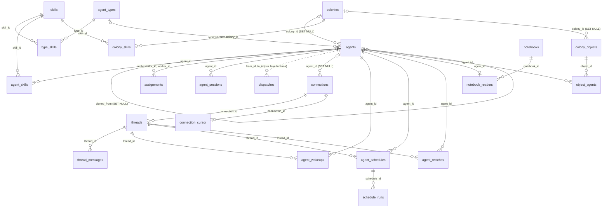

# 8. Modelo de datos

> 🇬🇧 [Read in English](../en/08-data-model.md)

Líneas verificadas contra el commit `60f69d8`.

## Qué muestra y cuándo consultarla

Las tablas SQLite de `~/.hive-am/hive-am.db` y cómo se apuntan entre sí, cómo se crea y se actualiza el esquema cuando el servidor abre la base de datos, y qué migración creó cada tabla o agregó cada columna. Consúltala antes de agregar una columna o una tabla, antes de escribir una consulta que una dos de ellas, o para saber qué se va cuando se borra un agente, una conexión o una colonia. Las conversaciones en sí no están aquí: viven en el almacén propio de cada CLI y hive-am solo guarda un apuntador a ellas ([referencia 8](../../reference/es/08-sesiones-e-historial.md)).

## Diagrama

Las líneas continuas son llaves foráneas; la línea punteada de `agents` a `dispatches` es un id simple sin llave foránea. Las columnas se omiten: las tablas de abajo las listan.

## Paso a paso

### Cómo se crea y se actualiza el esquema

| Paso | Archivo | Función o símbolo | Qué hace |
|---|---|---|---|
| 1 | `server/src/db.ts:10` | `DATA_DIR` | La carpeta de datos: `HIVE_AM_HOME`, si no `~/.hive-am`. |
| 2 | `server/src/db.ts:13` | `new Database` | Abre `hive-am.db` en esa carpeta, con WAL y llaves foráneas activadas (líneas 14 y 15). |
| 3 | `server/src/db.ts:18` | `migrate(db)` | Pone el esquema al día antes de que cualquier módulo prepare una sentencia. |
| 4 | `server/src/db/migrations.ts:279` | `migrate` | Lee `PRAGMA user_version` y corre cada migración con una versión mayor. |
| 5 | `server/src/db/migrations.ts:284` | `db.transaction` | Cada migración y su nuevo `user_version` se escriben en una sola transacción. |
| 6 | `server/src/db/migrations.ts:15` | `addColumn` | Agrega una columna solo si falta, así una migración puede correr sobre cualquier base de datos anterior. |
| 7 | `server/src/db/migrations.ts:276` | `SCHEMA_VERSION` | La versión del esquema es la de la última migración (hoy, 9). |
| 8 | `server/src/db.ts:291` | `status='idle'` | Al arrancar, los agentes que un fallo dejó en `running` vuelven a `idle`. |
| 9 | `server/src/db.ts:292` | `interruptLeftovers` | Al arrancar, las delegaciones que quedaron en `queued` o `running` pasan a `interrupted`. |

### Las tablas

Todas las tablas vienen de la migración 1 (`baseline`), salvo `notebooks` y `notebook_readers` (migración 6). La migración base es el esquema como estaba antes de versionarlo, escrita para no hacer nada en una base de datos que ya lo tenía. Una de sus tablas, `agent_notebooks`, ya no existe: la migración 6 mueve sus filas y la borra.

| Tabla | Definida en | Para qué sirve | La crea | Columnas agregadas después |
|---|---|---|---|---|
| `skills` | `server/src/db/migrations.ts:27` | La biblioteca de skills | 1 (baseline) | `load` (en 1) |
| `agent_types` | `server/src/db/migrations.ts:31` | Plantillas con las que se crean agentes | 1 (baseline) | `effort` (8) |
| `type_skills` | `server/src/db/migrations.ts:37` | Skills de un tipo | 1 (baseline) | `load` (en 1) |
| `agents` | `server/src/db/migrations.ts:42` | Agentes: proveedor, modelo, permiso, carpeta, sesión actual, estado | 1 (baseline) | `colony_id`, `overrides`, `session_cwd`, `instr_hash` (en 1); `browser` (3); `cloned_from` (7); `effort` (8) |
| `agent_skills` | `server/src/db/migrations.ts:50` | Skills de un agente | 1 (baseline) | `load` (en 1) |
| `assignments` | `server/src/db/migrations.ts:55` | A qué trabajadores puede delegar un orquestador | 1 (baseline) | ninguna |
| `colonies` | `server/src/db/migrations.ts:60` | Colonias: carpeta compartida, permiso, prompt, lo que heredan sus miembros | 1 (baseline) | ninguna |
| `colony_skills` | `server/src/db/migrations.ts:65` | Skills de una colonia | 1 (baseline) | `load` (en 1) |
| `agent_sessions` | `server/src/db/migrations.ts:71` | Cada conversación nativa que usó un agente (un apuntador, no el texto) | 1 (baseline) | `kind`, `from_id`, `task` (en 1); `permission` (4) |
| `dispatches` | `server/src/db/migrations.ts:78` | El registro de delegaciones: quién le pidió qué a quién, estado y resultado | 1 (baseline) | `session_id` (en 1); `mode`, `origin`, `notified_at`, `read_at` (9); índice sobre `created_at` (5) |
| `seeded_skills` | `server/src/db/migrations.ts:82` | Skills de fábrica que ya se agregaron una vez, para no volver a agregar una que se borró | 1 (baseline) | ninguna |
| `connections` | `server/src/db/migrations.ts:85` | Conexiones de Telegram y Slack y el agente que responde por cada una | 1 (baseline) | ninguna |
| `threads` | `server/src/db/migrations.ts:91` | Chats, temas e hilos conocidos, y a dónde va una respuesta | 1 (baseline) | `muted`, `seen_id` (en 1) |
| `thread_messages` | `server/src/db/migrations.ts:97` | Mensajes que entran y salen de cada hilo | 1 (baseline) | `files` (en 1) |
| `connection_cursor` | `server/src/db/migrations.ts:103` | Hasta dónde llegó el sondeo de una plataforma | 1 (baseline) | ninguna |
| `agent_wakeups` | `server/src/db/migrations.ts:109` | Peticiones de `wake_me` pendientes | 1 (baseline) | `req_id`, `req_name` (en 1) |
| `agent_schedules` | `server/src/db/migrations.ts:114` | Programaciones recurrentes | 1 (baseline) | `req_id`, `req_name` (en 1) |
| `schedule_runs` | `server/src/db/migrations.ts:121` | Las últimas ejecuciones de cada programación | 1 (baseline) | ninguna |
| `agent_watches` | `server/src/db/migrations.ts:126` | Procesos vigilados para `wake_when_done` | 1 (baseline) | ninguna |
| `agent_notebooks` | `server/src/db/migrations.ts:134` | La primera tabla de libretas, una por agente (la borra la 6) | 1 (baseline) | se borra en 6 |
| `colony_objects` | `server/src/db/migrations.ts:139` | Recursos: servidores, Docker, bases de datos, HTTP | 1 (baseline) | ninguna |
| `object_agents` | `server/src/db/migrations.ts:145` | El agente elegido para cuidar un recurso | 1 (baseline) | ninguna |
| `notebooks` | `server/src/db/migrations.ts:215` | Una libreta como fila propia | 6 (shared-notebook) | ninguna |
| `notebook_readers` | `server/src/db/migrations.ts:219` | Qué agente lee qué libreta y qué ya vio | 6 (shared-notebook) | ninguna |

"En 1" quiere decir que la columna la agrega `addColumn` dentro de la migración base (`server/src/db/migrations.ts:152` en adelante), para bases de datos anteriores al versionado; no es una versión aparte. La migración 2 (`renames`) solo cambia nombres en los datos. Ningún otro archivo crea tablas: los módulos dueños de una (`connections/store.ts`, `objects/store.ts`, `skills/notebook.ts`, `wake.ts`, `watch.ts`, `schedules.ts`) solo la leen y escriben.

### Quién lee y escribe cada grupo

| Paso | Archivo | Función o símbolo | Qué hace |
|---|---|---|---|
| 1 | `server/src/db.ts:205` | `agents` | Agentes, sus skills, trabajadores y sesiones. |
| 2 | `server/src/db.ts:260` | `dispatches` | El registro de delegaciones y sus cambios de estado. |
| 3 | `server/src/connections/store.ts:21` | `connections` | Conexiones; `threads` y `threadMessages` siguen en el mismo archivo. |
| 4 | `server/src/skills/notebook.ts:62` | `notebooks` | Las libretas y sus lectores. |
| 5 | `server/src/objects/store.ts:43` | `objectsStore` | Los recursos y el agente de cada uno. |
| 6 | `server/src/retention.ts:21` | `retentionPass` | Retira mensajes de hilos, delegaciones y sesiones viejos (diagrama 9). |

## Lo cubren

- `test-migrations.ts` (sin modelo): una base de datos escrita por una versión anterior abre y migra sin perder filas, abrirla una segunda vez no cambia nada y una base de datos nueva queda con el mismo esquema.
- `test-retention.ts` (sin modelo): qué se retira de `thread_messages`, `dispatches` y `agent_sessions`, y que nada reciente se pierde.

## Casos límite

- **Una migración que falla** se revierte junto con su `user_version`, así que el siguiente arranque la vuelve a intentar desde el mismo punto.
- **Borrar un agente** elimina sus skills, asignaciones, sesiones, recordatorios, programaciones, vigilancias, su lector de libreta y sus asignaciones de recursos (`ON DELETE CASCADE`), desvincula sus conexiones y los agentes clonados de él (`SET NULL`) y deja sus filas de `dispatches`: no tienen llave foránea, así que el registro muestra "a removed agent" (`server/src/dispatches.ts:24`).
- **Borrar una colonia** deja a sus miembros y recursos sin colonia (`SET NULL`) y elimina sus propias asignaciones de skills.
- **Una libreta que ya nadie lee** la borra el trigger `notebook_orphan` (`server/src/db/migrations.ts:225`).
- **Una tabla `wakeups` vieja** de las primeras versiones la borra la migración base (`server/src/db/migrations.ts:108`).
- **Topes de retención**: 500 mensajes por hilo y 30 días, 200 delegaciones, 50 sesiones de delegación por agente, 90 días para una conversación que el CLI ya no tiene (`server/src/retention.ts:11`).
- El diagrama está simplificado (sin columnas ni índices); las tablas de arriba son exactas.

## Ver también

- [Referencia 4: almacenamiento](../../reference/es/04-almacenamiento.md), con su propio diagrama de relaciones y todas las columnas.
- [Diagrama 9: ciclo de vida de un agente](09-agent-lifecycle.md) para lo que borra la retención.
- [Diagrama 7: mapa del código](07-server-source-map.md).
