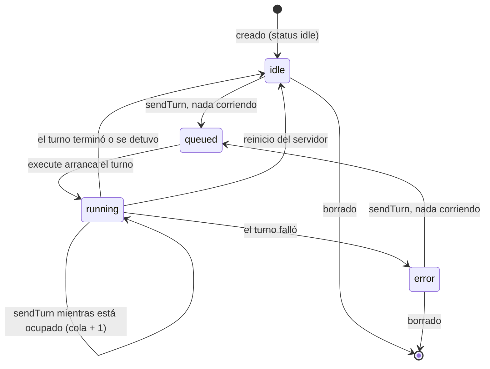
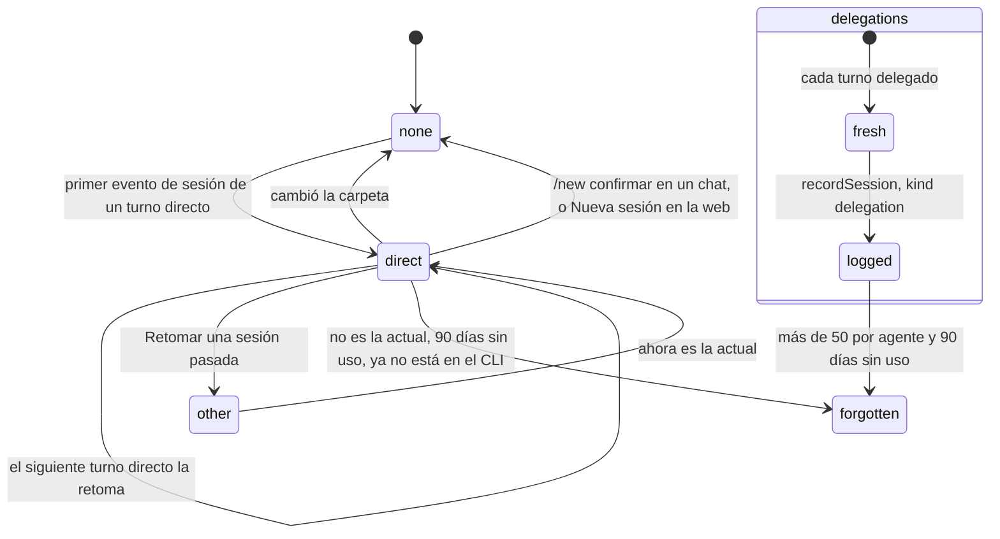

# 9. Ciclo de vida de un agente

> 🇬🇧 [Read in English](../en/09-agent-lifecycle.md)

Líneas verificadas contra el commit `60f69d8`.

## Qué muestra y cuándo consultarla

Los estados por los que pasa un agente desde que se crea (idle, queued, running, error) y qué lo mueve entre ellos; los estados de sus conversaciones (ninguna, una sesión directa que se retoma en cada turno, un reinicio, sesiones de delegación que nunca son la actual); y lo que la retención va quitando del registro propio de hive-am. Consúltala cuando el estado de un agente se vea mal, cuando una conversación haya empezado de cero sin esperarlo, o para saber qué sobrevive a un reinicio.

## Diagrama

El estado de un agente. `queued` solo se informa en el bus, con un conteo; la columna `status` guardada tiene `idle`, `running` o `error`.

La conversación de un agente. Las delegaciones nunca la tocan.

## Paso a paso

| Paso | Archivo | Función o símbolo | Qué hace |
|---|---|---|---|
| 1 | `server/src/services/agents.ts:22` | `create` | Crea el agente (desde el formulario, `createAgent` línea 31; desde un tipo, `spawnFromType` línea 39; como clon, `cloneAgent` línea 55) y lo vuelve a borrar si no tiene carpeta de trabajo. |
| 2 | `server/src/db.ts:210` | `create` | Inserta la fila con estado `idle` y sin sesión, sus skills y sus trabajadores, en una sola transacción. |
| 3 | `server/src/runtime.ts:14` | `status` | El mensaje de estado del bus: `idle`, `running`, `error` o `queued`, con el conteo de la cola. |
| 4 | `server/src/runtime.ts:60` | `queued` | Un mensaje nuevo informa `queued`, o `running` si ya hay un turno en curso. |
| 5 | `server/src/runtime.ts:106` | `agents.setStatus(agentId, 'running')` | Empieza el turno: estado guardado `running` (`agents.setStatus`, `server/src/db.ts:229`). |
| 6 | `server/src/runtime.ts:145` | `agents.setStatus` | Termina el turno: `error` si falló, si no `idle` (un turno detenido queda `idle`). |
| 7 | `server/src/runtime.ts:150` | `stopAgent` | Detener aborta el turno en curso; los mensajes en cola se quedan. |
| 8 | `server/src/runtime.ts:158` | `cancelQueued` | Una delegación cancelada sale del conteo de la cola de inmediato (diagrama 4). |
| 9 | `server/src/db.ts:291` | `status='idle'` | Al arrancar, un agente que quedó en `running` vuelve a `idle`; su sesión sigue intacta en disco. |
| 10 | `server/src/services/agents.ts:94` | `removeAgent` | Detiene al agente y lo borra (lo que se va con él: diagrama 8). |
| 11 | `server/src/runtime.ts:125` | `agents.setSession` | El primer id de sesión de un turno directo se vuelve la sesión del agente (`setSession`, `server/src/db.ts:230`): además limpia `instr_hash` y registra la sesión con su permiso. |
| 12 | `server/src/runtime.ts:85` | `agents.setSession(raw, null)` | La carpeta cambió desde que empezó la sesión: el siguiente turno empieza una nueva. |
| 13 | `server/src/connections/router.ts:144` | `name === 'new'` | `/new confirmar` de un administrador en un chat detiene al agente y suelta su sesión (línea 147). |
| 14 | `server/src/http/routes/agents.ts:68` | `/api/agents/:id/new-session` | La opción Nueva sesión de la web: detener y soltar la sesión. |
| 15 | `server/src/services/agents.ts:115` | `resumeSession` | Vuelve a hacer actual una sesión directa pasada; una delegada no puede serlo. |
| 16 | `server/src/runtime.ts:124` | `agents.recordSession` | La sesión de una delegación solo se registra como `delegation` (`server/src/db.ts:240`), con quién la pidió y la tarea. |
| 17 | `server/src/history/index.ts:21` | `readHistory` | Cualquiera de estas conversaciones se lee de la transcripción propia del CLI. |
| 18 | `server/src/retention.ts:21` | `retentionPass` | Retira lo viejo del registro de hive-am: mensajes de hilos más allá de 500 por hilo y 30 días, delegaciones más allá de 200, sesiones de delegación más allá de 50 por agente y 90 días sin uso, sesiones directas con 90 días sin uso que el CLI ya no tiene. |
| 19 | `server/src/connections/manager.ts:67` | `housekeeping` | Corre la retención (y limpia los archivos recibidos) al arrancar y cada 6 horas (`startAll`, línea 72). |

## Lo cubren

- `test-runtime-recovery.ts` (sin modelo): un turno que falla mientras se prepara deja al agente en `error`, no en `running`, y el siguiente mensaje lo regresa a `idle`.
- `test-retention.ts` (sin modelo): lo que quita la retención y lo que conserva.
- `test-session-permission.ts` (sin modelo): retomar una sesión y la marca de permiso desactualizado de una conversación de OpenCode.
- `test-agent-clone.ts` (sin modelo, levanta un servidor): un clon copia la configuración y ninguna de las sesiones.
- Ningún script cubre las transiciones de estado en conjunto.

## Casos límite

- **`queued` nunca se guarda**: tras un reinicio la cola está vacía y el estado guardado es `idle` o `error` (diagrama 2).
- **Un turno detenido termina en `idle`**, no en `error`: no tiene error, solo el resumen "Stopped".
- **Borrar un agente** detiene primero su turno en curso; no existe un estado en el que un agente se borre después de algunos días.
- **La retención nunca toca las conversaciones propias de los CLIs**, solo la copia de la lista que guarda hive-am (`server/src/retention.ts:7`). La sesión actual de un agente nunca se olvida.
- **Un permiso cambiado** no reinicia una sesión de OpenCode; en su lugar el agente queda marcado (`permissionStale`, `server/src/services/agents.ts:109`).
- **Las sesiones de delegación nunca se vuelven la actual**: la conversación propia del agente no se llena de trabajo delegado.

## Ver también

- [Referencia 8: sesiones e historial](../../reference/es/08-sesiones-e-historial.md), con el ciclo de vida de una sesión directa.
- [Diagrama 2: un turno dentro de un agente](02-agent-turn.md), [diagrama 8: modelo de datos](08-data-model.md), [diagrama 4: una delegación](04-dispatch.md).
