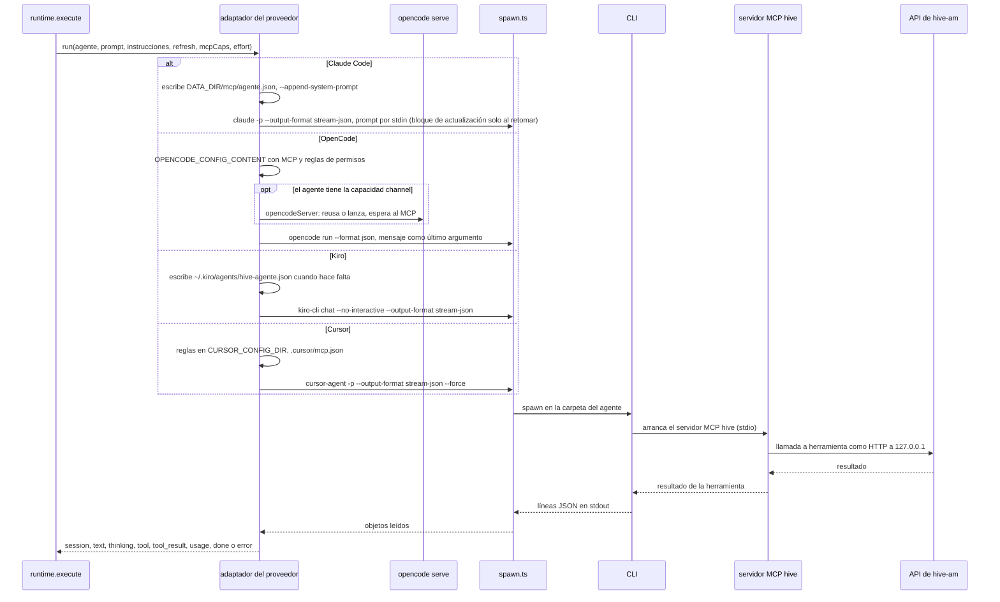

# 10. Proveedores

> 🇬🇧 [Read in English](../en/10-providers.md)

Líneas verificadas contra el commit `60f69d8`.

## Qué muestra y cuándo consultarla

Los cuatro CLIs que maneja hive-am (Claude Code, OpenCode, Kiro y Cursor) lado a lado: cómo les llegan el mensaje y las instrucciones, cómo se retoma una sesión, cómo se conecta el servidor MCP hive, cómo el nivel de permiso se vuelve reglas propias del CLI, qué imprime el CLI y qué procesos extra necesita. Cada adaptador es un generador asíncrono que convierte la salida de un CLI en `StreamEvent`s para el runtime (diagrama 2). Consúltala antes de cambiar una opción, cuando un proveedor se comporte distinto de los demás, o antes de agregar un quinto.

## Diagrama

Un turno, desde la llamada del runtime hasta que termina el CLI, con la parte que cambia según el proveedor en bloques `alt`.

## Paso a paso

### Lado a lado

| | Claude Code | OpenCode | Kiro | Cursor |
|---|---|---|---|---|
| Comando | `claude -p --output-format stream-json` | `opencode run --format json` | `kiro-cli chat --no-interactive --output-format stream-json` | `cursor-agent -p --output-format stream-json --stream-partial-output` |
| Mensaje | por stdin | último argumento | último argumento | último argumento |
| Instrucciones | `--append-system-prompt` en cada turno; `withInstructions` en el mensaje solo al retomar (la actualización) | `withInstructions` en el mensaje | `withInstructions` en el mensaje | `withInstructions` en el mensaje |
| Retomar | `--resume <id>` | `-s <id>`, solo si la sesión es de la misma carpeta | `--resume-id <id>` | `--resume <id>` |
| Config MCP | archivo `DATA_DIR/mcp/<agente>.json` y `--mcp-config` | `OPENCODE_CONFIG_CONTENT` en el entorno | un perfil generado `~/.kiro/agents/hive-<agente>.json` y `--agent` | `<carpeta>/.cursor/mcp.json` con valores `${env:...}`, y `--approve-mcps` |
| Permisos | `--permission-mode`, más una lista de exclusión para ediciones | reglas de permisos de OpenCode en la config | herramientas de confianza y rutas permitidas en el perfil, `--trust-all-tools` para acceso total | reglas `permissions` en un `cli-config.json` (`CURSOR_CONFIG_DIR`), `--mode plan` para solo lectura |
| Esfuerzo | `--effort` | `#variante` en el modelo | `--effort` | ninguno (es parte del id del modelo) |
| Procesos extra | ninguno | `opencode serve` para agentes con canal | ninguno | ninguno |
| Historial | `~/.claude/projects` | la base de datos de OpenCode | `~/.kiro/sessions/cli` | `~/.cursor/projects` |

### De dónde sale cada fila

| Paso | Archivo | Función o símbolo | Qué hace |
|---|---|---|---|
| 1 | `server/src/providers/index.ts:13` | `providers` | Un adaptador por proveedor; `runners` (línea 21) es lo que llama el runtime. |
| 2 | `server/src/providers/claude.ts:16` | `runClaude` | Claude Code. |
| 3 | `server/src/providers/claude.ts:18` | `--permission-mode` | Las opciones de cada turno, con el permiso del agente como modo propio de Claude. |
| 4 | `server/src/providers/claude.ts:19` | `CLAUDE_EDIT_DENY` | Al editar (`acceptEdits`) no puede tocar `.git`, `*.pem` ni `*.key` (lista en la línea 13). |
| 5 | `server/src/providers/claude.ts:20` | `--resume` | Retoma la sesión del agente. |
| 6 | `server/src/providers/claude.ts:27` | `--append-system-prompt` | Las instrucciones como prompt de sistema, la única copia que recibe una sesión nueva. |
| 7 | `server/src/providers/claude.ts:31` | `--chrome` | Un agente con el interruptor Browser (y que no esté en modo Plan) maneja el Chrome de la persona. |
| 8 | `server/src/providers/claude.ts:33` | `DATA_DIR` | Escribe el archivo de config MCP y permite `mcp__hive`. |
| 9 | `server/src/providers/claude.ts:44` | `stdin: prompt` | Claude es el único proveedor que recibe el mensaje por stdin: tal cual en una sesión nueva, con el bloque de actualización delante en una retomada cuyas instrucciones cambiaron (línea 28). |
| 10 | `server/src/providers/opencode.ts:58` | `runOpencode` | OpenCode. |
| 11 | `server/src/providers/opencode.ts:38` | `opencodeRunFlags` | Lee una vez `opencode run --help` y solo pasa las opciones que conoce esa versión (la 1.x y la 2.x son distintas). |
| 12 | `server/src/providers/opencode.ts:65` | `resume` | Una sesión que empezó en otra carpeta no se retoma. |
| 13 | `server/src/providers/opencode.ts:68` | `#${o.effort}` | El esfuerzo va como variante del modelo. |
| 14 | `server/src/providers/opencode.ts:20` | `opencodePermissions` | Los niveles de permiso como reglas de OpenCode: solo lectura niega ediciones y comandos; editar niega comandos, archivos protegidos y carpetas fuera de la del agente. |
| 15 | `server/src/providers/opencode.ts:74` | `OPENCODE_CONFIG_CONTENT` | La config (MCP, reglas, `question` negada) va en el entorno. |
| 16 | `server/src/providers/opencode.ts:81` | `channel` | Solo un agente con la capacidad `channel` usa un servidor persistente; cualquier otro corre con `--standalone` (línea 87) o con el comportamiento de la 1.x. |
| 17 | `server/src/providers/opencode-server.ts:154` | `opencodeServer` | Reusa el `opencode serve` del agente o lanza uno (se reinicia si cambió la carpeta o la config, línea 157). |
| 18 | `server/src/providers/opencode-server.ts:112` | `mcpSettled` | Espera a que los servidores MCP de la config se conecten, así la primera llamada a una herramienta hive no falla. |
| 19 | `server/src/providers/opencode.ts:89` | `asPositional` | El mensaje como último argumento; si empieza con guion se le pone un espacio para que no se lea como opción (`server/src/providers/preamble.ts:29`). |
| 20 | `server/src/providers/kiro.ts:23` | `runKiro` | Kiro. |
| 21 | `server/src/providers/kiro.ts:27` | `o.mcpCaps.length` | Con herramientas hive o límites de rutas se genera un perfil (`kiroProfile`, `server/src/mcp-config.ts:25`) que se pasa con `--agent`. |
| 22 | `server/src/providers/kiro.ts:17` | `kiroEditAccess` | Editar confía en las herramientas de archivos y web (línea 11) y deja que `fs_write` escriba solo dentro de la carpeta del agente. |
| 23 | `server/src/providers/kiro.ts:35` | `--trust-all-tools` | El acceso total confía en todas las herramientas. |
| 24 | `server/src/providers/kiro.ts:36` | `--resume-id` | Retoma la sesión. |
| 25 | `server/src/providers/cursor.ts:106` | `runCursor` | Cursor. |
| 26 | `server/src/providers/cursor.ts:108` | `--force` | Cada turno corre con `--force` (sin él se rechaza cada llamada MCP); las reglas ponen los límites. |
| 27 | `server/src/providers/cursor.ts:18` | `cursorPermissions` | Solo lectura niega escrituras y el shell; editar niega el shell y los archivos protegidos; el acceso total no tiene reglas. |
| 28 | `server/src/providers/cursor.ts:112` | `CURSOR_CONFIG_DIR` | Una carpeta de config del agente con el `cli-config.json` de la persona más esas reglas, que se reescribe en cada turno. |
| 29 | `server/src/providers/cursor.ts:60` | `writeCursorMcp` | Mezcla la entrada `hive` en el `.cursor/mcp.json` de la carpeta (`cursorMcpServer`, `server/src/mcp-config.ts:36`) y deja el archivo fuera de git (`excludeFromGit`, línea 41). |
| 30 | `server/src/providers/cursor.ts:114` | `--resume` | Retoma la sesión; no hay opción de esfuerzo (línea 116). |
| 31 | `server/src/providers/spawn.ts:7` | `KILL_GRACE_MS` | Común a los cuatro: detener manda SIGTERM y, tras 5 s, SIGKILL; el temporizador de silencio (diagrama 2); el final de stderr en los errores. |
| 32 | `server/src/history/index.ts:14` | `historyReaders` | Un lector de transcripciones por proveedor (`server/src/history/claude.ts`, `opencode.ts`, `kiro.ts`, `cursor.ts`). |

## Lo cubren

- `test-claude-args.ts` (sin modelo, CLI de mentira): las opciones de Claude para cada permiso, retomar, modelo, esfuerzo, navegador, MCP y carpeta de entrada, y lo que llega por stdin en una sesión nueva y en una retomada.
- `test-provider-args.ts` (sin modelo, CLIs de mentira): OpenCode, Kiro y Cursor reciben el mensaje una sola vez, como último argumento; las opciones de Cursor para retomar, modelo, esfuerzo y cada permiso.
- `test-providers-common.ts` (sin modelo): las ayudas compartidas de spawn y que hay un lector de historial para cada proveedor.
- `test-cursor-provider.ts` (sin modelo, salida grabada por un CLI de mentira): los eventos de Cursor, las reglas de permisos, `.cursor/mcp.json` y los modelos.
- `test-cursor-history.ts` (sin modelo): leer de vuelta una conversación de Cursor.
- `test-session-permission.ts` (sin modelo): una conversación de OpenCode conserva las herramientas con las que empezó.
- Ningún script corre los CLIs reales de Claude, OpenCode o Kiro sin modelo. Los scripts `sim-*` (por ejemplo `sim-readonly.ts`, que revisa que el CLI haga cumplir cada nivel de permiso) reciben un proveedor como argumento y necesitan un modelo real.

## Casos límite

- **Claude y `--resume`**: el prompt de sistema de una sesión retomada ya está fijo; los cambios viajan dentro del mensaje (diagrama 3).
- **OpenCode 1.x y 2.x** aceptan opciones distintas; una desconocida hace que imprima su ayuda y termine, por eso primero se revisan las opciones (`server/src/providers/opencode.ts:34`).
- **La herramienta `question` de OpenCode** terminaría un turno no interactivo, así que se niega (`server/src/providers/opencode.ts:73`).
- **Detener un turno de OpenCode en un servidor persistente** también detiene ese servidor, para que el modelo de verdad se detenga (`server/src/providers/opencode.ts:91`).
- **Kiro sin perfil** corre con sus propios valores por defecto: un agente de solo lectura sin herramientas hive no recibe perfil ni herramientas de confianza.
- **La herramienta de archivos de Cursor todavía puede escribir fuera de la carpeta del agente**: Cursor no tiene una regla para eso (comentario en `server/src/providers/cursor.ts:16`).
- **Issues abiertos**: [#53](https://github.com/hughcbscrt/hive-am/issues/53) da seguimiento a la verificación de Cursor con el CLI real, y [#58](https://github.com/hughcbscrt/hive-am/issues/58) a la de la cancelación con Kiro y Cursor.

## Ver también

- [Referencia 6: proveedores](../../reference/es/06-proveedores.md), incluido cómo agregar uno.
- [Diagrama 6: procesos y puertos](06-processes-and-ports.md) para `opencode serve`.
- [Diagrama 2: un turno dentro de un agente](02-agent-turn.md), [diagrama 3: el prompt efectivo](03-effective-prompt.md).
