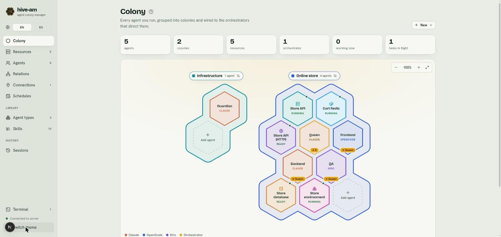
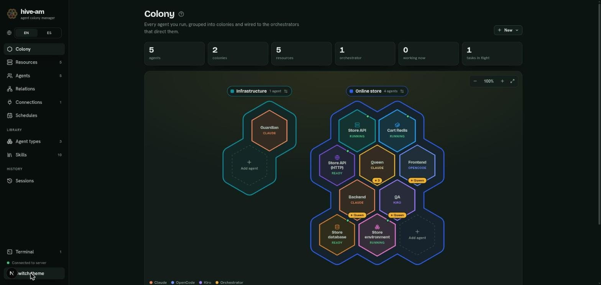
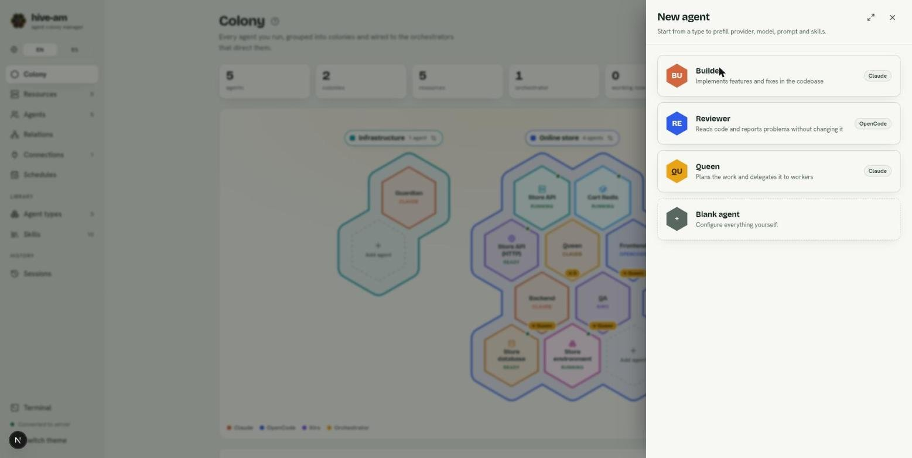
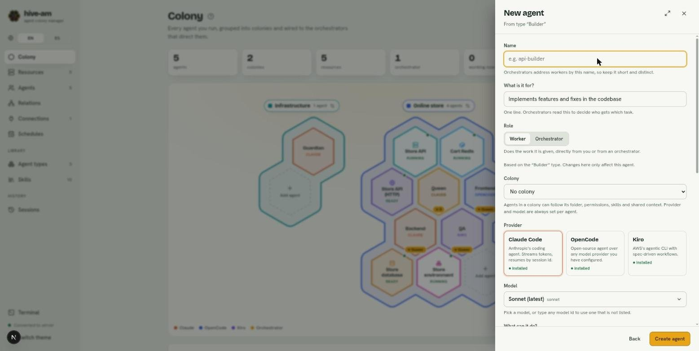
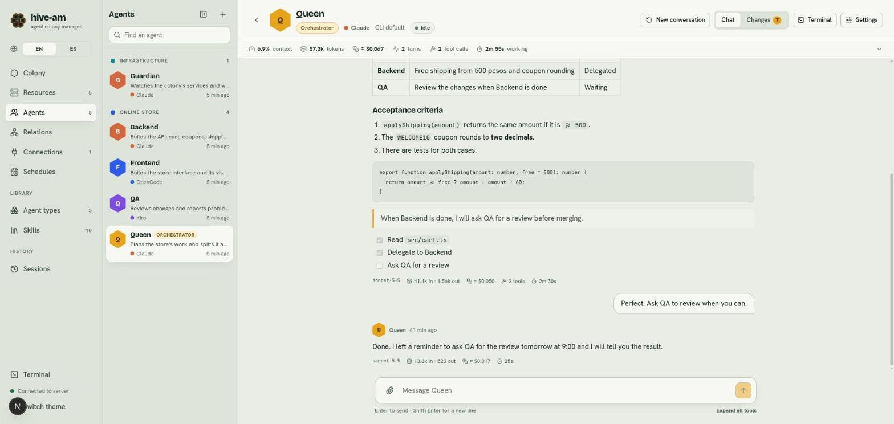

# Getting started

This chapter takes you from zero to your first agent in a conversation: what you need, how to start hive-am, how to move around the interface, and how to create and test an agent.

## Requirements

- **Node.js 20 or later.**
- **macOS or Linux.**
- At least one of these tools installed **and signed in**: `claude` (Claude Code), `opencode` or `kiro-cli`. You do not need all three.

> **Note:** hive-am runs those tools exactly as they are on your machine. If one does not work on its own in your terminal, it will not work from hive-am either.

## How to start hive-am

Pick one of the three ways.

**With npx (nothing to install):**

```bash
npx hive-am
```

**With a global install:**

```bash
npm install -g hive-am
hive-am
```

**From the source code:**

```bash
git clone git@github.com:hughcbscrt/hive-am.git
cd hive-am
npm install
npm run dev
```

Once it starts, open <http://127.0.0.1:4401> in your browser.

### Ports

- The server (API and WebSocket) uses port **4400**.
- The web interface uses port **4401**. To change it: `HIVE_AM_WEB_PORT=4500 hive-am`.
- With the npm package, the API port is fixed.

### Stop, update and help

- Stop hive-am with **Ctrl+C** in the terminal where you started it. To leave it running without keeping a terminal open, start it with `hive-am start --background`: it prints where its log is, and later `hive-am status` tells you whether it is running, `hive-am logs -f` shows what it prints and `hive-am stop` stops it (`hive-am restart` does both). Servers and containers you left as resources keep running.
- Update with `hive-am update` (it checks npm for a newer version and installs it; `hive-am update --check` only says whether there is one, and `hive-am update --restart` also restarts a hive-am you left running in the background). With npx: `npx hive-am@latest`. `hive-am version` prints the version you have.
- `hive-am --help` shows the options and `hive-am --version` shows the installed version.

### Where your data is stored

Everything is stored in `~/.hive-am` (the database is `~/.hive-am/hive-am.db`). To use another folder, set the `HIVE_AM_HOME` variable before starting. Conversations are not there: they live in the stores of each tool (Claude Code, OpenCode, Kiro). hive-am keeps its own record within limits: old channel messages, delegations and conversations that the tool no longer has are forgotten after a while, never the conversations themselves ([details](13-permissions-and-security.md)).

> **Tip:** to back up your data, stop hive-am and copy the whole `~/.hive-am` folder.

## Tour of the interface


*The Colony screen. On the left, the sidebar with all the sections. At the bottom left, the **Terminal** button, the connection indicator and **Switch theme**.*

The sidebar has these sections:

- **Main**
  - **Colony**: the map with your agents and resources ([chapter 2](02-the-colony.md)).
  - **Resources**: servers, containers, HTTP requests and clusters ([chapter 10](10-resources.md)).
  - **Agents**: the list of all your agents and their workspace ([chapter 3](03-agents.md)).
  - **Relations**: the canvas where you connect orchestrators with workers ([chapter 5](05-orchestration-and-relations.md)).
  - **Connections**: links with Telegram ([chapter 9](09-telegram-connections.md)).
  - **Schedules**: messages sent at a set time ([chapter 8](08-schedules.md)).
- **Library**
  - **Agent types**: agent templates.
  - **Skills**: reusable knowledge ([chapter 6](06-types-and-skills.md)).
- **History**
  - **Sessions**: the conversations of all your agents ([chapter 7](07-sessions.md)).

At the bottom of the menu are the **Terminal** button (opens the terminal panel, [chapter 12](12-terminals.md)), the server status indicator and **Switch theme**.

To give the screen more room, the panel button next to the hive-am name (**Collapse the menu**) folds the menu to a narrow column of icons. Hovering or focusing an icon shows its name, counts stay as small badges, and **EN** / **ES** stay one above the other. The same button (**Expand the menu**) opens it again. Your choice is remembered in the browser. On a narrow screen (under 760 px) the menu is a bar at the top with its labels, and it does not fold.

### Connection indicator

Near the bottom of the menu, **Connected to server** appears with a green dot while the interface is talking to the server. If the server stops, the text changes to **Server offline. Retrying…** and the interface reconnects on its own. If you see that message, check [chapter 14](14-troubleshooting.md).

### Language

The **EN** / **ES** selector at the top of the menu changes the interface language. The language is remembered in the browser. If none is saved, the browser language is used (Spanish if it starts with "es", English otherwise).



*The same screen in English. The **EN** / **ES** selector is at the top left, under the hive-am name.*

> **Note:** the names and descriptions you write yourself (agents, colonies, types) are not translated. Only the interface's own texts change.

### Light and dark theme

Click **Switch theme** (at the bottom of the sidebar) to toggle between the light and dark themes. Your choice is saved in the browser. With no saved choice, hive-am follows your system preference.



*The dark theme. The **Switch theme** button is at the bottom left, with the pointer over it.*

## Your first agent

You are going to create an agent, give it a working folder and send it a message.

1. Go to **Colony**, click **New** (top right) and choose **New agent**. You can also click **Add agent** on the dotted hexagon of a colony: that way the agent is created inside that colony.
2. Choose how to start:
   - A **type** from the list: it fills in provider, model, instructions and skills for you.
   - **Blank agent** ("Configure everything yourself."): you start with nothing.

   

   *Step 1 of the **New agent** panel: three sample types (Builder, Reviewer, Queen) and the **Blank agent** option. Each type shows its provider on the right.*

3. Fill in the form:
   - **Name**: short and unique. Orchestrators address workers by this name.
   - **What is it for?**: one line. Orchestrators read it to decide who gets each task.
   - **Role**: **Worker** (does the work it receives) or **Orchestrator** (plans and delegates).
   - **Colony**: optional. A colony can lend it a folder, permissions, skills and context.
   - **Provider**: **Claude Code**, **OpenCode** or **Kiro**. Each card shows whether it is installed (**installed**) or not (**not found**).
   - **Model**: the one you want to use. Left at the default, it uses the tool's own default.
   - **Working folder**: type it or click **Browse**. It is required, unless the agent follows its colony's folder.
   - **What can it do?** (permissions): **Read-only**, **Edit files** or **Full access**.

   

   *Step 2: the form created from the "Builder" type. At the top are **Name**, **What is it for?**, **Role** and **Colony**. Below them are the provider cards. At the bottom, **Back** and **Create agent**.*

4. Click **Create agent**. A notice appears with the name of the new agent.
5. Open its chat: select its hexagon in **Colony** and click **Open chat**, or go in from **Agents**.
6. Type a message in the field at the bottom and press Enter (Shift+Enter inserts a new line).



*An agent's chat (here Queen). At the top, its status and statistics bar. In the middle, the conversation. At the bottom, the field for typing, with the button to attach files.*

> **Tip:** start with **Read-only** if you want the agent to explore your project without touching anything. Once you trust it, move up to **Edit files**. **Full access** runs any command without asking: use it only in trusted or disposable folders.

> **Note:** the provider and the model are never inherited from the colony: you always choose them per agent.

### What if something fails

- If you click **Create agent** without a folder, the form asks you to pick one (or to put the agent in a colony that provides one).
- If the provider shows as **not found**, the tool is not in hive-am's `PATH`. See [chapter 14](14-troubleshooting.md).

Next: [The colony](02-the-colony.md)
