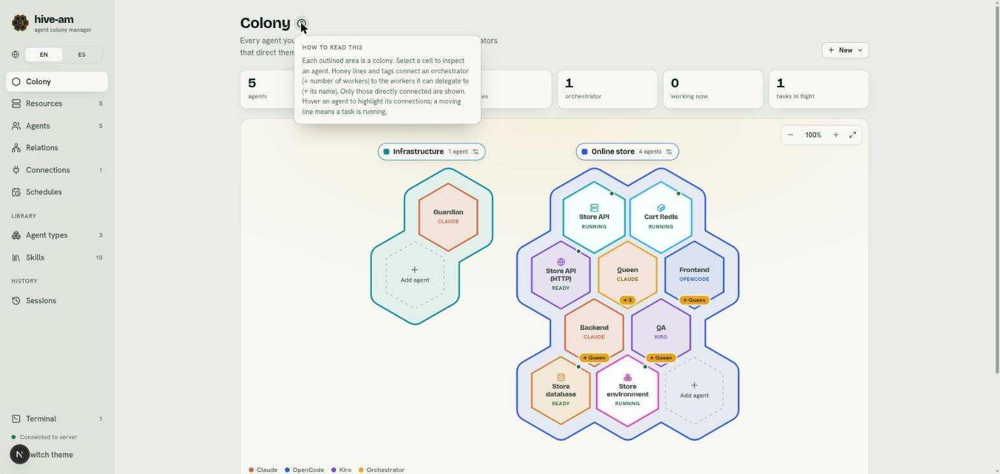
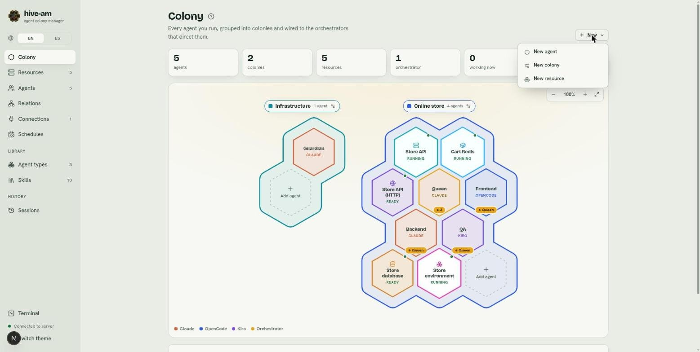
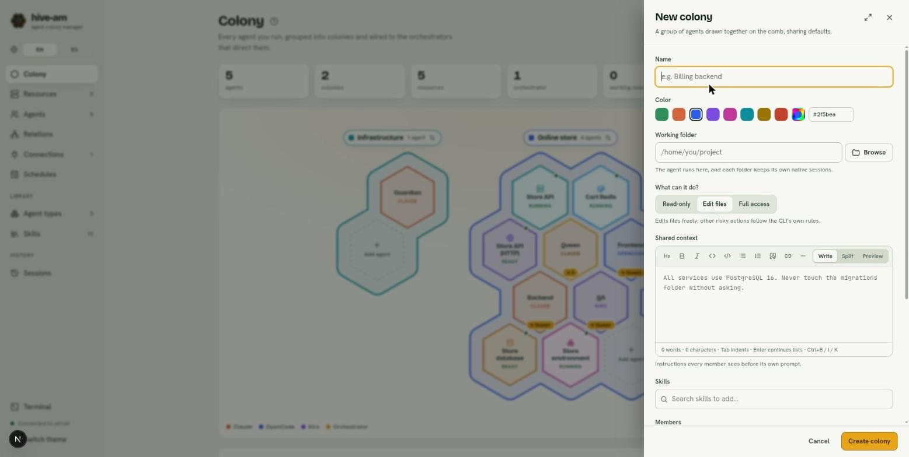

# The colony

The **Colony** screen is the center of hive-am. It shows all your agents and resources as hexagons on a map, grouped into colonies and connected to the orchestrators that direct them. From here you see who is working, create agents, colonies and resources, and open the chat of any agent.

*The Colony screen: the statistics at the top, below them the map with two colonies (Infrastructure and Online store) and, at the bottom, the provider color legend.*

## The statistics

Below the title there are six cards. Each number is calculated live:

| Card | What it counts | Where it links |
|---|---|---|
| **agents** | All agents | The **Agents** list |
| **colonies** | All colonies | Not a link |
| **resources** | All resources (hover to see how many are running) | The **Resources** screen |
| **orchestrators** | Agents with the Orchestrator role | The **Agents** list |
| **working now** | Agents with a turn in progress | The **Agents** list |
| **tasks in flight** | Delegations that are still running | The **Recent delegations** section, further down on the same screen |

## How to read the map

The **?** icon next to the title opens a short help, "How to read this". It closes with Esc, by clicking outside, or by clicking the icon again.

*The help popover. It sums up the essentials: each outlined area is a colony, and the honey-colored tags connect orchestrators with workers.*

These are the elements of the map:

- **Colonies:** each outlined area is a colony. At the top it has a tag with its color, its name and how many agents it has. The settings icon on the tag opens its editor.
- **Agents:** one hexagon per agent. The border shows the provider (the legend at the bottom explains it: Claude, OpenCode, Kiro) and orchestrators are honey-colored. The provider is shown under the name.
- **Resources:** also hexagons, with their own icon (server, database, HTTP requests, cluster) and their status under the name, such as **Running** or **Ready**.
- **Orchestrators:** carry a **↓ N** tag with the number of workers they can delegate to. Each worker carries **↑ Name** with the orchestrator that directs it. Only directly connected ones are shown.
- **Relation lines:** join an orchestrator to its workers. A moving line means a task is in progress. Dotted colored lines join a managing agent to the resources it looks after.
- **Status dots:** a pulsing dot means the element is working. Red means it needs attention.
- **Dotted "Add agent" hexagon:** appears at the end of each colony and creates an agent already inside that colony.

When you hover over an agent, its connections are highlighted and the rest fades. Hovering over an agent in the side list or a cell on the map also shows a card with its information.

## Select a hexagon

Click a hexagon to open its card next to it. It closes with the **X**, with Esc, or by selecting another one.

### An agent's card

*Backend selected: the rest of the map fades and only its relation with Queen is highlighted. The card shows description, provider, permissions, folder, session and colony.*

The card shows:

- Name, role (**Worker** or **Orchestrator**) and status (**Idle**, **Working**, **Needs attention**).
- Description, **Provider** and model, **Permissions**, **Folder** (with "from colony" if it inherits it), **Directed by** (for workers) or its team (for orchestrators), **Session** and when it was **Updated**.
- A **Colony** selector to move the agent to another colony (or leave it without one).
- The **Open chat** button and, on the right, the trash icon to delete the agent.
- At the top, the settings icon that opens the agent's editor without leaving the map.

### A resource's card

*The "Store API" resource (a server). The dotted line joins it to its manager, Store environment. You can see the command, the control buttons and the latest logs.*

A resource's card shows its status, how long it has been that way, the command, the **Start**, **Stop** and **Restart** buttons, **Terminal here** and **Logs in the panel** (they open the [terminal panel](12-terminals.md)), the latest logs and the **Who looks after it** section. The **Open panel** button takes you to the resource's full screen. More about them in [chapter 10](10-resources.md).

## Move colonies and free elements

You can arrange the map to your liking:

- **Colonies:** drag them by the tag with their name.
- **Agents or resources without a colony:** drag them by their hexagon.
- **With the keyboard:** focus a colony's tag or a free hexagon and use the arrow keys. With Shift the steps are bigger.

The position is saved in this browser. The **Put everything back where it was** button (above the map) resets the layout.

To move an agent **between colonies** you do not drag: use the **Colony** selector on its card or the colony editor.

## Zoom

At the top right of the map there are three controls: **Zoom out** (−), **Zoom in** (+) and **Fit the map to the panel (100%)**. You can also zoom with Ctrl (or ⌘) and the mouse wheel. The range goes from 40% to 250% and is remembered. When zoomed in, the panel scrolls.

## The New menu

At the top right, the **New** menu gathers the three creation actions of this screen.

*The **New** menu with **New agent**, **New colony** and **New resource**.*

- **New agent:** see [Getting started](01-getting-started.md#your-first-agent).
- **New colony:** see the next section.
- **New resource:** see [chapter 10](10-resources.md).

## Create a colony

A colony groups agents and lends them defaults.

1. Click **New** > **New colony**.
2. Type the **Name**. It cannot be repeated.
3. Choose a **Color** from the palette, a custom color, or type a hex code (for example `#2f5bea`).
4. Optional: **Working folder** (type it or use **Browse**). The colony's agents will run there.
5. Optional: choose **What can it do?**: **Read-only**, **Edit files** or **Full access**.
6. Optional: write the **Shared context**, instructions that every member sees before its own prompt. It supports Markdown.
7. Optional: add skills and **Members** (the agents that belong to the colony).
8. Click **Create colony**.

*The **New colony** panel: name, color palette with hex code, working folder with **Browse**, permissions and the shared context editor. At the bottom, **Cancel** and **Create colony**.*

> **Note:** an agent belongs to only one colony. If you add one that is in another colony as a member, it moves to this one.

## What agents inherit from their colony

| Field | How it combines with the agent's value |
|---|---|
| Working folder | The colony's **replaces** the agent's |
| Permissions | The colony's **replace** the agent's |
| Skills | They are **added**: the colony's first, then the agent's |
| Shared context | Goes **before** the agent's prompt |
| Provider and model | **Never** inherited: always the agent's own |

Each agent can opt out on its own. In its form, each inheritable field shows **Following** or **Own value**. With **Own value** the agent ignores the colony for that field. When you move an agent to another colony, those exceptions are reset.

### The question when you save

Every time you create or save a colony, **What should its agents inherit?** appears with one checkbox per field: **Working folder**, **Permissions**, **Skills** and **Shared context**.

- A checkbox is disabled if nothing is defined to share (for example, no folder).
- In a new colony, the checkboxes that have a value come checked.
- If changing the folder moves existing agents, the notice tells you how many **start a new conversation**. The earlier ones are kept in their **Sessions** tab.

## Edit or delete a colony

1. Click the settings icon on the colony's tag (**Edit colony**).
2. Change what you need and click **Save colony**. Answer the inheritance question.
3. To remove it, use **Delete colony**. Its agents stay, but they stop following the colony's folder, permissions, skills and context. If you would rather not delete it, choose **Keep colony** in the notice.

## Recent delegations

Below the map, **Recent delegations** lists the last 6 tasks that an orchestrator passed to a worker, with links to the agent and the session. If there are none yet, you will see the message: "When an orchestrator hands a task to a worker, it shows up here." The **tasks in flight** card in the statistics takes you to this section. More about delegating in [chapter 5](05-orchestration-and-relations.md).

Next: [Agents](03-agents.md)
