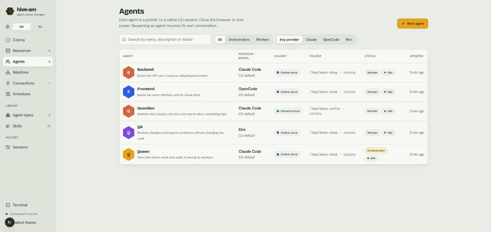
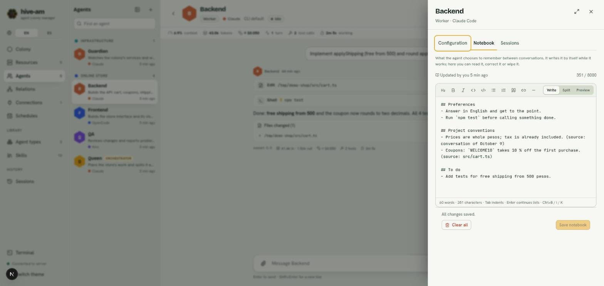

# Agents

An agent is a coding assistant with a name of its own. It has a provider (Claude Code, OpenCode or Kiro), a folder where it works, some instructions and some permissions. The **Agents** section is where you see them all in a table, create new ones and open each one. You edit an agent's settings in a side panel that opens from its screen.

## The agent list

Open **Agents** in the menu on the left. You will see a table with all your agents.

*The "Online store" project list: five agents (Backend, Frontend, Guardian, QA and Queen). Note the filters above the table and the yellow **New agent** button at the top right.*

The columns are:

| Column | What it shows |
|---|---|
| **Agent** | Avatar, name and description (if it has none, it says whether it is an orchestrator or a worker) |
| **Provider · model** | The CLI it uses and its model ("CLI default" if you did not pick one) |
| **Colony** | The colony it belongs to, with its color |
| **Folder** | The folder it actually works in. If it inherits it from its colony, the table says so |
| **Status** | Its role (**Worker** or **Orchestrator**) and whether it is idle, working or needs attention |
| **Updated** | When it last had activity |

### Search and filter

- **Search:** type in the "Search by name, description or folder" field.
- **Role filter:** **All**, **Orchestrators** or **Workers**.
- **Provider filter:** **Any provider**, **Claude**, **OpenCode** or **Kiro**.

If nothing matches, you see "Nothing matches" and a button to clear the filters.

### Open an agent

Click any row (or the name). The agent's screen opens, with its chat. That screen is explained in [Chat](04-chat.md).

## Create an agent

1. Go to **Agents** and click **New agent**. You can also create one from the colony screen. A panel opens on the right.
2. Choose how to start:
   - **A type:** fills in provider, model, prompt and skills with the values from a template. Types are explained in [Types and skills](06-types-and-skills.md).
   - **Blank agent:** "Configure everything yourself".
3. Fill in the form (the fields are described below).
4. Click **Create agent**. If you picked the wrong template, **Back** returns to step 1.

*First step: the available types (Builder, Reviewer, Queen) and, at the end, **Blank agent**. Each type shows its provider on the right.*

> **Note:** creating from a type copies its values. After that the agent is independent: if you later edit the type, agents already created do not change.

## The form fields

The same form is used to create and to edit.

*Second step, "From type Builder". At the top are **Name**, **What is it for?**, **Role**, **Colony** and **Provider**. The **Back** and **Create agent** buttons stay pinned at the bottom.*

### Name

It is required and cannot be repeated. Orchestrators address workers by name, so keep it short and distinct (for example `api-builder`).

### What is it for?

One line. Orchestrators read it to decide who gets each task, so describe it clearly ("Implements backend endpoints and their tests").

### Role

- **Worker:** does the work it is given, directly from you or from an orchestrator.
- **Orchestrator:** plans the work and delegates it to the workers assigned to it. When you choose it, the **Team** section appears, where you tick which workers it can send tasks to (you can also do this in Relations; see [Orchestration and relations](05-orchestration-and-relations.md)).

### Colony

Choose a colony or **No colony**. Agents in a colony can follow its folder, permissions, skills and shared context. The provider and the model are never inherited: they always belong to the agent. More in [The colony](02-the-colony.md).

If you choose a colony that shares something, a row appears for each inheritable value (permissions, folder, shared context, skills) with the **Following** mark. Click it to switch to **Own value** and set one just for this agent.

### Provider and model

Choose one of the three: **Claude Code**, **OpenCode** or **Kiro**. Each card shows whether the CLI is installed on your machine.

The **Model** field is a searchable selector: "CLI default" (the CLI picks), the models the CLI lists, or any id you type by hand ("Use “id”").

> **Note:** if you change the provider of an agent that already has a conversation, that conversation is discarded: a CLI's session id is of no use in another CLI. Earlier conversations are kept in the **Sessions** tab.

### What can it do? (permissions)

Three levels: **Read-only**, **Edit files** and **Full access**. If you do not use a type, a new agent starts at **Edit files**. What each level means for each provider is in [Permissions and security](13-permissions-and-security.md).

OpenCode keeps the tools a conversation started with. If you change an OpenCode agent's permission (or its colony's) while a conversation is open, the chat shows a warning and an **Apply now** button, which starts a new conversation with the new permission. The current one stays in the Sessions tab. Conversations that were open before this warning existed are not detected: use **New conversation**.

> **Tip:** use **Full access** only in throwaway folders or folders you have a copy of.

### Working folder

The folder the agent runs in. You can type the path or use **Browse**. It must exist on disk. Each folder keeps its own sessions: if you change the effective folder (its own or inherited), the agent starts a new conversation.

### System prompt

The agent's own instructions, added to the CLI's own instructions on every turn. You write them in a Markdown editor with a toolbar (headings, bold, italic, code, lists, quote, link, line) and three views: **Write**, **Split** and **Preview**. At the bottom you see the word and character count. Shortcuts: Tab indents, Enter continues lists, and Ctrl+B, Ctrl+I and Ctrl+K give bold, italic and link.

If the agent follows its colony's context, that context is placed before your prompt.

### Skills

Skills are reusable blocks of instructions. Search in "Search skills to add" and pick them: each one becomes a tag with a button that switches between two modes.

*Lower part of the form. Above, the system prompt editor. Below, the **Notebook** skill with the **always** mark, its estimated weight ("~577 tokens") and the resource search.*

- **always:** the full text goes into the instructions of every turn. Use it for short rules that must always apply.
- **on demand:** the agent sees only the name and description, and loads the text when the task calls for it. Use it for long or situational guides.

Click the tag to switch. Under the selector you see how much the "always" skills add to the prompt. If the colony also provides the skill and the agent has it too, the agent's choice wins.

### Resources it looks after

Servers, containers and clusters the agent can see, read the logs of, and start, stop or restart. A resource has a single manager: if you choose one that another agent already looks after, it moves to this agent (the selector shows "now: name"). The agent gets the "Colony resources" skill. Resources are explained in [Resources](10-resources.md).

### Connections

If the agent is linked to a connection (Telegram or Slack), a notice appears and the agent cannot be left at **Read-only**: a read-only agent cannot reply through a channel. See [Connections](09-telegram-connections.md).

## The agent settings panel

To edit an existing agent, open its screen and click **Settings** in the header. A panel opens on the right with three tabs: **Configuration**, **Notebook** and **Sessions**.

*The **Configuration** tab for Queen. The footer has **Delete agent**, **Discard** and **Save changes**, next to the text "All changes saved."*

- The **Configuration** tab has the same form as above.
- You can widen the panel with the button in the corner, or drag its left edge (double-click to toggle).
- While there are changes, the footer says "You have unsaved changes.", the **Settings** button shows a dot, and **Discard** and **Save changes** become active.
- **Save changes** applies the changes. If the agent is working, they apply from the next turn.
- **Discard** goes back to the saved values.

### Closing with unsaved changes

If you close the panel with unsaved changes, hive-am asks "Discard unsaved changes?". You have two options: **Keep editing** or **Discard changes** (your edits are lost).

## The notebook

The notebook is the agent's memory between conversations: what it decides to remember (preferences, project conventions, pending items). The agent writes it itself while it works. You can read it, correct it or wipe it.

*Backend's notebook. At the top "Updated by you 7 min ago" and the **385 / 8000** counter. The notes are in `##` sections. At the bottom, **Clear all** and **Save notebook**.*

How it works:

- It is Markdown text with sections (`## Topic`) and notes (`- ...`).
- The limit is **8000 characters**, shown in the counter. It counts as prompt on every turn, so it is best to keep it short.
- Each note stores its origin (for example "source: conversation of October 9") so you can review it.
- Notes with credentials (keys, tokens, passwords) are rejected.
- It refreshes by itself while you are not typing. If you save an old version, it is rejected so it does not overwrite what the agent wrote later.

To edit it:

1. Open **Settings** > **Notebook**.
2. Change the text in the editor.
3. Click **Save notebook**.

**Clear all** asks for confirmation ("Clear the notebook?"): the agent will forget everything it noted, and this cannot be undone. **Reload** brings the latest version.

> **Note:** the notebook works thanks to the **Notebook** skill. If the agent does not have it, the tab warns you ("This agent doesn’t have the “Notebook” skill, so it doesn’t use its notebook.") and offers a **Turn on** button.

The **Sessions** tab is explained in [Sessions](07-sessions.md).

## Delete an agent

1. Open the agent's **Settings**, **Configuration** tab.
2. Click **Delete agent** in the footer.
3. Confirm in "Delete *name*?". **Keep agent** cancels.

The agent and its connections are removed. The files of its native sessions stay on disk, untouched.

Next: [Chat](04-chat.md)
