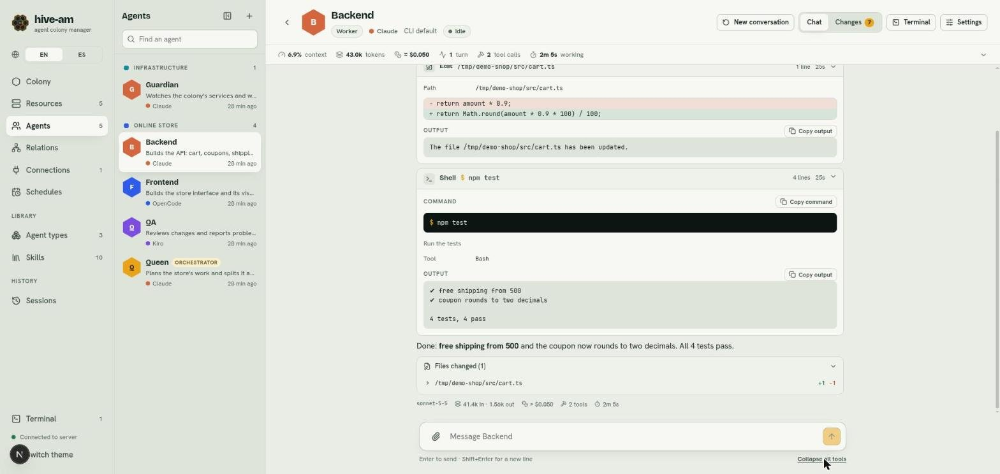

# Chat

When you open an agent you reach its screen: the conversation with it, a bar with the session statistics and a header with the main shortcuts. Here you write to the agent, see what it does (what it reads, edits and runs), and can pick the conversation up again even if you close the browser or restart the server, because the real conversation is stored by the agent's own CLI (see [Sessions](07-sessions.md)).

*Queen's screen (an orchestrator). From left to right: the agent list and the conversation, with the header and the statistics bar on top. The text box is at the bottom.*

## The header

At the top you see the agent's name, role, provider, model and status (for example **Idle**). On the right there are four controls:

| Control | What it does |
|---|---|
| **New conversation** | Starts a new conversation with the agent (see below) |
| **Chat** / **Changes** | Switches between the conversation and the git changes explorer for the agent's folder. **Changes** shows the number of modified files. See [Changes explorer](11-changes-explorer-git.md) |
| **Terminal** | Opens a terminal in the agent's folder. See [Terminals](12-terminals.md) |
| **Settings** | Opens the agent's settings panel. See [Agents](03-agents.md) |

The arrow to the left of the name goes back to the colony.

## The side agent list

To the left of the conversation there is a list of all your agents, grouped by colony. Use it to jump from one to another without going back to the **Agents** section.

- Each colony heading (and **No colony**) folds or unfolds its group with a click, or with Enter or Space. Orchestrators come first in each group. A folded group still shows the agent you are on, and a pulsing dot when one of its agents is working. Folded groups are remembered.
- Use **Find an agent** to filter. While you search every group with a match is shown open; clearing the search brings back the groups you had folded.
- Each agent shows its provider and how long ago it was active, always on one line (a long model name is cut), so every row has the same height and rows never move when an agent changes state.
- The line under the name says what the agent is up to, in this order: the delegations it is waiting for ("Delegated to Reviewer: check the diff", with "(queued)" while the worker has not started; "Delegated 3 tasks: Reviewer, Tester, Docs" when there are several); what it is doing live (for example "Thinking…" or a tool in progress); "Finished: …" with the start of its reply when it finished while you were elsewhere; "Needs attention" after an error; otherwise its description.
- The dot on the avatar is honey and pulsing while the agent works, red when it needs attention and green when it finished and you have not seen it yet (see **Activity** in [chapter 1](01-getting-started.md)). Screen readers hear the state too. A colony heading shows a small pill with a dot and the number of agents with something unread (red if one of them failed), folded or not.
- The button in the list header collapses it to a narrow column with just the initials. It stays grouped by colony: each group starts with a short heading (the colony's initials, in its color, and how many agents it has; the full name on hover; a green or red dot when one of its agents has something unread) that folds or unfolds it the same way, and what you fold there is folded in the full list too. Your choice is remembered.

## Send messages

1. Type in the "Message *name*" box.
2. Press **Enter** to send. **Shift+Enter** inserts a line break.
3. While the agent answers you see its work live and, at the bottom, the elapsed time.

If the agent has not talked to you yet, you see "Say hello to *name*" with a suggestion: describe a goal to an orchestrator, give a task to a worker.

### Queued messages

While the agent works, the box changes to "Queue a follow-up…". If you type, the message waits and is sent when the current answer ends. Under the box you see how many are queued.

### Stop

While the agent works, the **Stop** button appears. It cuts the turn in progress.

> **Note:** **Stop** does not empty the queue: messages that were already queued are sent afterwards.

### A draft per agent

What you type and do not send is saved in the browser, per agent. You can switch agents or reload the page and the text is still there. It is cleared when you send it.

## Attach files and pictures

There are three ways:

- **Paste** with Ctrl+V (⌘V on a Mac): works for a picture or a copied file.
- **Drag** any file onto the text box.
- The **paperclip** button, to the left of the box.

Each attachment appears as a preview (pictures) or a chip (other files), with an × to remove it. Limits: up to 5 per message and 20 MB each.

When you send, the files are saved in the agent's inbox and your message carries a note with their paths so the agent can open them with its tools. In the conversation, pictures show as thumbnails and other files as a chip you can click to download.

## What the agent does: tools

When the agent reads, edits or runs something, you see a collapsible row for each tool call, with its label (**Read**, **Edit**, **Write**, **Shell**, **Delegate**...) and a summary.

*Backend with both rows open. **Edit** shows the path and the change (red is removed, green is added). **Shell** shows the `npm test` command and its output. At the bottom, **Files changed (1)**.*

On the right of each row you see metadata: the number of output lines, the duration and, if it failed, a red mark. A tool in progress has a honey-colored border and a timer. When you open a row:

- **Shell:** the full command (with **Copy command**) and the output (with **Copy output**).
- **Edit:** the path and a diff of what was removed and added.
- **Read** and **Write:** the path and the content or output.

### Expand and collapse

Each row opens or closes with a click. To do it for all of them at once, use the **Expand all tools** link (which becomes **Collapse all tools**) in the bottom right corner, under the text box.

### Normal and compact view

Under the text box, next to **Expand all tools**, a **Normal / Compact** switch changes how the agent's steps look. The choice is remembered in this browser and applies to the chat of every agent (and to the transcripts on the **Sessions** page). **Normal** is the default: one row per step, as described above.

In **Compact** each step is a small pill with a grey icon, on the same row as the agent's name:

- Reasoning, shell commands, files read, written or edited, searches, web, `hive` tools (reply, send file, skill, mute, delegate, roster), subagents, plan, browser and any other tool each get a pill with a short label (the command, the file name, the agent...). Hover or focus a pill to see the full command or path.
- Click a pill to open its detail under the row (the same command, output, copy buttons and diff as in Normal); click it again to close it. Several can be open at once.
- Earlier replies fold into one summary pill such as `3 steps · 1 tool · 4.9s`. Click it to show that reply's pills. The latest reply shows its pills; while the agent is working, every saved reply is folded and the reply being written shows its pills.
- A failed step has a red border and says `exit N` or `failed`. A summary pill that hides a failed step is red too and says how many failed.
- A tool in progress keeps the honey border, the timer and the pulsing dot.
- **Files changed (N)** is a pill with the lines added and removed; it stays visible even when its reply is folded, and opens the same list of files and changes.
- **Expand all tools** opens every pill and unfolds every summary; **Collapse all tools** closes and folds them.

### Thought process

If the agent exposes its reasoning, a collapsible **Thought process** row appears before its actions. Open it to read it.

### Files changed

At the end of each answer, a collapsible **Files changed (N)** block lists the files the agent wrote or edited, with the lines added (+N) and removed (-N). Expand a file to see its changes. If the agent wrote a file in full, it is marked "written".

> **Note:** this data comes from what the agent did, not from git. To see the real state of the repository, use the **Changes** tab.

## Delegations

When an orchestrator hands out work, you will see **Delegate** rows with the subagent and the task. Opening them shows the full task and what the worker answered.

*Queen reads `src/cart.ts` and delegates to Backend. The **Delegate** row shows **Subagent**, **Task** and the worker's answer. At the bottom, above the text, the **Jump to latest** button.*

In the worker's chat, the delegated task appears as "Delegated task from *name*" while it runs, but it runs in its own session and does not clutter its direct conversation. More in [Orchestration and relations](05-orchestration-and-relations.md).

## Each answer: the footer

Under each answer you see a discreet line with the model, input and output tokens, the cost (with `≈` if it is an estimate), the number of tools and the duration. Hover over the tokens or the cost for more detail.

## The statistics bar

Under the header, a strip summarizes the session you are viewing:

| Indicator | What it means |
|---|---|
| **context** | Percentage of the context the conversation takes up |
| **tokens** | Total tokens: input, output and cache |
| **credits** | Credits used (Kiro only) |
| cost | Total cost in dollars, with `≈` if estimated |
| **turns** | Messages you have sent |
| **tool calls** | How many times the agent used tools, and how many failed |
| **working** | Accumulated working time (not counting pauses) |

Click the bar (or the arrow at its right end) to expand the detail: the **Token mix**, the **Models** used, the **Tools used** and the **Tokens per turn** of the latest turns.

## Moving around the conversation

- The view stays at the bottom while new messages arrive. If you scroll up to read, it stops following them and the **Jump to latest** button appears: click it to go back to the bottom.
- In long conversations, **Show earlier messages (N more)** appears at the top to load older ones.

## New conversation

1. Click **New conversation** in the header. It is disabled while the agent works or if it has no conversation yet.
2. Confirm with **Start new conversation**.

The agent starts a clean session. The previous one is not lost: it stays in the **Sessions** tab of its settings and you can resume it whenever you want.

> **Tip:** if the **context** indicator climbs high, a new conversation is usually faster and cheaper. The agent's notebook keeps what matters between conversations.

Next: [Orchestration and relations](05-orchestration-and-relations.md)
