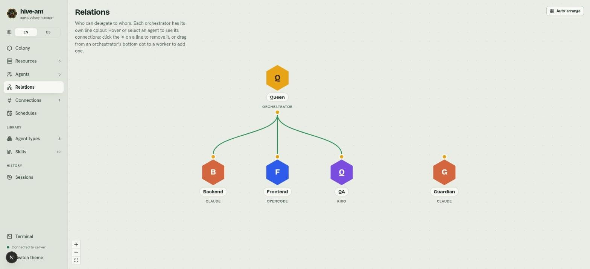
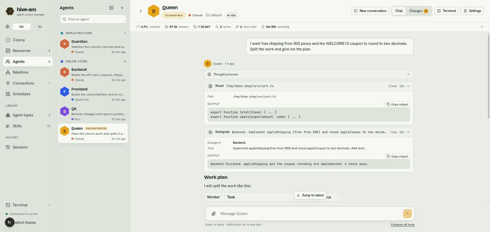
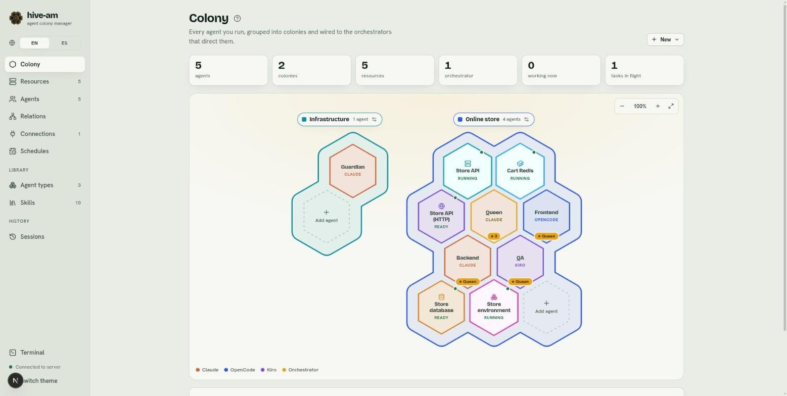
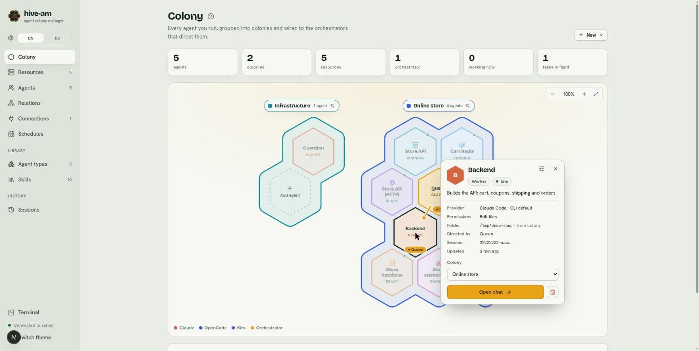

# Orchestration and relations

An orchestrator is an agent that hands out work to other agents, its workers. In this chapter you learn how it delegates, how you connect each orchestrator to its workers on the **Relations** canvas, and how to see what is happening while a task travels from one agent to another.

## Orchestrators and workers

Each agent has a role that you choose when you create it:

- **Orchestrator:** plans and delegates. It can have several workers connected.
- **Worker:** carries out the tasks it receives. It can be connected to several orchestrators.

In the example project, **Queen** is the orchestrator and **Backend**, **Frontend** and **QA** are her workers. **Guardian** is a worker without an orchestrator: nobody delegates to it.

> **Note:** only orchestrators can have connections.

## The delegation rule

An orchestrator can only delegate to the workers **connected directly to it**. It does not matter whether they are in a colony, or share a colony with it: a colony neither grants nor removes delegation. The rule is enforced on the server and does not depend on what the model "thinks" it knows. If an orchestrator tries to delegate to an agent that is not its own, it gets an error.

## How an orchestrator delegates

When an orchestrator has at least one worker connected, it gets three tools:

| Tool | What it does |
|---|---|
| `list_agents` | Returns the list of its direct workers, with name, description, provider and whether they are busy. |
| `dispatch` | Sends a task to a worker by its exact name. By default it does not wait: it gets a task id and the answer reaches it later as a message. With `background: false` it waits for the final answer. |
| `dispatch_status` | Tells the state of a task it delegated (queued, running, done, failed or interrupted) and, once finished, its result. It can wait up to a minute for the end. |

What you should know:

- **Every delegation opens a new native session of the worker.** The worker does not remember earlier delegations, so the orchestrator must include all the context in the task. Your direct conversation with that worker does not change.
- **A delegation goes in the background by default.** The orchestrator gets a task id at once, can keep talking to you or delegate to other workers meanwhile, and when the worker finishes it receives a message *"Delegated task … to Backend finished (done). Result: …"* in the same place where you asked it (the web chat, or the same Telegram or Slack thread), and carries on from there.
- **The result is not lost.** It is kept in hive-am, not in the call: if hive-am restarts while a worker is on a background task, the task is marked **interrupted** (it is not resumed) and the orchestrator is told so, to check the work and send it again if needed. A result is never sent twice. If the thread where it was asked no longer exists or is muted, the orchestrator can still read the result with `dispatch_status`.
- **Limit:** an orchestrator can have at most 10 background tasks that have not finished; beyond that it is told to wait.
- **An agent handles one turn at a time.** If the worker is busy (with a message from you or another delegation), the task waits its turn in the queue, marked **queued**.
- **Different agents work in parallel.**
- The orchestrator's team updates itself: if you connect or disconnect a worker, the orchestrator's next message already knows about it.

## Connecting and disconnecting workers

Open **Relations** from its card in Home (group **Work**) or with **Ctrl K** (type "relations" or "graph"). You will see one hexagon per agent. Orchestrators have a dot at the bottom and workers have one at the top.

*The Relations canvas. Queen (orchestrator) connects with three lines to Backend, Frontend and QA. Notice that Guardian has no line: no orchestrator can delegate to it. The **Auto-arrange** button is at the top right.*

### Connect a worker

1. Open **Relations**.
2. Drag from the bottom dot of the orchestrator to the worker.
3. Release. A notice such as "Backend connected to Queen" appears and the line is drawn.

Another way: click an agent to open its side panel. An orchestrator shows "Delegates to · N" and the **Connect a worker…** selector. A worker shows "Directed by" and the **Connect to an orchestrator…** selector.

### Disconnect a worker

1. Hover over the line (or select the agent).
2. Click the **✕** that appears at the midpoint of the line.

You can also use the **Disconnect** button in the side panel of the selected agent. A notice such as "Backend disconnected from Queen" appears.

### Reading the canvas

- **One color per orchestrator:** each orchestrator has its own line color, so you can tell apart lines that cross or that reach the same worker.
- **Focus:** when you hover over an agent (or select it), its connections are highlighted and the rest fade out.
- **Animated line:** the worker is working.
- **Moving nodes:** you can drag the hexagons. Your layout is remembered in the browser.
- **Auto-arrange:** the **Auto-arrange** button clears your positions and brings back the automatic layout (orchestrators on top, their workers below, workers without an orchestrator on the right).

> **Tip:** you can also pick the workers with checkboxes in the **Team** section of an orchestrator's form. The **Colony** screen only shows the relations, it does not edit them.

## What a delegation looks like

### In the chat

When an orchestrator delegates, a **Delegate** row appears in its chat with the worker (**Subagent**), the **Task** and, when you open it, the **Output**: the worker's answer (for a background task, the task id; the answer arrives later as a new message starting with "Delegated task").

*Queen's chat. Point at the **Delegate** row: it shows the subagent Backend, the task and, in the output, what Backend answered. Below, Queen summarizes the plan.*

In the worker's chat, while it runs, a "Delegated task from Queen" card appears with the task. It disappears when the task ends, because the delegation runs in its own session and is not part of the worker's direct conversation. You can find it later in the worker's **Settings** > **Sessions**, under **Delegated tasks** (see [Sessions](07-sessions.md)).

### In the colony

The **Colony** screen draws the relations on the honeycomb.

*The colony map. Queen carries the **↓ 3** label (three workers) and each worker carries **↑ Queen**. At the top, the summary cards include "tasks in flight".*

- An orchestrator shows **↓ N** (how many workers it has) and each worker shows **↑ orchestrator name** (or **↑ N** if it has several).
- Hover over an agent to highlight its connections. A moving line means a task is in progress.
- The **?** icon next to the title explains how to read the map.
- The cards at the top count agents, colonies, resources, orchestrators, working agents and **tasks in flight**.
- The **Recent delegations** list shows the latest delegations: from whom to whom, the task, how long ago and its status: a pulsing dot while it runs, a hollow one while it waits for a busy worker (queued), green when done and red when it failed or was interrupted. Point at the dot to read the status.

Click an agent to open its card.

*Backend's agent card. Look at the **Directed by** row: Queen. At the bottom is the **Open chat** button and, at the top, the agent's settings icon.*

## Best practices

- **Short, exact names.** The orchestrator delegates by exact name. Use names that are easy to type and different from each other (Backend, Frontend, QA).
- **Clear descriptions.** The orchestrator reads each worker's description to decide who gets what. Say what the worker does and what it does not do: "Implements the API: cart, coupons, shipping and orders".
- **Connect only what you need.** An orchestrator with a few well-defined workers decides better.
- **Ask for self-contained tasks.** Since every delegation starts a new session, the orchestrator must give all the context in the task.
- **Choose permissions by role.** A review worker can be read-only (see [Permissions and security](13-permissions-and-security.md)).

Next: [Agent types and skills](06-types-and-skills.md)
