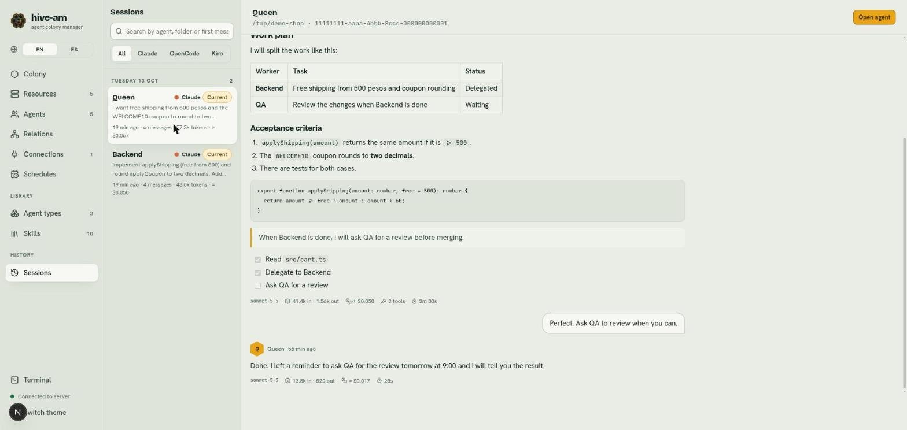
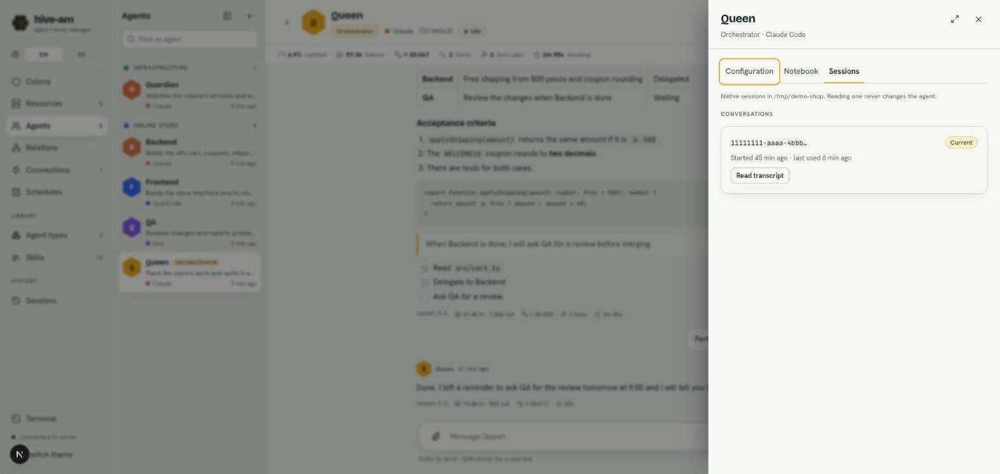

# Sessions

A session is one conversation of an agent. The **Sessions** section gathers the history of every conversation your agents have had, so you can search and read them. Inside each agent's settings, the **Sessions** tab lets you pick up an earlier conversation.

## What a native session is

hive-am does not store your conversations. It stores only a pointer: which native session each agent uses. The real conversation lives in the store of the CLI itself (Claude Code, OpenCode or Kiro), and hive-am reads it from there when it needs it.

That is why:

- If the power goes out, you close the browser or you restart the server, when you open the agent you see the whole conversation and the next message continues the same session.
- There are no summaries or parallel memory to keep in sync.
- The same conversations can be opened directly with the CLI.

> **Note:** what does not survive an interruption is a half-finished turn. If the agent was working when the server stopped, that turn is lost (the session stays intact) and you have to send the message again.

Each session belongs to a folder. If you change the agent's provider or its effective folder, the agent starts a new session and the earlier ones are kept for reading.

## Session types

| Type | What it is |
|---|---|
| **Direct** | The conversation between you and the agent. It is the one you see in its chat. One of them is the **Current** one |
| **Delegated** | The one opened when an orchestrator delegates a task to it. It is read-only and does not change its direct conversation |

Delegations run in their own session so that the direct chat with a worker contains only what you and the worker talked about. The trade-off: a worker does not remember earlier delegations, so the orchestrator must give it all the context in each task.

## The Sessions screen

Open **Sessions** from its card in Home (group **Library and history**) or with **Ctrl K** ("history" also finds it).

*On the left, the sessions from Tuesday, October 13 (Queen and Backend, both marked **Current**). On the right, Queen's transcript, with the **Open agent** button at the top.*

### What the list shows

- Sessions are grouped by day, with the number of sessions for each day.
- Each entry shows the agent, its provider, a label (**Current** or "Delegated by *name*"), the beginning of the first message and a summary: how long ago, number of messages, tokens and cost.
- Only the sessions managed by hive-am are shown, not every session that exists in the CLIs.

### Search and filter

- **Search:** type in "Search by agent, folder or first message".
- **Provider filter:** **All**, **Claude**, **OpenCode** or **Kiro**.

If nothing matches you see "No sessions match." If there are no sessions yet, send a message to any agent and it will appear here.

### Read a transcript

1. Click a session in the list.
2. The transcript loads on the right, in the same format as the chat (text, tool rows, footer of each answer). If it is long, **Show N earlier messages** appears at the top.

Reading never changes the agent.

### Open the agent

With a session open, click **Open agent** (top right) to go to its chat screen.

## An agent's Sessions tab

Here you see only one agent's sessions and can pick up an earlier one.

1. Open the agent and click **Settings**.
2. Go to the **Sessions** tab.

*Queen's settings, **Sessions** tab. Under **Conversations** there is a single one, marked **Current**, with when it started and its last use, and the **Read transcript** button.*

You will see two lists:

- **Conversations:** its direct sessions. The one it uses now has the **Current** mark.
- **Delegated tasks:** the sessions opened for it by orchestrators ("From *name*"), with the text of the task.

### Read an earlier conversation

1. On the session you want, click **Read transcript**.
2. The panel closes and the chat shows that conversation. The text box is replaced by the notice "You’re reading an older session. Make it current to continue it." and the statistics bar shows that session's numbers.
3. To leave, click **Back to current** in the header.

### Resume an earlier conversation

There are two ways to make it the current one:

- In the **Sessions** tab, click **Resume this one** on a conversation that is not the current one.
- While reading it, click **Make this conversation current** in the header.

You will see the notice "Conversation resumed". From then on, your next message continues that conversation.

> **Note:** only direct sessions can be resumed. Delegated sessions can be read, but **Make this conversation current** is disabled for them.

### Start from scratch

**New conversation** (in the chat header) leaves the agent with no current session: the next message opens a new one. The previous one stays in this tab, ready to be resumed. See [Chat](04-chat.md).

Next: [Schedules](08-schedules.md)
