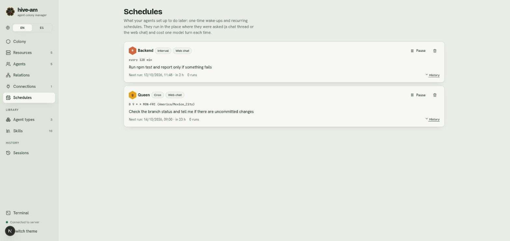

# Schedules

An agent only runs while it is handling a message. So that it can act later, hive-am gives it three ways to do so, and the **Schedules** section shows you everything the agents have left pending. You do not create schedules here: the agents create them. Here you view and manage them.

## The three ways to act later

| Way | What it is for | Example |
|---|---|---|
| **One-time reminder** (wake-up) | The agent wakes up once, in a while | "Tell me in 30 minutes if the deployment has finished" |
| **Recurring schedule** | The agent repeats a task on a timetable | "Every weekday at 9, check the QA logs and tell me" |
| **Watch a process** (watch) | The agent wakes up right when a command ends | "Tell me when the deployment finishes" |

Recurring schedules come in two kinds: **Cron** (a timetable with a time zone, for example `0 9 * * MON-FRI`) or **Interval** (every N minutes). In the list they appear as **Cron**, **Interval**, **Once** and **Waiting for a process**.

### One-time reminders

The agent schedules a reminder for 1 to 240 minutes ahead. When the time comes it receives a message in the same place where you asked: the same Telegram thread or its own web chat conversation. It checks what it was waiting for and reports to you. If it is still pending, it can schedule another one.

### Recurring schedules

- **Cron:** five fields (minute, hour, day of month, month, day of week). It accepts names such as `MON-FRI`, lists, ranges, steps and macros such as `@daily`. It carries a time zone (for example `America/Mexico_City`); if none is given, it uses the server's.
- **Interval:** every N minutes.
- When it is created, the agent tells you the next runs.
- Daylight saving time is respected: an hour that is skipped is skipped, and an hour that repeats runs only once.

### Watching a process until it ends

The agent launches a long command in the background and asks hive-am to watch it. hive-am only watches, it never runs anything. When the process ends:

- In a chat thread, hive-am immediately sends a one-line notice and wakes the agent so it reads the result and reports to you.
- In the web chat, it wakes the agent directly.
- If the process is still running when the wait limit is reached (120 minutes by default, 240 at most), the agent wakes up anyway and tells you how far it got.

## How they are created

The agents create them, with the **Wake-ups** skill. Without that skill, the agent cannot schedule anything.

1. Assign the **Wake-ups** skill to the agent (see [Agent types and skills](06-types-and-skills.md)). Agents that answer through a Telegram connection get it automatically.
2. Ask for what you want in plain language: "every weekday at 9, check the QA logs and tell me".
3. The schedule appears in **Schedules**.

> **Note:** agents that an orchestrator delegates to cannot create reminders or schedules during that task.

## The Schedules screen

Open **Schedules** in the side menu. If there is nothing, you will see "Nothing scheduled".

*Two example schedules. Backend has an **Interval** (`every 120 min`) and Queen has a **Cron** (`0 9 * * MON-FRI` in `America/Mexico_City`). Point at the **Web chat** label, the **Next run** line, the **Pause** button, the trash icon and the **History** link.*

Each card shows:

- The agent, the kind (**Cron**, **Interval**, **Once** or **Waiting for a process**) and where it runs (**Web chat** or the chat thread).
- The timetable and the note about what it should do.
- **Next run**, with the time and how long is left (on a watch, **Waits until**).
- **Last** run and the number of runs.
- A **Paused** label if you paused it.

### Pause and resume

1. On the card, click **Pause**. The schedule stops running.
2. To turn it back on, click **Resume**.

### Delete

1. Click the trash icon on the card.
2. Confirm in the "Delete this schedule?" prompt. It stops for good. The agent can create it again if you ask.

### View the history

Click **History** to see the runs (the last 50 per schedule are kept). **Hide history** closes it. If it has not run, you will see "It has not run yet."

Each run ends in a status:

| Status | What it means |
|---|---|
| **Delivered** | The message reached the agent |
| **Failed** | It could not be delivered |
| **Skipped (muted)** | The chat thread was muted |
| **Skipped (agent busy)** | The agent already had messages waiting |
| **Skipped (missed)** | The server was down and the run arrived more than 5 minutes late |
| **Skipped (connection off)** | The Telegram connection was off |
| **Paused (agent changed)** | The connection moved to another agent, so the schedule was paused |

> **Note:** a missed run is never made up: it is skipped and the next one is set.

## What it costs

Each run is a model turn, just as if you had written it a message, and it spends tokens. That is why hive-am sets limits:

- At least 15 minutes between runs of a recurring schedule.
- Up to 10 schedules per agent, and up to 5 pending reminders or watches per agent.
- Notes are short (up to 400 characters).

> **Tip:** check **Schedules** now and then. A schedule you no longer need keeps costing one turn each time until you pause or delete it.

## What happens if you restart hive-am

Reminders, schedules and watches are saved, so they survive a restart. Reminders that are more than 2 hours late are discarded.

Next: [Telegram connections](09-telegram-connections.md)
