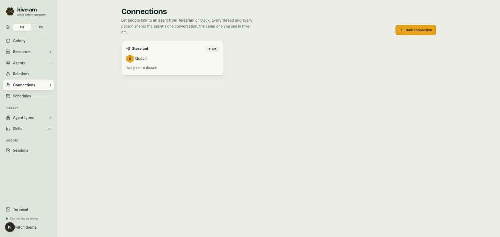
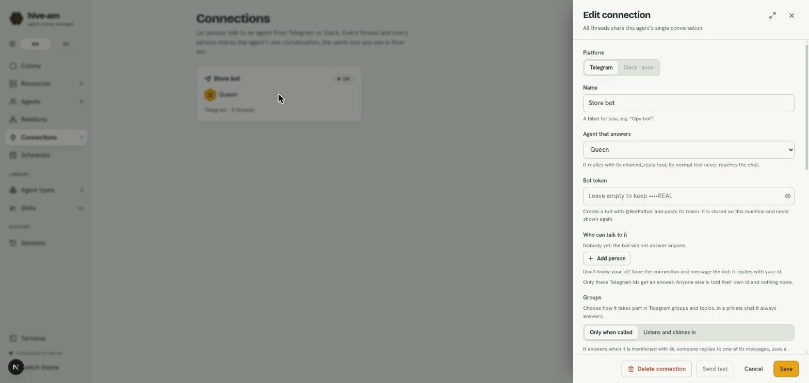

# Telegram connections

A connection links a hive-am agent to a Telegram bot so you can talk to it from your phone. Right now only Telegram exists; Slack appears as "soon". It works without a public URL: hive-am asks Telegram for new messages.

## How it works

- **A single conversation.** The connection is just an adapter. All messages from all threads and from hive-am's web chat share the agent's direct conversation. What you tell it on Telegram it remembers in the web chat, and the other way around.
- **The agent answers with `channel_reply`.** This is the tool it uses to reply to the thread of the message it is handling. Its normal text does **not** reach the Telegram chat.
- **While it works**, the bot shows "typing...". If the agent is busy, it tells you your message is queued.

*The connections list. The card shows the name, the agent that answers (Queen), the platform, how many threads it has and its status (here **Off**). At the top right is **New connection**.*

## Create the bot in Telegram

1. In Telegram, open a conversation with **@BotFather**.
2. Send `/newbot` and follow the questions (the bot's name and username).
3. BotFather gives you a **token**. Copy it.

## Create the connection

1. Open **Connections** and click **New connection**.
2. Under **Platform**, leave **Telegram** (Slack appears as "Slack · soon" and cannot be chosen).
3. Enter a **Name**, a label for yourself (for example "Store bot").
4. Under **Agent that answers**, choose the agent.
5. Paste the **Bot token**.
6. Add the people who can talk to it (next section).
7. Click **Create connection**.

*The connection panel. Point at **Agent that answers**, **Bot token** (it shows only the end of the saved token), **Who can talk to it**, and at the bottom the **Delete connection**, **Send test**, **Cancel** and **Save** buttons.*

> **Note:** the token is stored on this machine and is never shown again. When editing, leave it empty to keep the current one.

## Who can talk to it

Only the people in the **Who can talk to it** list get an answer. Anyone else is only told their own Telegram id by the bot.

### How to find a Telegram id

1. Save the connection and turn the bot on.
2. Message the bot from your Telegram account.
3. The bot replies with your id.
4. In the connection panel click **Add person**, enter the **Telegram id** and, if you want, the **Name (optional)**.
5. Click **Save**.

Each person has an **Admin** checkbox: they can reset the shared conversation with `/new`. Use **Remove** to take someone off the list. If the list is empty, the bot answers nobody.

## Groups

In a private chat the bot always answers. For groups and topics, the **Groups** section lets you choose **When it speaks in a group**:

| Mode | What it does |
|---|---|
| **Only when called** | Answers when it is mentioned with @, someone replies to one of its messages, uses a command or says its name |
| **Listens and chimes in** | Reads everything that is written and speaks only when it has something useful to add |

- **Allowed groups:** click **Add group** and enter the group id (it usually starts with `-100`). Any member of that group can talk to it without being in the people list, and the agent's permissions apply to everyone. To find the id, mention the bot in the group: it replies with the chat id.
- **Names it answers to:** aliases separated by commas (for example "Morena, queen"). If someone writes one in a group, it counts as a mention.
- **Telegram hides group messages** that do not mention the bot (privacy mode). To use **Listens and chimes in**, send `/setprivacy` to @BotFather and choose **Disable**, then add the bot to each group again.

## Threads and muting

The connection panel lists the **Threads** (a private chat, a group or a group topic) with the last message and its activity. Each thread has a button to **Mute** or **Unmute**.

A muted thread does not wake the agent for general chatter. A mention, an alias, a reply to its message or a command does wake it. You can also mute from the chat:

| Command | Who | What it does |
|---|---|---|
| `/stop` | Any authorized person | Aborts the turn in progress |
| `/status` | Any authorized person | Shows agent, status, folder and queue |
| `/mute` and `/unmute` | Any authorized person | Mutes or unmutes the agent in that thread |
| `/new` | Admins only | Asks for confirmation (`/new confirm`) and resets the shared conversation |

The agent can also mute itself if someone asks it to.

## Files and images

- **Receiving files:** authorized people can send photos, documents, audio, voice notes and videos (up to 20 MB each and 5 per message). They are saved on your machine for 14 days and the agent opens them with its file tools. The agent cannot listen to audio or watch video. Turn it on or off with **Receive files**.
- **Seeing images:** many models do not accept images. This option lets you choose **With the agent's model** or **With another model** (for example Claude Haiku). With "another model", that model describes each image and the description travels with the message. **The image is sent to that provider.**
- **Sending files:** the agent sends files to the chat with `channel_send_file`, only from its working folder, the received-files folder or the temporary one. It never sends files such as `.env`, keys, databases or `.git` folders.

## Other settings

- **Bot language:** Spanish or English (the bot's notices).
- **If the agent finishes without replying:** **Tell the thread**, **Send its plain text** or **Do nothing**.
- **Reasoning effort:** **Agent default**, **Low**, **Medium**, **High**, **Extra high** or **Max**. It overrides the effort set on the agent, only for the turns of this connection; leave it on **Agent default** to use the agent's. **Low** answers a bit faster. With OpenCode the level becomes the variant its model has for it; if the model has none, the agent's own is used.
- **Active:** turn it off to stop the bot without deleting it.

## Statuses

Each card shows a status:

| Status | Meaning |
|---|---|
| **Connected** | The bot is active |
| **Connecting…** | It is starting up |
| **Problem** | Something failed (for example, an invalid token); the reason appears in the connection |
| **Off** | The connection is turned off |

## Send a test

With the connection saved and active, open its panel and click **Send test**. It checks the token and greets the allowed people. If it fails, you will see "The test failed" with the reason.

## Agent permissions

A **Read-only** agent cannot reply through a channel. If you try, the panel warns you and offers **Allow editing files**. With **Full access**, anyone on the list can make the agent run anything on your machine: hive-am shows a warning. More in [Permissions and security](13-permissions-and-security.md).

## Security

- It only answers authorized people (or groups).
- The token is never shown again, and the agent must not look for it or use it: it sends everything through hive-am's tools. This is an instruction to the model, not a technical barrier. If you suspect it leaked, generate a new one in @BotFather.
- Secrets are not shared over chat: before sending a text, the server blocks those that contain known keys or tokens.
- Messages from an external chat carry a header with their origin. In hive-am's web chat they appear as a channel bubble.

> **Tip:** if you share the agent with people you do not fully trust, use minimal permissions.

Next: [Resources](10-resources.md)
