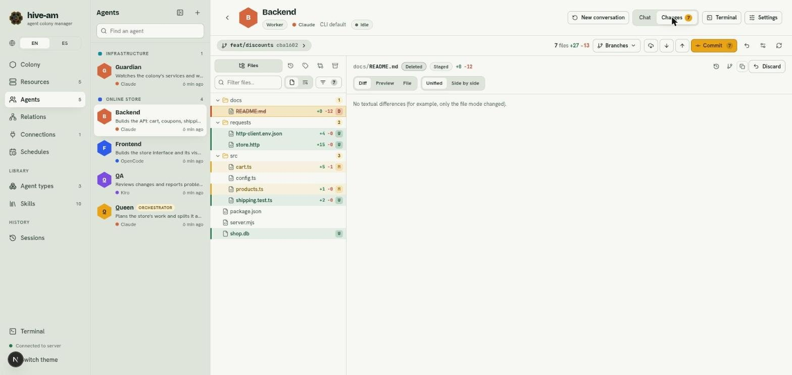
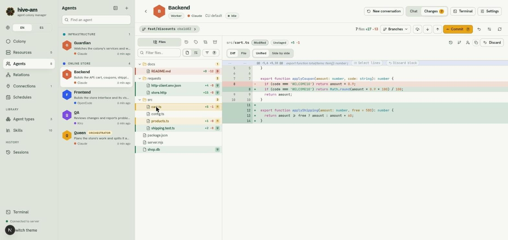
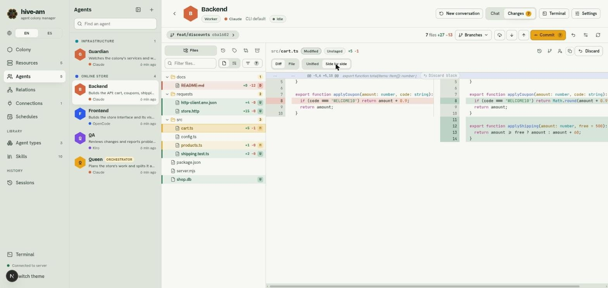
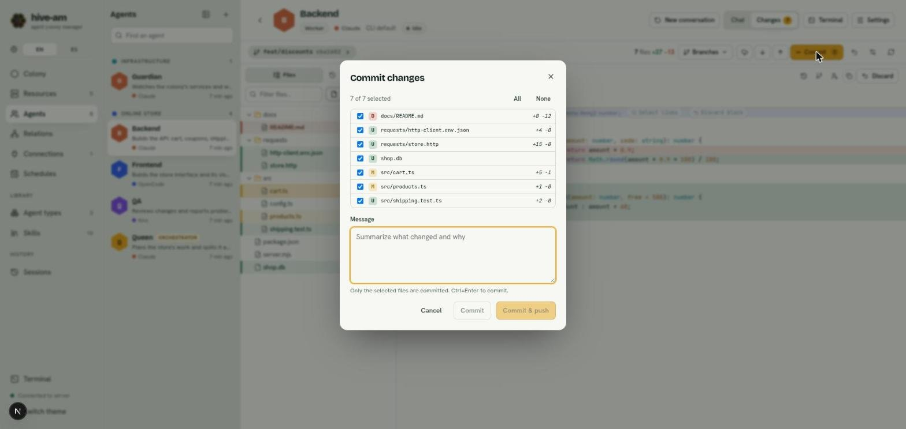
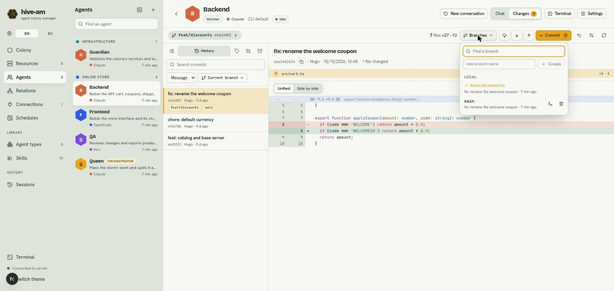
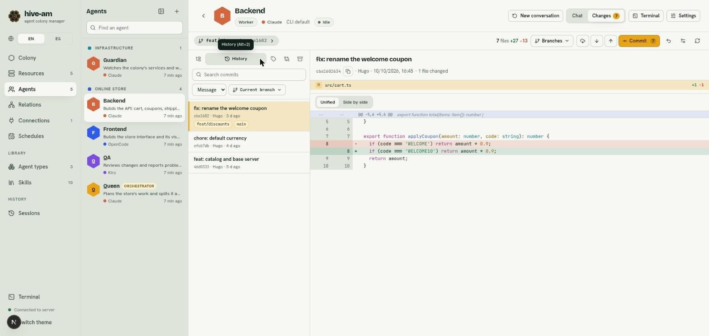

# Changes explorer (git)

On each agent's screen, next to **Chat**, there is a **Changes** tab. It is an explorer for the folder where the agent works: it shows all its files, highlights the ones git considers changed and, when you pick one, shows its diff or its content. From there you also run the usual git actions (commit, fetch, pull, push, branches) and browse the history.

Use it to review what an agent did before accepting it, and to save it in git without leaving hive-am.

> **Note:** you cannot edit code from this tab. What you can do is discard changes and resolve merge conflicts.

## The header: branch and summary

When you open **Changes** (the number on the tab tells you how many files have changes), at the top you see:

- **The branch badge:** the branch name, the short hash of the last commit and, if there are commits ahead of or behind the remote branch, `↑n ↓n`. Press it to expand the full details: the remote branch and its status, the full message of the last commit, its author and its date. Each name and hash has a button to copy it.
- **The summary:** how many files changed and the lines added and removed compared with the last commit (for example `7 files changed +27 -13`).
- **The git buttons:** **Branches**, **Fetch**, **Pull**, **Push** and **Commit**. Pull and Push show a counter with the commits to bring in or to send, and Commit shows how many files have changes.
- **More icons:** discard all changes, the code view settings (**Code view settings**) and refresh (the reload icon).

If the agent works in a subfolder of the repository, everything is limited to that subfolder and you are told so.

> **Note:** if the folder is not a git repository, the tab says so and suggests running `git init` in that path. If `git` is not installed, it tells you that it is not available.

## The file tree

On the left is the tree with **all the files git knows about** in the folder: the versioned ones plus the new unversioned ones. Files ignored by `.gitignore` (such as `node_modules`) are shown dimmed and in italics, and you can open them to read them. Deleted files keep appearing, marked.

Each file with changes has a colored bar, its name in bold, a status letter and, if known, the `+added -removed` lines. Folders with changes carry a counter.

| Letter | Status | When |
|---|---|---|
| **M** | Modified | The file changed. |
| **U** | Untracked | It is new and not in git yet. |
| **A** | Added | It is new and already staged. |
| **D** | Deleted | It was deleted (the name is struck through). |
| **R** | Renamed | It was moved or renamed. |
| **!** | Conflict | There is a merge conflict. |
| **T** | Type changed | For example, from a file to a symbolic link. |

*The Changes tab of "Backend". In the tree, docs/README.md appears deleted (D), store.http and http-client.env.json as new (U) and cart.ts and products.ts as modified (M). At the top, the feat/discounts branch, the summary and the Branches, Commit and other buttons.*

### Filter and search

- The **Filter files…** box searches by path and opens the folders that match.
- The **All files** / **Changed** selector switches between seeing the whole tree and only what changed.
- In the **Files** tab you can switch the filter from **Name** to **Content** to search inside the files (up to 300 matches). When you press one, the file opens at that line.
- With the keyboard, the up and down arrows move the focus, and right and left open and close folders. The `/` key jumps to the filter.

## See a file's changes

When you pick a file, the right side shows its content. For a file with text changes, the view opens on **Diff**, with these tabs:

- **Diff:** what changed since the last commit.
- **Preview:** only for Markdown files, it shows the formatted text.
- **File:** the full content. On a modified file, it marks added and modified lines in color, and when you press a mark the change block opens, with arrows to go to the previous and next change.

A file with no changes opens directly on **File**. Images are shown as images (also if they were modified) and binary files only tell you that they are binary.

A heading shows the status of the change and whether it is **Staged** or **Unstaged**. Diffs are always calculated against the last commit and include both what is staged and what is not.

### Unified and side by side

Next to the tabs you have two ways to view diffs:

- **Unified:** a single column, with removed lines in red and added lines in green, and line numbers from before and after.

*Diff of cart.ts in Unified view. You see the changed coupon line (red and green) and four new lines of applyShipping. Above the block are the Select lines and Discard block buttons.*

- **Side by side:** the original on the left and the new version on the right. Both halves scroll sideways together.

*The same change in Side by side. On the left is the original line (red) and on the right the new one (green) together with the added lines. Below there is a horizontal bar to scroll through long lines.*

The **settings** (the settings icon in the bar) let you change the color theme, show whitespace and choose the tab width. They are saved only in this browser and apply to the viewer, the diffs and the history.

### Blame and other versions

In the **File** tab of a versioned file, the **Blame** button adds a column with the commit and author of each stretch. When you click one, that commit opens in the history. **File history** lists only the commits that touched the file, and **View at…** shows the file as it was on any branch, tag or commit.

## Discard changes

You can discard at three levels. It is always compared with the last commit and **there is no backup**.

| Where | What it discards |
|---|---|
| **Discard** button in the file header | All the changes in that file. A new file is deleted completely. |
| **Discard block** button in a block's heading | Only that block (in modified files). |
| The undo icon in the bar | Everything changed in the agent's folder. |

To discard individual lines:

1. In the **Unified** view, press **Select lines** in the block heading.
2. Mark the `+` or `-` lines you want to undo (with the checkbox or by clicking the row). **All** marks them all.
3. Press **Discard N lines**, or **Cancel** to leave.

Discarding a file or all changes always asks for confirmation, and the warning tells you with numbers what will be lost. Discarding a block or individual lines happens instantly. Files in conflict cannot be discarded: you resolve them or abort the merge.

## Make a commit

1. Press **Commit** in the bar. The **Commit changes** dialog opens.
2. Review the list of changed files. All of them come checked; use **All** or **None**, or uncheck the ones you do not want to include.
3. Type the **Message**: summarize what changed and why.
4. Press **Commit**, or **Commit & push** to also send the branch. **Ctrl+Enter** also confirms.

*The Commit changes dialog. At the top, "7 of 7 selected" with the All and None buttons; in the list, each file with its status letter and its lines. Below, the Message box and the Cancel, Commit and Commit & push buttons (disabled while the message is empty).*

Only what is checked is committed. The repository's *hooks* run. If a merge is in progress, git does not allow partial commits and everything that is staged is committed.

> **Note:** if the agent is in the middle of a turn, a warning appears: committing, pulling or switching branches now may collide with its edits. The actions are not blocked, the decision is yours.

## Fetch, pull and push

| Button | What it does |
|---|---|
| **Fetch** | Brings in information from all remotes (`git fetch --all --prune`). It does not touch your files. |
| **Pull** | Brings in changes only if they are fast-forward. If the branches have diverged, the notice offers **Pull with merge** and **Pull with rebase**. |
| **Push** | Sends the branch. If it has no remote branch yet, it creates one. It never uses `--force`, and it is disabled if the branch is detached. |

When it finishes, a notice shows the last line git printed. If git fails (credentials, conflicts, local changes), you see its text as is in a red notice. If credentials are missing, git fails instead of waiting.

## Branches

The **Branches** button opens a menu with a search box, your **Local** branches and the **Remote** ones.

*The Branches menu over the history view. At the top, the search box and the "new-branch-name" field with the Create button. Below, the local branches: feat/discounts (the current one, with a check mark) and main, with the merge and delete icons on the right.*

- **Switch branch:** click a branch. A remote branch becomes a local branch that tracks it.
- **Create a branch:** type the name in the field and press **Create**. It starts from the current branch.
- **Merge:** a branch's merge icon asks for confirmation and merges it into the current one.
- **Delete:** the trash icon deletes a local branch. If git refuses because it has commits that are in no other branch, the dialog offers **Delete anyway**. You cannot delete the branch you are on.

### Smart branch switch

If you have uncommitted changes, hive-am switches branches without losing them and without asking:

- If none of your files collide with the target branch, your changes travel with you.
- If something collides, hive-am saves your changes in a *stash*, switches branch and applies them again. If there is a conflict, a **Smart switch in progress** strip remains so you can resolve it, with **Finish** or **Cancel smart switch** (which leaves everything as it was).
- The only thing it asks about: if another agent is working in the same repository right now, the notice offers **Switch anyway**.

## Commit history

The **History** tab (next to **Files**) lists the commits of the current branch, 30 per page with **Load more**: subject, hash, author, date and the branches that point to it. When you pick a commit you see its full message, author and date, the files it touched with their lines and the diff of each one (unified or side by side). For a merge commit, the changes shown are against the first parent.

*The History tab. On the left, the search box and the filters (Message, Current branch) above the list of commits. On the right, the commit "fix: rename the welcome coupon" with its diff.*

To search:

1. Type in **Search commits**.
2. Choose what to search by: **Message**, **Author** or **Content** (commits that added or removed that text).
3. Choose **Current branch**, another branch, a tag or **All branches**. You can also paste a hash to jump to it.

## Tags, compare and stashes

Next to **Files** and **History** there are more side tabs:

- **Tags:** lists the repository's tags, with a search box. When you pick one you see the files as they were at that tag and its changes. **Create a branch here** creates a branch at the tag without switching you to it.
- **Compare:** two selectors, *From* and *To*, for branches, tags or a pasted commit. It shows how many commits apart they are, the commits in between, the changed files and their diffs.
- **Stashes:** lists the saved stashes. You can **Save changes to stash**, **Apply** (keeps the stash), **Apply and delete** and **Delete** (with confirmation).

All of this is read-only, except the stash actions and creating a branch.

## Resolve conflicts

When a merge, a pull with merge or a rebase leaves conflicts, a **Merge in progress** (or **Rebase in progress**) strip appears with the number of files in conflict and the **Abort merge** button. Files in conflict carry the letter **!**, and when you pick them the resolver opens:

1. Each conflict is a block with two columns: **Mine (current branch)** and **Remote (incoming)**.
2. In each block choose **Keep mine**, **Keep remote** or **Keep both**. You can mix decisions between blocks.
3. Review the result, which is at the bottom and can be edited by hand.
4. Press **Mark as resolved**. It is rejected if `<<<<<<<` or `>>>>>>>` markers remain.
5. With everything resolved, the strip offers **Finish merge (commit)** (or **Continue rebase**).

**Keep all mine** and **Keep all remote** take one whole side of the file and are the only option for binary files.

## Tips and limits

> **Tip:** open the Changes tab when an agent's turn ends. It refreshes by itself at the end of each turn and every 5 seconds while the agent works, and the reload icon forces it.

- hive-am never uses `--force` and never skips *hooks*.
- Actions that write are only accepted from the local app.
- An ignored `.env` file can be opened and is shown on screen like any other: be careful when sharing your screen.
- There is no *cherry-pick* or interactive *rebase*.

Next: [Terminals](12-terminals.md)
