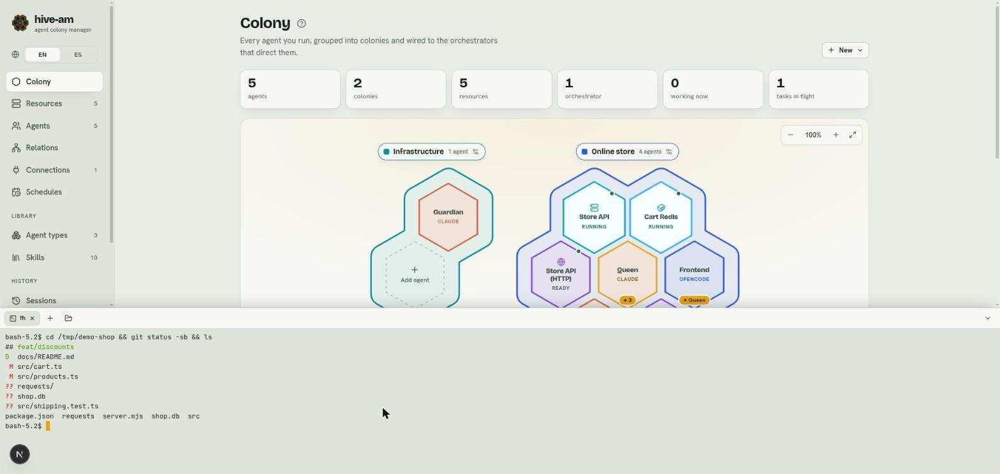

# Terminals

A panel at the bottom of every screen holds **terminals** (real shells on your machine) and resource **logs**, in tabs. Use it to run commands, check a server or look at a project without leaving hive-am. Because it sits below the screen you are on, a chat stays usable while you watch a server.

*The bottom panel with a terminal in the sample project folder, after running `git status -sb && ls`. At the top of the panel are the terminal's tab, the **+** button and the folder button.*

## Open the panel

- Press **Ctrl+`** on any screen, or click the **Terminal** button at the bottom of the sidebar (it shows a number when terminals are open).
- The first time, it starts a terminal in your home folder.
- Drag the top edge of the panel to change its height. The screen above gets the remaining height, so nothing hides behind it.
- The button in the panel's corner hides it (**Hide the panel**). The browser remembers whether it was open, its height and the last tab.

## What you can open

- **+** opens a terminal in the folder of the last one (your home folder at first).
- The folder button (**Terminal in a folder…**) asks you for a folder and opens the terminal there.
- From an agent's header, the **Terminal** button opens a terminal in that agent's folder.
- From a resource's panel (see [chapter 10](10-resources.md)):
  - On a **server**, **Terminal here** opens a terminal in its folder.
  - On a Docker container, **Shell in the container** opens a shell inside it (it uses `bash` or, if there is none, `sh`). A compose project has several containers, so it only offers logs.
  - Every resource that has logs offers **Logs in the panel**, which opens them as one more tab.

> **Tip:** on a resource's card on the map you also find **Terminal here** and **Logs in the panel**, without going into its screen.

## The tabs

- Each tab is a terminal or a resource's logs. The **×** closes the tab. Closing a terminal ends it.
- A gray dot means the shell has ended. The exit code appears in the tooltip on hover and is written in the terminal itself ("Ended with code N").
- You can have up to **12** terminals at a time.

## How they work

Each terminal is a shell that runs on the hive-am server and that the page draws. That means:

- If you reload the page or open another one, you see the same terminals and the latest output they printed is replayed (up to 256 KB).
- Terminals end when the server stops. Server resources, on the other hand, keep running.
- Colors, arrow keys, `vim`, `top`, resizing and accented text work like in any terminal.
- The shell is yours (the interactive one from `$SHELL`), with your environment.

## Only from this machine

A terminal is **your shell on your machine**: whoever can talk to it can run everything you can. That is why hive-am only allows terminals from this machine:

- The page must have been loaded from a local address (`localhost`, `127.0.0.1` or `[::1]`). If you open hive-am through an address on your local network, you will not get terminals.
- Another website open in your browser cannot reach a terminal.
- The server only listens on `127.0.0.1`.
- **Agents have no tool to open or use terminals**: they keep working with the tools of their own CLI and their permission level.

To turn terminals off completely, start hive-am with `HIVE_AM_TERMINALS=0`. The panel will show: "Terminals are turned off on this server."

## If a terminal does not open

- The panel says "The terminal could not be opened." or that terminals are turned off. Check that you are not using `HIVE_AM_TERMINALS=0` and that you open hive-am from `localhost` or `127.0.0.1`.
- The library that creates the terminals (`node-pty`) is optional. Where it cannot be installed or loaded, hive-am works anyway and opening a terminal tells you so. Reinstall hive-am without the `--omit=optional` option to have it.
- A tab that says "This terminal is gone" was left behind after a server restart. Open it again with **+**.

Next: [Permissions and security](13-permissions-and-security.md)
