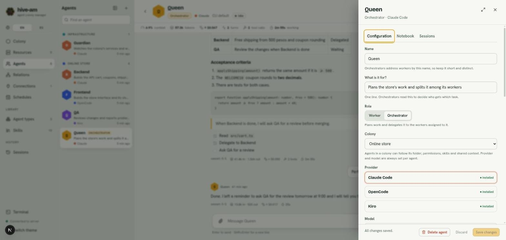

# Permissions and security

hive-am is a local tool for one person. Agents run coding CLIs on your machine, so it is worth knowing what they can do, what hive-am protects and what is up to you. This chapter explains the permission levels, inheritance from the colony, who can reach what, and where your data and secrets are stored.

## The three permission levels

Each agent has one permission. You choose it in the agent form, in the **What can it do?** field.

| Level | Description in the interface |
|---|---|
| **Read-only** | Plans and reads; never edits files or runs commands |
| **Edit files** | Edits files freely; other risky actions follow the CLI’s own rules |
| **Full access** | Runs anything without asking. Use in throwaway folders |

An agent is not interactive: if an action needs approval, it cannot ask you for it. That is why the level decides what gets done and what fails.

*Queen's settings, **Configuration** tab. The permission field is in the form, lower down than the provider (scroll inside the panel). If the agent inherits its colony's permissions, you will see the **Following** row instead.*

## What each level means for each provider

The three levels apply to all four providers, but each CLI implements them in its own way.

| Level | Claude Code | OpenCode | Kiro | Cursor |
|---|---|---|---|---|
| **Read-only** | Claude's planning mode | Editing, commands and tasks are denied | No trusted tools | Plan mode; writing and commands are denied |
| **Edit files** | Edits files, without touching `.git` or keys. File commands (`touch`, `mv`...) are let through. Other shell commands are not approved and fail | Edits (including `.env`), no commands, no `.git` or keys, only inside its folder | Same as OpenCode | Edits (including `.env`), no commands, no `.git` or keys, but **it can write outside its folder** |
| **Full access** | No restrictions | No restrictions | All tools trusted | No restrictions |

> **Note:** in **Read-only**, Claude Code also blocks hive's tools (delegate, notebook, on-demand skills). In that case on-demand skills are included in full in the instructions.

## What the Edit files level protects

With **Edit files**, all four providers:

- Cannot edit `.git`.
- Cannot edit private keys (`*.pem` and `*.key` files).
- Cannot leave the agent's folder, **except Cursor**: Cursor has no rule that keeps its file tool inside a folder, so a Cursor agent can create or change files elsewhere on your machine. Give a Cursor agent **Edit files** only where you would also give it that, or use **Read-only**.
- Can edit `.env`.

OpenCode, Kiro and Cursor block all shell commands at this level. Claude allows only file commands.

> **Tip:** if you want an agent to run tests or install dependencies, it needs **Full access** (in Claude, some commands get through at **Edit files**, but do not count on it). Give that level only in a project you can recover with git.

The agent's working folder is its boundary. In OpenCode, the only exception is the attachments inbox (`~/.hive-am/inbox/`).

## Permission inheritance from the colony

A colony can lend its permissions to its agents. When you save a colony, hive-am asks "What should its agents inherit?" and you can tick **Permissions**. Then:

- The colony's permission replaces the agent's.
- In the agent form you will see the **Permissions** *from colony* row with the **Following** mark. Click it to switch to **Own value** and set a permission just for that agent.
- The folder, the context and the skills are inherited differently. See [The colony](02-the-colony.md).

Permissions are one of the fields that can be inherited. The provider and the model are never inherited.

## Agents with external connections

An agent linked to Telegram or Slack cannot be at **Read-only**: a read-only agent cannot reply through a channel. In the form, that option appears locked ("Not available while the agent is linked to a connection.").

Also, whoever can talk to it through the channel controls what the agent does with its permissions:

- With **Full access**, anyone on the list of authorized people can make it run anything on your machine.
- Authorizing a group gives that access to all of its members, including people who join later. To keep a group with **Full access**, choose **Only these people** under it and list who may talk there: then only that list gets in, not even the people of **People (direct messages)** unless you add them too, and an empty list admits nobody. A group you do not list at all still lets in the people of **People (direct messages)**.
- OpenCode ignores the permission setting in these cases, and can edit files and run commands whatever the setting says. The connection screen warns you about it.

See [Connections](09-telegram-connections.md).

## Who can reach hive-am

- **The server listens only on `127.0.0.1`.** Other machines on your network cannot reach it. The web app uses port 4401 and the server 4400.
- **There is no login.** Anyone who can open hive-am from this machine can create agents and talk to them. Trust your own user session.
- Web pages you open in your browser could try to talk to the local server. While hive-am is running, avoid browsing sites you do not trust.
- The Next web interface can show a local network address. That is why the most sensitive actions (next section) are rejected if they do not come from the app itself.

## What can only be done from this machine

Some actions run real commands, so hive-am rejects them if the request does not come from the local app:

- **Resources:** creating, changing, deleting and acting on servers, containers and clusters. See [Resources](10-resources.md). Running the requests of an HTTP resource and querying a database also count (they use the saved password).
- **Terminals:** they are your own shell. They only open if the server was reached through a local name (`localhost`, `127.0.0.1` or `[::1]`). Opening hive-am through a local network address gives no terminals. Agents have no tool to open or use terminals. See [Terminals](12-terminals.md).
- **Git actions:** commit, pull, push and branches. They never force or skip *hooks*, and they are limited to the agent's folder. See [Changes explorer](11-changes-explorer-git.md).

## Where your data is stored

Everything lives in your home folder, in `~/.hive-am/`:

- `hive-am.db`: the database with agents, colonies, types, skills, connections and the notebooks.
- `inbox/`: the files an agent receives, through the chat or through a channel. They are kept for 14 days, with a maximum of 20 MB each, and are never run.

You can change the folder with the `HIVE_AM_HOME` environment variable.

Conversations are not there: each CLI stores them in its own store (for example `~/.claude`). See [Sessions](07-sessions.md).

What hive-am keeps of its own record does not grow for ever. Every six hours it forgets the messages of a channel conversation past the newest 500 once they are 30 days old, the delegations past the newest 200 (except a background task whose result has not reached its orchestrator yet), the delegated conversations of an agent past the newest 50 once they have not been used for 90 days, and the conversations of the list that the CLI no longer has once they have not been used for 90 days (the one an agent is using now is never forgotten). Only hive-am's own list is trimmed: the conversations themselves, in each CLI, are never touched.

> **Note:** the database holds your prompts, skills and the agents' notebooks in plain text. The notebook rejects notes with credentials.

## Agents that build colonies

The **Colony builder** skill lets an agent create, change and delete colonies, agents and resources of **any** colony, and give any permission, **Full access** included. Giving it this skill is giving it control over everything hive-am runs: it can create an agent with Full access, or a server that runs a command. Assign it only to an agent you trust with everything, and take it away from the ones that do not need it (in the agent's form, or in its colony's skills if it comes from there).

What the server enforces, whatever the agent is told:

- An agent in **Read-only** (Plan mode) with the skill can still use all of its tools: Plan mode limits what it does in its folder, not these tools. It can give **Edit files** or **Full access** to others too; the skill tells it to ask you before giving Full access.
- It never sees a password, a secret variable or an `env` value, and it cannot save a password or a secret: you fill those in from the web app.
- It cannot touch Telegram or Slack connections, nor delete an agent that has one.
- It cannot delete itself, the orchestrator it works for, an agent it has a task with, or its own colony, and it cannot take this skill away from itself.
- It deletes only when it gives the exact name of what is deleted; the first attempt only says what would go.

The skill tells it to ask you before building, to change only what you asked for and to delete only after your explicit yes in the same message. The server cannot know who said yes: in a Telegram or Slack group, a message from someone else could ask it to delete something. Keep this agent out of shared groups, or limit them to **Only these people**.

## Where secrets go

- **The CLIs use their own session.** hive-am does not store your Claude, OpenCode, Kiro or Cursor logins.
- **Bot token:** the only credential hive-am stores is the bot token of each external connection, in `hive-am.db`. The API never returns it: the interface shows only a hint (like `••••1234`). When you edit the connection, if you leave the field empty the stored one is kept.
- **Database passwords:** those of database-type resources are stored locally and are not returned by the API. Only the local actions described above use them.
- **Tokens never reach the agent:** when an agent replies through a channel, it is the server that sends the message.

> **Important:** an agent with file access could read `hive-am.db`, where the bot token is. The instructions tell it not to look for it, and the server checks what is sent through a channel to block known secrets, but that does not replace a prudent permission level.

## Practical recommendations

1. Start with **Edit files** and move up to **Full access** only in throwaway folders or folders backed up with git.
2. Use **Read-only** for agents that review code or answer questions.
3. Give each agent its own narrow folder, not your home folder.
4. Review the changes in the **Changes** tab before you commit.
5. With connections, authorize only people and groups you trust, and limit shared groups to **Only these people**.
6. Do not put passwords or tokens in prompts, skills or notebooks.
7. Give the **Colony builder** skill to one agent you trust, not to a whole colony.
8. Do not expose hive-am's port to the network (for example with a tunnel) while there is no login.
9. Back up `~/.hive-am/` if your setup matters to you.

Next: [Troubleshooting](14-troubleshooting.md)
