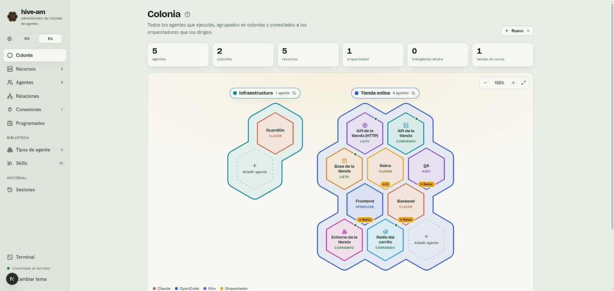
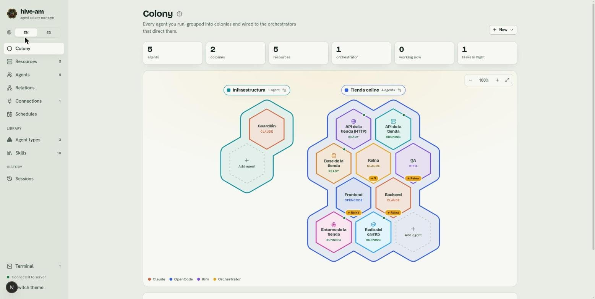
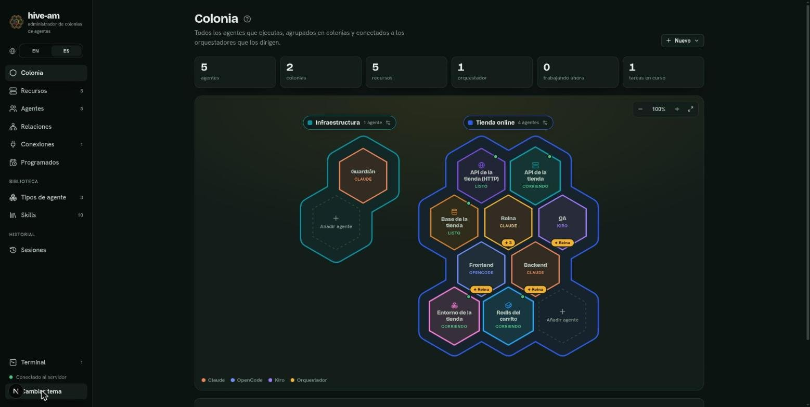
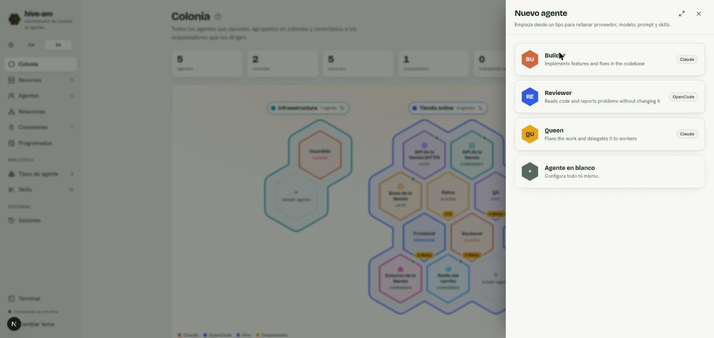
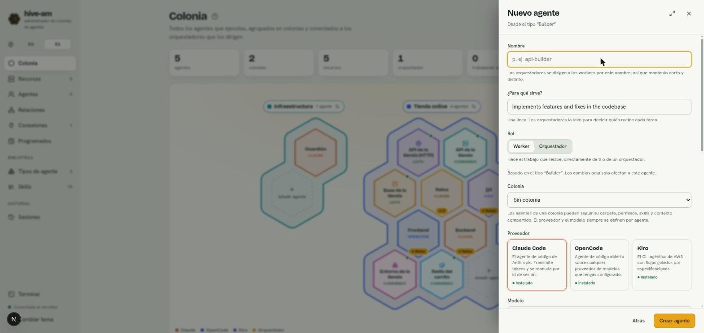
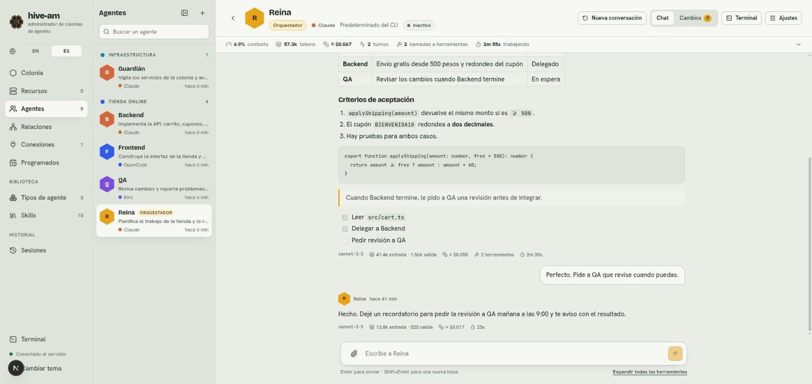

# Primeros pasos

Este capítulo te lleva desde cero hasta tu primer agente conversando: qué necesitas, cómo arrancar hive-am, cómo moverte por la interfaz y cómo crear y probar un agente.

## Requisitos

- **Node.js 20 o superior.**
- **macOS o Linux.**
- Al menos una de estas herramientas instaladas **y con la sesión iniciada**: `claude` (Claude Code), `opencode` o `kiro-cli`. No hace falta tener las tres.

> **Nota:** hive-am ejecuta esas herramientas tal como están en tu equipo. Si una no funciona sola en tu terminal, tampoco funcionará desde hive-am.

## Cómo iniciar hive-am

Elige una de las tres formas.

**Con npx (sin instalar nada):**

```bash
npx hive-am
```

**Con instalación global:**

```bash
npm install -g hive-am
hive-am
```

**Desde el código fuente:**

```bash
git clone git@github.com:hughcbscrt/hive-am.git
cd hive-am
npm install
npm run dev
```

Cuando arranque, abre <http://127.0.0.1:4401> en tu navegador.

### Puertos

- El servidor (API y WebSocket) usa el puerto **4400**.
- La interfaz web usa el puerto **4401**. Para cambiarlo: `HIVE_AM_WEB_PORT=4500 hive-am`.
- Con el paquete de npm, el puerto de la API es fijo.

### Detener, actualizar y ayuda

- Detén hive-am con **Ctrl+C** en la terminal donde lo arrancaste. Para dejarlo corriendo sin mantener una terminal abierta, arráncalo con `hive-am start --background`: te dice dónde está su log, y después `hive-am status` indica si está corriendo, `hive-am logs -f` muestra lo que imprime y `hive-am stop` lo detiene (`hive-am restart` hace ambas cosas). Los servidores y contenedores que hayas dejado como recursos siguen corriendo.
- Actualiza con `hive-am update` (consulta npm por una versión más nueva y la instala; `hive-am update --check` solo dice si la hay, y `hive-am update --restart` además reinicia un hive-am que dejaste corriendo en segundo plano). Con npx: `npx hive-am@latest`. `hive-am version` imprime la versión que tienes.
- `hive-am --help` muestra las opciones y `hive-am --version` la versión instalada.

### Dónde se guardan los datos

Todo se guarda en `~/.hive-am` (la base de datos es `~/.hive-am/hive-am.db`). Para usar otra carpeta, define la variable `HIVE_AM_HOME` antes de arrancar. Las conversaciones no están ahí: viven en los almacenes de cada herramienta (Claude Code, OpenCode, Kiro). hive-am mantiene su propio registro dentro de límites: los mensajes de canal viejos, las delegaciones y las conversaciones que la herramienta ya no tiene se olvidan con el tiempo, nunca las conversaciones en sí ([detalle](13-permisos-y-seguridad.md)).

> **Consejo:** para hacer una copia de seguridad, detén hive-am y copia la carpeta `~/.hive-am` completa.

## Recorrido por la interfaz



*La pantalla Colonia. A la izquierda, el menú lateral con todas las secciones; abajo a la izquierda, el botón **Terminal**, el indicador de conexión y **Cambiar tema**.*

El menú lateral tiene estas secciones:

- **Principal**
  - **Colonia**: el mapa con tus agentes y recursos ([capítulo 2](02-la-colonia.md)).
  - **Recursos**: servidores, contenedores, peticiones HTTP y clústeres ([capítulo 10](10-recursos.md)).
  - **Agentes**: la lista de todos tus agentes y su espacio de trabajo ([capítulo 3](03-agentes.md)).
  - **Relaciones**: el lienzo donde conectas orquestadores con workers ([capítulo 5](05-orquestacion-y-relaciones.md)).
  - **Conexiones**: enlaces con Telegram ([capítulo 9](09-conexiones-telegram.md)).
  - **Programados**: mensajes que se envían a una hora definida ([capítulo 8](08-programados.md)).
- **Biblioteca**
  - **Tipos de agente**: plantillas de agente.
  - **Skills**: conocimientos reutilizables ([capítulo 6](06-tipos-y-skills.md)).
- **Historial**
  - **Sesiones**: las conversaciones de todos los agentes ([capítulo 7](07-sesiones.md)).

Al final del menú están el botón **Actividad** (avisos de agentes que terminaron, ver más abajo), el botón **Terminal** (abre el panel de terminales, [capítulo 12](12-terminales.md)), el indicador de estado del servidor y **Cambiar tema**, con la versión de hive-am instalada (por ejemplo `v1.7.0`) debajo. En pantallas estrechas no se muestra.

Para dar más espacio a la pantalla, el botón de panel junto al nombre hive-am (**Contraer el menú**) pliega el menú a una columna estrecha de iconos. Al pasar el mouse o llevar el foco a un icono se ve su nombre, los contadores quedan como pequeñas insignias y **EN** / **ES** quedan uno encima del otro. El mismo botón (**Expandir el menú**) lo vuelve a abrir. Tu elección se recuerda en el navegador. En una pantalla estrecha (menos de 760 px) el menú es una barra superior con sus etiquetas y no se pliega.

### Actividad: lo que terminó mientras mirabas otra cosa

Cuando un agente termina una respuesta y no estás mirando su chat (estás en otra pantalla, en otro agente o la pestaña está en segundo plano), deja un **aviso**: un punto verde en su avatar (rojo si necesita atención) en la lista lateral del chat y en el mapa de Colonia, y un número en el botón **Actividad**. Actividad es el primer botón del pie del menú, justo encima de **Terminal**; su insignia cuenta los agentes con algo sin leer (verde, o roja si alguno falló; `99+` a partir de 100). La pestaña del navegador también lo dice: `(3) hive-am`.

Haz clic en **Actividad** para abrir su panel:

- **Sin leer**: una fila por agente, la más reciente arriba, con su colonia, **Terminó** o **Necesita atención**, hace cuánto y las primeras palabras de su última respuesta. Haz clic en una fila para abrir ese chat, o en la **×** para marcarla como leída. **Marcar todo como leído** vacía la lista.
- **Ahora**: los agentes que trabajan en este momento y los orquestadores que esperan una delegación, con lo que hace cada uno.
- **Avisos del navegador**: desactivados por defecto. Actívalos para recibir una notificación del sistema cuando un agente termine con esta pestaña en segundo plano o sin foco; el navegador pide permiso solo entonces. Un clic en la notificación abre ese agente. Si el navegador bloquea las notificaciones del sitio, el interruptor queda deshabilitado y lo explica.

Un aviso se borra al abrir el chat de ese agente con la pestaña visible. Se guarda uno por agente (uno nuevo reemplaza al anterior), los de más de 7 días se eliminan y también los de agentes borrados. Un trabajador que termina bien una delegación no deja aviso (lo deja su orquestador cuando recibe el resultado); una delegación que falla, sí.

> **Nota:** los avisos se guardan solo en este navegador (`localStorage`), junto con un extracto corto de cada respuesta (hasta 140 caracteres). **Marcar todo como leído** borra esos extractos. hive-am solo detecta los turnos que terminan mientras alguna de sus pestañas está abierta; para lo anterior, mira **Sesiones**.

El panel se abre hacia arriba junto al menú y se cierra con **Esc**, con un clic fuera o al salir de él con Tab. En una pantalla estrecha el botón Actividad queda fijo en el extremo derecho de la barra superior y el panel se abre como una hoja en la parte de abajo.

### Indicador de conexión

Junto al pie del menú aparece **Conectado al servidor** con un punto verde cuando la interfaz habla con el servidor. Si el servidor se detiene, el texto cambia a **Servidor sin conexión. Reintentando…** y la interfaz reconecta sola. Si ves ese aviso, consulta el [capítulo 14](14-problemas-frecuentes.md).

### Idioma

El selector **EN** / **ES** en la parte superior del menú cambia el idioma de la interfaz. El idioma se recuerda en el navegador; si no hay uno guardado, se usa el del navegador (español si empieza por "es", inglés en cualquier otro caso).



*La misma pantalla en inglés. El selector **EN** / **ES** está arriba a la izquierda, bajo el nombre de hive-am.*

> **Nota:** los nombres y descripciones que escribes tú (agentes, colonias, tipos) no se traducen. Solo cambian los textos propios de la interfaz.

### Tema claro y oscuro

Pulsa **Cambiar tema** (abajo en el menú lateral) para alternar entre el tema claro y el oscuro. La elección se guarda en el navegador. Sin elección guardada, hive-am sigue la preferencia de tu sistema.



*El tema oscuro. El botón **Cambiar tema** aparece abajo a la izquierda, con el puntero encima.*

## Tu primer agente

Vas a crear un agente, darle una carpeta de trabajo y enviarle un mensaje.

1. Ve a **Colonia**, pulsa **Nuevo** (arriba a la derecha) y elige **Nuevo agente**. También puedes pulsar **Añadir agente** en el hexágono punteado de una colonia: así el agente nace dentro de esa colonia.
2. Elige cómo empezar:
   - Un **tipo** de la lista: rellena proveedor, modelo, instrucciones y skills por ti.
   - **Agente en blanco** ("Configura todo tú mismo"): empiezas sin nada.

   

   *Paso 1 del panel **Nuevo agente**: tres tipos de ejemplo (Builder, Reviewer, Queen) y la opción **Agente en blanco**. Cada tipo muestra su proveedor a la derecha.*

3. Rellena el formulario:
   - **Nombre**: corto y distinto. Los orquestadores se dirigen a los workers por este nombre.
   - **¿Para qué sirve?**: una línea. Los orquestadores la leen para decidir quién recibe cada tarea.
   - **Rol**: **Worker** (hace el trabajo que recibe) u **Orquestador** (planifica y delega).
   - **Colonia**: opcional. Una colonia puede prestarle carpeta, permisos, skills y contexto.
   - **Proveedor**: **Claude Code**, **OpenCode** o **Kiro**. Cada tarjeta indica si está instalado (**instalado**) o no (**no encontrado**).
   - **Modelo**: el que quieras usar; si lo dejas por defecto, usa el predeterminado de la herramienta.
   - **Carpeta de trabajo**: escríbela o pulsa **Explorar**. Es obligatoria, salvo que el agente siga la carpeta de su colonia.
   - **¿Qué puede hacer?** (permisos): **Solo lectura**, **Editar archivos** o **Acceso total**.

   

   *Paso 2: el formulario creado desde el tipo "Builder". Arriba están **Nombre**, **¿Para qué sirve?**, **Rol** y **Colonia**; debajo, las tarjetas de proveedor. Abajo, **Atrás** y **Crear agente**.*

4. Pulsa **Crear agente**. Aparece un aviso con el nombre del agente creado.
5. Abre su chat: selecciona su hexágono en **Colonia** y pulsa **Abrir chat**, o entra desde **Agentes**.
6. Escribe un mensaje en el campo inferior y pulsa Enter (Shift+Enter inserta una línea nueva).



*El chat de un agente (aquí Reina). Arriba, su estado y barra de estadísticas; en el centro, la conversación; abajo, el campo para escribir con el botón de adjuntar archivos.*

> **Consejo:** empieza con **Solo lectura** si quieres que el agente explore tu proyecto sin tocar nada. Cuando confíes, sube a **Editar archivos**. **Acceso total** ejecuta cualquier comando sin preguntar: úsalo solo en carpetas de confianza o desechables.

> **Nota:** el proveedor y el modelo nunca se heredan de la colonia: siempre se eligen por agente.

### Qué pasa si algo falla

- Si pulsas **Crear agente** sin carpeta, el formulario te pide elegir una (o ponerlo en una colonia que la aporte).
- Si el proveedor aparece como **no encontrado**, la herramienta no está en el `PATH` de hive-am. Mira el [capítulo 14](14-problemas-frecuentes.md).

Siguiente: [La colonia](02-la-colonia.md)
