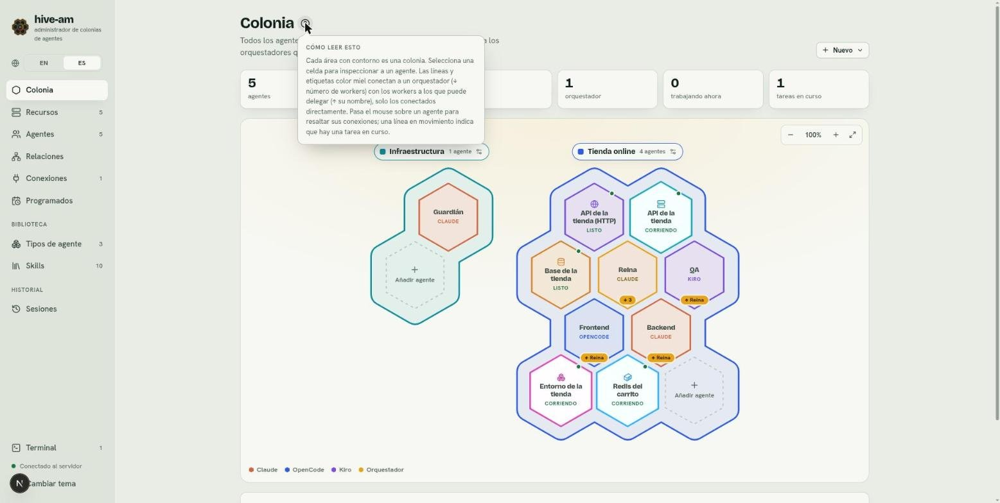
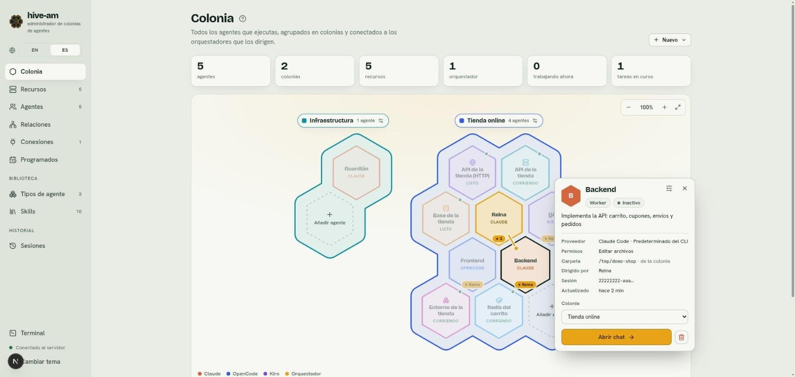
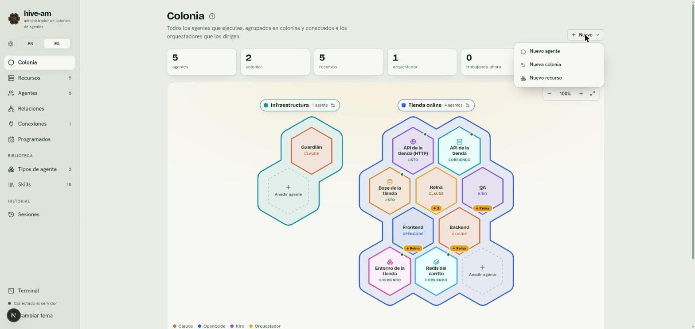
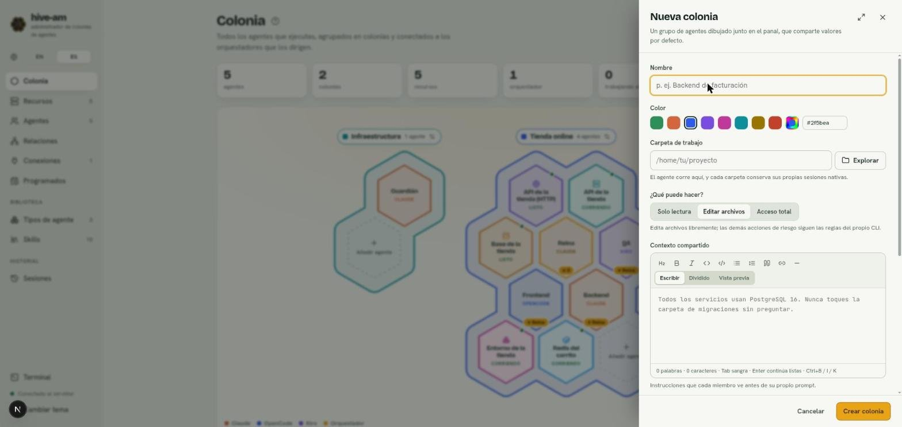

# La colonia

La pantalla **Colonia** (`/colony`) es el centro de hive-am. Ábrela con **Colonia** en el menú o con su tarjeta en Inicio. Muestra todos tus agentes y recursos como hexágonos en un mapa, agrupados en colonias y conectados a los orquestadores que los dirigen. Desde aquí ves quién está trabajando, creas agentes, colonias y recursos, y abres el chat de cualquier agente.

*La pantalla Colonia: arriba las estadísticas, debajo el mapa con dos colonias (Infraestructura y Tienda online) y, al fondo, la leyenda de colores de proveedor.*

## Las estadísticas

Bajo el título hay seis tarjetas. Cada número se calcula en vivo:

| Tarjeta | Qué cuenta | A dónde enlaza |
|---|---|---|
| **agentes** | Todos los agentes | La lista **Agentes** |
| **colonias** | Todas las colonias | No es un enlace |
| **recursos** | Todos los recursos (al pasar el ratón indica cuántos están corriendo) | La pantalla **Recursos** |
| **orquestador(es)** | Agentes con rol Orquestador | La lista **Agentes** |
| **trabajando ahora** | Agentes con un turno en curso | La lista **Agentes** |
| **tareas en curso** | Delegaciones que siguen ejecutándose | La sección **Delegaciones recientes**, más abajo en la misma pantalla |

## Cómo leer el mapa

El icono **?** junto al título abre una ayuda breve, "Cómo leer esto". Se cierra con Esc, al hacer clic fuera o al pulsar otra vez el icono.

*El popover de ayuda. Resume lo esencial: cada área con contorno es una colonia y las etiquetas color miel conectan orquestadores con workers.*

Estos son los elementos del mapa:

- **Colonias:** cada área con contorno es una colonia. Arriba lleva una etiqueta con su color, su nombre y cuántos agentes tiene. El icono de ajustes de la etiqueta abre su editor.
- **Agentes:** un hexágono por agente. El borde indica el proveedor (la leyenda del pie lo explica: Claude, OpenCode, Kiro) y los orquestadores van en color miel. Debajo del nombre se lee el proveedor.
- **Recursos:** también son hexágonos, con un icono propio (servidor, base de datos, peticiones HTTP, clúster) y su estado debajo del nombre, como **Corriendo** o **Listo**.
- **Orquestadores:** llevan una etiqueta **↓ N** con el número de workers a los que pueden delegar. Cada worker lleva **↑ Nombre** con el orquestador que lo dirige. Solo se muestran los conectados directamente.
- **Líneas de relación:** unen a un orquestador con sus workers. Una línea en movimiento indica que hay una tarea en curso. Las líneas punteadas de color unen a un agente administrador con los recursos que cuida.
- **Puntos de estado:** un punto pulsante indica que el elemento está trabajando; rojo, que requiere atención.
- **Hexágono punteado "Añadir agente":** aparece al final de cada colonia y crea un agente ya dentro de esa colonia.

Al pasar el ratón sobre un agente se resaltan sus conexiones y el resto se atenúa. Mover el ratón sobre un agente de la lista lateral o una celda del mapa también muestra una tarjeta con su información.

## Seleccionar un hexágono

Haz clic en un hexágono para abrir su tarjeta junto a él. Se cierra con la **X**, con Esc o seleccionando otro.

### Tarjeta de un agente

*Backend seleccionado: el resto del mapa se atenúa y solo se resalta su relación con Reina. La tarjeta muestra descripción, proveedor, permisos, carpeta, sesión y colonia.*

La tarjeta muestra:

- Nombre, rol (**Worker** u **Orquestador**) y estado (**Inactivo**, **Trabajando**, **Requiere atención**).
- Descripción, **Proveedor** y modelo, **Permisos**, **Carpeta** (con "de la colonia" si la hereda), **Dirigido por** (en workers) o su equipo (en orquestadores), **Sesión** y cuándo se **Actualizó**.
- Un selector **Colonia** para mover al agente a otra colonia (o dejarlo sin colonia).
- El botón **Abrir chat** y, a la derecha, el icono para **clonar** al agente y el de papelera para eliminarlo.
- Arriba, el icono de ajustes que abre la edición del agente sin salir del mapa.

### Clonar un agente

Pulsa el icono de clonar en la tarjeta de un agente (o **Clonar** en el pie de sus ajustes). Un diálogo pide el **nombre** del clon (se sugiere `Maggie 2`) y su **colonia** (la misma por defecto), y dice qué es el clon:

- Es un **agente aparte**, así que su conversación y la del original pueden ocurrir **al mismo tiempo**. Un agente responde un mensaje a la vez, así que un clon es la forma de tener dos conversaciones en paralelo sin configurar todo otra vez.
- Conserva la **misma configuración**: prompt, skills, permisos, modelo y carpeta. Dos agentes en la misma carpeta pueden editar los mismos archivos.
- **Comparte el cuaderno** del original: las notas son las mismas para los dos, y lo que escribe uno lo lee el otro. En el cuaderno, cada nota dice qué agente la escribió.
- **No trae** las conexiones (bots de Telegram o Slack), programaciones, avisos ni la administración de recursos del original. Si el clon debe responder por el mismo bot o cuidar los mismos servidores, eso se configura aparte.

**Siempre se distingue un clon de su original.** En el mapa, el hexágono de un clon lleva una etiqueta violeta con el nombre del agente del que se clonó (por ejemplo *Maggie*). El listado de Agentes, la cabecera del chat y la lista junto al chat muestran la misma marca (en la lista y la cabecera es un enlace al original), igual que la pantalla de Relaciones; el original muestra cuántos clones tiene (*2 clones*, con sus nombres al pasar el mouse). La marca se conserva después de **Separar**. Si se elimina al original, sus clones simplemente dejan de tener uno.

Eliminar a cualquiera de los dos mantiene el cuaderno para el otro. Si quieres que el clon deje de compartir, abre su pestaña **Cuaderno** y pulsa **Separar**: se queda con su propia copia de las notas y dejan de leerse entre sí.

### Tarjeta de un recurso

*El recurso "API de la tienda" (un servidor). La línea punteada lo une a su administrador, Entorno de la tienda. Se ven el comando, los botones de control y los últimos logs.*

La tarjeta de un recurso muestra su estado, cuánto lleva así, el comando, los botones **Iniciar**, **Detener** y **Reiniciar**, **Terminal aquí** y **Logs en el panel** (abren el [panel de terminales](12-terminales.md)), los últimos logs y la sección **Quién lo cuida**. El botón **Abrir panel** lleva a la pantalla completa del recurso. Más sobre ellos en el [capítulo 10](10-recursos.md).

## Mover colonias y elementos libres

Puedes ordenar el mapa a tu gusto:

- **Colonias:** arrástralas por la etiqueta con su nombre.
- **Agentes o recursos sin colonia:** arrástralos por su hexágono.
- **Con el teclado:** enfoca la etiqueta de una colonia o un hexágono libre y usa las flechas. Con Mayús los pasos son más grandes.

La posición se guarda en este navegador. El botón **Devolver todo a su lugar** (arriba del mapa) restablece la disposición.

Para mover un agente **entre colonias** no se arrastra: usa el selector **Colonia** de su tarjeta o el editor de la colonia.

## Zoom

Arriba a la derecha del mapa hay tres controles: **Alejar** (−), **Acercar** (+) y **Ajustar el mapa al panel (100%)**. También puedes hacer zoom con Ctrl (o ⌘) y la rueda del ratón. El rango va del 40 % al 250 % y se recuerda. Con zoom, el panel se desplaza.

## El menú Nuevo

Arriba a la derecha, el menú **Nuevo** reúne las tres altas de esta pantalla.

*El menú **Nuevo** con **Nuevo agente**, **Nueva colonia** y **Nuevo recurso**.*

- **Nuevo agente:** ver [Primeros pasos](01-primeros-pasos.md#tu-primer-agente).
- **Nueva colonia:** ver la sección siguiente.
- **Nuevo recurso:** ver el [capítulo 10](10-recursos.md).

## Crear una colonia

Una colonia agrupa agentes y les presta valores por defecto.

1. Pulsa **Nuevo** > **Nueva colonia**.
2. Escribe el **Nombre**. No puede repetirse.
3. Elige un **Color** de la paleta, un color personalizado o escribe un código hexadecimal (por ejemplo `#2f5bea`).
4. Opcional: **Carpeta de trabajo** (escríbela o usa **Explorar**). Los agentes de la colonia correrán allí.
5. Opcional: elige **¿Qué puede hacer?**: **Solo lectura**, **Editar archivos** o **Acceso total**.
6. Opcional: escribe el **Contexto compartido**, instrucciones que cada miembro ve antes de su propio prompt. Admite Markdown.
7. Opcional: añade skills y **Miembros** (los agentes que pertenecen a la colonia).
8. Pulsa **Crear colonia**.

*El panel **Nueva colonia**: nombre, paleta de colores con código hex, carpeta de trabajo con **Explorar**, permisos y el editor del contexto compartido. Abajo, **Cancelar** y **Crear colonia**.*

> **Nota:** un agente pertenece a una sola colonia. Si añades como miembro a uno que está en otra, se mueve a esta.

## Qué heredan los agentes de su colonia

| Campo | Cómo se combina con el valor del agente |
|---|---|
| Carpeta de trabajo | La de la colonia **reemplaza** a la del agente |
| Permisos | Los de la colonia **reemplazan** a los del agente |
| Skills | Se **suman**: primero las de la colonia, luego las del agente |
| Contexto compartido | Va **antes** del prompt del agente |
| Proveedor y modelo | **Nunca** se heredan: son siempre del agente |

Cada agente puede salirse por su cuenta. En su formulario, cada campo heredable muestra **Siguiendo** o **Valor propio**; con **Valor propio** el agente ignora a la colonia en ese campo. Al cambiar a un agente de colonia, esas excepciones se reinician.

### La pregunta al guardar

Cada vez que creas o guardas una colonia aparece **¿Qué deben heredar sus agentes?** con una casilla por campo: **Carpeta de trabajo**, **Permisos**, **Skills** y **Contexto compartido**.

- Una casilla se desactiva si no hay nada definido que compartir (por ejemplo, sin carpeta).
- En una colonia nueva, las casillas con valor vienen marcadas.
- Si cambiar la carpeta mueve a agentes existentes, el aviso te dice cuántos **empiezan una conversación nueva**. Las anteriores se conservan en su pestaña **Sesiones**.

## Editar o eliminar una colonia

1. Pulsa el icono de ajustes en la etiqueta de la colonia (**Editar colonia**).
2. Cambia lo que necesites y pulsa **Guardar colonia**. Responde la pregunta de herencia.
3. Para quitarla, usa **Eliminar colonia**. Sus agentes se quedan, pero dejan de seguir la carpeta, los permisos, las skills y el contexto de la colonia. Si prefieres no borrarla, elige **Conservar colonia** en el aviso.

## Delegaciones recientes

Debajo del mapa, **Delegaciones recientes** lista las últimas 6 tareas que un orquestador pasó a un worker, con enlaces al agente y a la sesión. Si aún no hay ninguna, verás el mensaje: "Cuando un orquestador le pasa una tarea a un worker, aparece aquí". La tarjeta **tareas en curso** de las estadísticas lleva a esta sección. Inicio muestra la misma lista. Más sobre delegar en el [capítulo 5](05-orquestacion-y-relaciones.md).

Siguiente: [Agentes](03-agentes.md)
