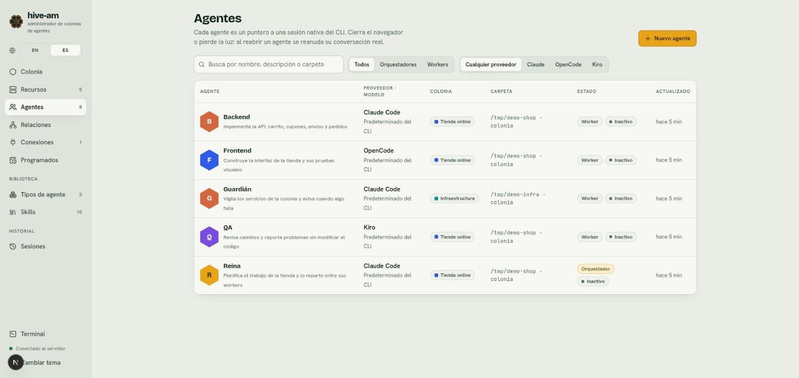
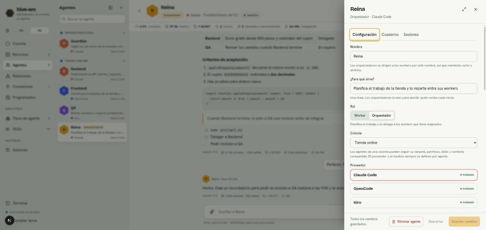
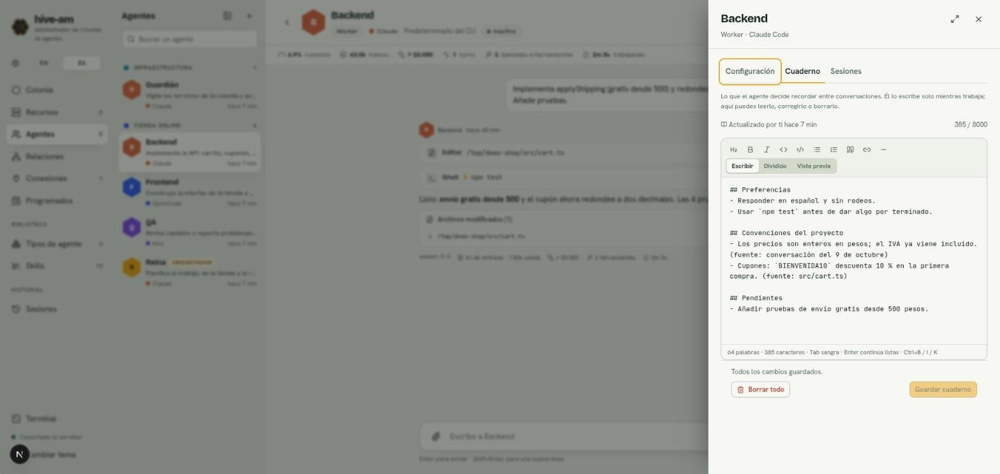

# Agentes

Un agente es un asistente de código con nombre propio: tiene un proveedor (Claude Code, OpenCode, Kiro o Cursor), una carpeta donde trabaja, unas instrucciones y unos permisos. La sección **Agentes** es donde los ves todos en una tabla, los creas y entras a cada uno. Los ajustes de un agente se editan en un panel lateral que se abre desde su pantalla.

## La lista de agentes

Abre **Agentes** en el menú de la izquierda. Verás una tabla con todos tus agentes.

*La lista del proyecto "Tienda online": cinco agentes (Backend, Frontend, Guardián, QA y Reina). Fíjate en los filtros sobre la tabla y en el botón amarillo **Nuevo agente** arriba a la derecha.*

Las columnas son:

| Columna | Qué muestra |
|---|---|
| **Agente** | Avatar, nombre y descripción (si no tiene, indica si es orquestador o worker) |
| **Proveedor · modelo** | El CLI que usa y su modelo ("Predeterminado del CLI" si no elegiste uno) |
| **Colonia** | La colonia a la que pertenece, con su color |
| **Carpeta** | La carpeta efectiva donde trabaja. Si la hereda de su colonia, lo indica |
| **Estado** | Su rol (**Worker** u **Orquestador**) y si está inactivo, trabajando o con error |
| **Actualizado** | Cuándo tuvo actividad por última vez |

### Buscar y filtrar

- **Búsqueda:** escribe en el campo "Busca por nombre, descripción o carpeta".
- **Filtro por rol:** **Todos**, **Orquestadores** o **Workers**.
- **Filtro por proveedor:** **Cualquier proveedor**, **Claude**, **OpenCode**, **Kiro** o **Cursor**.

Si nada coincide, aparece "Nada coincide" y un botón para limpiar los filtros.

### Abrir un agente

Haz clic en cualquier fila (o en el nombre). Se abre la pantalla del agente, con su chat. Esa pantalla se explica en [Chat](04-chat.md).

## Crear un agente

1. Ve a **Agentes** y pulsa **Nuevo agente**. También puedes crearlo desde la pantalla de la colonia. Se abre un panel a la derecha.
2. Elige cómo empezar:
   - **Un tipo:** rellena proveedor, modelo, prompt y skills con los valores de una plantilla. Los tipos se explican en [Tipos y skills](06-tipos-y-skills.md).
   - **Agente en blanco:** "Configura todo tú mismo".
3. Rellena el formulario (los campos están abajo).
4. Pulsa **Crear agente**. Si te equivocaste de plantilla, **Atrás** vuelve al paso 1.

*Primer paso: los tipos disponibles (Builder, Reviewer, Queen) y, al final, **Agente en blanco**. Cada tipo muestra su proveedor a la derecha.*

> **Nota:** crear desde un tipo copia sus valores. Después el agente es independiente: si luego editas el tipo, los agentes ya creados no cambian.

## Los campos del formulario

El mismo formulario se usa al crear y al editar.

*Segundo paso, "Desde el tipo Builder". Arriba están **Nombre**, **¿Para qué sirve?**, **Rol**, **Colonia** y **Proveedor**. Los botones **Atrás** y **Crear agente** quedan fijos abajo.*

### Nombre

Es obligatorio y no puede repetirse. Los orquestadores se dirigen a los workers por su nombre, así que mantenlo corto y distinto (por ejemplo `api-builder`).

### ¿Para qué sirve?

Una línea. Los orquestadores la leen para decidir quién recibe cada tarea, así que descríbela con claridad ("Implementa endpoints del backend y sus pruebas").

### Rol

- **Worker:** hace el trabajo que recibe, directamente de ti o de un orquestador.
- **Orquestador:** planifica el trabajo y lo delega a los workers que tiene asignados. Al elegirlo aparece la sección **Equipo**, donde marcas qué workers puede mandar (también se hace en Relaciones; ver [Orquestación y relaciones](05-orquestacion-y-relaciones.md)).

### Colonia

Elige una colonia o **Sin colonia**. Los agentes de una colonia pueden seguir su carpeta, permisos, skills y contexto compartido. El proveedor y el modelo nunca se heredan: siempre son del agente. Más en [La colonia](02-la-colonia.md).

Si eliges una colonia que comparte algo, aparece una fila por cada valor heredable (permisos, carpeta, contexto compartido, skills) con la marca **Siguiendo**. Haz clic para cambiarla a **Valor propio** y definir uno solo para este agente.

### Proveedor y modelo

Elige uno de los cuatro: **Claude Code**, **OpenCode**, **Kiro** o **Cursor**. Cada tarjeta indica si el CLI está instalado en tu máquina. Cursor necesita `cursor-agent` instalado y con la sesión iniciada (`cursor-agent login`); un plan gratuito de Cursor solo ejecuta el modelo `auto`.

El campo **Modelo** es un selector con búsqueda: "Predeterminado del CLI" (lo elige el CLI), los modelos que lista el CLI, o cualquier id que escribas a mano ("Usar «id»").

### Esfuerzo de razonamiento

Debajo del modelo, **Esfuerzo de razonamiento** fija cuánto piensa el modelo en **cada** turno de este agente: el chat web, Telegram y Slack, las programaciones, los avisos y las tareas delegadas. **Predeterminado** deja el del propio CLI, que es con lo que empieza cualquier agente. El campo solo ofrece lo que admiten el proveedor y el modelo elegidos: Claude Code y Kiro admiten **Bajo, Medio, Alto, Muy alto** y **Máximo**; en OpenCode son las variantes que tiene el modelo seleccionado (se leen de la propia lista de OpenCode: un modelo puede ofrecer Bajo, Alto y Máximo, otro de 0 a 5, otro ninguna, y entonces el campo lo dice). Cursor no tiene este campo: el nivel va en el modelo que elijas (`gpt-5.3-codex-high`, `claude-opus-5-5-max`). Cambiar el proveedor o el modelo lo devuelve a **Predeterminado** si el nivel ya no aplica. Un **tipo** también lo lleva, y una conexión puede reemplazarlo para su propio chat (ver [Conexiones](09-conexiones-telegram.md)). Un nivel más bajo responde más rápido y piensa menos.

> **Nota:** si cambias el proveedor de un agente que ya tiene conversación, esta se descarta: el id de sesión de un CLI no sirve en otro. Las conversaciones anteriores se conservan en la pestaña **Sesiones**.

### ¿Qué puede hacer? (permisos)

Tres niveles: **Solo lectura**, **Editar archivos** y **Acceso total**. Si no usas un tipo, un agente nuevo empieza en **Editar archivos**. Qué significa cada uno en cada proveedor está en [Permisos y seguridad](13-permisos-y-seguridad.md).

OpenCode conserva las herramientas con las que empezó una conversación. Si cambias el permiso de un agente de OpenCode (o el de su colonia) con una conversación abierta, el chat muestra un aviso y un botón **Aplicar ahora**, que empieza una conversación nueva con el permiso nuevo. La actual queda en la pestaña Sesiones. Las conversaciones que estaban abiertas antes de existir este aviso no se detectan: usa **Nueva conversación**.

> **Consejo:** usa **Acceso total** solo en carpetas desechables o de las que tengas copia.

### Carpeta de trabajo

La carpeta donde corre el agente. Puedes escribir la ruta o usar **Explorar**. Debe existir en disco. Cada carpeta conserva sus propias sesiones: si cambias la carpeta efectiva (propia o heredada), el agente empieza una conversación nueva.

### System prompt

Instrucciones propias del agente, que se añaden a las del CLI en cada turno. Se escriben en un editor Markdown con barra de herramientas (encabezados, negrita, cursiva, código, listas, cita, enlace, línea) y tres vistas: **Escribir**, **Dividido** y **Vista previa**. Abajo ves el conteo de palabras y caracteres. Atajos: Tab sangra, Enter continúa las listas y Ctrl+B, Ctrl+I y Ctrl+K dan negrita, cursiva y enlace.

Si el agente sigue el contexto de su colonia, ese contexto se coloca antes de tu prompt.

### Skills

Las skills son bloques de instrucciones reutilizables. Busca en "Buscar skills para añadir" y elígelas: cada una queda como una etiqueta con un botón que alterna entre dos modos.

*Parte baja del formulario. Arriba el editor del system prompt. Abajo la skill **Notebook** con la marca **siempre**, el peso estimado ("~577 tokens") y el buscador de recursos.*

- **siempre:** el texto completo va en las instrucciones de cada turno. Úsalo para reglas cortas que deben cumplirse siempre.
- **bajo demanda:** el agente ve solo el nombre y la descripción, y carga el texto cuando la tarea lo pide. Úsalo para guías largas o situacionales.

Haz clic en la etiqueta para alternar. Bajo el selector verás cuánto pesa lo que va siempre en el prompt. Si la colonia también aporta la skill y el agente la tiene, vale la elección del agente.

### Recursos que cuida

Servidores, contenedores y clústeres que el agente puede ver, de los que lee los logs y que inicia, detiene o reinicia, y bases de datos en las que puede mirar dentro y ejecutar SQL, hasta donde le permita su permiso. Un recurso tiene un solo administrador: si eliges uno que ya cuida otro agente, pasa a este (el selector muestra "ahora: nombre"). El agente recibe la skill "Colony resources", o "Database management" para una base de datos. Los recursos se explican en [Recursos](10-recursos.md).

### Conexiones

Si el agente está vinculado a una conexión (Telegram o Slack), aparece un aviso y no se puede dejar en **Solo lectura**: un agente de solo lectura no puede responder por un canal. Ver [Conexiones](09-conexiones-telegram.md).

## El panel de ajustes del agente

Para editar un agente existente, abre su pantalla y pulsa **Ajustes** en la cabecera. Se abre un panel a la derecha con tres pestañas: **Configuración**, **Cuaderno** y **Sesiones**.

*Pestaña **Configuración** de Reina. En el pie están **Eliminar agente**, **Descartar** y **Guardar cambios**, junto al texto "Todos los cambios guardados".*

- La pestaña **Configuración** tiene el mismo formulario de arriba.
- Puedes ampliar el panel con el botón de la esquina, o arrastrar su borde izquierdo (doble clic para alternar).
- Mientras haya cambios, el pie dice "Tienes cambios sin guardar", el botón **Ajustes** muestra un punto y se activan **Descartar** y **Guardar cambios**.
- **Guardar cambios** aplica los cambios. Si el agente está trabajando, aplican desde el siguiente turno.
- **Descartar** vuelve a los valores guardados.

### Cerrar con cambios sin guardar

Si cierras el panel con cambios sin guardar, hive-am pregunta "¿Descartar los cambios sin guardar?". Tienes dos opciones: **Seguir editando** o **Descartar cambios** (se pierden las ediciones).

## El cuaderno

El cuaderno es la memoria del agente entre conversaciones: lo que decide recordar (preferencias, convenciones del proyecto, pendientes). Lo escribe él mismo mientras trabaja. Tú puedes leerlo, corregirlo o borrarlo.

*Cuaderno de Backend. Arriba "Actualizado por ti hace 7 min" y el contador **385 / 8000**. Las notas están en secciones con `##`. Abajo **Borrar todo** y **Guardar cuaderno**.*

Cómo funciona:

- Es texto Markdown con secciones (`## Tema`) y notas (`- ...`).
- El límite es de **8000 caracteres**, y se ve en el contador. Cuenta como prompt en cada turno, así que conviene que sea breve.
- Cada nota guarda su origen (por ejemplo "fuente: conversación del 9 de octubre") para que puedas revisarla.
- Las notas con credenciales (claves, tokens, contraseñas) se rechazan.
- Se refresca solo mientras no estás escribiendo. Si guardas una versión vieja, se rechaza para no pisar lo que el agente escribió después.

Para editarlo:

1. Abre **Ajustes** > **Cuaderno**.
2. Modifica el texto en el editor.
3. Pulsa **Guardar cuaderno**.

**Borrar todo** pide confirmación ("¿Borrar el cuaderno?"): el agente olvidará todo lo anotado y no se puede deshacer. **Recargar** trae la última versión.

**Cuaderno compartido.** Un agente y sus clones (ver [La colonia](02-la-colonia.md#clonar-un-agente)) leen y escriben el mismo cuaderno. Cuando se comparte, la pestaña lo dice ("Compartido con Backend 2: lo que escribe cualquiera de ellos, lo leen todos") y ofrece **Separar**. **Borrar todo** entonces lo vacía para todos, y su confirmación lo dice.

> **Nota:** el cuaderno funciona gracias a la skill **Notebook**. Si el agente no la tiene, la pestaña lo avisa ("Este agente no tiene la skill «Notebook»") y ofrece un botón **Activar**.

La pestaña **Sesiones** se explica en [Sesiones](07-sesiones.md).

## Eliminar un agente

1. Abre **Ajustes** del agente, pestaña **Configuración**.
2. Pulsa **Eliminar agente** en el pie.
3. Confirma en "¿Eliminar a nombre?". Con **Conservar agente** cancelas.

Se eliminan el agente y sus conexiones. Los archivos de sus sesiones nativas permanecen en disco, intactos. Si su cuaderno se comparte con otros agentes, se queda con ellos (el diálogo lo dice); un cuaderno que nadie comparte se va con su agente.

Siguiente: [Chat](04-chat.md)
