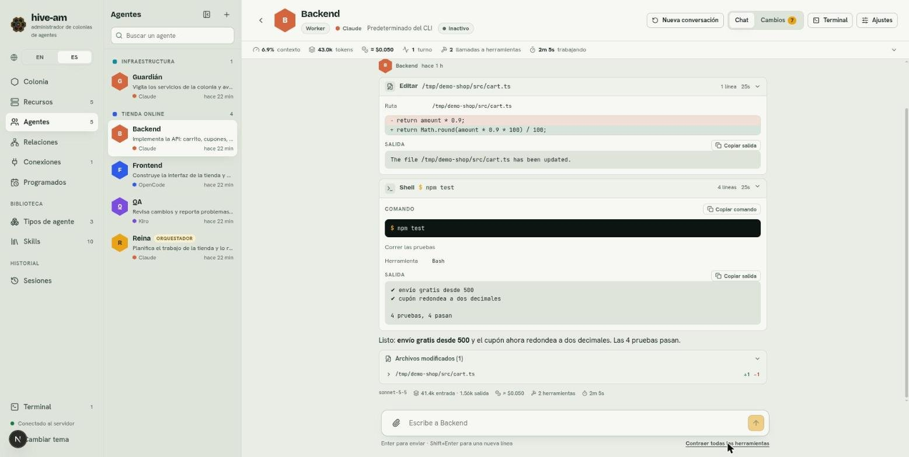

# Chat

Al abrir un agente llegas a su pantalla: la conversación con él, una barra con las estadísticas de la sesión y una cabecera con los accesos principales. Aquí le escribes, ves lo que hace (lo que lee, edita y ejecuta) y puedes seguir la conversación aunque cierres el navegador o reinicies el servidor, porque la conversación real la guarda el propio CLI del agente (ver [Sesiones](07-sesiones.md)).

*Pantalla de Reina (orquestadora). De izquierda a derecha: la lista de agentes, la conversación y, arriba, la cabecera y la barra de estadísticas. Abajo está la caja de texto.*

## La cabecera

Arriba ves el nombre del agente, su rol, el proveedor, el modelo y su estado (por ejemplo **Inactivo**). A la derecha hay cuatro controles:

| Control | Para qué sirve |
|---|---|
| **Nueva conversación** | Empieza una conversación nueva con el agente (ver más abajo) |
| **Chat** / **Cambios** | Alterna entre la conversación y el explorador de cambios git de la carpeta del agente. **Cambios** muestra el número de archivos modificados. Ver [Explorador de cambios](11-explorador-de-cambios-git.md) |
| **Terminal** | Abre una terminal en la carpeta del agente. Ver [Terminales](12-terminales.md) |
| **Ajustes** | Abre el panel de ajustes del agente. Ver [Agentes](03-agentes.md) |

La flecha a la izquierda del nombre vuelve a la colonia.

## La lista de agentes lateral

A la izquierda de la conversación hay una lista con todos tus agentes, agrupados por colonia. Sirve para saltar de uno a otro sin volver a la sección **Agentes**.

- El encabezado de cada colonia (y **Sin colonia**) pliega o despliega su grupo con un clic, o con Intro o Espacio. Los orquestadores salen primero en cada grupo. Un grupo plegado sigue mostrando el agente en el que estás, y un punto pulsante cuando alguno de sus agentes está trabajando. Los grupos plegados se recuerdan.
- Usa **Buscar un agente** para filtrar. Mientras buscas, todo grupo con coincidencias se ve abierto; al borrar la búsqueda vuelven los grupos que tenías plegados.
- Cada agente muestra su proveedor y cuánto hace que tuvo actividad. Mientras trabaja, el subtítulo muestra lo que está haciendo en vivo (por ejemplo "Thinking…" o una herramienta en curso).
- El botón de la cabecera de la lista la contrae a una columna estrecha con solo las iniciales. Sigue agrupada por colonia: cada grupo empieza con un encabezado corto (las iniciales de la colonia, en su color, y cuántos agentes tiene; el nombre completo al pasar el mouse) que lo pliega o despliega igual, y lo que pliegas ahí queda plegado también en la lista completa. Tu elección se recuerda.

## Enviar mensajes

1. Escribe en la caja "Escribe a *nombre*".
2. Pulsa **Enter** para enviar. **Shift+Enter** inserta un salto de línea.
3. Mientras el agente responde verás su trabajo en vivo y, abajo, el tiempo transcurrido.

Si el agente aún no ha hablado contigo, ves "Saluda a *nombre*" con una sugerencia: a un orquestador descríbele una meta, a un worker dale una tarea.

### Mensajes en cola

Mientras el agente trabaja, la caja cambia a "Encola un mensaje de seguimiento…". Si escribes, el mensaje espera y se envía cuando termine la respuesta actual. Bajo la caja aparece cuántos hay en cola.

### Detener

Mientras trabaja aparece el botón **Detener**, que corta el turno en curso.

> **Nota:** **Detener** no vacía la cola: los mensajes que ya estaban en cola se enviarán después.

### Borrador por agente

Lo que escribes y no envías se guarda en el navegador, por agente. Puedes cambiar de agente o recargar la página y el texto sigue ahí. Se borra al enviarlo.

## Adjuntar archivos e imágenes

Hay tres formas:

- **Pegar** con Ctrl+V (⌘V en Mac): sirve para una imagen o un archivo copiado.
- **Arrastrar** cualquier archivo sobre la caja de texto.
- El botón del **clip**, a la izquierda de la caja.

Cada adjunto aparece como vista previa (imágenes) o etiqueta (otros archivos), con una × para quitarlo. Límites: hasta 5 por mensaje y 20 MB cada uno.

Al enviar, los archivos se guardan en el buzón del agente y su mensaje lleva una nota con las rutas para que los abra con sus herramientas. En la conversación, las imágenes se ven como miniaturas y los demás archivos como una etiqueta que puedes pulsar para descargar.

## Lo que hace el agente: herramientas

Cuando el agente lee, edita o ejecuta algo, ves una fila plegable por cada llamada a herramienta, con su etiqueta (**Leer**, **Editar**, **Escribir**, **Shell**, **Delegar**...) y un resumen.

*Backend con las dos filas abiertas. **Editar** muestra la ruta y el cambio (rojo lo quitado, verde lo añadido). **Shell** muestra el comando `npm test` y su salida. Abajo, **Archivos modificados (1)**.*

A la derecha de cada fila ves metadatos: el número de líneas de salida, la duración y, si falló, una marca roja. En una herramienta en curso, el borde es de color miel y hay un cronómetro. Al abrir una fila:

- **Shell:** el comando completo (con **Copiar comando**) y la salida (con **Copiar salida**).
- **Editar:** la ruta y un diff de lo quitado y lo añadido.
- **Leer** y **Escribir:** la ruta y el contenido o la salida.

### Expandir y contraer

Cada fila se abre o se cierra con un clic. Para hacerlo con todas a la vez, usa el enlace **Expandir todas las herramientas** (que pasa a **Contraer todas las herramientas**) en la esquina inferior derecha, bajo la caja de texto.

### Vista normal y compacta

Bajo la caja de texto, junto a **Expandir todas las herramientas**, el selector **Normal / Compacto** cambia cómo se ven los pasos del agente. La elección se recuerda en este navegador y vale para el chat de todos los agentes (y para las transcripciones de la página **Sesiones**). **Normal** es la vista por defecto: una fila por paso, como se describe arriba.

En **Compacto** cada paso es una píldora pequeña con un icono gris, en la misma fila que el nombre del agente:

- El razonamiento, los comandos de shell, los archivos leídos, escritos o editados, las búsquedas, la web, las herramientas de `hive` (responder, enviar archivo, skill, silencio, delegar, equipo), los subagentes, el plan, el navegador y cualquier otra herramienta tienen cada uno su píldora con una etiqueta corta (el comando, el nombre del archivo, el agente...). Pasa el ratón o el foco por una píldora para ver el comando o la ruta completos.
- Haz clic en una píldora para abrir su detalle bajo la fila (el mismo comando, salida, botones de copiar y diff que en Normal); otro clic lo cierra. Puedes tener varias abiertas a la vez.
- Las respuestas anteriores se pliegan en una sola píldora resumen como `3 pasos · 1 herramienta · 4.9s`. Haz clic en ella para ver las píldoras de esa respuesta. La última respuesta muestra sus píldoras; mientras el agente trabaja, todas las respuestas guardadas se pliegan y la que se está escribiendo muestra las suyas.
- Un paso fallido tiene el borde rojo y dice `salida N` o `falló`. Una píldora resumen que esconde un paso fallido también se tiñe de rojo y dice cuántos fallaron.
- Una herramienta en curso conserva el borde miel, el contador y el punto que late.
- **Archivos modificados (N)** es una píldora con las líneas añadidas y quitadas; se ve aunque su respuesta esté plegada y abre la misma lista de archivos y cambios.
- **Expandir todas las herramientas** abre todas las píldoras y despliega todos los resúmenes; **Contraer todas las herramientas** las cierra y los pliega.

### Proceso de razonamiento

Si el agente expone su razonamiento, aparece una fila plegable **Proceso de razonamiento** antes de sus acciones. Ábrela para leerlo.

### Archivos modificados

Al final de cada respuesta, un bloque plegable **Archivos modificados (N)** lista los archivos que el agente escribió o editó, con las líneas añadidas (+N) y quitadas (-N). Despliega un archivo para ver sus cambios. Si un archivo lo escribió completo, aparece marcado como "nuevo".

> **Nota:** estos datos salen de lo que hizo el agente, no de git. Para ver el estado real del repositorio usa la pestaña **Cambios**.

## Delegaciones

Cuando un orquestador reparte trabajo, verás filas **Delegar** con el subagente y la tarea. Al abrirlas se ve la tarea completa y lo que respondió el worker.

*Reina lee `src/cart.ts` y delega en Backend. En la fila **Delegar** se ven **Subagente**, **Tarea** y la respuesta del worker. Abajo, sobre el texto, el botón **Ir al final**.*

En el chat del worker, la tarea delegada aparece como "Tarea delegada por *nombre*" mientras corre, pero corre en su propia sesión y no ensucia su conversación directa. Más en [Orquestación y relaciones](05-orquestacion-y-relaciones.md).

## Cada respuesta: el pie

Bajo cada respuesta ves una línea discreta con el modelo, los tokens de entrada y salida, el costo (con `≈` si es una estimación), el número de herramientas y la duración. Pasa el cursor por encima de los tokens o del costo para ver más detalle.

## La barra de estadísticas

Bajo la cabecera, una franja resume la sesión que estás viendo:

| Indicador | Qué significa |
|---|---|
| **contexto** | Porcentaje del contexto que ocupa la conversación |
| **tokens** | Total de tokens: entrada, salida y caché |
| **créditos** | Créditos consumidos (solo Kiro) |
| costo | Costo total en dólares, con `≈` si es estimado |
| **turnos** | Mensajes que has enviado |
| **llamadas a herramientas** | Cuántas veces el agente usó herramientas, con cuántas fallaron |
| **trabajando** | Tiempo de trabajo acumulado (sin contar pausas) |

Haz clic en la barra (o en la flecha de su extremo derecho) para desplegar el detalle: la **Mezcla de tokens**, los **Modelos** usados, las **Herramientas usadas** y los **Tokens por turno** de los últimos turnos.

## Moverte por la conversación

- La vista se mantiene al final mientras llegan mensajes nuevos. Si subes para leer, deja de seguirlos y aparece el botón **Ir al final**: púlsalo para volver al fondo.
- En conversaciones largas, arriba aparece **Mostrar mensajes anteriores (N más)** para cargar lo más antiguo.

## Nueva conversación

1. Pulsa **Nueva conversación** en la cabecera. Está desactivado mientras el agente trabaja o si aún no tiene conversación.
2. Confirma con **Empezar nueva conversación**.

El agente empieza una sesión limpia. La anterior no se pierde: queda en la pestaña **Sesiones** de sus ajustes y puedes reanudarla cuando quieras.

> **Consejo:** si el indicador de **contexto** sube mucho, una conversación nueva suele ser más rápida y barata. El cuaderno del agente conserva lo importante entre conversaciones.

Siguiente: [Orquestación y relaciones](05-orquestacion-y-relaciones.md)
