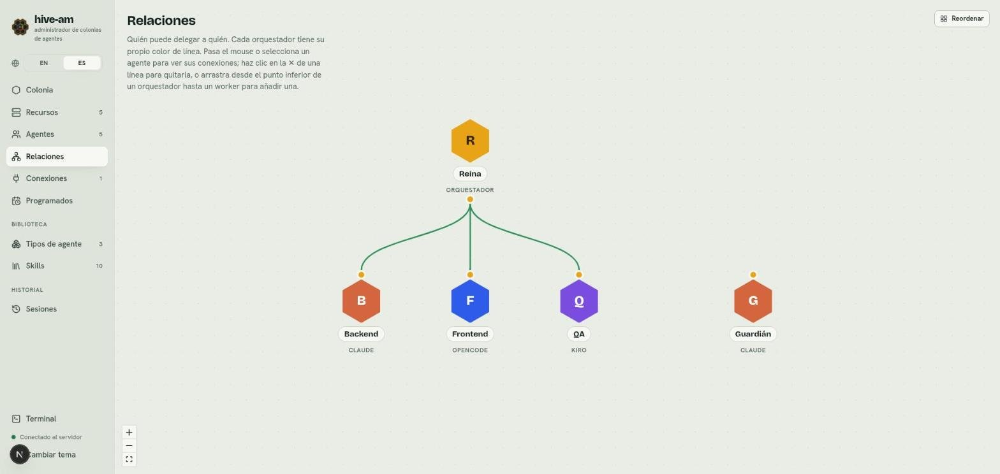
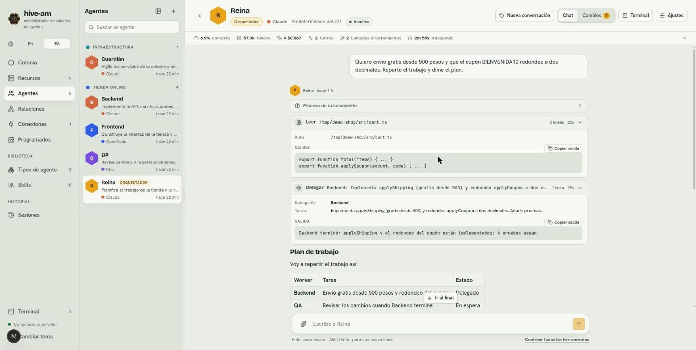

# Orquestación y relaciones

Un orquestador es un agente que reparte trabajo entre otros agentes, sus workers. Aquí aprendes cómo delega, cómo conectas a cada orquestador con sus workers en el lienzo **Relaciones** y cómo ver qué está pasando mientras una tarea viaja de uno a otro.

## Orquestadores y workers

Cada agente tiene un rol que eliges al crearlo:

- **Orquestador:** planifica y delega. Puede tener varios workers conectados.
- **Worker:** ejecuta las tareas que recibe. Puede estar conectado a varios orquestadores.

En el proyecto de ejemplo, **Reina** es la orquestadora y **Backend**, **Frontend** y **QA** son sus workers. **Guardián** es un worker sin orquestador: nadie le delega nada.

> **Nota:** solo los orquestadores pueden tener conexiones.

## La regla de la delegación

Un orquestador solo puede delegar a los workers **conectados directamente a él**. Da igual que estén o no en una colonia, o que compartan colonia con él: la colonia no concede ni quita delegaciones. La regla se aplica en el servidor, no depende de lo que el modelo "crea" saber. Si un orquestador intenta delegar a un agente que no es suyo, recibe un error.

## Cómo delega un orquestador

Cuando un orquestador tiene al menos un worker conectado, recibe tres herramientas:

| Herramienta | Qué hace |
|---|---|
| `list_agents` | Le devuelve la lista de sus workers directos, con nombre, descripción, proveedor y si están ocupados. |
| `dispatch` | Envía una tarea a un worker por su nombre exacto. Por defecto no espera: recibe el id de la tarea y la respuesta le llega después como mensaje. Con `background: false` espera la respuesta final. |
| `dispatch_status` | Dice el estado de una tarea que delegó (en cola, en curso, terminada, fallida o interrumpida) y, al terminar, su resultado. Puede esperar hasta un minuto a que termine. |

Lo que debes saber:

- **Cada delegación abre una sesión nativa nueva del worker.** El worker no recuerda delegaciones anteriores, así que el orquestador debe incluir todo el contexto en la tarea. Tu conversación directa con ese worker no cambia.
- **Una delegación va en segundo plano por defecto.** El orquestador recibe enseguida el id de la tarea, puede seguir hablando contigo o delegar a otros workers mientras tanto, y cuando el worker termina le llega un mensaje *"Delegated task … to Backend finished (done). Result: …"* en el mismo sitio donde se lo pediste (el chat web, o el mismo hilo de Telegram o Slack), y sigue desde ahí.
- **El resultado no se pierde.** Se guarda en hive-am, no en la llamada: si hive-am se reinicia mientras un worker está con una tarea en segundo plano, la tarea queda **interrumpida** (no se reanuda) y al orquestador se le avisa, para que revise el trabajo y la vuelva a mandar si hace falta. Un resultado nunca se manda dos veces. Si el hilo donde se pidió ya no existe o está silenciado, el orquestador aún puede leer el resultado con `dispatch_status`.
- **Límite:** un orquestador puede tener como mucho 10 tareas en segundo plano sin terminar; pasado eso se le pide que espere.
- **Un agente hace un turno a la vez.** Si el worker está ocupado (con un mensaje tuyo u otra delegación), la tarea espera su turno en la cola, marcada **en cola**.
- **Agentes distintos trabajan en paralelo.**
- El equipo del orquestador se actualiza solo: si conectas o desconectas un worker, el siguiente mensaje del orquestador ya lo sabe.

## Conectar y desconectar workers

Entra en **Relaciones** en el menú lateral. Verás un hexágono por agente. Los orquestadores tienen un punto en la parte inferior y los workers uno en la parte superior.

*El lienzo Relaciones. Reina (orquestadora) se conecta con tres líneas a Backend, Frontend y QA. Fíjate en que Guardián no tiene línea: ningún orquestador puede delegarle. Arriba a la derecha está el botón **Reordenar**.*

### Conectar un worker

1. Entra en **Relaciones**.
2. Arrastra desde el punto inferior del orquestador hasta el worker.
3. Suelta. Aparece un aviso "X conectado a Y" y se dibuja la línea.

Otra forma: haz clic en un agente para abrir su panel lateral. Un orquestador muestra "Delega a · N" y el selector **Conectar un worker…**. Un worker muestra "Dirigido por" y el selector **Conectar a un orquestador…**.

### Desconectar un worker

1. Pasa el mouse sobre la línea (o selecciona el agente).
2. Haz clic en la **✕** que aparece en el punto medio de la línea.

También puedes usar el botón **Desconectar** del panel lateral del agente seleccionado. Aparece el aviso "X desconectado de Y".

### Leer el lienzo

- **Color por orquestador:** cada orquestador tiene su propio color de línea, para distinguir líneas que se cruzan o que llegan al mismo worker.
- **Foco:** al pasar el mouse sobre un agente (o seleccionarlo) se resaltan sus conexiones y se atenúa el resto.
- **Línea animada:** el worker está trabajando.
- **Mover nodos:** puedes arrastrar los hexágonos; tu disposición se recuerda en el navegador.
- **Reordenar:** el botón **Reordenar** borra tus posiciones y devuelve la disposición automática (orquestadores arriba, sus workers debajo, los workers sin orquestador a la derecha).

> **Consejo:** también puedes elegir los workers con casillas en la sección **Team** del formulario de un orquestador. La pantalla **Colonia** solo muestra las relaciones, no las edita.

## Cómo se ve una delegación

### En el chat

Cuando un orquestador delega, en su chat aparece una fila **Delegar** con el worker (**Subagente**), la **Tarea** y, al abrirla, la **Salida**: la respuesta del worker (en una tarea en segundo plano, el id de la tarea; la respuesta llega después como un mensaje nuevo que empieza con "Delegated task").

*Chat de Reina. Señala la fila **Delegar**: muestra el subagente Backend, la tarea y, en la salida, lo que Backend respondió. Debajo, Reina resume el plan.*

En el chat del worker, mientras corre, aparece una tarjeta "Tarea delegada por Reina" con la tarea. Desaparece al terminar porque la delegación corre en su propia sesión y no forma parte de su conversación directa. La encuentras después en **Ajustes** > **Sesiones** del worker, en **Tareas delegadas** (ver [Sesiones](07-sesiones.md)).

### En la colonia

La pantalla **Colonia** dibuja las relaciones sobre el panal.

*Mapa de la colonia. Reina lleva la etiqueta **↓ 3** (tres workers) y cada worker lleva **↑ Reina**. En lo alto, las tarjetas de resumen incluyen "tareas en curso".*

- El orquestador muestra **↓ N** (cuántos workers tiene) y cada worker **↑ nombre del orquestador** (o **↑ N** si tiene varios).
- Pasa el mouse sobre un agente para resaltar sus conexiones. Una línea en movimiento indica que hay una tarea en curso.
- El icono **?** junto al título explica cómo leer el mapa.
- Las tarjetas de arriba cuentan los agentes, colonias, recursos, orquestadores, agentes trabajando y **tareas en curso**.
- La lista **Delegaciones recientes** muestra las últimas delegaciones: de quién a quién, la tarea, hace cuánto y su estado: un punto que late mientras corre, uno hueco mientras espera a un worker ocupado (en cola), verde al terminar y rojo si falló o se interrumpió. Pasa el puntero sobre el punto para leer el estado.

Al hacer clic en un agente se abre su tarjeta.

*Tarjeta del agente Backend. Mira la fila **Dirigido por**: Reina. Abajo está el botón **Abrir chat** y, arriba, el icono de ajustes del agente.*

## Buenas prácticas

- **Nombres cortos y exactos.** El orquestador delega por nombre exacto. Usa nombres fáciles de escribir y distintos entre sí (Backend, Frontend, QA).
- **Descripciones claras.** El orquestador lee la descripción de cada worker para decidir a quién le toca cada cosa. Di qué hace y qué no hace: "Implementa la API: carrito, cupones, envíos y pedidos".
- **Conecta solo lo necesario.** Un orquestador con pocos workers bien definidos decide mejor.
- **Pide tareas autocontenidas.** Como cada delegación empieza una sesión nueva, el orquestador debe dar todo el contexto en la tarea.
- **Elige los permisos por rol.** Un worker de revisión puede ir en solo lectura (ver [Permisos y seguridad](13-permisos-y-seguridad.md)).

Siguiente: [Tipos de agente y skills](06-tipos-y-skills.md)
