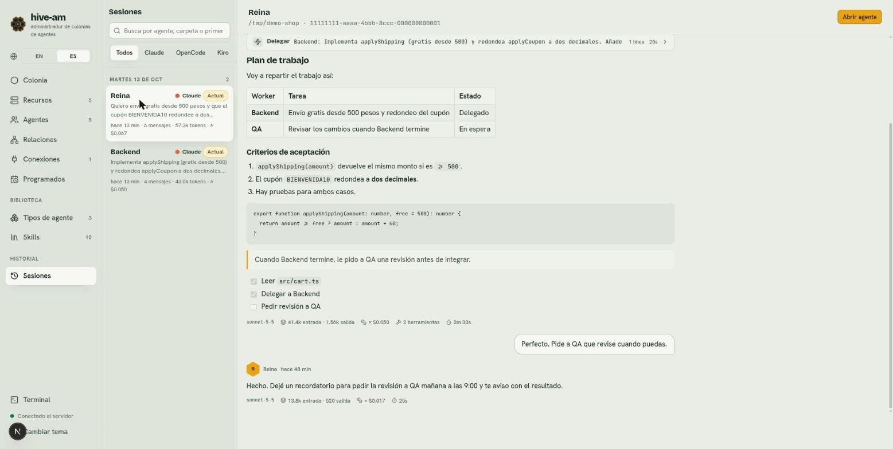
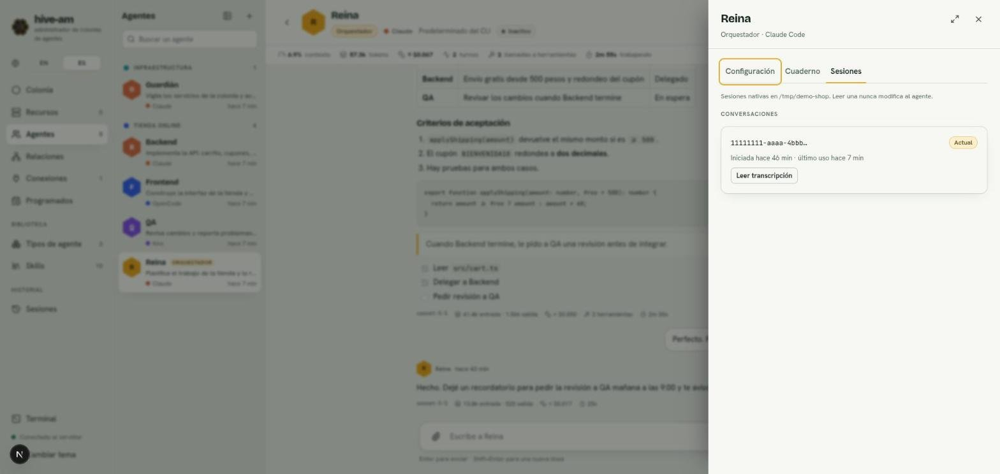

# Sesiones

Una sesión es una conversación de un agente. La sección **Sesiones** reúne el historial de todas las conversaciones que han tenido tus agentes, para que puedas buscarlas y leerlas. Dentro de los ajustes de cada agente, la pestaña **Sesiones** te permite retomar una conversación anterior.

## Qué es una sesión nativa

hive-am no guarda tus conversaciones. Guarda solo un puntero: qué sesión nativa usa cada agente. La conversación real vive en el almacén del propio CLI (Claude Code, OpenCode o Kiro), y hive-am la lee de ahí cuando la necesita.

Por eso:

- Si se va la luz, cierras el navegador o reinicias el servidor, al abrir el agente ves la conversación completa y el siguiente mensaje continúa la misma sesión.
- No hay resúmenes ni memoria paralela que mantener sincronizada.
- Las mismas conversaciones se pueden abrir directamente con el CLI.

> **Nota:** lo que no sobrevive a un corte es un turno a medias. Si el agente estaba trabajando cuando se detuvo el servidor, ese turno se pierde (la sesión queda intacta) y tienes que reenviar el mensaje.

Cada sesión pertenece a una carpeta. Si cambias el proveedor del agente o su carpeta efectiva, el agente empieza una sesión nueva y las anteriores se conservan para leerlas.

## Tipos de sesión

| Tipo | Qué es |
|---|---|
| **Directa** | La conversación entre tú y el agente. Es la que ves en su chat. Una de ellas es la **Actual** |
| **De delegación** | La que se abre cuando un orquestador le delega una tarea. Es de solo lectura y no cambia su conversación directa |

Las delegaciones corren en una sesión propia para que el chat directo con un worker contenga solo lo que hablaron tú y él. La contrapartida: un worker no recuerda delegaciones anteriores, así que el orquestador debe darle todo el contexto en cada tarea.

## La pantalla Sesiones

Abre **Sesiones** desde su tarjeta en Inicio (grupo **Biblioteca e historial**) o con **Ctrl K** ("historial" también la encuentra).

*A la izquierda, las sesiones del martes 13 de octubre (Reina y Backend, ambas marcadas **Actual**). A la derecha, la transcripción de Reina, con el botón **Abrir agente** arriba.*

### Qué muestra la lista

- Las sesiones están agrupadas por día, con el número de sesiones de cada día.
- Cada entrada indica el agente, su proveedor, una etiqueta (**Actual** o "Delegada por *nombre*"), el comienzo del primer mensaje y un resumen: cuánto hace, número de mensajes, tokens y costo.
- Solo se muestran las sesiones que gestiona hive-am, no todas las que existan en los CLI.

### Buscar y filtrar

- **Búsqueda:** escribe en "Busca por agente, carpeta o primer mensaje".
- **Filtro por proveedor:** **Todos**, **Claude**, **OpenCode** o **Kiro**.

Si nada coincide verás "Ninguna sesión coincide". Si aún no hay sesiones, envía un mensaje a cualquier agente y aparecerá aquí.

### Leer una transcripción

1. Haz clic en una sesión de la lista.
2. A la derecha se carga la transcripción, con el mismo formato del chat (texto, filas de herramientas, pie de cada respuesta). Si es larga, arriba aparece **Ver N mensajes anteriores**.

Leer nunca modifica al agente.

### Abrir el agente

Con una sesión abierta, pulsa **Abrir agente** (arriba a la derecha) para ir a su pantalla de chat.

## La pestaña Sesiones de un agente

Aquí ves solo las sesiones de un agente y puedes retomar una anterior.

1. Abre el agente y pulsa **Ajustes**.
2. Ve a la pestaña **Sesiones**.

*Ajustes de Reina, pestaña **Sesiones**. Bajo **Conversaciones** hay una sola, marcada **Actual**, con cuándo se inició y su último uso, y el botón **Leer transcripción**.*

Verás dos listas:

- **Conversaciones:** sus sesiones directas. La que usa ahora lleva la marca **Actual**.
- **Tareas delegadas:** las sesiones que le abrieron orquestadores ("De *nombre*"), con el texto de la tarea.

### Leer una conversación anterior

1. En la sesión que quieras, pulsa **Leer transcripción**.
2. El panel se cierra y el chat muestra esa conversación. La caja de texto se sustituye por el aviso "Estás leyendo una sesión anterior. Hazla la actual para continuarla." y la barra de estadísticas muestra los números de esa sesión.
3. Para salir, pulsa **Volver a la actual** en la cabecera.

### Retomar una conversación anterior

Tienes dos formas de hacerla la actual:

- En la pestaña **Sesiones**, pulsa **Reanudar esta** en una conversación que no sea la actual.
- Mientras la lees, pulsa **Hacer actual esta conversación** en la cabecera.

Verás el aviso "Conversación reanudada". Desde ese momento tu siguiente mensaje continúa esa conversación.

> **Nota:** solo se pueden retomar sesiones directas. Las sesiones de delegación se pueden leer, pero **Hacer actual esta conversación** aparece desactivado para ellas.

### Empezar de cero

**Nueva conversación** (en la cabecera del chat) deja al agente sin sesión actual: el siguiente mensaje abre una nueva. La anterior queda en esta pestaña, lista para retomarla. Ver [Chat](04-chat.md).

Siguiente: [Programados](08-programados.md)
