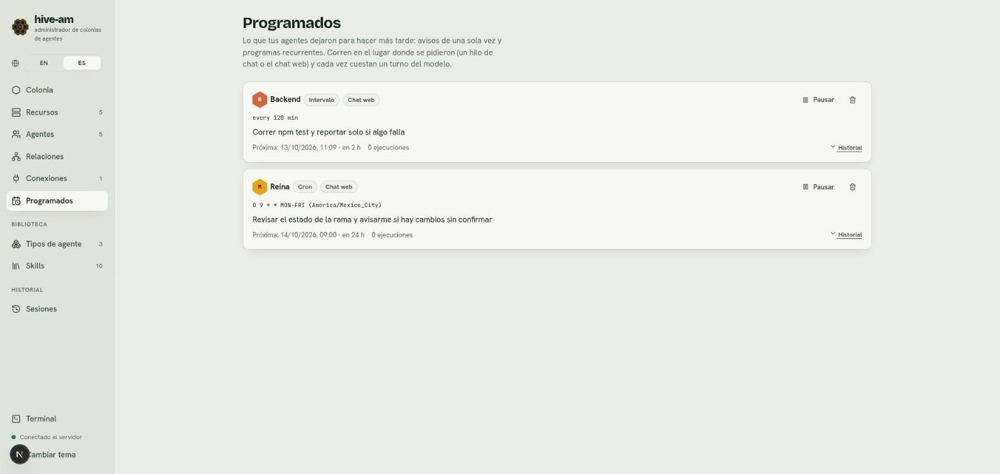

# Programados

Un agente solo corre mientras atiende un mensaje. Para que pueda actuar más tarde, hive-am le da tres formas de hacerlo, y la sección **Programados** te muestra todo lo que los agentes dejaron pendiente. Tú no creas los programas aquí: los crean los agentes. Aquí los ves y los gestionas.

## Las tres formas de actuar más tarde

| Forma | Para qué sirve | Ejemplo |
|---|---|---|
| **Aviso de una sola vez** (wake-up) | Que el agente despierte una vez, dentro de un rato | "Avísame en 30 minutos si ya terminó el despliegue" |
| **Programa recurrente** | Que el agente repita una tarea con un horario | "Cada día hábil a las 9 revisa los logs de QA y avísame" |
| **Vigilar un proceso** (watch) | Que el agente despierte justo cuando un comando termina | "Avísame cuando termine el despliegue" |

Los recurrentes pueden ser de dos tipos: **Cron** (un horario con zona horaria, por ejemplo `0 9 * * MON-FRI`) o **Intervalo** (cada N minutos). En la lista aparecen como **Cron**, **Intervalo**, **Una vez** y **Esperando un proceso**.

### Avisos de una sola vez

El agente se agenda un aviso de 1 a 240 minutos. Al llegar la hora recibe un mensaje en el mismo lugar donde se lo pediste: el mismo hilo de Telegram o su propia conversación del chat web. Revisa lo que esperaba y te reporta. Si sigue pendiente, puede agendar otro.

### Programas recurrentes

- **Cron:** cinco campos (minuto, hora, día del mes, mes, día de la semana). Admite nombres como `MON-FRI`, listas, rangos, pasos y macros como `@daily`. Lleva una zona horaria (por ejemplo `America/Mexico_City`); si no se indica, usa la del servidor.
- **Intervalo:** cada N minutos.
- Al crearlo, el agente te dice las próximas ejecuciones.
- El horario de verano se respeta: una hora que se salta se salta, y una que se repite corre una sola vez.

### Vigilar un proceso hasta que termine

El agente lanza un comando largo en segundo plano y pide a hive-am que lo vigile. hive-am solo vigila, nunca ejecuta nada. Cuando el proceso termina:

- En un hilo de chat, hive-am manda de inmediato un aviso de una línea, y despierta al agente para que lea el resultado y te informe.
- En el chat web, despierta directamente al agente.
- Si el proceso sigue corriendo al llegar al límite de espera (120 minutos por defecto, máximo 240), el agente despierta igual y te dice cuánto avanzó.

## Cómo se crean

Los crean los agentes, con la skill **Wake-ups**. Sin esa skill, el agente no puede programar nada.

1. Asigna la skill **Wake-ups** al agente (ver [Tipos de agente y skills](06-tipos-y-skills.md)). Los agentes por los que contesta una conexión de Telegram la reciben solos.
2. Pídele lo que quieras en lenguaje natural: "cada día hábil a las 9 revisa los logs de QA y avísame".
3. El programa aparece en **Programados**.

> **Nota:** los agentes delegados por un orquestador no pueden crear avisos ni programas durante esa tarea.

## La pantalla Programados

Entra en **Programados** en el menú lateral. Si no hay nada, verás "Nada programado".

*Dos programas de ejemplo. Backend tiene un **Intervalo** (`every 120 min`) y Reina un **Cron** (`0 9 * * MON-FRI` en `America/Mexico_City`). Señala la etiqueta **Chat web**, la línea **Próxima**, el botón **Pausar**, el icono de papelera y el enlace **Historial**.*

Cada tarjeta muestra:

- El agente, el tipo (**Cron**, **Intervalo**, **Una vez** o **Esperando un proceso**) y dónde corre (**Chat web** o el hilo de chat).
- El horario y la nota de lo que debe hacer.
- **Próxima** ejecución, con la hora y cuánto falta (en un watch, **Espera hasta**).
- **Última** ejecución y el número de ejecuciones.
- Una etiqueta **En pausa** si lo pausaste.

### Pausar y reanudar

1. En la tarjeta, pulsa **Pausar**. El programa deja de ejecutarse.
2. Para volver a activarlo, pulsa **Reanudar**.

### Eliminar

1. Pulsa el icono de papelera de la tarjeta.
2. Confirma en el aviso "¿Borrar este programa?". Se detiene para siempre. El agente puede crearlo de nuevo si se lo pides.

### Ver el historial

Pulsa **Historial** para ver las ejecuciones (se guardan las últimas 50 por programa). **Ocultar historial** lo cierra. Si no se ha ejecutado, verás "Todavía no se ha ejecutado."

Cada ejecución termina en un estado:

| Estado | Qué significa |
|---|---|
| **Entregado** | El mensaje llegó al agente |
| **Falló** | No se pudo entregar |
| **Omitido (silenciado)** | El hilo de chat estaba silenciado |
| **Omitido (agente ocupado)** | El agente ya tenía mensajes esperando |
| **Omitido (se perdió)** | El servidor estaba caído y la ejecución llegó con más de 5 minutos de retraso |
| **Omitido (conexión apagada)** | La conexión de Telegram estaba apagada |
| **En pausa (cambió el agente)** | La conexión pasó a otro agente, así que el programa se pausó |

> **Nota:** una ejecución perdida nunca se repone: se omite y se fija la siguiente.

## Cuánto cuesta

Cada ejecución es un turno del modelo, igual que si le escribieras un mensaje, y gasta tokens. Por eso hive-am pone límites:

- Al menos 15 minutos entre ejecuciones de un programa recurrente.
- Hasta 10 programas por agente, y hasta 5 avisos o vigilancias pendientes por agente.
- Las notas son cortas (hasta 400 caracteres).

> **Consejo:** revisa **Programados** de vez en cuando. Un programa que ya no necesitas sigue costando un turno cada vez hasta que lo pausas o lo eliminas.

## Qué pasa si reinicias hive-am

Los avisos, programas y vigilancias se guardan, así que sobreviven a un reinicio. Los avisos con más de 2 horas de retraso se descartan.

Siguiente: [Conexiones con Telegram](09-conexiones-telegram.md)
