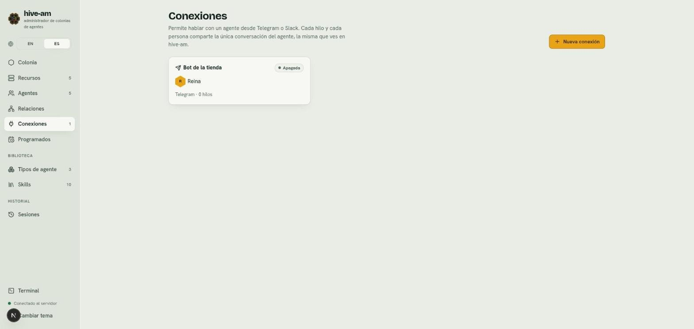
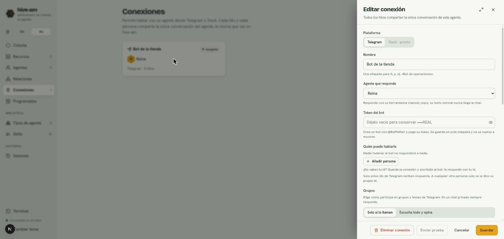

# Conexiones con Telegram y Slack

Una conexión vincula un agente de hive-am con un bot de Telegram o una app de Slack para que converses con él desde tu teléfono o tu workspace. Ninguna necesita URL pública: hive-am pregunta a Telegram por los mensajes nuevos y abre su propia conexión hacia Slack. Este capítulo cubre primero Telegram; Slack tiene [su propia sección](#slack).

## Cómo funciona

- **Una sola conversación.** La conexión es solo un adaptador. Todos los mensajes de todos los hilos y del chat web de hive-am comparten la conversación directa del agente. Lo que le dices por Telegram lo recuerda en el chat web, y al revés.
- **El agente responde con `channel_reply`.** Es la herramienta con la que contesta al hilo del mensaje que atiende. Su texto normal **no** llega al chat de Telegram.
- **Mientras trabaja**, el bot muestra "escribiendo...". Si el agente está ocupado, te avisa que tu mensaje queda en cola.

*La lista de conexiones. La tarjeta muestra el nombre, el agente que responde (Reina), la plataforma, cuántos hilos tiene y su estado (aquí **Apagada**). Arriba a la derecha está **Nueva conexión**.*

## Crear el bot en Telegram

1. En Telegram, abre una conversación con **@BotFather**.
2. Envía `/newbot` y sigue las preguntas (nombre y nombre de usuario del bot).
3. BotFather te da un **token**. Cópialo.

## Crear la conexión

1. Entra en **Conexiones** y pulsa **Nueva conexión**.
2. En **Plataforma**, deja **Telegram** (Slack aparece como "Slack · pronto" y no se puede elegir).
3. Escribe un **Nombre**, una etiqueta para ti (por ejemplo "Bot de la tienda").
4. En **Agente que responde**, elige el agente.
5. Pega el **Token del bot**.
6. Añade a las personas que pueden hablarle (siguiente sección).
7. Pulsa **Crear conexión**.

*El panel de la conexión. Señala **Agente que responde**, **Token del bot** (muestra solo el final del token guardado), **Quién puede hablarle**, y abajo los botones **Eliminar conexión**, **Enviar prueba**, **Cancelar** y **Guardar**.*

> **Nota:** el token se guarda en esta máquina y no se vuelve a mostrar. Al editar, déjalo vacío para conservar el actual.

## Quién puede hablarle

Solo reciben respuesta las personas de la lista **Quién puede hablarle**. A cualquier otra persona, el bot solo le dice su propio id de Telegram.

### Cómo averiguar un id de Telegram

1. Guarda la conexión y activa el bot.
2. Escríbele al bot desde tu cuenta de Telegram.
3. El bot te responde con tu id.
4. En el panel de la conexión pulsa **Añadir persona**, escribe el **Id de Telegram** y, si quieres, el **Nombre (opcional)**.
5. Pulsa **Guardar**.

Cada persona tiene la casilla **Admin**: puede reiniciar la conversación compartida con `/new`. Con **Quitar** la eliminas de la lista. Si la lista está vacía, el bot no responde a nadie.

## Grupos

En un chat privado el bot siempre responde. Para grupos y temas, la sección **Grupos** te deja elegir **Cuándo habla en un grupo**:

| Modo | Qué hace |
|---|---|
| **Solo si lo llaman** | Responde cuando lo mencionan con @, le responden a un mensaje suyo, usan un comando o dicen su nombre |
| **Escucha todo y opina** | Lee todo lo que se escribe y habla solo cuando tiene algo útil que aportar |

- **Grupos autorizados:** pulsa **Añadir grupo** y escribe el id del grupo (suele empezar por `-100`). Cualquier miembro de ese grupo puede hablarle sin estar en la lista de personas, y los permisos del agente aplican a todos. Para saber el id, menciona al bot en el grupo: responde con el id del chat.
- **Nombres con los que responde:** alias separados por comas (por ejemplo "Morena, queen"). Si alguien escribe uno en un grupo, cuenta como una mención.
- **Telegram oculta los mensajes de grupo** que no mencionan al bot (modo de privacidad). Para usar **Escucha todo y opina**, en @BotFather envía `/setprivacy` y elige **Disable**, y vuelve a añadir el bot a cada grupo.

## Hilos y silenciar

El panel de la conexión lista los **Hilos** (un chat privado, un grupo o un tema de grupo) con el último mensaje y su actividad. Cada hilo tiene un botón para **Silenciar** o **Reactivar**.

Un hilo silenciado no despierta al agente con la charla general. Sí lo despiertan una mención, un alias, una respuesta a su mensaje o un comando. También puedes silenciar desde el chat:

| Comando | Quién | Qué hace |
|---|---|---|
| `/stop` | Cualquier persona autorizada | Aborta el turno en curso |
| `/status` | Cualquier persona autorizada | Muestra agente, estado, carpeta y cola |
| `/mute` y `/unmute` | Cualquier persona autorizada | Silencia o reactiva al agente en ese hilo |
| `/new` | Solo admins | Pide confirmación (`/new confirmar`) y reinicia la conversación compartida |

El agente también puede silenciarse si alguien se lo pide.

## Archivos e imágenes

- **Recibir archivos:** las personas autorizadas pueden enviar fotos, documentos, audios, notas de voz y videos (hasta 20 MB cada uno y 5 por mensaje). Se guardan en tu equipo durante 14 días y el agente los abre con sus herramientas de archivos. El agente no puede escuchar audio ni ver video. Se activa o desactiva con **Recibir archivos**.
- **Ver imágenes:** muchos modelos no aceptan imágenes. Esta opción te deja elegir **Con el modelo del agente** o **Con otro modelo** (por ejemplo Claude Haiku). Con "otro modelo", cada imagen la describe ese modelo y la descripción viaja con el mensaje. **La imagen se envía a ese proveedor.**
- **Enviar archivos:** el agente manda archivos al chat con `channel_send_file`, solo desde su carpeta de trabajo, la de archivos recibidos o la temporal. Nunca envía archivos como `.env`, llaves, bases de datos ni carpetas `.git`.

## Otros ajustes

- **Idioma del bot:** Español o Inglés (los avisos del bot).
- **Si el agente termina sin responder:** **Avisar en el hilo**, **Enviar su texto normal** o **No hacer nada**.
- **Esfuerzo de razonamiento:** **El del agente**, **Bajo**, **Medio**, **Alto**, **Muy alto** o **Máximo**. Reemplaza el esfuerzo que tiene el agente, solo en los turnos de esta conexión; déjalo en **El del agente** para usar el del agente. **Bajo** responde un poco más rápido. Con OpenCode el nivel se convierte en la variante que su modelo tiene para él; si el modelo no tiene, se usa el del propio agente.
- **Activa:** apágala para detener el bot sin borrarlo.

## Estados

Cada tarjeta muestra un estado:

| Estado | Significa |
|---|---|
| **Conectada** | El bot está activo |
| **Conectando...** | Está arrancando |
| **Problema** | Algo falló (por ejemplo, token inválido); el motivo aparece en la conexión |
| **Apagada** | La conexión está desactivada |

## Enviar una prueba

Con la conexión guardada y activa, abre su panel y pulsa **Enviar prueba**. Comprueba el token y saluda a las personas permitidas. Si falla, verás "Falló la prueba" con el motivo.

## Permisos del agente

Un agente de **Solo lectura** no puede responder por un canal. Si lo intentas, el panel te avisa y ofrece **Permitir editar archivos**. Con **Acceso total**, cualquiera de la lista puede hacer que el agente ejecute lo que sea en tu máquina: hive-am muestra una advertencia. Más en [Permisos y seguridad](13-permisos-y-seguridad.md).

## Seguridad

- Solo responde a personas (o grupos) autorizados.
- El token no se vuelve a mostrar, y el agente no debe buscarlo ni usarlo: envía todo por las herramientas de hive-am. Esto es una instrucción al modelo, no una barrera técnica. Si sospechas que se filtró, genera uno nuevo en @BotFather.
- Los secretos no se comparten por chat: antes de enviar un texto, el servidor bloquea los que contienen claves o tokens conocidos.
- Los mensajes de un chat externo llevan una cabecera con su origen. En el chat web de hive-am se ven como una burbuja de canal.

> **Consejo:** si compartes el agente con personas en las que no confías del todo, usa permisos mínimos.

## Slack

Una conexión de Slack funciona como una de Telegram (la misma conversación única, la misma lista de permitidos, los mismos comandos, archivos y reacciones) con las costumbres propias de Slack. Tampoco necesita **URL pública**: hive-am abre una conexión hacia Slack (Socket Mode) desde tu máquina, así que funciona con hive-am corriendo en tu laptop. El agente solo responde mientras esa máquina está encendida y hive-am está corriendo.

### Crear la app de Slack

1. Entra a [api.slack.com/apps](https://api.slack.com/apps), **Create New App**, **From scratch**, ponle un nombre y elige tu workspace.
2. **Socket Mode**: actívalo. Slack te pide crear un **token de nivel de app**: dale el permiso `connections:write` y cópialo (`xapp-…`).
3. **OAuth & Permissions**, **Bot Token Scopes**: añade `app_mentions:read`, `channels:history`, `groups:history`, `im:history`, `mpim:history`, `chat:write`, `reactions:write`, `files:read`, `files:write`, `users:read`, `channels:read` y `groups:read`.
4. **Event Subscriptions**: actívalas y, en **Subscribe to bot events**, añade `app_mention`, `message.channels`, `message.groups`, `message.im` y `message.mpim`. Con Socket Mode no hace falta Request URL.
5. **Slash Commands**: crea un comando, `/hive` (sin URL con Socket Mode). Se usa como `/hive status`, `/hive id`, `/hive new confirmar`… Slack reserva nombres como `/status` y `/mute`, por eso lo más sencillo es un solo comando.
6. **App Home**: en **Show Tabs**, activa la **pestaña Messages** y marca "Allow users to send Slash commands and messages from the messages tab", para que la gente pueda escribirle a la app por mensaje directo.
7. **Install App** en el workspace y copia el **Bot User OAuth Token** (`xoxb-…`).
8. En cada canal donde la quieras, invita a la app: `/invite @tu-app`.

### Crear la conexión

En **Conexiones**, **Nueva conexión**, elige **Slack** y pega los dos tokens: **Token del bot** (`xoxb-…`) y **Token de la app** (`xapp-…`). Completa el agente y las personas permitidas con su **id de miembro de Slack** (`U…`: abre el perfil de la persona, menú ⋮, **Copiar ID de miembro**). Para canales enteros, añade su **id de canal** (`C…`, al final de los detalles del canal). La plataforma de una conexión guardada no se puede cambiar.

### Cómo se comporta en Slack

- **Hilos.** Cada conversación es un hilo de Slack. Cuando alguien le escribe al agente en un canal, responde **en un hilo abierto sobre ese mensaje**, y quien siga hablando en ese hilo le está hablando al agente (no hace falta mencionarlo de nuevo). En un mensaje directo no hay hilos.
- **Los mensajes programados y los recordatorios van al canal**, no al hilo donde se pidieron.
- **Sin «escribiendo…».** Slack no tiene ese indicador para apps: no se muestra nada mientras el agente trabaja, y la respuesta llega cuando está lista.
- **Los comandos** son los mismos que en Telegram (`new`, `stop`, `status`, `mute`, `unmute`, `help`, `id`), con `/hive <comando>`. Slack no manda el hilo con un comando de barra, así que la respuesta va al canal; para silenciar un solo hilo, escribe `@tu-app /mute` dentro de él.
- **Las reacciones** usan los emojis de Slack; el agente puede reaccionar con ✅, 🚀, 👀 y muchos más.

Siguiente: [Recursos](10-recursos.md)
