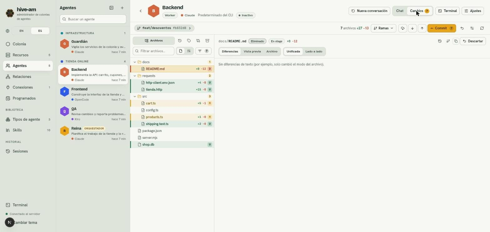
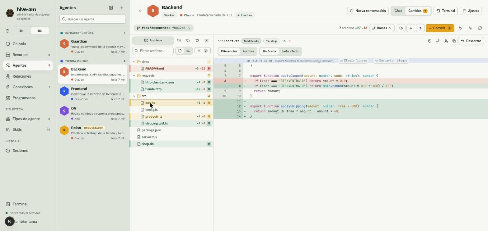
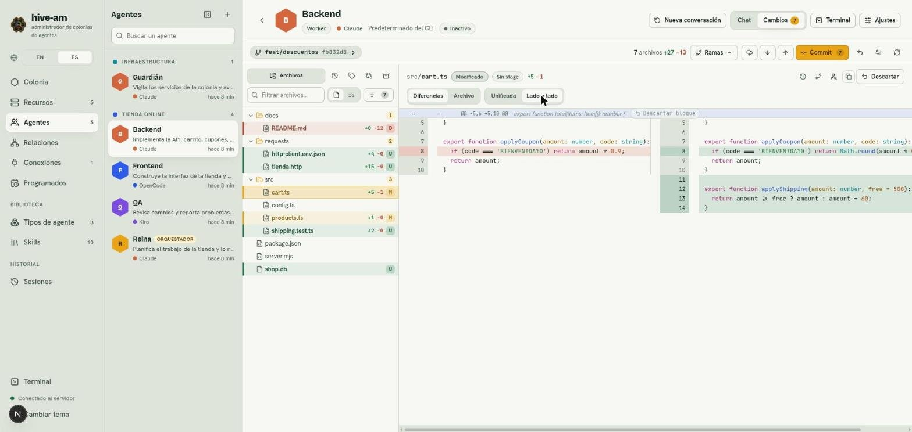
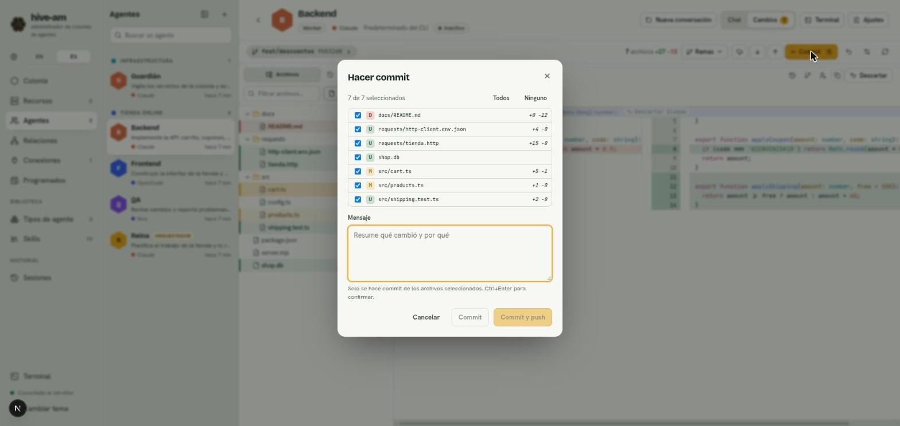
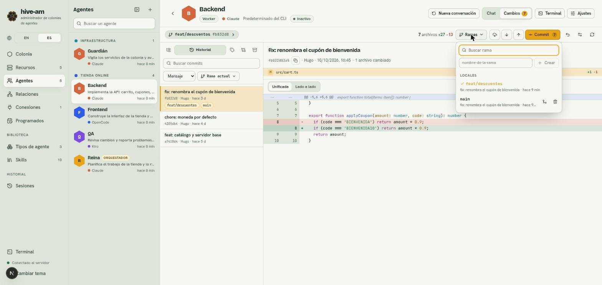
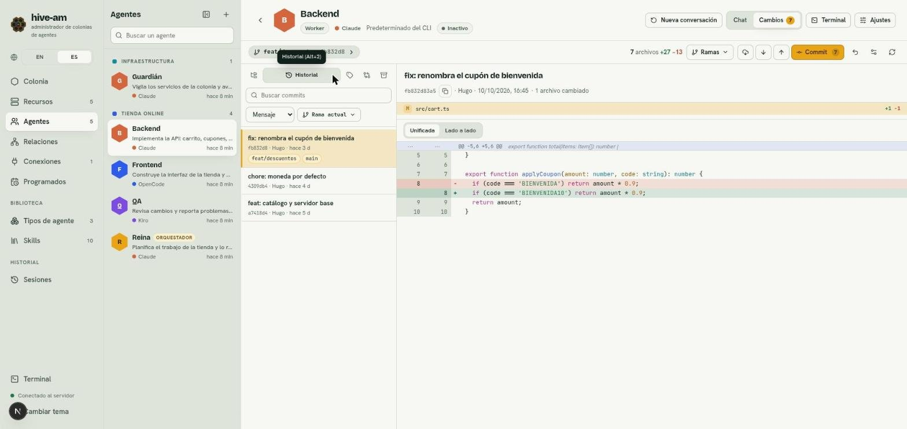

# Explorador de cambios (git)

En la pantalla de cada agente, junto a **Chat**, hay una pestaña **Cambios**. Es un explorador de la carpeta donde trabaja el agente: muestra todos sus archivos, resalta los que git considera cambiados y, al elegir uno, enseña su diferencia o su contenido. Desde ahí también haces las acciones habituales de git (commit, fetch, pull, push, ramas) y consultas el historial.

Sirve para revisar lo que hizo un agente antes de aceptarlo, y para guardarlo en git sin salir de hive-am.

> **Nota:** el código no se edita desde esta pestaña. Lo que sí puedes hacer es descartar cambios y resolver conflictos de fusión.

## La cabecera: rama y resumen

Al abrir **Cambios** (el número de la pestaña indica cuántos archivos tienen cambios), arriba ves:

- **El badge de la rama:** el nombre de la rama, el hash corto del último commit y, si hay commits por delante o por detrás de la rama remota, `↑n ↓n`. Púlsalo para desplegar el detalle completo: la rama remota y su estado, el mensaje completo del último commit, su autor y su fecha. Cada nombre y hash tiene botón para copiarlo.
- **El resumen:** cuántos archivos cambiaron y las líneas agregadas y quitadas respecto al último commit (por ejemplo `7 archivos +27 -13`).
- **Los botones de git:** **Ramas**, **Fetch**, **Pull**, **Push** y **Commit**. Pull y Push muestran un contador con los commits por traer o por enviar, y Commit, cuántos archivos tienen cambios.
- **Más iconos:** descartar todos los cambios, **Ajustes** de la vista y actualizar (el icono de recarga).

Si el agente trabaja en una subcarpeta del repositorio, todo se limita a esa subcarpeta y se avisa.

> **Nota:** si la carpeta no es un repositorio git, la pestaña lo dice y te sugiere ejecutar `git init` en esa ruta. Si `git` no está instalado, avisa que no está disponible.

## El árbol de archivos

A la izquierda está el árbol con **todos los archivos que git conoce** en la carpeta: los versionados más los nuevos sin versionar. Los que ignora `.gitignore` (como `node_modules`) se muestran atenuados y en cursiva, y puedes abrirlos para leerlos. Los archivos borrados siguen apareciendo, marcados.

Cada archivo con cambios lleva una barra de color, su nombre en negrita, una letra de estado y, si se conoce, las líneas `+añadidas -eliminadas`. Las carpetas con cambios llevan un contador.

| Letra | Estado | Cuándo |
|---|---|---|
| **M** | Modificado | El archivo cambió. |
| **U** | Sin seguimiento | Es nuevo y todavía no está en git. |
| **A** | Añadido | Es nuevo y ya está en el *stage*. |
| **D** | Eliminado | Se borró (el nombre sale tachado). |
| **R** | Renombrado | Se movió o renombró. |
| **!** | Conflicto | Hay un conflicto de fusión. |
| **T** | Tipo cambiado | Por ejemplo, de archivo a enlace simbólico. |

*La pestaña Cambios de "Backend". En el árbol, docs/README.md aparece eliminado (D), tienda.http y http-client.env.json como nuevos (U) y cart.ts y products.ts como modificados (M). Arriba, la rama feat/descuentos, el resumen y los botones Ramas, Commit y demás.*

### Filtrar y buscar

- El cuadro **Filtrar archivos…** busca por ruta y abre las carpetas que coinciden.
- El selector **Todos** / **Con cambios** alterna entre ver todo el árbol y solo lo que cambió.
- En la pestaña **Archivos** puedes cambiar el filtro de **Nombre** a **Contenido** para buscar dentro de los archivos (hasta 300 coincidencias). Al pulsar una, se abre el archivo en esa línea.
- Con el teclado, las flechas arriba y abajo mueven el foco, y derecha e izquierda abren y cierran carpetas. La tecla `/` salta al filtro.

## Ver los cambios de un archivo

Al elegir un archivo, la derecha muestra su contenido. En un archivo con cambios de texto, la vista abre en **Diferencias**, con estas pestañas:

- **Diferencias:** lo que cambió desde el último commit.
- **Vista previa:** solo en archivos Markdown, muestra el texto ya formateado.
- **Archivo:** el contenido completo. En un archivo modificado, marca en color las líneas agregadas y modificadas, y al pulsar una marca se abre el bloque de cambios con flechas para ir al cambio anterior y al siguiente.

Un archivo sin cambios se abre directamente en **Archivo**. Las imágenes se muestran como imagen (también si fueron modificadas) y los archivos binarios solo avisan que son binarios.

Un encabezado indica el estado del cambio y si está **En stage** o **Sin stage**. Las diferencias se calculan siempre contra el último commit e incluyen lo que está en el *stage* y lo que no.

### Unificada y lado a lado

Junto a las pestañas tienes dos modos de ver las diferencias:

- **Unificada:** una sola columna, con las líneas quitadas en rojo y las agregadas en verde, y números de línea de antes y de después.

*Diferencias de cart.ts en vista Unificada. Se ve la línea del cupón cambiada (rojo y verde) y cuatro líneas nuevas de applyShipping. Sobre el bloque aparecen los botones Elegir líneas y Descartar bloque.*

- **Lado a lado:** el original a la izquierda y la versión nueva a la derecha. Las dos mitades se desplazan juntas hacia los lados.

*El mismo cambio en Lado a lado. A la izquierda queda la línea original (rojo) y a la derecha la nueva (verde) junto con las líneas agregadas. Debajo hay una barra horizontal para recorrer las líneas largas.*

Los **Ajustes** (icono de ajustes en la barra) permiten cambiar el tema de colores, mostrar los espacios en blanco y elegir el ancho del tabulador. Se guardan solo en este navegador y valen para el visor, los diffs y el historial.

### Blame y otras versiones

En la pestaña **Archivo** de un archivo versionado, el botón **Blame** agrega una columna con el commit y el autor de cada tramo. Al hacer clic en uno se abre ese commit en el historial. **Historial del archivo** lista solo los commits que lo tocaron, y **Ver en…** muestra el archivo como estaba en cualquier rama, tag o commit.

## Descartar cambios

Puedes descartar a tres niveles. Siempre se compara con el último commit y **no hay copia de respaldo**.

| Dónde | Qué descarta |
|---|---|
| Botón **Descartar** en la cabecera del archivo | Todos los cambios de ese archivo. Un archivo nuevo se elimina por completo. |
| Botón **Descartar bloque** en el encabezado de un bloque | Solo ese bloque (en archivos modificados). |
| El icono de deshacer de la barra | Todo lo cambiado en la carpeta del agente. |

Para descartar líneas sueltas:

1. En la vista **Unificada**, pulsa **Elegir líneas** en el encabezado del bloque.
2. Marca las líneas `+` o `-` que quieras deshacer (con la casilla o haciendo clic en la fila). **Todas** las marca todas.
3. Pulsa **Descartar N líneas**, o **Cancelar** para salir.

Descartar un archivo o todos los cambios siempre pide confirmación, y el aviso dice con números qué se perderá. Descartar un bloque o líneas sueltas se hace al instante. Los archivos en conflicto no se pueden descartar: se resuelven o se cancela la fusión.

## Hacer commit

1. Pulsa **Commit** en la barra. Se abre el diálogo **Hacer commit**.
2. Revisa la lista de archivos cambiados. Todos vienen marcados; usa **Todos** o **Ninguno**, o desmarca los que no quieras incluir.
3. Escribe el **Mensaje**: resume qué cambió y por qué.
4. Pulsa **Commit**, o **Commit y push** para además enviar la rama. **Ctrl+Enter** también confirma.

*El diálogo Hacer commit. Arriba, "7 de 7 seleccionados" con los botones Todos y Ninguno; en la lista, cada archivo con su letra de estado y sus líneas. Abajo, el cuadro Mensaje y los botones Cancelar, Commit y Commit y push (desactivados mientras el mensaje está vacío).*

Solo se confirma lo marcado. Se ejecutan los *hooks* del repositorio. Si hay una fusión en curso, git no admite commits parciales y se confirma todo lo que esté en el *stage*.

> **Nota:** si el agente está en medio de un turno, aparece una advertencia: hacer commit, pull o cambiar de rama ahora puede chocar con sus ediciones. Las acciones no se bloquean, la decisión es tuya.

## Fetch, pull y push

| Botón | Qué hace |
|---|---|
| **Fetch** | Trae la información de todos los remotos (`git fetch --all --prune`). No toca tus archivos. |
| **Pull** | Trae los cambios solo si son de avance rápido. Si las ramas divergieron, el aviso ofrece **Pull con merge** y **Pull con rebase**. |
| **Push** | Envía la rama. Si aún no tiene rama remota, la crea. Nunca usa `--force`, y se desactiva si la rama está desacoplada. |

Al terminar aparece un aviso con la última línea que imprimió git. Si git falla (credenciales, conflictos, cambios locales), ves su texto tal cual en un aviso rojo. Si faltan credenciales, git falla en lugar de quedarse esperando.

## Ramas

El botón **Ramas** abre un menú con buscador, tus ramas **locales** y las **remotas**.

*El menú Ramas sobre la vista del historial. Arriba, el buscador y el campo "nombre-de-la-rama" con el botón Crear. Debajo, las ramas locales: feat/descuentos (la actual, con marca) y main, con los iconos de fusionar y de borrar a la derecha.*

- **Cambiar de rama:** haz clic en una rama. Una rama remota se convierte en rama local que la sigue.
- **Crear una rama:** escribe el nombre en el campo y pulsa **Crear**. Nace desde la rama actual.
- **Fusionar:** el icono de fusión de una rama pide confirmación y la fusiona en la actual.
- **Borrar:** el icono de papelera borra una rama local. Si git la rechaza porque tiene commits que no están en otra rama, el diálogo ofrece **Borrar de todos modos**. No puedes borrar la rama en la que estás.

### Cambio inteligente de rama

Si tienes cambios sin commit, hive-am cambia de rama sin perderlos y sin preguntar:

- Si ningún archivo tuyo choca con la rama destino, tus cambios viajan contigo.
- Si algo choca, hive-am guarda tus cambios en un *stash*, cambia de rama y los vuelve a aplicar. Si hay un conflicto, queda una franja de **Cambio inteligente en curso** para resolverlo, con **Terminar** o **Cancelar cambio inteligente** (que deja todo como estaba).
- Lo único que pregunta: si otro agente está trabajando ahora mismo en el mismo repositorio, el aviso ofrece **Cambiar de todos modos**.

## Historial de commits

La pestaña **Historial** (junto a **Archivos**) lista los commits de la rama actual, 30 por página con **Cargar más**: asunto, hash, autor, fecha y las ramas que apuntan a él. Al elegir un commit ves su mensaje completo, autor y fecha, los archivos que tocó con sus líneas y el diff de cada uno (unificado o lado a lado). En un commit de fusión se muestran los cambios respecto al primer padre.

*La pestaña Historial. A la izquierda, el buscador y los filtros (Mensaje, Rama actual) sobre la lista de commits. A la derecha, el commit "fix: renombra el cupón de bienvenida" con su diff.*

Para buscar:

1. Escribe en **Buscar commits**.
2. Elige por qué buscar: **Mensaje**, **Autor** o **Contenido** (commits que agregaron o quitaron ese texto).
3. Elige **Rama actual**, otra rama, un tag o **Todas las ramas**. También puedes pegar un hash para ir a él.

## Tags, comparar y stashes

Junto a **Archivos** e **Historial** hay más pestañas laterales:

- **Tags:** lista los tags del repositorio, con buscador. Al elegir uno ves los archivos tal como estaban en ese tag y sus cambios. **Crear una rama aquí** crea una rama en el tag sin cambiarte a ella.
- **Comparar:** dos selectores, *Desde* y *Hasta*, de ramas, tags o un commit pegado. Muestra cuántos commits hay de diferencia, los commits intermedios, los archivos cambiados y sus diffs.
- **Stashes:** lista los stashes guardados. Puedes **Guardar cambios en un stash**, **Aplicar** (conserva el stash), **Aplicar y borrar** y **Borrar** (con confirmación).

Todo esto es de solo lectura, salvo las acciones de los stashes y de crear una rama.

## Resolver conflictos

Cuando una fusión, un pull con merge o un rebase deja conflictos, aparece una franja **Fusión en curso** (o **Rebase en curso**) con el número de archivos en conflicto y el botón **Cancelar fusión**. Los archivos en conflicto llevan la letra **!**, y al elegirlos se abre el resolvedor:

1. Cada conflicto es un bloque con dos columnas: **Mío (rama actual)** y **Remoto (lo que entra)**.
2. En cada bloque elige **Quedarme con lo mío**, **Quedarme con el remoto** o **Quedarme con ambos**. Puedes mezclar decisiones entre bloques.
3. Revisa el resultado, que está abajo y se puede editar a mano.
4. Pulsa **Marcar como resuelto**. Se rechaza si aún quedan marcadores `<<<<<<<` o `>>>>>>>`.
5. Con todo resuelto, la franja ofrece **Concluir fusión (commit)** (o **Continuar rebase**).

**Todo lo mío** y **Todo lo del remoto** toman un lado completo del archivo y son la única opción para archivos binarios.

## Consejos y límites

> **Consejo:** abre la pestaña Cambios cuando termine un turno del agente. Se actualiza sola al terminar cada turno y cada 5 segundos mientras trabaja, y el icono de recarga lo fuerza.

- hive-am nunca hace `--force` ni salta los *hooks*.
- Las acciones que escriben solo se aceptan desde la app local.
- Un archivo de `.env` ignorado se puede abrir y se ve en pantalla como cualquier otro: cuidado al compartir la pantalla.
- No hay *cherry-pick* ni *rebase* interactivo.

Siguiente: [Terminales](12-terminales.md)
