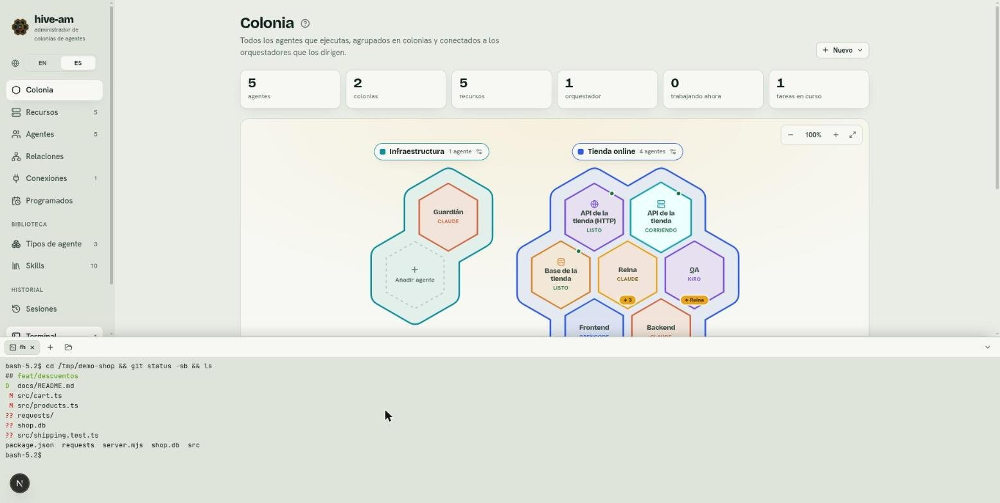

# Terminales

Un panel al pie de todas las pantallas guarda **terminales** (shells reales de tu máquina) y los **logs** de los recursos, en pestañas. Sirve para ejecutar comandos, revisar un servidor o mirar un proyecto sin salir de hive-am. Como queda debajo de la pantalla en la que estás, un chat sigue usable mientras vigilas un servidor.

*El panel inferior con una terminal en la carpeta del proyecto de ejemplo, tras ejecutar `git status -sb && ls`. Arriba del panel están la pestaña de la terminal, el botón **+** y el botón de carpeta.*

## Abrir el panel

- Pulsa **Ctrl+`** en cualquier pantalla, o el botón **Terminal** al final del menú lateral (muestra un número cuando hay terminales abiertas).
- La primera vez, inicia una terminal en tu carpeta personal.
- Arrastra el borde superior del panel para cambiar su altura. La pantalla de arriba recibe la altura que queda, así que nada se esconde detrás.
- El botón de la esquina del panel lo oculta (**Ocultar el panel**). El navegador recuerda si estaba abierto, su altura y la última pestaña.

## Qué puedes abrir

- **+** abre una terminal en la carpeta de la última (la personal al principio).
- El botón de carpeta (**Terminal en una carpeta…**) te pide una carpeta y abre allí la terminal.
- Desde la cabecera de un agente, el botón **Terminal** abre una terminal en la carpeta de ese agente.
- Desde el panel de un recurso (ver [capítulo 10](10-recursos.md)):
  - En un **servidor**, **Terminal aquí** abre una terminal en su carpeta.
  - En un contenedor Docker, **Shell en el contenedor** abre un shell dentro (usa `bash` o, si no hay, `sh`). Un proyecto compose tiene varios contenedores, así que solo ofrece logs.
  - Todo recurso que tiene logs ofrece **Logs en el panel**, que los abre como una pestaña más.

> **Consejo:** en la tarjeta de un recurso del mapa también encuentras **Terminal aquí** y **Logs en el panel**, sin entrar a su pantalla.

## Las pestañas

- Cada pestaña es una terminal o los logs de un recurso. La **×** cierra la pestaña; cerrar una terminal la termina.
- Un punto gris indica que el shell terminó. El código de salida aparece en el aviso al pasar el ratón y escrito en la propia terminal ("Terminó con código N").
- Puedes tener hasta **12** terminales a la vez.

## Cómo funcionan

Cada terminal es un shell que corre en el servidor de hive-am y que la página dibuja. Por eso:

- Si recargas la página o abres otra, ves las mismas terminales y se reproduce lo último que imprimieron (hasta 256 KB).
- Las terminales terminan cuando el servidor se detiene. Los recursos servidor, en cambio, siguen corriendo.
- Los colores, las flechas, `vim`, `top`, el cambio de tamaño y el texto con acentos funcionan como en cualquier terminal.
- El shell es el tuyo (el de `$SHELL`, interactivo), con tu entorno.

## Solo desde esta máquina

Una terminal es **tu shell en tu máquina**: quien pueda hablarle puede ejecutar todo lo que tú. Por eso hive-am solo las permite desde esta máquina:

- La página debe haberse cargado por una dirección local (`localhost`, `127.0.0.1` o `[::1]`). Si abres hive-am por una dirección de tu red local, no tendrás terminales.
- Otro sitio web abierto en tu navegador no puede llegar a una terminal.
- El servidor solo escucha en `127.0.0.1`.
- Los **agentes no tienen herramienta para abrir ni usar terminales**: siguen trabajando con las herramientas de su propia CLI y su nivel de permisos.

Para apagar las terminales por completo, arranca hive-am con `HIVE_AM_TERMINALS=0`. El panel mostrará: "Las terminales están desactivadas en este servidor."

## Si no se abre una terminal

- El panel avisa "No se pudo abrir la terminal." o que están desactivadas. Revisa que no uses `HIVE_AM_TERMINALS=0` y que abras hive-am desde `localhost` o `127.0.0.1`.
- La biblioteca que crea las terminales (`node-pty`) es opcional. Donde no se pueda instalar o cargar, hive-am funciona igual y abrir una terminal lo indica. Reinstala hive-am sin la opción `--omit=optional` para tenerla.
- Una pestaña que dice "Esta terminal ya no existe" quedó atrás tras reiniciar el servidor. Ábrela de nuevo con **+**.

Siguiente: [Permisos y seguridad](13-permisos-y-seguridad.md)
