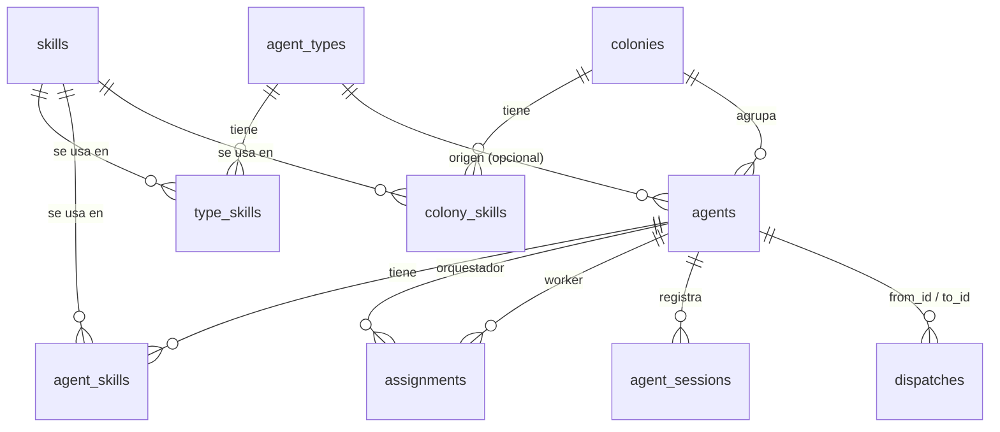

# 4. Almacenamiento

hive-am guarda datos en **cinco** lugares. Entender cuál guarda qué es clave:

| Lugar | Quién lo escribe | Qué contiene |
|---|---|---|
| `~/.hive-am/hive-am.db` | hive-am | Configuración: agentes, tipos, skills, colonias, relaciones, punteros a sesiones, registro de delegaciones |
| `~/.hive-am/mcp/<agentId>.json` | hive-am | Configuración MCP temporal por agente (solo Claude) |
| `~/.hive-am/inbox/<agentId>/<fecha>/` | hive-am | Archivos que las personas enviaron a un agente por una conexión; se borran a los 14 días ([14.6.2](14-conexiones-externas.md#1462-archivos-recibidos)) |
| Almacenes nativos de cada CLI | **cada CLI** | Las **conversaciones** (mensajes, herramientas, uso de tokens) |
| `localStorage` del navegador | la interfaz | Preferencias de vista (tema, panel, posiciones del lienzo) |

> **Regla central:** la conversación no se copia a la base de hive-am. La base solo sabe *qué sesión* usa cada agente.

## 4.1 Base de datos SQLite: `~/.hive-am/hive-am.db`

- Motor: `better-sqlite3` (síncrono).
- Ubicación: `$HIVE_AM_HOME/hive-am.db` (por defecto `~/.hive-am/`).
- Pragmas: `journal_mode = WAL` y `foreign_keys = ON`. Con WAL aparecen también `hive-am.db-wal` y `hive-am.db-shm`; es normal.
- Los identificadores son UUID v4 en texto. Las fechas son milisegundos Unix (`Date.now()`).
- **El esquema está versionado.** Vive en un solo lugar, `server/src/db/migrations.ts`: una lista de migraciones a la que solo se añade. `PRAGMA user_version` registra cuántas ha pasado una base; al abrirla corren las que faltan, cada una dentro de una transacción junto con el cambio de versión. Son aditivas e idempotentes (`CREATE TABLE IF NOT EXISTS`, `ADD COLUMN` solo si la columna no existe), así que una base de cualquier versión anterior abre sin perder una fila. La versión 1 es la **línea base**: todos los `CREATE TABLE` y `ALTER TABLE` que antes estaban repartidos por los módulos (no hace nada donde ya existen, por eso algunas columnas no aparecen en el primer `CREATE TABLE`). La versión 2 son los **renombres**: los recursos de tipo `boss` pasan a `cluster` y la skill que trae hive-am sigue el cambio de Objetos a Recursos (salvo que ya la hayas renombrado). Los módulos ya no crean tablas al importarse.
- Acceso: `db.ts` guarda en caché sus sentencias preparadas, y crear o actualizar un agente, un tipo o una colonia (con sus skills y miembros) es **atómico**, una sola transacción. Las columnas JSON se leen con `db/json.ts` (`parseJson`): un valor dañado da un valor por defecto y un aviso único en el log, en lugar de un error en la petición.

### Diagrama de relaciones



### Tabla `skills`

| Columna | Tipo | Notas |
|---|---|---|
| `id` | TEXT PK | UUID |
| `name` | TEXT, UNIQUE | Nombre único |
| `description` | TEXT | Una línea |
| `content` | TEXT | Markdown con las instrucciones |
| `load` | TEXT | **Sugerencia** para cuando se asigna la skill: `always` o `on_demand`. Las nuevas nacen `on_demand` si pasan de 2000 caracteres, y `always` si no. Cómo se carga de verdad lo decide cada asignación (7.3.3) |
| `created_at`, `updated_at` | INTEGER | ms |

Al instalar, `skills.seedDefaults` (`server/src/skills/defaults.ts`) añade **una vez** las skills que vienen con hive-am, anotando cada una en `seeded_skills (slug)`. A partir de ahí son skills normales: se editan o se borran, y una skill borrada **no vuelve** a crearse en el siguiente arranque. Si ya existía una con ese nombre, la nueva se añade como «Nombre (hive-am)». Una versión futura de hive-am que traiga más skills las añade una sola vez, y nunca modifica las que ya tienes. Su id es `default-<slug>`. Las que vienen con hive-am se crean `on_demand`, salvo Notebook (`always`).

### Tablas `notebooks` y `notebook_readers`

Un cuaderno (ver [7.3.2](07-agentes-tipos-skills-colonias.md#732-el-cuaderno-del-agente)) es un objeto propio con **lectores**: un agente y los clones hechos a partir de él leen y escriben el mismo. Van en tablas aparte para que no viajen con el listado de agentes. La migración 6 movió aquí la antigua tabla `agent_notebooks` sin perder ninguna fila (se conservan el texto, la versión y quién escribió al final, y cada agente que tenía cuaderno conserva uno propio).

`notebooks`:

| Columna | Tipo | Notas |
|---|---|---|
| `id` | TEXT PK | |
| `content` | TEXT | Markdown (máx. 8000 caracteres) |
| `version` | INTEGER | Sube con cada cambio |
| `updated_at`, `updated_by` | INTEGER, TEXT | `agent` o `user` |

`notebook_readers` (una fila por agente que tiene cuaderno):

| Columna | Tipo | Notas |
|---|---|---|
| `agent_id` | TEXT PK | `ON DELETE CASCADE`: eliminar un agente quita solo su fila de lector |
| `notebook_id` | TEXT | El cuaderno que lee (`ON DELETE CASCADE`) |
| `seen` | INTEGER | Última versión que la conversación viva de **este lector** ya contiene (cada agente tiene la suya) |

El trigger `notebook_orphan` borra un cuaderno cuando se va su último lector, sea como sea (eliminar al agente, o pasar a otro cuaderno), así que no quedan filas huérfanas; eliminar a un lector mantiene el cuaderno, con su texto y el `seen` de los demás.

### Tabla `agent_types`

Plantillas de agente.

| Columna | Notas |
|---|---|
| `id`, `name` (UNIQUE), `description` | |
| `role` | `orchestrator` \| `worker` |
| `provider` | `claude` \| `opencode` \| `kiro` |
| `model` | Texto libre; vacío = valor por defecto del CLI |
| `system_prompt` | |
| `permission` | `plan` \| `acceptEdits` \| `bypassPermissions` (por defecto `acceptEdits`) |
| `color` | Reservado; hoy solo se rellena en el seed |
| `created_at` | |

Tabla puente `type_skills (type_id, skill_id, load)`, ambas con `ON DELETE CASCADE`. `load` (`always` / `on_demand`) es cómo se carga **esa** skill para ese tipo; igual en `agent_skills` y `colony_skills`.

### Tabla `agents`

| Columna | Notas |
|---|---|
| `id`, `name` (UNIQUE, sin distinguir mayúsculas al buscar por nombre), `description` | |
| `role` | `orchestrator` \| `worker` |
| `type_id` | FK a `agent_types`, `ON DELETE SET NULL`. Solo informativa: el agente es una copia, no sigue a su tipo |
| `provider`, `model`, `system_prompt`, `permission` | Configuración propia del agente |
| `cwd` | Carpeta propia. Puede ser `''` si hereda la de la colonia |
| `session_id` | **Puntero** a la sesión directa actual (id nativo del CLI) |
| `session_cwd` | Carpeta con la que se creó esa sesión (migración) |
| `instr_hash` | Huella de las instrucciones que recibió esa sesión (migración) |
| `status` | `idle` \| `running` \| `error` |
| `colony_id` | FK a `colonies`, `ON DELETE SET NULL` (migración) |
| `overrides` | JSON: campos donde el agente ignora a su colonia, p. ej. `["cwd","skills"]` (migración) |
| `cloned_from` | FK a `agents`, `ON DELETE SET NULL` (migración 7): el agente del que se clonó este, `NULL` para cualquier otro agente y cuando se elimina el origen |
| `created_at`, `updated_at` | |

Tablas puente:

- `agent_skills (agent_id, skill_id, load)`: skills propias del agente (`CASCADE` en ambos lados).
- `assignments (orchestrator_id, worker_id)`: **relaciones** de delegación (`CASCADE`). Es la fuente de verdad de qué orquestador puede delegar a qué worker.

### Tabla `colonies`

| Columna | Notas |
|---|---|
| `id`, `name` (UNIQUE), `color` | `color` es un hex como `#2f8f5b` |
| `cwd` | Carpeta compartida |
| `permission` | Permiso compartido |
| `system_prompt` | Contexto compartido |
| `inherit` | JSON `{ "cwd": bool, "permission": bool, "skills": bool, "prompt": bool }`: qué campos siguen los miembros por defecto |
| `created_at` | |

Tabla puente `colony_skills (colony_id, skill_id)` (`CASCADE`). La pertenencia de agentes a la colonia se guarda en `agents.colony_id` (un agente pertenece como máximo a una colonia).

### Tabla `agent_sessions`

Bitácora de las sesiones nativas que un agente ha usado. Alimenta las pestañas y pantallas de Sessions. La recorta `retentionPass` (`retention.ts`, al arrancar y cada seis horas, junto a la limpieza del buzón): se eliminan las sesiones delegadas que pasen de las 50 más nuevas de su agente y lleven 90 días sin usarse, y las directas sin uso en 90 días cuyo transcript la CLI ya no tiene (nunca la actual del agente). La misma pasada conserva los 500 `thread_messages` más nuevos de cada hilo y todo lo de menos de 30 días, los 200 `dispatches` más nuevos (nunca uno que sigue en cola o en curso, ni uno en segundo plano cuyo resultado no se le avisó al orquestador ni se leyó con `dispatch_status`) y vacía `thread_messages.files` pasados los 14 días del buzón. Solo se van esas filas: las conversaciones quedan en la CLI. La migración 5 añade `idx_dispatches_created` para esto.

| Columna | Notas |
|---|---|
| `agent_id`, `session_id` | Clave primaria compuesta |
| `provider` | Proveedor con el que se creó |
| `cwd` | Carpeta efectiva con la que corrió |
| `first_seen`, `last_seen` | ms |
| `kind` | `direct` (conversación del usuario) \| `delegation` (tarea de un orquestador) |
| `from_id` | Orquestador que delegó (solo `delegation`) |
| `task` | Texto de la tarea, recortado a 500 caracteres (solo `delegation`) |

### Tabla `dispatches`

Registro de delegaciones: quién pidió qué a quién.

| Columna | Notas |
|---|---|
| `id` | UUID |
| `from_id`, `to_id` | Orquestador y worker (sin clave foránea: el registro sobrevive si se borra un agente) |
| `task` | Texto completo de la tarea |
| `status` | `queued` (espera detrás de otros turnos del worker) \| `running` \| `done` \| `failed` \| `interrupted` |
| `result` | Respuesta final del worker, recortada a 20 000 caracteres |
| `session_id` | Sesión nativa del worker donde se ejecutó (migración) |
| `mode` | `sync` (la respuesta vuelve a la llamada de la herramienta) o `background` (se avisa al orquestador cuando termina). Migración 9; las filas anteriores son `sync` |
| `origin` | Solo en segundo plano: JSON con el hilo de chat donde se le pidió al orquestador (`connection_id`, `thread_id`, `req_id`, `req_name`); `NULL` para su conversación web |
| `notified_at` | Cuándo se le entregó al orquestador el resultado de una tarea en segundo plano (o se desistió porque no había a quién avisar) |
| `read_at` | Cuándo el orquestador leyó el resultado terminado con `dispatch_status` |
| `created_at`, `finished_at` | |

### Datos iniciales (seed)

`server/src/seed.ts` se ejecuta en cada arranque pero **solo actúa si no hay tipos, agentes ni skills**. Crea:

- Tipos: **Queen** (orquestador, Claude/sonnet), **Builder** (worker, Claude/sonnet), **Reviewer** (worker, OpenCode, permiso `plan`). No se crean skills de ejemplo (versiones anteriores creaban `concise-reports` y `careful-reviewer`; al arrancar se eliminan donde siguen como se crearon).

### Integridad y borrados

| Acción | Efecto |
|---|---|
| Borrar un agente | Se eliminan sus skills propias, sus asignaciones (como orquestador y como worker) y su bitácora de sesiones. **Los archivos nativos de las sesiones no se tocan.** |
| Borrar una colonia | Sus agentes quedan sin colonia (`colony_id = NULL`) y dejan de heredar. |
| Borrar un tipo | Los agentes creados desde él conservan sus valores; `type_id` pasa a `NULL`. |
| Borrar una skill | Se desvincula de agentes, tipos y colonias. |

## 4.2 Archivos de configuración MCP: `~/.hive-am/mcp/<agentId>.json`

Solo para **Claude** y solo cuando el agente es orquestador con al menos un subagente. En cada turno se reescribe con:

```json
{ "mcpServers": { "hive": { "command": "<node>", "args": ["…/server/mcp/dispatch.mjs"],
  "env": { "HIVE_AGENT_ID": "<id>", "HIVE_AM_API": "http://127.0.0.1:4400" } } } }
```

Se pasa a Claude con `--mcp-config`. OpenCode recibe la misma información por la variable de entorno `OPENCODE_CONFIG_CONTENT` (no escribe archivo).

## 4.3 Almacenes nativos de los CLIs (solo lectura para hive-am)

hive-am **lee** estos archivos para mostrar el historial; nunca los modifica.

| Proveedor | Ubicación | Formato |
|---|---|---|
| Claude Code | `~/.claude/projects/<carpeta-codificada>/<sessionId>.jsonl` | JSONL, una línea por bloque de contenido. La carpeta codificada reemplaza `/` y `.` por `-`. Si no se encuentra en la carpeta esperada, se busca en todas las carpetas de proyecto. |
| OpenCode | `~/.local/share/opencode/opencode.db` | SQLite, tablas `session_v2` (metadatos, `directory`) y `session_message` (mensajes). Se abre en modo `readonly`. |
| Kiro | `~/.kiro/sessions/cli/<sessionId>.jsonl` y `<sessionId>.json` | `.jsonl`: mensajes (`Prompt`, `AssistantMessage`, …). `.json`: metadatos de sesión, incluido el medidor por turno (créditos, duración, % de contexto). |

Detalle de cada lector en el [documento 8](08-sesiones-e-historial.md).

## 4.4 `localStorage` del navegador

Solo preferencias de vista; si se borran, la interfaz funciona igual.

| Clave | Valor | Dónde se usa |
|---|---|---|
| `hive-theme` | `light` \| `dark` | `Shell.tsx`: tema elegido (si no existe, se sigue el del sistema) |
| `hive-cfg-open` | `1` \| `0` | `agents/[id]/page.tsx`: si el panel de ajustes del agente queda abierto |
| `hive-rel-pos-v2` | JSON `{ id: {x, y} }` | `relations/page.tsx`: posiciones de nodos que arrastraste a mano |
| `hive-locale` | `en` \| `es` | `lib/i18n`: idioma de la interfaz (nunca se refleja en la URL) |
| `hive-git-view` | JSON `{ theme, whitespace, tabSize }` | `lib/git/gitPrefs.ts`: tema, espacios visibles y tabulador del visor de código |
| `hive-switcher-collapsed` | `1` \| `0` | `agents/[id]/page.tsx`: si la lista lateral de agentes está contraída |
| `hive-am.railCollapsed` | `true` \| `false` | `Shell.tsx`: si la barra lateral principal está plegada a iconos (la aplica antes del primer pintado el script en línea de `layout.tsx`) |
| `hive-am.switcher.folded` | arreglo JSON de ids | `AgentSwitcher.tsx`: los grupos de colonia plegados en la lista lateral de agentes del chat, completa o contraída (ids de colonia y `free` para "Sin colonia") |
| `hive-cfg-width` | número (px) | `agents/[id]/page.tsx`: ancho del panel de ajustes del agente (se arrastra, con `useResizableWidth`) |
| `hive-am.drawerWidth` | número (px) | `Dialog.tsx` (`Drawer`): ancho de los paneles laterales (se arrastra, con `useResizableWidth`) |
| `hive-obj-switcher-collapsed` | `1` \| `0` | `ObjectWorkspace.tsx`: si la lista de recursos está contraída |
| `hive-colony-layout` | JSON `{ id: {x, y} }` | `app/colony/page.tsx`: dónde colocaste colonias, agentes libres y recursos en el mapa |
| `hive-colony-zoom` | número | `app/colony/page.tsx`: zoom del mapa de la colonia |
| `hive-am.agents.q` | texto | `agents/page.tsx`: búsqueda de la lista de agentes |
| `hive-am.agents.role` | `all` \| rol | `agents/page.tsx`: filtro por rol de la lista de agentes |
| `hive-am.agents.provider` | `all` \| proveedor | `agents/page.tsx`: filtro por proveedor de la lista de agentes |
| `hive-am.draft.<agentId>` | texto | `Chat.tsx`: el mensaje sin enviar de cada agente (una clave por agente) |
| `hive-am.dock` | JSON `{ open, height, active }` | `lib/dock.tsx`: estado del panel inferior de terminales |
| `hive-am.logsize` | número (10 a 20) | `LogPane.tsx`: tamaño del texto de los logs de recursos |
| `hive-am.dbq.<resourceId>` | texto | `DbWorkspace.tsx`: el SQL que se está escribiendo en cada recurso de base de datos |
| `hive-am.git.where.<agentId>` | JSON | `GitExplorer.tsx`: dónde estaba la persona en el explorador de cambios de cada agente. Todos los campos son opcionales: `{ file, dirs, mode, hist, commit, cmp: { base, head }, stash, tag }` (el archivo, las carpetas abiertas, la pestaña y lo que tenía seleccionado) |

La clave anterior `hive-rel-pos` ya no se usa (se abandonó al rediseñar el lienzo).

Cómo se leen y se escriben: las claves nuevas van bajo el prefijo `hive-am.` y usan `usePersistentState` (JSON, seguro si el almacenamiento está bloqueado, el primer render usa el valor por defecto para no desajustar la hidratación); `useResizableWidth` guarda el ancho de paneles y cajones. Las claves antiguas que guardan texto plano (`hive-theme`, `hive-locale`) conservan su formato. No todo está en `localStorage`: la pestaña o la sesión elegida vive en la URL (`?tab=`, `?session=`; ver [11.3](11-frontend.md#113-estado-global-libstoretsx)) y no se guarda.

## 4.5 Lo que **no** se guarda

- Mensajes, respuestas, llamadas a herramientas y su salida (están en el almacén nativo).
- Tokens y costos (se calculan al leer el historial).
- Cookies o credenciales: hive-am no autentica; los CLIs usan su propia sesión iniciada.
