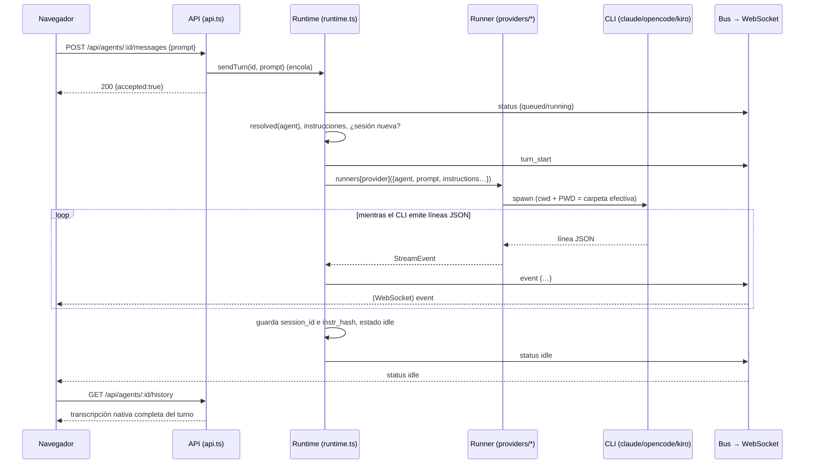

# 5. Comunicación entre backend y frontend

El navegador habla con el servidor por **dos canales**:

| Canal | Para qué | Dirección |
|---|---|---|
| **HTTP REST** (`/api/*`) | Leer y modificar datos; enviar mensajes; detener turnos | Petición/respuesta |
| **WebSocket** (`/ws`) | Recibir en vivo lo que ocurre (tokens, herramientas, cambios de estado) | Solo servidor → navegador |

El navegador **no envía** nada por el WebSocket: todas las acciones son peticiones HTTP.

## 5.1 Camino de red

```
Navegador (localhost:4401)
   │  fetch('/api/...')            ← mismo origen que la página
   ▼
Next.js (4401)  ── rewrites() ──▶  http://127.0.0.1:4400/api/...   (servidor hive-am)

Navegador ── WebSocket directo ──▶ ws://<hostname>:4400/ws
```

- `web/next.config.mjs` define un `rewrites()` que reenvía `/api/:path*` a `${HIVE_AM_API}/api/:path*` (por defecto `http://127.0.0.1:4400`). Por eso el front llama a rutas relativas y no hay problemas de CORS en uso normal.
- El WebSocket **no pasa por el proxy**: `lib/store.tsx` abre `ws://${location.hostname}:${NEXT_PUBLIC_HIVE_WS_PORT ?? 4400}/ws` (`wss://` si la página se sirve por https; una variable de puerto vacía significa el mismo host y puerto de la página, para un proxy inverso).
- El servidor responde `Access-Control-Allow-Origin: *` (y métodos `GET,POST,PATCH,PUT,DELETE,OPTIONS`) y contesta `204` a `OPTIONS`. Está pensado para uso local; ver seguridad en el [documento 12](12-operacion-y-problemas.md). Endurecerlo (comprobar Host/Origin en todas las rutas) sigue pendiente y está documentado como `TODO(security)` en `api.ts`: antes hay que demostrar que no rompe el proxy de Next ni a los clientes MCP.

## 5.2 Convenciones de la API REST

- Todas las respuestas son JSON (`content-type: application/json`), también las de error.
- Éxito: **HTTP 200** con el objeto resultante (las altas también devuelven 200, no 201). Algunas rutas devuelven `null` si no hay dato (p. ej. `/live` sin turno).
- Error de validación: **400** `{ "error": "mensaje" }`. No encontrado: **404** `{ "error": "…" }`. Ruta inexistente: **404** `{ "error": "No such route" }`. Fallo interno: **500** `{ "error": "Unexpected server error" }`.
- El cuerpo debe ser JSON válido **y un objeto**; si no, 400 `Request body is not valid JSON` o `Request body must be a JSON object`. Un escape `%` mal formado en la URL da 400 `Malformed URL`.
- **Límite de tamaño del cuerpo** (`http/body.ts`): 2 MiB para JSON; las rutas que reciben archivos (los adjuntos del chat viajan en base64 dentro del JSON) aceptan unos 135 MB (5 archivos de 20 MB más el sobrecoste de base64). Pasado el límite la respuesta es **413** `The request is too big (limit N MB)` y la conexión se cierra tras responder.
- **Los errores, en un solo sitio** (`http/errors.ts`): los handlers lanzan `HttpError` (400, 403, 404, 413) o un error de dominio; `toHttpError` convierte cada `DomainError` (`server/src/errors.ts`, base de `ObjectError`, `WakeError`, `ScheduleError`, `GitOpError`, etc.) en un estado según su `kind`: `invalid` 400, `forbidden` 403, `not_found` 404, `conflict` 409, `unavailable` 503. Así una acción rechazada es un 400 en todas las rutas, con el mismo mensaje de antes. Cualquier otra cosa se registra y se responde 500.
- Los endpoints que actúan sobre la máquina usan una sola guarda (`requireLocal`, `http/guards.ts`): el `Origin` de un navegador debe ser esta máquina (o el nombre al que se dirigió la petición); las terminales además fijan el `Host` a un nombre de loopback. Los programas sin `Origin` (curl, el MCP) pasan.
- El cliente (`web/lib/api.ts`) expone `api.get/post/patch/put/del`; ante un estado no-OK lanza `ApiError` con el mensaje del servidor, que la interfaz muestra tal cual en un aviso.
- `api.ts` es una fachada sobre `http/`: el enrutador (`http/router.ts`) convierte `:param` en un grupo de captura de expresión regular y cada dominio registra sus rutas en `http/routes/<dominio>.ts`, con las reglas de negocio que no son solo HTTP en `services/` (agents, colonies, connections, notebook, schedules, providers). No hay middlewares.

## 5.3 Referencia de endpoints

### Salud y proveedores

| Método y ruta | Respuesta |
|---|---|
| `GET /api/health` | `{ ok: true }` |
| `GET /api/providers` | `[{ id, label, installed, version }]`. Ejecuta `<cli> --version` (tiempo máx. 8 s). Caché de 60 s. |
| `GET /api/providers/:p/models` | `[{ id, label }]`. Caché de 10 min por proveedor. Puede devolver `[]` si el CLI no listó modelos. |

### Agentes

| Método y ruta | Cuerpo | Respuesta / notas |
|---|---|---|
| `GET /api/agents` | — | Lista de agentes con `queued` (mensajes en cola) y `live` (¿hay turno en curso?). Cada agente incluye `effective` (valores ya resueltos con la colonia). |
| `POST /api/agents` | `name`, `role`, `provider`, `cwd`, y opcionales `description`, `model`, `system_prompt`, `permission`, `skill_ids`, `skill_loads`, `worker_ids`, `type_id`, `colony_id`, `overrides` | El agente creado. 400 si falta el nombre, el proveedor/rol es inválido, la carpeta no existe, el nombre ya existe o no queda ninguna carpeta efectiva. |
| `GET /api/agents/:id` | — | Un agente. |
| `PATCH /api/agents/:id` | Cualquier subconjunto de los campos anteriores | El agente actualizado. Si cambia el `provider`, se descarta la sesión actual. |
| `DELETE /api/agents/:id` | — | Detiene su turno en curso y lo elimina. `{ ok: true }` |
| `POST /api/agents/:id/messages` | `{ prompt, images? }` | **Encola** el turno y responde de inmediato `{ accepted: true, prompt }`. El resultado llega por WebSocket. | `images` (hasta 5, `{ name, data }` en base64 o data URL; PNG, JPEG, GIF o WebP, 10 MB cada una, verificadas por sus bytes) se guardan en el buzón del agente y se añade al prompt una nota con sus rutas (`prompt` en la respuesta es el texto como lo recibió el agente). |
| `GET /api/agents/:id/inbox?path=` | — | Un archivo enviado desde el chat (miniatura o descarga): solo archivos dentro del buzón de ese agente; las imágenes en línea, lo demás solo como descarga (`attachment`). |
| `POST /api/agents/:id/stop` | — | Aborta el turno en curso. `{ stopped: bool }` |
| `POST /api/agents/:id/new-session` | — | Detiene el turno y borra el puntero de sesión: el siguiente mensaje abre una conversación nueva. |
| `POST /api/agents/:id/resume-session` | `{ session_id }` | Hace actual una sesión **directa** anterior del agente. 400 si no es suya o es de delegación. |
| `GET /api/agents/:id/history?session=<id>` | — | `{ session_id, messages: ChatMessage[] }`. Sin `session`, usa la actual. 400 si la sesión no pertenece al agente. |
| `GET /api/agents/:id/stats?session=<id>` | — | `SessionStats` (ver [documento 10](10-chat-y-visualizacion.md)). |
| `GET /api/agents/:id/live` | — | Turno en curso `{ turnId, prompt, events[], source }` o `null`. |
| `GET /api/agents/:id/sessions` | — | Filas de `agent_sessions` (con `from_name` en las delegaciones). |

### Sesiones de todos los agentes

| Método y ruta | Respuesta |
|---|---|
| `GET /api/sessions` | Todas las sesiones registradas, más `current`, `message_count`, `preview`, `usage`, `cost`, `tool_calls`, `model`. **Lee el historial de cada sesión** en cada llamada. |

### Explorador de cambios (git)

Lecturas: [documento 13, §13.4](13-explorador-de-cambios-git.md#134-api-de-lectura). Historial y acciones que escriben (commit, pull, push, fetch, ramas): [§13.8](13-explorador-de-cambios-git.md#138-acciones-de-git-e-historial).

| Método y ruta | Respuesta |
|---|---|
| `GET /api/agents/:id/git/status` | Rama, último commit y lista de cambios de la carpeta efectiva del agente |
| `GET /api/agents/:id/git/tree` | Todos los archivos (versionados + nuevos, sin ignorados) |
| `GET /api/agents/:id/git/diff?path=&old=` | Diff unificado de un archivo contra `HEAD` |
| `GET /api/agents/:id/git/file?path=` | Contenido de un archivo (o su versión de `HEAD` si fue borrado) |
| `GET /api/agents/:id/git/raw?path=` | Bytes de una imagen para la vista previa |

### Skills

| Método y ruta | Cuerpo | Respuesta |
|---|---|---|
| `GET /api/skills` | — | Lista |
| `GET /api/skills/usage` | — | `{ [skillId]: { agents, types } }` (cuenta agentes y tipos que la usan; **no** cuenta colonias) |
| `POST /api/skills` | `{ name, description?, content?, load? }` | La skill (`load`: modo **sugerido** al asignarla). 400 si el nombre existe. |
| `PATCH /api/skills/:id` | subconjunto | La skill |
| `DELETE /api/skills/:id` | — | `{ ok: true }` |
| `POST /api/skills/read` | `{ from, name }` | Lo usa el MCP `hive` (`skill_read`): `{ name, content }` de una skill que el agente `from` tiene; 400 con la lista de sus skills si el nombre no existe |
| `POST /api/agents/:id/clone` | `{ name, colony_id? }` | Un agente aparte con la misma configuración que lee el mismo cuaderno (ver 7.3.2). 400 por nombre repetido o colonia desconocida, 404 si el agente no existe. |
| `GET /api/agents/:id/notebook` | - | `{ content, version, size, max, updated_at, updated_by, enabled, skill_id, shared_with }` (`enabled`: el agente tiene la skill Notebook; `shared_with`: `{ id, name }[]`, los demás agentes que leen el mismo cuaderno) |
| `POST /api/agents/:id/notebook/separate` | - | El agente se queda con una copia del texto actual como su propio cuaderno y el compartido sigue con los demás. Solo origen local. |
| `PUT /api/agents/:id/notebook` | `{ content, version? }` | Edición del usuario. 400 si pasa de 8000 caracteres o si `version` ya no es la actual (el agente escribió mientras tanto). Solo origen local. |
| `POST /api/notebook/read` · `/add` · `/rewrite` | `{ from, … }` | Los usa el MCP `hive` (`notebook_read`, `notebook_add`, `notebook_rewrite`) |

### Tipos de agente

| Método y ruta | Cuerpo | Respuesta |
|---|---|---|
| `GET /api/types` | — | Lista (cada tipo con `skill_ids` y `skill_loads`) |
| `POST /api/types` | `name`, `role`, `provider` y opcionales `description`, `model`, `system_prompt`, `permission`, `skill_ids`, `skill_loads` | El tipo |
| `PATCH /api/types/:id` | subconjunto | El tipo |
| `DELETE /api/types/:id` | — | `{ ok: true }` |
| `POST /api/types/:id/spawn` | `{ name, cwd?, description?, colony_id? }` | Crea un **agente** copiando los valores del tipo |

### Colonias

| Método y ruta | Cuerpo | Respuesta |
|---|---|---|
| `GET /api/colonies` | — | Lista (con `skill_ids`, `skill_loads`, `agent_ids`, `inherit`) |
| `POST /api/colonies` | `name`, y opcionales `color`, `cwd`, `permission`, `system_prompt`, `skill_ids`, `skill_loads`, `inherit`, `agent_ids` | La colonia |
| `PATCH /api/colonies/:id` | subconjunto; `agent_ids` **reemplaza** la membresía | La colonia |
| `DELETE /api/colonies/:id` | — | `{ ok: true }` |

### Orquestación

| Método y ruta | Cuerpo | Respuesta |
|---|---|---|
| `GET /api/orchestrators/:id/workers` | — | `[{ name, role, description, provider, busy }]`: solo los subagentes **directos** (lo usa la herramienta `list_agents`) |
| `PUT /api/orchestrators/:id/workers` | `{ worker_ids }` | Reemplaza las conexiones del orquestador. 400 si el agente no es orquestador. |
| `POST /api/dispatch` | `{ from, agent, task, background?, poll? }` | Con `background: true` o `poll: true` guarda y encola la tarea y devuelve enseguida `{ id, agent, status, mode }` (`background` además le avisa el resultado al orquestador cuando termina; 400 pasadas 10 tareas en segundo plano sin terminar). Sin ninguno **bloquea** hasta que el worker termina y devuelve `{ ok, text, error? }` (se mantiene para clientes antiguos). 400 si el agente no existe, no está asignado, etc. |
| `POST /api/dispatch/status` | `{ from, id, wait_seconds? }` | `{ id, agent, status, mode, result?, note? }`: `result` cuando la tarea terminó (`done`, `failed`, `interrupted`). `wait_seconds` (0 a 60; más se recorta y `note` lo dice) espera a que termine. 403 si `from` no la inició, 404 si el id no existe |
| `GET /api/dispatches` | — | Últimas 50 delegaciones |

### Utilidades

| Método y ruta | Respuesta |
|---|---|
| `GET /api/fs/dirs?path=<ruta>` | `{ path, parent, dirs: [{ name, path }] }` para el selector de carpetas (oculta carpetas que empiezan con `.` y `node_modules`; sin `path` usa tu carpeta personal). |

## 5.4 WebSocket: `ws://<host>:4400/ws`

Cada mensaje es un objeto JSON con un campo `kind`. Los genera el `bus` del runtime (`runtime.ts`).

| `kind` | Campos | Cuándo se emite |
|---|---|---|
| `turn_start` | `agentId`, `turnId`, `prompt`, `source` (`user` \| `dispatch`), `from?` | Al empezar a ejecutarse un turno (no al encolarlo). |
| `event` | `agentId`, `turnId`, `event` (un `StreamEvent`) | Por cada evento que produce el runner. |
| `status` | `agentId`, `status` (`idle` \| `running` \| `error` \| `queued`), `queued` | Al encolar, al empezar y al terminar un turno. |
| `agents_changed` | — | Cuando cambia el conjunto de agentes/colonias o una sesión (alta, edición, baja, nueva sesión, etc.). |

### Eventos de un turno (`StreamEvent`)

Son comunes a los cuatro proveedores (cada runner traduce su formato propio):

| `t` | Campos | Significado |
|---|---|---|
| `session` | `sessionId` | El CLI informó el id de su sesión (se guarda como puntero). |
| `text` | `delta` | Fragmento de texto de la respuesta. |
| `thinking` | `delta` | Fragmento de razonamiento. |
| `tool` | `id`, `name`, `input` | El agente invoca una herramienta. |
| `tool_result` | `id`, `output`, `error?` | Resultado de esa herramienta. |
| `usage` | `usage` (parcial), `cost?`, `model?`, `durationMs?` | Uso de tokens/créditos y costo. |
| `done` | `ok`, `summary?` | Fin correcto. |
| `error` | `message` | Fin con error. |

## 5.5 Flujo completo de un mensaje



Puntos importantes:

1. **La respuesta HTTP del POST no contiene la respuesta del agente**; solo confirma que se encoló.
2. El navegador pinta el turno en vivo a partir de los eventos del WebSocket. Es un estado temporal (`LiveTurn`).
3. Al llegar `status: idle` (o `error`), el store incrementa un contador `finished[agentId]`. El chat reacciona leyendo `GET …/history`: la transcripción nativa reemplaza al estado temporal.
4. Si el turno termina en `error`, el estado en vivo **se conserva** para que veas el mensaje, hasta que pulses *Dismiss*.

## 5.6 Estado en el navegador (`lib/store.tsx`)

`HiveProvider` mantiene en un reductor:

```
ready, error, connected,
agents[], types[], skills[], colonies[], providers[], dispatches[],
live: { [agentId]: LiveTurn },       // turno en curso
finished: { [agentId]: number }      // contador de turnos terminados
```

| Momento | Qué ocurre |
|---|---|
| Montaje | `refresh()` carga agentes, tipos, skills, colonias y el registro de delegaciones; aparte se piden los proveedores. `ready` pasa a `true` solo cuando la API ha respondido; si falla, `error` guarda el mensaje (traducido) y el store reintenta con una pausa creciente (de 2 s hasta 15 s). `retry()` lo fuerza, y las pantallas muestran un aviso de error con un botón *Reintentar* en lugar de listas vacías. |
| WebSocket abierto | `refresh(['agents'])`; luego, para cada agente con `live: true`, se pide `GET /live` y se **reconstruye** el turno con sus eventos acumulados. Así, recargar la página a mitad de un turno no pierde lo ya mostrado. |
| `agents_changed` | `refresh(['agents','colonies','connections'])` y, con espera (400 ms), una recarga de `dispatches`. |
| `turn_start` | Crea un `LiveTurn` vacío para ese agente. |
| `event` | Pliega el evento en el `LiveTurn` (ver [documento 10](10-chat-y-visualizacion.md)). Ignora eventos de un `turnId` distinto al actual. |
| `status` | Actualiza estado y cola del agente. `queued` se muestra como `running`. En `idle` borra el `LiveTurn` y, si lo había, sube `finished`; en `error` lo conserva. |
| `turn_start` de una delegación, `status` `idle` / `error` | Recarga de `dispatches` con espera, para que el feed *Reciente* se mantenga al día sin sondeo. |
| Cierre del socket | `connected = false`; reintenta con espera exponencial: `min(8000, 800 · 2^n)` ms. |

Un mensaje mal formado se ignora (no rompe el manejador del socket). El estado de conexión se muestra al pie de la barra lateral, junto a la versión ("Connected", con "Connected to server" como tooltip / "Server offline. Retrying…").

`useHive()` conserva su forma de siempre, pero los componentes calientes leen porciones más estrechas para que cada token del stream no los vuelva a renderizar: `useHiveSelector(select)`, `useHiveData()` (todo menos `live` y `finished`), `useLive(agentId)`, `useFinished(agentId)`, `useAgent(id)` y `useHiveActions()`. El cliente `api.ts` lanza `ApiError` (con `status`), y cada método acepta un último argumento `{ signal, timeoutMs }`; `isAbort(e)` reconoce una llamada cancelada.

## 5.7 Cómo se mantiene fresca la interfaz

- Los cambios hechos por esta pestaña, o por otra, llegan como `agents_changed` y fuerzan un `refresh`.
- *Recent delegations* en Colony ya no consulta periódicamente: el store guarda `dispatches` y los recarga (con espera) cuando el WebSocket avisa de un cambio. Las demás pantallas que consultan (p. ej. schedules) usan `usePolling`, que se pausa con la pestaña oculta, aumenta la espera ante errores y avisa una sola vez.
- El listado de proveedores se pide una vez; el servidor lo cachea 60 s.
